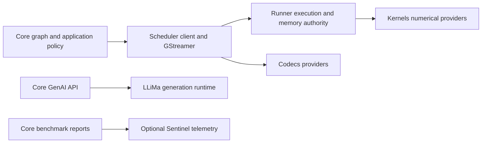

# Repository Architecture & Design

This page is for contributors who need to understand how the library is
structured, where responsibilities live, and how to extend the framework
without breaking its module and runtime contracts.

## Compiled Scheduler boundary

Core consumes `SimaScheduler::frontend` and the independently owned
`simaai::scheduler::client` types. Numerical authoring, inspection, dynamic
selection, stopped-graph attachment, selected memory access and video layout
queries cross this compiled boundary. Core does not open Runner sessions or
include Kernels or Codecs implementation interfaces.



Kernels remains the operation catalogue and numerical-admission authority.
Scheduler forwards generic requests through Runner; neither Scheduler nor Core
maintains firmware IDs or a per-operation dispatch table. Core retains public
node APIs, geometry policy and wire formatting. Fresh adapter/resolver factories
are instantiated by Scheduler after cohort validation. A cached dynamic
selection retains its operation but binds the current frame's memory.

GenAI calls LLiMa directly, not through Runner or a Scheduler GenAI adapter. MLA profiling is
a separate, default-off pass: Core calls Scheduler's client, and Runner runs the installed `mla-rt`
command-line tool. It requires an idle DevKit with no other MLA work.

---

## GStreamer interface ownership

Scheduler owns the GStreamer transport and structured error interfaces, including
the installed `gst/SimaaiGstErrors.h` header. Core consumes those interfaces; it
does not keep a second implementation. The Core `0.6.0` includes this
file-ownership transition. Upgrade the matching Core/Scheduler package set
together; this package version does not change a platform or numerical contract.

## Framework vs environment

The word "Neat" is used for two related but separate concerns:

- **Neat Library:** the C++/Python library and runtime in this repository. It loads model
  packs, composes pipelines, validates contracts, runs on Modalix hardware, and exposes the
  public API.
- **Palette SDK / environment:** the containerized development workflow around the framework,
  including DevKit Sync, shared workspaces, and agent tooling.

When changing this repository, optimize for framework properties that support both humans and
agents: explicit APIs, deterministic behavior, structured diagnostics, strict validation, and
stable public contracts.

---

## What this library is for

### Primary users

Developers who want to:
- Assemble pipelines from reusable building blocks (without writing raw GStreamer boilerplate)
- Validate pipelines early (CI-friendly) and understand failures quickly
- Run pipelines and consume frames in C++ via `appsink`
- Optionally serve a pipeline over RTSP (via `gst-rtsp-server`)
- Feed ML code via tensor-friendly outputs without writing GStreamer plumbing

## Package ownership

The selected Core artifact is the source of truth for the Core, LLiMa and matched Scheduler
dependency packages installed together. Core forwards that artifact closure without choosing or
rewriting dependency versions. Packages outside the artifact remain platform-owned; update an
incompatible platform rather than repairing it through Core or LLiMa.

Core consumes the installed `SimaScheduler` client component, not lower CMake
development interfaces. Scheduler's dependency coordinator validates the selected
Kernels/Runner/Codecs closure and retains its exact provenance. Metadata-only
`SimaRuntime` compatibility aliases do not own another implementation. The build
entry point still prepares sibling sources or reuses explicitly selected packages
in Kernels → Runner → Scheduler → Core order. This coordinates builds, not runtime
execution or firmware activation. See [local dependency builds](../build-test/local-dependencies.md).

### Renderer and optional backend providers

Core owns box/mask publication policy. Existing axis-aligned BBOX payloads use int32
coordinates; the separate `BBOX_OBB_V1` oriented-box format preserves FP32 geometry
and is rejected by the axis-aligned renderer. Scheduler owns caps, lifecycle and
cold provider admission. Production composition requires the
renderer’s typed int32 capability; it does not reinterpret those values as float
or add per-frame conversion. Kernels owns the canonical A65 `render` operation;
Runner owns execution and ReadWrite image retirement. Scheduler records the
checked operation and consumed Kernels/Runner identities. Core verifies this
cohort and composes the normal dependencies, without an `a65apps` archive.

Runner records platform-owned providers separately from redistributable dependencies. Core
preserves that receipt and checks the installed platform; it does not infer compatibility from a
platform build number or bundle platform DSOs into a consumer package. See [Local
dependencies](../build-test/local-dependencies.md) for provider admission and composition.

### Runtime transport ownership

Core consumes the installed `SimaScheduler` package. `SimaScheduler::elements` owns
`neatcamerabridge`, `neatmultipartjpegdemux` and `neatlatestbystreammux`, including
their GObject types and process-local registration. Core's `src/gst/` entry points
are compatibility forwarders, not second implementations. These elements do not
use the numerical executor or require Kernels.

Core retains public C++/Python APIs, Node options, graph lowering, Sample/Tensor
objects and graph-private credits. `src/pipeline/gst/RealtimeMuxCredits.cpp`
projects those credits through Scheduler's value-only loan interface. The mux loan
registry and shared input-frame counter have one Scheduler owner. Camera ABI layouts
come from the matched allocator header, not Core-private copies.

Implementation tests for mux fairness/backpressure, multipart parsing and capture
parent lifetime live with Scheduler. Core retains public API, graph-credit and
end-to-end device tests. Install the matched Runner and Scheduler packages before building Core;
Core internal tests link its transport target directly. Do not qualify hardware
capture or compact TensorBuffer metadata with provider-free host tests.

### Adding numerical kernels

For an operation expressible through the existing tensor and execution
contracts, development belongs in **Kernels and Core only**:

1. In Kernels, add the operation-local typed request, checked plan, numerical
   implementation, executable factory and named-request decoder. Register the
   operation once in the Kernels-owned catalogue and add correctness tests.
2. In Core, add the Node and translate its options into the canonical request:
   operation, explicit target, input/output specifications and typed parameters.
   Call Scheduler's generic preparation API; do not call an operation factory
   or add an operation switch to Runner or Scheduler.
3. Rebuild/install **Kernels → Runner → Scheduler → Core**. An EV catalogue
   change requires explicitly composed matching firmware even when Runner
   source is unchanged. Qualify it using the exclusive device procedure.

Preparation follows **Core → Scheduler → Runner → Kernels**. Kernels performs
numerical validation; Runner is the generic gateway. Cold checking does not open
hardware or provision execution resources. Retain the returned checked executable
and inspect its canonical requirements before admitting the complete stage.
Streaming uses that same executable without decoding operation names again.

Dynamic variants use an optional kernel-owned capability bound during setup.
Core retains graph/metadata policy and existing bounded caches. A cache miss can
refine immutable parameters; the provider proves whether the exact tensor
contract/resources are shared or full rechecking is required. Cache hits do not
create another operation or retain camera/codec frame loans.

Runner owns execution, resources, coherency and retirement; Scheduler owns Gst
carriers, plugins and transport integration. Their canonical installed packages
are `SimaRunner` and `SimaScheduler`. The metadata-only `SimaRuntime` compatibility
package forwards historical targets to those same implementations. Header aliases
reuse canonical Kernels types; static link dependencies may remain transitive.
There is no second tensor schema, allocator, execution queue or numerical registry.

Numerical stages render `neatkernelrunner`; there is no opt-in or fallback to the retired
ProcessCVU plugin. Core-owned public output packing remains a dependent host operation with its
original metrics boundary. Codecs remains a separate encode/decode backend; its Gst wrappers
belong to Scheduler, not Runner or numerical Kernels.

Build receipts bind exact installed bytes and consumed dependency identities.
They are not hardware or performance qualification. Do not mix headers,
archives, firmware or Codecs from unmatched packages.

A new transport, tensor representation or execution capability is a framework
extension and may require Runner changes. The Kernels/Core-only guarantee does
not cover those changes. Timeout or cancellation never proves DMA retirement;
the existing allocation owner must survive until definitive completion or
verified platform recovery.

Core selects operations by semantic name, not firmware graph ID. Kernels exposes
an immutable catalogue of operation names and their compiled targets; Runner and
Scheduler forward that catalogue without maintaining another operation registry.
Core owns typed graph-rewrite rules, including mandatory `DetessCast` and
`DetessDequant` fusion. If a required fused implementation is unavailable,
preparation fails rather than splitting the operation into separate kernels.
A Core stage need not correspond to one operation: TrackKLT still prepares its
existing composite request.

TrackKLT's public tensor list is positional: previous image, current image, then
integer seed points. Optional names assert those roles; they do not reorder
storage. Core checks the authored input contract before seed inference and again
before queue admission, without mapping or copying tensor data. Unnamed tensors
remain positional. This policy applies only to explicitly authored direct public
inputs, not internal stage links or model input transformations.

The tracker request owns numerical quality controls and optional residual
publication. Core appends the residual after points, status and any requested
features; it does not reinterpret status as unconditional tracking confidence.
Disabling detection removes that operation and its output allocation. Kernels
owns the versioned native packet and numerical validation; Runner and Scheduler
continue to transport and bind generic checked requests.

### Direct-driver recovery

`deps/manifest.json` selects Scheduler and LLiMa. Scheduler’s installed coordinator validates
the matched Kernels, Runner and Codecs closure; Core consumes the validated cohort rather than
duplicating lower-level platform checks.

Recovery belongs to the selected platform, not to dispatcher error matching.
Core does not start AppComplex, restart dispatcher services, or reset remote
processors after an inference failure. Runtime reports completion and retirement
through the driver contract; an unknown completion is not permission to recycle
DMA storage. Platform boot-time MLA initialization remains a platform dependency.

### Memory ownership

Core uses Scheduler's allocation and mapping interfaces, not physical addresses
attached from metadata, `libsimaaimem`, or a second allocation registry. See the
[memory model](../../advanced-concepts/data-model-contracts/memory_model.md)
for CPU access, mapping lifetimes, imported memory and parent-batch constraints.

Core does not choose a cache-coherency mode from graph topology.
`RunAdvancedOptions::prepare_output_cpu_visible` remains for options-layout
compatibility; no redundant eager synchronization runs before the real mapping.
The source-compatible `defer_output_invalidate` option must remain true; false is
rejected rather than restoring a producer-side slow path.

Async MLA submission and ordered output emission use separate existing paths.
The completion callback records terminal state; the emitter publishes the result
without performing CPU cache maintenance. The submit path can admit a
later frame while that emission is active, subject to bounded lane capacity and
independent allocation ownership. Completion alone does not return admission
credit: a completed slot remains owned until emission releases it. Output-pool
loans can outlive that release and continue to prevent storage reuse.

This overlap does not remove cache maintenance or shorten the dependency chain
within one frame. It avoids exposing independent CPU and device work as serial
pipeline stalls, without another synchronization worker. Graph construction sets
budgets once; no per-frame operation-specific scheduling policy is needed.

### Memory planning with FrameLayout

Core has one build-local planning flow:

1. Select model routes and preserve invocation identity.
2. Compile checked recipes and resolve each executor once.
3. Resolve root carriers, views, consumers and ownership groups.
4. Choose heaps and pack with the shared physical-DAG lifetime proof.
5. Finalize stage-local `FrameLayout` objects and publication; render once without repairing placement.

Any EV74 access requires CMA; owned MLA/A65-only carriers use DMS. Qualified fresh A65 public terminals may use HostCpu. Imported backing, offsets, geometry and producer loans remain pinned. Fan-out includes every consumer, and views share their root carrier.

`AllocationPolicy::PreferDmsThenCma` explicitly permits eligible owned DMS allocations to fall back to CMA on capacity failure. It does not select Linux system memory. Pool boundaries, Queue boundaries, independent invocations and retained outputs constrain lifetime reuse.

Scheduler prepares each layout's allocation groups through Runner. Allocation indices and offsets are local to their buffer group; identical offsets in different groups do not overlap. Rebuild matched Core and Scheduler packages together.

### Default device-to-CPU coherency

There is one prepared memory engine. `SIMA_CORE_DEMAND_COHERENCY_V1` and Runner's
experimental build option are removed; configure fresh builds without them.
No environment opt-in or whole-graph Legacy downgrade remains. Core uses only
Scheduler allocation, mapping and stage interfaces. Public tensor geometry,
Kernels requests and numerical behavior are unchanged.

The [memory model](../../advanced-concepts/data-model-contracts/memory_model.md)
defines the shared access-acquisition and lifetime contract.

#### Mapping a logical DMA-backed tensor

Public `Tensor::map()` and its `view()` alias preserve their existing storage
mapping contract: they apply `byte_offset` once and may expose trailing backing
bytes. Named-segment bounds and application mapping callbacks remain
authoritative. `TensorBuffer::map()` still maps the storage directly.

Shape-bounded internal consumers use `map_dense_tensor_read()` instead. It
checks positive strides and overflow against the current geometry, then exposes
only the physical tensor span, including stride gaps. Core-owned DMA storage can
authorize that exact range. Wrapped or custom callbacks keep their existing
mapping and cleanup behavior; the helper validates their returned extent before
narrowing the logical view. No geometry is cached across mutable tensor views.
Composite images and encoded or unresolved geometry keep the existing mapping
path; a dense logical span does not authorize access to their other planes.

Scheduler can reuse Runner's already-qualified, current-generation visibility
for the exact view. A first read after a device write, an uncovered range or an
unqualified import retains exporter synchronization. Active writers, pending
device work and quarantine remain errors. The mapping retains both the original
Gst sample and the current public storage/producer loan until CPU access ends.
No ownership mode, payload copy, WRITE-END cleaning or public object layout changes.

A kernel-stage `resource_busy` error does not necessarily mean submission
capacity is exhausted. Its sanitized, bounded `Reason` retains the original
access, enrollment, ownership or capacity diagnostic. Inspect that cause before
changing concurrency; do not reuse buffers while ownership or device completion
is unresolved.

### Codec ownership

Scheduler owns `neatdecoder`, `neatencoder` and their GStreamer adaptation. Codecs owns
decoder/encoder sessions and numerical implementations. Consume the matched installed headers
and libraries; do not copy backend code into Runner or combine wrappers with a different backend
ABI.

### Hardware encoder configuration

`SimaEncode` and raw `VideoSender` derive resolution from negotiated input caps.
Resolution stays fixed within a run; changing it requires a new run.
Their encoder options contain no width or height, and the input adapter preserves
visible geometry without resizing. Unknown input dimensions remain unknown in the
build-time output contract until the upstream input provides them.

`SimaEncode` prepares raw input once and maps codec-specific options to
`neatencoder`. Scheduler owns GStreamer adaptation and output publication; Codecs owns the
encoder session. Runner retains memory ownership and synchronization authority. Core adds no encoder execution thread.
The legacy `H264EncodeSima` preserves its adapter-free input contract while sharing
encoder property generation. The public class layout changes are included in ABI 6 and
rebuilt binary consumers; existing source entry points remain available.

### Common workflows

- **Decode / ingest:** file or RTSP -> depay/demux/parse -> decode -> convert/caps -> appsink -> C++ consumer
- **Validate:** build + parse + preroll (PAUSED) to catch negotiation issues early
- **Serve RTSP:** push synthetic frames into an RTSP server pipeline using `appsrc`
- **Image/video tensor adapter:** image/video/RTSP -> decode -> convert/scale -> `add_output_tensor(...)` -> `Run::pull_tensors()`
- **Tutorials:** start at [Tutorials](/tutorials) for a runnable, ordered learning path

### Canonical production pipeline (source of truth)

The canonical "production path" for this repo is:
**input -> preprocess -> MLA -> postprocess**. The source of truth lives in:
`tests/e2e_pipelines/obj_detection/sync_yolov8_test.cpp`.

When this test changes, update README + Architecture to keep docs aligned.

### Mental model (business logic &lt;-&gt; pipeline glue)

Your app keeps the business logic; the framework owns the pipeline glue.

```text
Business logic
    |
    v
Nodes/Graph fragments  ->  GStreamer fragments  ->  caps negotiation  ->  runtime (Run)
    |                                                           |
    +-----------------------------------------------------------+
                                Sample / Tensor
```

---

## Core concepts

The framework is intentionally organized around a small set of concepts. Most user code touches
only `Model`, `Graph`, `Run`, `Tensor`, and `Sample`; lower-level contributors also work with
`Node`, reusable Graph fragments, MPK-contract parsing, and Graph internals.

| Concept | Role |
| --- | --- |
| Model archive | A sealed `.tar.gz` artifact containing the MPK inference contract, plugin-private configs, model binaries, and kernel artifacts. |
| `Model` | The public loader for a `.tar.gz` model archive. It parses the MPK contract, runs route planning, exposes model stages, and provides simple `run(...)` / `Graph` composition entry points. |
| `Tensor` | Typed numeric payload with dtype, shape, layout, storage, device, and semantic metadata. |
| `Sample` | Runtime/media envelope around tensors, tensor lists, or bundles. Check `Sample::kind` before reading fields. Pipeline boundaries preserve a bundle as one frame. |
| `Node` | Atomic pipeline stage that emits a deterministic GStreamer fragment and owned element names. |
| Reusable Graph fragment | A premade `Graph` that expands to multiple Nodes, such as decoded RTSP input or model stages. |
| `Graph` | Assembly and validation boundary. Nodes, Models, and reusable Graph fragments become a negotiated, buildable pipeline. |
| `Run` | Live pipeline handle returned by `Graph::build(...)`; owns push/pull/runtime lifecycle. |
| Graph | Use builder graph for DAG composition inside one pipeline; use runtime graph for coordinating stages/runs across pipelines. |

Read the relationship left to right:

```text
model archive on disk -> Model -> Graph fragments/Nodes -> Graph -> Run
                                           |
                                           v
                                  Tensor/Sample flow
```

`Model` is the beginner-facing entry point, but it is not a separate execution engine. It resolves
to model Graph fragments/Nodes that can be added to a `Graph`. `Graph` is the central assembly
concept; `Run` is the live object after build.

---

## Design principles for contributors

These are the load-bearing architecture principles behind the framework. Use them when deciding
between implementation options.

- **Determinism wins.** Keep element names, generated pipeline strings, serialized pipeline data,
  report fields, and tests reproducible. Diagnostics and agent loops depend on stable identifiers.
- **Debuggability is first-class.** Failures should produce structured data, not only strings:
  `GraphReport.error_code`, `repro_note`, bus messages, and replayable backend pipelines.
- **No silent fallback.** Do not hide model-input bugs or hardware/runtime failures by quietly
  converting formats, changing graph families, falling back to CPU, or swallowing plugin errors.
- **Validate before run.** Prefer structural, caps, shape, and contract validation before runtime
  threads start or hardware resources are acquired.
- **The MPK contract is the model source of truth.** Core routing, dtype, shape, quantization, and
  stage decisions must come from `mpk.json` / `*_mpk.json`. Per-stage JSON files are
  plugin-private.
- **Detess logical rank and runtime geometry are separate.** Preserve the MPK-authored `frame_shape`; accept rank-2 NC/HW interpretations only when byte spans identify one unambiguous geometry. Fused DetessDequant carries both descriptors through one per-frame contract: tile rank determines kernel rank, leading batch dimensions stay separate, and semantic axes, byte spans, strides and explicit tiled-storage encoding remain authoritative. Core forwards these canonical typed contracts through Scheduler; Kernels validates the selected operation and encoding. Do not reconstruct a ProcessCVU prepared request across the DSO boundary.
- **Numerical backend policy has one authority.** The checked capability owns supported targets and AUTO preference. Explicit stage or session targets either run on the requested supported backend or fail; later role-based overrides must not contradict that decision.
- **Public APIs stay stable.** Public headers under `include/*` are installed and supported.
  Prefer additive changes and deprecation paths over breaking signatures.
- **Concurrency must be bounded and observable.** Streaming-thread work should be lightweight;
  probe-side diagnostics need atomics or equivalent thread-safe handling; teardown must not hang.

---

## Model execution path

For model-backed pipelines, the high-level path is:

```text
input Sample/Tensor
  -> optional preprocessing / format normalization
  -> MLA inference stages selected from MPK contract
  -> optional postprocessing / box decode
  -> output Sample/Tensor
```

The user-visible `Model` contract is intentionally friendlier than the MLA hardware contract. The
MLA may require INT8/BF16 and tessellated layouts, while user code generally works with FP32
and normal tensor layouts. The framework bridges that gap with manifest-driven adapter stages.

Preprocessing and postprocessing are explicit framework stages/options. A format mismatch, missing
required preprocessing metadata, unavailable selected hardware transport, invalid model archive or MPK contract, or caps negotiation
failure should surface as an actionable structured error rather than a hidden runtime correction.

### Public execution plan

`Model::execution_plan(...)` returns what `build(...)` with the same arguments runs: the Model's
graph nodes in pipeline order, where each node runs (`A65`, `EV74`, or `MLA`), and the tensors on
the edges between them. It calls `build(...)` with startup preflight off, reads the plan that the
build recorded on its `DiagCtx` after placement and publication planning, and closes the pipeline, so it needs the
same device as `build(...)`. It is a public diagnostic view, separate from the internal `ModelExecutionPlan` described below. Its JSON
contract is `schemas/execution_plan_v1.schema.json`; `schema_version` changes only when a change
breaks existing readers. The memory summary counts owned allocations once and reports `CMA`,
`DMS`, `HostCpu`, or `Mixed`; explicit DMS fallback is reported by its preferred heap.

### Board telemetry

`TelemetryMonitor` reads power and board telemetry from Sentinel, the board telemetry daemon,
through its HTTP API on `/run/simaai-sentinel/api.sock`; Core does not read the power monitor
chips. `start()` reads Sentinel's sample cache once for the metric definitions, the sample
interval, and the newest sample, which predates the window and is not counted. A worker thread
then asks for the latest sample shortly before each one is due and counts each new sample once
into a running summary, identified by its timestamp. When a timestamp is not one interval after
the last counted one, the worker counts the missed samples from the cache, which holds Sentinel's
latest 240 samples. The monitor creates nothing in Sentinel, so any number of monitors can run at
once and a killed process leaves nothing behind.

The default monitor uses the socket above. An explicit `TelemetryMonitor(socket_path)` selects
another Sentinel Unix socket for that instance only; `Model::benchmark()` retains the default
endpoint.

`Model::benchmark()` uses this same monitor, not a second trace engine. It cold-prepares the
connection and waiting worker before the throughput timer, arms the window after measurement
starts, and seals it after all required outputs complete but before stopping measurement.
Arming and sealing allocate nothing, take no mutex, and do not join or contact Sentinel. Only
then does the benchmark join the worker and final-read the cache. In-flight polls are bounded
by a UTC read preceding their stop check, so sealing cannot admit a later sample. Benchmark
attribution validates UTC sample timestamps and paired UTC/steady boundaries; detected
clock discontinuities invalidate telemetry instead of changing the measured throughput.
Standalone monitors keep their cache-order recovery after clock rollback.

Sentinel samples about
every 2 s, so the throughput pass runs for at least `BenchmarkOptions::min_duration_ms` (10 s by
default). The latency pass follows the same minimum so both passes stop by the same rule. When
Sentinel is not running or the window has no samples, the benchmark still returns latency and FPS;
the power fields are zero and `telemetry.status` names the reason. Board mode of
`tools/install_neat_framework.sh` installs Sentinel or upgrades it to the latest production build. When
that fails, the installer warns and continues; run `sima-cli neat install sentinel` later, or set
`NEAT_INSTALLER_SENTINEL_REQUIRED=ON` to make the failure fatal, as CI does. The deprecated
`Run` power monitor (`RunOptions::power_monitor`) also comes from Sentinel: Core polls its latest
sample and reads no power monitor chips over I2C.

MLA profiling is opt-in through two `BenchmarkOptions` fields that default to false:
`include_mla_layer_stats` and `include_mla_stage_stats`. After the latency and throughput runners
close, Core measures the extracted model's MLA executables through Scheduler's client, one
profiling pass after the other. MLA layer stats covers only the MLA stages in the resolved
inference route, including its terminal policy. Runner runs `mla-rt` in a separate process for
each executable. MLA layer stats also uses the compiler stats YAML; MLA stage stats runs each MLA
executable 200 times without interruption and reads the mean `tile.lat` from the `mla-rt` stats file. Runner
validates the inputs and outputs and removes temporary files; it stops `mla-rt` if one run takes
longer than 120 s. MLA-RT owns hardware profiling and the handoff back to
kernel execution. Profiling requires no overlapping MLA workloads. The benchmark gate serializes
benchmark calls, not other inference APIs or applications.

An `mla-rt` run that fails, crashes, or is stopped may leave MLA work unfinished, so Runner starts
no further `mla-rt` run in that process. Later profiling passes report that MLA needs recovery.
Keep the DevKit idle until MLA recovery is verified.

Profiling is best effort. When `mla-rt` is missing, fails, times out, or writes unusable output,
Core keeps the headline measurements, leaves that list empty, prints a warning, and sets
`mla_layer_stats.status` or `mla_stage_stats.status` to the reason. A status is otherwise
`"not requested"` or `"ok"`.

`BenchmarkReport::mla_layer_stats` contains each compiled MLA layer's zero-based executable
stage index, name, and hardware latency in microseconds from one profiling pass per layer.
`BenchmarkReport::mla_stage_stats` contains each MLA stage's index, numbered the same way, and its
mean hardware latency in microseconds. These measurements use separate profiling passes, so layer
latencies do not sum to the stage or headline latency.
`BenchmarkReport::save(file_path)` explicitly writes the complete report using the public field
names and units: `.json` selects JSON; `.yaml` and other endings select YAML. It includes
telemetry, both statuses, and empty MLA lists when profiling is disabled. It creates missing
parent directories and atomically replaces an existing destination.

Retired PreparedRunner options must remain at their defaults. Use `processcvu.async` and `GraphOptions::async_queue_depth` for concurrency; the legacy dequantization and profiling flags have no direct replacement. Leave `advanced_execution.defer_output_cache_sync=true` and use Tensor/GstMemory CPU mapping when accessing outputs. `RunOptions::advanced.prepare_output_cpu_visible` remains a compatibility no-op; it does not request eager cache synchronization.

### Compiled model execution contract

The DMA-BUF driver migration keeps model semantics separate from per-frame
storage. Core compiles model-load facts into one immutable internal
`ModelExecutionPlan`:

- values contain exact names, required bytes, optional logical type facts, and
  an optional root-relative read expression `{source ValueId, byte offset,
  byte strides}`;
- operations contain exact ordered edges and operation-specific configuration;
- MLA backend ports contain ELF/model order, exact required bytes, alignment
  authority, and access direction; and
- public outputs contain only publication order and the value they expose.

MPK manifests use `MpkDecoder`. `MpkDecoder::load` is the single manifest
entry point: model loading, stage preparation, and the PCIe host read
`mpk.json` through it once, and it builds the semantic `MpkContract` from the
same bytes that admission decodes. The optional `model_sdk_version`
string is retained as provenance and does not restrict admission. The decoder
accepts only the exact registered `(processor, kernel)` vocabulary,
resolves full tensor names, validates operation byte equations, and reconciles
each MPK MLA stage independently with its exact ELF IFM/OFM topology. The
decoder joins executable evidence by both compiler-authored logical stage ID
and the manifest executable token; archive order and filename suffixes are not
semantic evidence. The resulting immutable plan exposes a checked
`{stage index, op ID, logical stage ID, executable}` key and pre-indexed ordered
port spans for every MLA operation. Ambiguity, missing slots, or conflicting
evidence is a model-load error; sidecar JSON, substring matching, environment
state, and runtime buffers are not evidence.

Core can reconcile different input and output buffer orderings when the mapping
is unambiguous, including batched inputs and outputs. Applications keep the
model's public tensor names, order, and sample order.

Single-input, batch-one models with normal spatial storage can use automatic
input channel padding. Applications keep the model's logical tensor shape;
custom spatial storage padding is outside this support scope.

An AFE artifact ending in `.so` is classified by its MPK stage. For
`processor="MLA"`, Core validates its ELF topology without loading it into the host
process and passes the artifact to MLArt. An A65 host module with the compiler's
`input_names`, `input_types` and `output_types` becomes a typed TVM program. The
legacy EVO alignment remains an explicit 4096-byte `LegacyPolicy`; new typed
contracts declare their own alignment.

Runtime frames do not copy the static plan. The direct path carries standard
DMA-BUF ownership plus checked absolute `{fd, offset, length}` views and a
bounded frame-slot lifetime. Unpack and Slice are consumer read expressions,
not runtime operations: the decoder composes them to one materialized root
carrier only after proving their exact offsets, byte strides, and physical
spans. Pack, tessellation, and precision conversion remain producer/compute
semantics unless a lowering pass proves exact backend production or equivalent
fusion. This prevents storage placement from silently changing MLA port arity
or model behavior.

`FrameLayout` is each stage's storage contract: an allocation list, allocation-local spans, input routes and output ownership. `ReuseInput` retains an identified input allocation group. Core packs owned carriers once; Scheduler prepares pools through Runner. MLA's padded physical capacity remains separate from logical publication bytes. Imported backing and producer loans stay pinned.

Core's immutable MPK package is the inference-contract authority. Logical public
shapes remain distinct from native MLA sample spans, whole-batch CVU execution
views and backing capacity. Rank-two Detess views are normalized only when actual
input/output byte geometry identifies an unambiguous execution shape. Fusion is
selected through semantic operation discovery, never a Core-owned graph-ID table.

#### Canonical identity and selected publication

Core finalizes numerical stage identity when it constructs a compiled contract.
It normalizes supported model spellings and rejects disagreement between the
operation, family and family enum. Legacy graph and descriptor IDs are not
execution authority. Identity normalization does not mark an incomplete semantic
contract as complete; Kernels still owns operation discovery and numerical admission.

For a model-managed Preproc handoff, image geometry and storage extent are separate
facts. Tile padding can make the required storage larger than the dense scalar
count. Core validates the absorbed transform chain against the typed model plan,
finishes carrier placement and the selected output route, then constructs the
exposed output view. The runtime descriptor, route and public view must refer to
the same finalized storage. A larger parent allocation does not authorize an
undersized logical view, and equal byte counts do not prove matching geometry.

Standalone packed Preproc queries the canonical checked executable for its storage
requirement before publishing facts or allocating an arena. It does not derive
packed capacity by multiplying logical dimensions. A multi-ROI capacity retains
its batch axis in the public shape; single-image standalone views retain their
existing HWC shape.

Typed model descriptors cover the full tensor, including its batch dimension.
For an explicitly batched rank-four HWC tensor, the leading axis is N.
Their execution repetition count is one: semantic batch size does not request
repeated execution of the whole tensor. Packed, interleaved batch heads use per-sample
bindings and publish one complete tensor per head, preserving ordered singleton-axis
views. Batch size alone does not disable
DetessCast or DetessDequant fusion. These fused stages retain
an explicitly proved private singleton-axis view when their published rank differs
from their execution geometry.

This singleton handoff rule does not replace deliberately filtered output views,
such as KLT status publication. Changes happen during preparation, not frame
execution. Preserve fused operations, explicit offsets and quantization metadata;
do not repair a contract mismatch with a staging copy or a numerical fallback.

#### Typed transform preparation

Core resolves external dtype names and MPK tensor descriptors once during graph
preparation. The handoff contains checked executables with canonical `TensorSpec`
and `DType` contracts, including per-input precision. Runner and Scheduler do not
reparse operation-specific dtype strings. Core's publication and carrier metadata
remain explicit, separate from numerical type authority.

Execution shape and published shape need not be identical. Core explicitly
authorizes singleton-axis views from the semantic output contract and packed
physical-storage views from the compiled model's transport contract. Scheduler
checks each output binding against that relation during preparation, including
dtype, layout, strides and storage bounds. Equal byte counts alone do not authorize
a reshape. These views preserve the backing allocation; they do not add a tensor
copy or numerical conversion. Changes to the output contract require fresh
validation, including for dynamically prepared variants.

Equivalent dtype spellings are accepted case-insensitively. Unknown names and
contradictory descriptors fail before execution. The shared legacy BF16/INT16
encoding requires an explicit semantic type. Request errors expose the reason
without enabling verbose GStreamer diagnostics.

#### Checked numerical stages

`FrameSpan` offsets are local to their allocation and buffer group, not global graph addresses. Identical offsets in different groups do not overlap. BoxDecode and ArgMax keep head-relative tensor offsets separate from storage offsets. Direct-memory and runtime physical-binding inputs retain their addressing mode.

Core lowers Preproc, transforms and vision stages, including ArgMax, BoxDecode,
SuperPoint and the LiDAR/BEV kernel nodes (SimaVoxelize, SimaPillarScatter,
SimaBEVPoolPlan and SimaBEVPool), to canonical requests and explicit tensor-port
mappings.
Scheduler's generic tensor-stage engine owns GStreamer binding and publication;
Runner owns dependencies, asynchronous execution and execution-time buffer lifetime. Core imports carrier
capacities from the upstream allocation contract or ingress storage, never from
logical shapes alone. BoxDecode and SuperPoint numerical outputs stay private; a
dependent Core wire-serialization executable preserves the public BBOX and feature
payloads without duplicating decode math. Oriented boxes use a separate versioned
`BBOX_OBB_V1` serializer with the same numerical-completion dependency; failed
numerical work must not publish stale results.

The immutable kernel recipe retains the producer-authored tensor wire format after the typed node contract is lowered. Cold publication applies that format to both fresh and cached caps; it never infers semantics from a kernel name or byte shape. The public OBB tensor remains dense, rank-one UInt8 with `BBOX_OBB_V1` semantics.

InputStream projects the authored format onto each returned tensor before publishing a Sample, including owned-copy and cached-metadata paths. Raw `Sample.tensors` and the `TensorList` convenience API therefore carry the same detection semantics.

For checked MLA-tiled numerical outputs, Core attaches physical layout to each logical output only when its shape and dtype match the checked producer. InputStream decodes this immutable caps metadata when initializing its decode cache, then retains it in cached Tensor templates. Raw-byte aliases and INT8 cell tiles whose bytes already match dense NHWC remain unchanged. `TessSpec::storage_bytes` distinguishes explicit tiled storage from legacy format-only annotations. `copy_payload_bytes()` and `clone()` preserve stored bytes, padding and layout; dense copies, typed access and DLPack reject explicit tiled storage. Layout-aware graph consumers receive the checked layout without a hidden conversion.

Image-size changes select immutable, resource-compatible prepared BoxDecode variants
before binding. They do not mutate an operation used by an in-flight frame. RCNN
stage 1 preserves per-level top-K count-plus-FP16 proposal groups. Core must not
load the retired objectdecode plugin as a fallback.

A65 is an execution target, not a GStreamer memory domain. The plugin still imports
DMA-BUF carriers. Direct tensor ingress uses shared-CMA allocations, for example
`Tensor::from_vector(values, shape, TensorMemory::EV74)`; the selected executable
continues to run on A65.

---

## Repository layout

### High-level structure

- `include/` -- public headers (the supported API surface)
- `src/` -- implementations
- `docs/` -- documentation (this file)
- `examples/` -- small runnable examples
- `tests/` -- unit/integration tests
- `python/` -- `pyneat` package sources, nanobind bindings, and Python tests
- `old_*` -- legacy monolithic implementation snapshots kept for reference/migration

### Public header tree (`include/`)

Public headers live under `include/<module>/...`.
Examples: `include/pipeline/Graph.h`, `include/model/Model.h`.

Public convenience entry headers:
- `include/neat.h` (umbrella)
- `include/neat/runtime.h`
- `include/neat/models.h`
- `include/neat/nodes.h`
- `include/neat/node_groups.h`

There is intentionally no `include/neat/graph.h` public umbrella. Runtime/compiler tests that
need the lower-level graph substrate include the narrow `include/graph/...` headers directly.
Applications, examples, and public docs should use the single public `simaai::neat::Graph` from
`<neat.h>`.

### Internal headers and runtime plugin paths

Public headers under `include/` are installed and treated as stable API.
Internal headers under `src/**/internal` are not installed; examples/tutorials
should use only public API.

The shared Core CMake target exports C++20 and its public GStreamer, OpenCV and JSON
requirements. Core builds against the installed Scheduler frontend and LLiMa; lower runtime
libraries remain deployment dependencies, not direct Core development interfaces. Static
consumers explicitly request the Static component and provision its implementation link
dependencies.

Runtime environment notes:

- Installed Scheduler plugins reside under `${CMAKE_INSTALL_PREFIX}/${CMAKE_INSTALL_LIBDIR}/neat/gst-plugins`. For a non-system prefix, include that directory in `GST_PLUGIN_PATH` or `GST_PLUGIN_PATH_1_0`.
- Runner runtime libraries reside under `${CMAKE_INSTALL_PREFIX}/${CMAKE_INSTALL_LIBDIR}/neat/runtime`; consume the installed CMake targets rather than build-tree libraries.
- After a system-wide plugin update, rebuild the system GStreamer cache.

Build Core and its installed consumers with a JSON header version ABI-compatible
with the selected LLiMa package. LLiMa exports JSON-bearing C++ methods; compatible
source syntax alone does not prove link compatibility. SDK/library receipts and
real link checks take precedence over a package's broad minimum-version label.

---

## Planned vs stable (API surface)

| Area / API | Status | Notes |
| --- | --- | --- |
| Core pipeline API (`Graph`, `Run`, `Tensor`, `Sample`) | Stable | Primary supported C++ surface. |
| Builder internals (`Node`, private node-vector helpers, `GraphPrinter`) | Internal | STL-only, pre-GStreamer composition support. |
| Model API (`Model`, reusable Graph fragments) | Stable | Canonical model-archive integration path. |
| `include/policy/*` | Stable | Minimal validated policy contracts and defaults (`Decoder`, `Encoder`, `Memory`, `RTSP`). |
| `include/nodes/groups/ImageToH264RtspGroup.h` | Planned | Empty placeholder group. |
| Python bindings (`python/`, `pyneat`) | Beta | Nanobind-based bindings and packaging live in-repo; API surface focuses on `Tensor`, `Graph/Run`, `Model`, and core node/group helpers. |

---

## Modules and responsibilities

### `builder/` -- node contracts and private linear composition support (no GStreamer)

**Purpose:** Define how pipelines are assembled from logical parts.

Key types:
- `Node` -- interface implemented by each pipeline building block
- private node-vector helpers and `GraphPrinter` -- composition utilities and diagnostics

**Rule:** builder must remain mostly STL-only. It should not own GStreamer runtime objects.

---

### `nodes/` -- typed pipeline building blocks

**Purpose:** Provide ready-to-use Node implementations that emit deterministic GStreamer fragments.

`VideoRate()` always emits `videorate drop-only=true`, including when inserted
by a source group. This avoids duplicated output headers sharing pooled decoder
memory and preserves source timestamps. The C++ `VideoRate()` and Python
`video_rate()` factories take no arguments and do not duplicate frames.

Examples:
- `nodes/io/HttpSource`, `nodes/io/RTSPInput`, `nodes/io/StillImageInput`
- `nodes/common/*` (Caps, Queue, Output, etc.)
- `nodes/sima/*` (SiMa.ai decode/encode/parse/pay nodes)
- `nodes/rtp/*` (depay/payload helpers)
- `nodes/groups/*` (common multi-node recipes)

**Contract:**
Each Node must produce:
- `backend_fragment(index)` -- the GStreamer fragment for this node at a given index
- `element_names(index)` -- deterministic element names owned by this node (for diagnostics and enforcement)

The LiDAR/BEV nodes keep options, port descriptions and pure numerical request
construction in `nodes/`. Their existing `NodeContractProvider` compilation hooks
are implemented in `pipeline/internal/sima/LidarBevNodeContracts.cpp`. That compiler
passes the operation name to Scheduler's existing `check_kernel(...)` API and uses
the normal stage recipe and `FrameLayout` execution path. `StaticSpecBuilders.cpp`
shares metadata-only ingress projection and direct-input binding with `SimaArgMax`;
these helpers neither prepare nor schedule kernels. The LiDAR/BEV node files do not
include pipeline-private implementation headers. This split adds no per-frame work
or payload copies.

Standalone `Cast` compiles typed views into a canonical `cast` request checked by Kernels. Logical identities, strides and tensor-relative offsets remain explicit. Semantic compilation reconciles ordered MLA input ports before packing; rendering preserves the checked contracts. Execution capacity defaults to four asynchronously and one synchronously, with separate output carriers for retention. Subset or reordered TensorSets use parent-retaining metadata envelopes without changing the held publication or payload.

#### Typed image frontends and multi-plane publication

`Resize`, `ColorConvert`, and `Normalization` are thin factories over the existing
final `Preproc` node. An immutable implementation-private policy in its existing
holder separates frontend semantics without changing the public Preproc or
PreprocOptions layouts. Model-specific ROI/source-template behavior remains gated
to the legacy fused mode. Resize admits bounded dynamic input geometry with fixed
output dimensions; color conversion and normalization fix geometry per run.

Raw image contracts retain checked plane descriptors and one image carrier. After placement, Core projects allocation-local plane offsets, strides and bounds into `GstVideoMeta` and dynamic `GstSimaMeta`. Metadata queries use immutable plane-relative geometry without adapters or device allocation. Named selectors remain validated; raw images do not acquire tensor-set descriptors. Normalization publishes a BF16 tensor, while NV16 preserves its full-height UV plane and image owner.

New image stages preserve known upstream temporal caps in a cold, stage-local
OutputSpec projection. A boundary without an OutputSpecProvider invalidates only
the inherited rate for this strict projection; a later explicit caps provider
can restore it. The private payload carries the resulting fraction to raw image
publication. Unknown rates remain omitted, and no warmed frame work or rate
inference is added. Legacy best-effort OutputSpec projection is unchanged.

Native image layouts preserve holes; encoder-compatible NV12 uses Runner's
installed video-layout authority and an explicit InitializeStorage kernel policy.
The EV writer initializes declared pitch tails and storage rows each invocation;
allocation/page slack is not implicit writable padding. Core never initializes
payload padding or repacks output on A65. Existing fused Preproc dispatch,
metadata compatibility and BF16 arithmetic remain unchanged.

---

### `gst/` -- thin GStreamer utilities

**Purpose:** Small wrappers/helpers around common GStreamer patterns.

Examples:
- initialization (`GstInit`)
- parsing launch strings (`GstParseLaunch`)
- bus draining/stringifying (`GstBusWatch`)
- caps helpers / element introspection (`GstHelpers`, `GstIntrospection`)
- pad taps / probe helpers (`GstPadTap`)

**Rule:** `gst/` must not depend on `pipeline/` (to avoid dependency cycles and "utility layer" bloat).

---

### `pipeline/` -- runtime orchestration and public API

**Purpose:** Own the runtime lifecycle: build -> parse -> run -> consume -> teardown, with diagnostics.

Key types:
- `Graph` -- the main entry point for users
- `Run` -- running pipeline handle with push/pull APIs
- `Sample` -- structured output payload returned by pulls
- `GraphReport` -- structured diagnostics for failures, stalls, and reproduction
- `Errors` -- exceptions (`NeatError`) embedding a report

#### Error semantics contract

`GraphReport.error_code` is the canonical machine-triage field. Framework
runtime/build/IO paths map terminal failures into stable code families:

- `misconfig.pipeline_shape`
- `misconfig.caps`
- `misconfig.input_shape`
- `misconfig.input_capacity`
- `misconfig.media_caps`
- `misconfig.tensor_dtype_missing`
- `misconfig.option_out_of_range`
- `build.parse_launch`
- `build.pipeline_syntax`
- `build.plugin_missing`
- `build.property_invalid`
- `runtime.pull`
- `runtime.element_failed`
- `runtime.output_timeout`
- `io.parse`
- `io.open`
- `io.file_not_found`
- `io.permission_denied`
- `io.rtsp_connection_failed`
- `io.camera_not_found`
- `codec.*`, `resource.*`, `infra.*`, and `internal.*`

GStreamer errors pass through one internal parser, classifier, and renderer.
Classification prefers a versioned Neat diagnostic ID, then the native
GStreamer domain/code and element factory, then narrow compatibility mappings
for older plugins. Unknown failures use `runtime.element_failed`; they are not
reported as `misconfig.media_caps` unless negotiation actually failed. When a pipeline
posts several errors, the most specific root cause is rendered and every error
is retained in the bus log.

`GraphReport.repro_note` is the human-facing summary. Production rendering
contains a plain-language cause, relevant observed/expected values, concrete
user actions, and a stable diagnostic ID. Raw plugin strings, source locations,
and GStreamer domain/code are debug-only. The bracketed public code is added
once when the `NeatError` is constructed.
`GraphReport.bus` is the source of truth for plugin/runtime error details.
For build(input) flows, `GraphReport.build_adaptation` records the resolved shape policy/capability, origins for seed/max limits, byte-guard origin, and applied/skipped adaptation actions.
For non-throwing runtime pulls, `PullError.code` uses the same taxonomy.
Input-stream worker failures retain the typed error code and report across the
worker-thread boundary, so `Run::pull()` and the Python exception translator
surface the same `NeatError`.

Support triage order is:
1. bucket by `error_code`
2. read `repro_note`
3. inspect first terminal `bus` errors
4. replay with `repro_gst_launch`

Error wrappers format their diagnostic before transferring the diagnostic report.
Formatting a report and moving it in separate constructor arguments is unsafe
because argument evaluation order can discard the original message. Cleanup must
preserve both the exception message and structured report.

##### Numerical Runner diagnostics

The default `neatkernelrunner` path preserves Runtime's canonical error category,
phase, field and optional kernel rule/cause through the versioned GStreamer error
details. Graph preparation uses the same diagnostic mapping. Core presents these
failures; it does not duplicate kernel validation or infer support from error prose.
Request, unsupported-implementation, binding and dependency failures have distinct
`misconfig.kernel_request`, `misconfig.kernel_unsupported`, `runtime.kernel_binding`
and `runtime.kernel_dependency` codes. Missing rule or phase information remains
unavailable. A timeout is not device retirement and does not permit buffer reuse.

#### Internal pipeline diagnostics

Under `src/pipeline/internal/` (internal-only):
- `Diagnostics.h` -- shared diagnostics types used by runtime:
  - `DiagCtx` (bus log + node reports + boundary/element counters)
  - `BoundaryFlowCounters` (atomic counters updated from streaming threads)
  - `ElementTimingCounters` (atomic per-element compute timing)
  - `ElementFlowCounters` (atomic per-element flow stats)
- `GstDiagnosticsUtil.h` -- helpers for formatting and collecting GStreamer diagnostics

#### Typed Scheduler stage contract {#sima-static-manifest-context-contract}

Core passes immutable `StageRequest` objects through Scheduler's installed client.
Each owns its frame layout, output publication and checked kernel, MLA or TVM program.
Scheduler validates the stopped cohort before attachment and retains those owners
through execution.

##### Model execution and admission

`ModelPack` caches immutable `ModelExecutionPlan`, artifact identity and `PhysicalExecutionPlan` facts. It caches neither selected executors nor speculative placement. Metadata inspection allocates no device storage and instantiates no adapters.

Each build selects routes and resolves checked executors once. Selected fragments preserve the compiler's pre/inference/post boundaries. Fan-out, views, imports and retained public outputs contribute access and lifetime evidence before packing; separate invocations preserve their ownership groups.

Device transfers and InputStream allocation use standard DMA-BUF memory and
resolved CMA/DMS placement. Shared TensorSet envelopes retain each source
memory, its parent buffer and existing loan credit, including when a CPU sibling
requires packing. Explicit CPU memory and Owned outputs remain supported;
required device allocations fail rather than silently falling back to CPU
memory. Applications do not select a memory backend or initialize GStreamer.

Input allocation preference and runtime admission are separate decisions. Core
resolves both from the declared `Input` and its executable downstream route at
build time; it does not rewrite `Auto` into an explicit device requirement.
`PreferDeviceZeroCopy` favors device allocation without rejecting an existing
CPU-backed input. Explicit EV74/DMS0 policies and device-only routes retain their
device-visible input checks. Device-preferred routes forward caller-owned
`Tensor` and `Sample` storage without a CPU image round trip. Compatible DMA-BUF
input remains zero-copy; CPU input may still require materialization at an
existing device-ingress boundary such as `neatencoderinput`.

`try_compile_dmabuf_plan()` validates the MPK and exact MLA/TVM artifacts without choosing storage. The offline `neat-dmabuf-plan-audit` tool accepts `--mpk <mpk.json>` and repeatable `--mla-artifact <stage-id> <manifest-executable> <resolved-file>` triples; `--elf` handles one unambiguous MLA stage. It runs the common planner without device allocations or adapter factories. Its versioned JSON retains reason codes, locations and basenames: `source_digest` identifies immutable model facts, while `plan_digest` identifies finalized default-target layouts. Failure never selects a legacy executor.

After checked recipes are available, Core resolves producer/consumer carriers and ownership, then packs once through the common lifetime-aware packer. It finalizes allocation-local spans and publication. Rendering preserves those decisions; Scheduler validates and executes them.

When `cv::Mat` input is materialized as a Tensor, unresolved `Auto` placement
uses the owning Tensor default: copy directly into EV74-visible DMA-BUF-backed
DDR. Connected graph construction and named/default pushes share this conversion.
Explicit `SystemMemory` (or `use_simaai_pool=false` with `Auto`) retains a borrowed
host view; explicit DMS placement remains unchanged. This does not change the
public `from_cv_mat_view()` API or make borrowed host storage device-compatible.

`Tensor` device transfers perform explicit cache-synchronized copies. Shared ingress retains each DMA-BUF, checked view and producer loan; packing a CPU field does not copy DMA-backed siblings. `DirectMemory`, `PhysicalBinding` and `KnownFrameSpan` are input representations. Reuse follows resolved backing identity and the input allocation group, including aliases; no tag alone grants ownership.

A non-materializing, component-form Pack establishes producer placement before
carrier allocation. Writable producer outputs occupy their final component
ranges in the shared parent; allocation, lifetime analysis and device commands
use that single storage relationship. Parent base alignment does not impose
page alignment on every interior component. This placement does not combine
externally owned allocations or insert a runtime copy.

Invalid DMA views fail rather than falling back to segmented allocation or
whole-envelope materialization. Explicit Owned output and CPU/device transfers
remain intentional copy operations.

At strict stage boundaries, logical payload size and physical address span are
different facts. The MPK-derived typed operation owns shape/layout and the
required address span; TensorBuffer metadata owns the checked DMA-BUF memory,
offset and available physical span. For example, a C16-strided 12-byte logical
value may touch offsets through byte 176 in a 192-byte MLA OFM. ProcessMLA's
direct binding therefore remains the ordered IFM/OFM mirror
`{tensor_slot, parent_carrier}`. The one boolean identifies a zero-offset
logical anchor for a larger physical port; it does not duplicate layout.
ProcessMLA must not add redundant `padded`, `strided`, or `contiguous` flags.

For a packed one-IFM/one-OFM model, Core proves the upstream logical outputs
are the ordered children of one complete IFM carrier. Downstream Unpack/Slice
values are published as logical reads of the one OFM carrier. ProcessMLA still
submits exactly one physical port in each direction; the consuming CVU kernel
uses the compiled offset/stride expressions directly, without an unpack job or
intermediate copy.

Multiple MLA OFMs may be logical views of one allocation. Descriptors sharing an allocation retain its parent segment; logical/backend names preserve port identity, and allocation-local spans preserve each view. Publication describes the finalized `FrameLayout` without reconstructing packed outputs.

Core may simplify singleton batch dimensions in internal conversion descriptors
when the execution view preserves the same addressed bytes. Tensor `Model::input_specs()`
and `output_specs()` retain the MPK-authored rank, including batch one. HWC input
shorthand remains accepted for batch-one models; image preprocessing keeps its
dynamic image contract.
`Model::compiled_batch_size()` reads the MLA’s declared batch size; tensor rank does not identify a batch axis.

##### Direct runtime execution

Checked numerical stages pass tensor routes and `FrameLayout` through Scheduler to Runner. Kernels owns numerical admission; Runner owns execution, memory access, completion and retirement. `ReuseInput` preserves the identified input group and its loans. Failed preparation or execution never falls back to ConfigManager or a dispatcher.

ProcessMLA submits through kernel-driver MLArt on `/dev/mla` without the MLA
dispatcher, MLASHM, segmented allocation, or M4. Legacy libraries may still
be linked into a multi-route plugin for unmigrated graphs; link presence is not
a fallback permission. Once a strict route is selected, any executor, mapping,
or synchronization error is terminal.

##### Configuration resolution

`StageTransformRuleRegistry` (internal) is the single mapping table that tells the resolver which
non-MLA stages inherit tensor contracts from MLA inputs vs MLA outputs, and when output quant is
propagated. This keeps pre/post derivation explicit and testable.

Compiled numerical routes carry explicit source bindings and tensor-port mappings through the
Scheduler frontend. Legacy input-buffer names are not execution authority; consumers must use
the checked current-frame bindings.

Both authored MPK BoxDecode terminals and public `SimaBoxDecode` nodes use
`neatkernelrunner`. They share graph-build admission for carrier capacities,
numerical requests, output publication and dynamic image geometry. Model dimensions
come from the MLA input contract or explicit ingress metadata, not detection-head
shapes. Deploy matching Kernels and Runtime packages and rebuild Core when upgrading
the backend. Existing public output formats remain compatible; oriented decoding
uses its own typed C++ and Python parsing helpers.

##### YOLOv5 and YOLO26 BoxDecode class-count contracts

YOLOv5 detection is a fixed standard-anchor profile. Core requires exactly three raw packed
P3/P4/P5 tensors in stride-8/16/32 order, each with logical depth
`3 * (num_classes + 5)`. It normalizes the score domain to sigmoid and rejects contradictory
class counts before lowering. The runtime derives the rectangular x/y strides from model and
head geometry and applies the standard YOLOv5 anchor table. Custom AutoAnchor tables are outside
this contract.

For model-managed YOLO26 detection, pose, segmentation, and oriented-box routes, the MPK class-head depth is the
authoritative class count. `Model::Options::num_classes = 0` selects that inferred value. A positive
value must match it; a contradiction fails during contract construction and reports the configured
value, the MPK-derived value, and the decode type. This prevents an invalid class count from being
used to interpret the grouped raw-head layout. SSD and other pre-YOLO26 non-pose YOLO families
retain their existing explicit-override behavior, while pose and SuperPoint decoders retain their
family-specific rules.

##### YOLO26 oriented-box contract

`BoxDecodeType::YoloV8Obb` uses `yolo_dfl_obb_v1` with 64-channel DFL boxes and angle logits. It shares the oriented geometry and publication path; Kernels owns DFL, angle activation and rotated Fast-NMS.

`BoxDecodeType::YoloV26Obb` lowers to the named `yolo26_obb_v1` numerical profile.
It requires nine grouped heads in FP32, BF16, or INT8: three four-channel distance heads, three
class-logit heads with the same complete class count (1–256), and three one-channel
raw-radian angle heads, at strides 8, 16, and 32. Core rejects contradictory roles,
probability score domains, class-count mismatches, and nonzero per-frame NMS.
Kernels owns sigmoid, two-stage anchor/class selection, rotated geometry and
strict score filtering; Core does not duplicate those numerical operations.

INT8 heads require positive finite per-tensor quantization metadata and an INT8 zero point. BF16 and FP32 heads do not use integer quantization metadata. Core preserves the checked native dtype and byte strides. For INT8 it forwards the FP32 reciprocal `1.0F / float(divisor)` and zero point to Kernels. It does not materialize complete FP32 head tensors; required MLA detessellation remains explicit and dtype-preserving.

Geometry requires an explicit finite model-to-original transform with positive
equal X/Y scales and no shear, including explicit identity for model-sized tiles.
Core checks authoritative scale equality before narrowing metadata to FP32.
Per-frame changes select immutable, resource-compatible `image_geometry` variants;
missing or anisotropic transforms fail rather than approximate a rotated rectangle.

In source-driven graphs, Core derives cold admission geometry from a checked upstream Preproc contract. This is only a preparation seed: every frame must still carry a finite, positive uniform affine and a matching model canvas. A missing frame transform is an error, not an identity fallback.

The numerical outputs are private FP32 `[K,5]` geometry, FP32 `[K]` scores,
INT32 `[K]` class IDs, and INT32 `[1]` count. The dependent serializer publishes
`BBOX_OBB_V1`: a 32-byte header and `K` 32-byte records, with unused records zeroed.
Geometry remains `cx, cy, width, height, angle_radians`; signed finite extents are
preserved without clipping. The owned `decode_obb_tensor` and `decode_obb` helpers
validate the versioned carrier and return separate typed tensors. Legacy BBOX
parsers and the axis-aligned renderer reject this format. Tile recovery and
cross-tile polygon suppression remain application responsibilities. See
[YOLO26 oriented boxes](../../../reference/boxdecode_decode_types.md#yolo26-oriented-boxes)
for configuration and Python usage.

##### SuperPoint BoxDecode contract

SuperPoint uses the same MPK-to-checked-kernel boundary as other model-managed BoxDecode
families, with these additional invariants:

- The MPK record owns the detector-logits and descriptor-grid tensor identities, storage
  representations, dtype/shape facts, numerical-profile provenance, and optional explicit NMS and
  border controls. Core never identifies these roles from tensor values.
- Core binds exactly one tensor to each role, validates the profile fingerprint and supported
  representations, applies explicit `Model::Options::superpoint` overrides, and resolves only
  omitted profile defaults. Changing a profile recomputes its derived defaults while preserving
  controls explicitly authored by the MPK or API.
- Core forwards the resolved contract in the checked kernel program attached to
  `neatkernelrunner`; the prepared stage retains its immutable authoring data.
- Production output uses the `FEATURE_POINTS_V1` wire format and feature semantic metadata.
  `FEATURE_POINTS_LEGACY_A65_V0` is available only when explicitly selected for compatibility;
  consumers must not infer either format from buffer size.

##### YOLOX segmentation + pose BoxDecode contract

`yolox-seg-pose` uses the same MPK-to-checked-kernel path as other BoxDecode families.

- Inputs are 13 tensors: three boxes, three class heads, three mask-coefficient heads, three keypoint heads, then one mask prototype. Each group uses stride-8/16/32 order.
- `Auto` selects `GroupedByRoleLogit`. Only `GroupedByRole` and `GroupedByRoleLogit` are accepted; scores use sigmoid.
- The class head contains one objectness channel followed by class channels. Core derives the class count as depth minus one and rejects a conflicting explicit count.
- Model-managed and standalone routes resolve the same layout, activation and class count.
- Output contains boxes, masks and keypoints, each with `top_k` slots. `decode_segmentation_pose(...)` returns all three; `decode_bbox(...)` and `BoxDecodeResults(...)` read the leading boxes.

The output has a 4-byte count header. Each slot uses 24 bytes for a box, `160*160` bytes for a
mask and 204 bytes for 17 keypoints. The helper derives capacity from:

```text
capacity = (buffer_bytes - 4) / (24 + 160*160 + 204)
```

It rejects incompatible format tags and partial records, accepts untagged buffers only as rank-1
`UInt8`, and clamps the detection count to capacity. All three regions must use that same
capacity. The legacy a65 `boxrender` assumes 20 box slots and cannot read other capacities
correctly.

`Model::Options::yolox_seg_pose.pose_classes` reaches the backend through the typed payload or
JSON `pose_classes` field. Core validates class IDs and decoder support. The backend zeros
excluded classes' keypoints, including visibility; Core copies the results unchanged. With no
list configured, every class gets keypoints.

YOLOX segmentation/pose uses one canonical numerical request with six outputs:
count, boxes, scores, classes, masks and keypoints. Core retains the producer's
model-to-original axis-aligned affine and its original image extent in each
immutable geometry variant. Explicit image dimensions do not discard crop/pad
offsets. Crop admission requires authoritative preprocess affine metadata.
The kernel emits 1–17 keypoints; Core's compatibility publication always has
17 slots per detection, with unused slots zeroed. The optional pose-class gate
is checked and sorted during preparation, included in graph serialization and
stage cache identity, and forwarded generically without Scheduler dispatch.
`decode_bbox()` bounds reads by the box region even when masks and keypoints
follow it. The combined helper returns aligned boxes, masks and keypoints.

---

### `contracts/` -- validation rules

**Purpose:** Encode "what a valid pipeline looks like" beyond "gst_parse_launch succeeded".

Examples:
- validator interfaces and registries
- structured `ValidationReport`

This layer can be used for CI and for catching issues before runtime.

---

### `policy/` -- user-tunable behavior

**Purpose:** Centralize tunables (defaults, memory constraints, encoder/decoder/RTSP policy choices).

The goal is to make "knobs" explicit and discoverable rather than hidden in scattered code.

---

### Model archive integration

**Purpose:** Load `.tar.gz` model archives through `Model` and adapt the parsed MPK
inference contract into routeable graph fragments.

The secure archive loader is internal implementation detail; application code should
construct `Model` and compose `model.graph()` or the stage-specific fragments.

Common usage:

```cpp
simaai::neat::Model model("resnet_50.tar.gz");
simaai::neat::Graph graph;
graph.add(model.graph());
```

---

### Model stage fragments

**Purpose:** Compose the preprocess, inference, postprocess, or full route exposed by
`Model` without exposing the internal archive loader.

Key APIs:
- `Model::preprocess()`
- `Model::inference()`
- `Model::postprocess()`
- `Model::graph()`

This is used for hybrid flows where preproc is done once and MLA/BoxDecode are run
in a separate graph or thread.

Frame-arena planning joins consecutive regions of one model invocation, including
model-owned postprocess nodes. A full route or a restart of preprocessing/inference
begins a separate invocation, even when the model source is shared. Split stages
within one invocation retain one placement authority; repeated invocations keep
separate command selections and arena ownership. This is a build-time distinction
and does not copy tensor payloads or change asynchronous execution.

---

### Where work runs (CPU / CVU / MLA)

Processor routing is determined by the MPK contract (the CVU/MLA stages defined
in the model archive) plus optional runtime overrides:

* `Model::Options` controls preprocess, postprocess, naming, and buffering choices.
* `SIMA_MLA_NEXT_CPU` can override the next stage for MLA in some configs.
* Pipeline nodes themselves are declarative; actual execution happens in the
  GStreamer plugins and their configs.

Practical impact: more buffers and explicit routing can improve throughput, while
caps mismatches or undersized buffers will fail fast during negotiation.

---

## Runtime model (how execution works)

### Initialization

All runtime entry points call a single safe initialization routine:
- `gst_init_once()` (thread-safe, `std::call_once`)

Additionally, runtime paths may verify required plugins are present:
- `require_element("appsink", ...)`, etc.

### Building pipelines

A `Graph` is built by adding `Node` objects and reusable Graph fragments. Use a
codec-aware fragment for RTSP so the source is depacketized and parsed before
decode:

```cpp
simaai::neat::nodes::groups::RtspDecodedInputOptions source;
source.url = "rtsp://example/live";
source.codec = simaai::neat::nodes::groups::RtspCodec::H265;
source.source_fps = 30;

simaai::neat::Graph graph;
graph.add(simaai::neat::nodes::groups::RtspDecodedInput(source));
graph.add(simaai::neat::nodes::Output());
```

Internally:

1. The Graph enforces one Node object per logical composition vertex. Repeated `connect()` calls
   can reuse that indexed vertex for fan-out.
2. A composition mutation commits as one unit or rolls back completely.
3. The Graph asks each Node for `backend_fragment(i)` and concatenates fragments with `!`.
4. It optionally inserts **boundary markers** between nodes:

   * `identity name=sima_b<i> silent=true`
5. It analyzes exact `name=` bindings, parses once with GStreamer, and inventories the constructed
   object tree. Duplicate or missing names fail before downstream configuration.
6. It builds a `DiagCtx`:

   * `node_reports` for reproducibility
   * `boundaries` as `BoundaryFlowCounters` (atomics)

Normal graph construction prepares checked recipes, finalizes storage, then
output publication. `prepare_and_attach_stages()` validates the complete stopped
candidate bin, pads, member ordering and resource budgets before attachment.
Failures retain their original diagnostic.

For YOLO26 segmentation, the numerical member writes masks directly into the mask
suffix of the public output buffer. A dependent serializer writes only the count
and box-record prefix. Core declares an explicit packed-storage view; Scheduler
still validates every writer, complete byte coverage, bounds and cache-line
dependencies, and retains one allocation-owned access epoch.

Small numerical results stay in private buffers. The wire format is unchanged.
A member or retirement failure suppresses downstream publication; it does not
guarantee that the unpublished buffer was untouched.

Preproc's Core-owned frame adapter preserves dynamic image/ROI geometry and
metadata. Its bounded two-entry cache holds immutable operations and publication
facts, never current buffers or producer loans. Independent preparations receive
fresh adapters. Scheduler retains its generic binding, allocation, completion and
publication paths; immutable constants are copied once during preparation, not
uploaded per frame.

### Push/pull runtime model

`Run` owns input/output queues and an input thread:

* `push(...)` enqueues inputs (blocking or dropping based on `RunOptions::overflow_policy`)
* `pull(...)` dequeues `Sample` outputs from the appsink
* `try_push(...)` is non-blocking (returns false if the queue is full)

This supports fully async pipelines (producer/consumer split) as well as
one-shot flows (`Graph::run(...)`).

### Standalone stage admission and reuse

Standalone stages construct ingress caps and optional source labels from the
actual input metadata. A source label is not a consumer input name: several
logical heads can share one physical carrier without losing their individual
identities. The cold stage build receives the complete input `Sample`, including
head offsets, routing and storage ownership, for executable admission.

Runtime metadata inspection does not prepare numerical kernels. MLA ingress
facts come from the exact selected model-fragment schedule; when a transform
precedes MLA, the seeded compiler validates that first consumer instead of
comparing application input bytes against an internal MLA tensor. Preprocessing
and ROI projections use the existing compiled preprocessing contract. Compilation
failures retain the provider diagnostic and are rejected before plugin parsing.

Cached tensor-stage plans require equal effective model options and a complete
value-only input-layout signature. The signature covers all heads, physical
bindings, visible capacities and sharing topology, but contains no allocation
addresses, payload data or retained producer loans. Metadata inspection does not
map or copy payloads. Equivalent fresh allocations can reuse a plan; unsupported
representations use strict seeded compilation without cache reuse. Fixed resize
policy and geometry used during admission stay in the key. For geometry-sensitive stages, only
original-image dimensions handled by the non-SuperPoint BoxDecode resolver can vary
outside it; a new geometry variant can still require preparation inside that resolver.

Fixed MPK inference stages (`Infer` and `MLA`) treat preprocess ROI and affine metadata as
per-frame values, not preparation inputs; outputs carry the current frame's affine and image dimensions. Other
stages retain geometry-sensitive admission. Shared envelope facts are described once per actual
buffer/caps contract. The standalone-stage cache retains at most 16 entries and evicts the least
recently used. Eviction releases only the cache's reference, outside its mutex; caller-held runs
are not forcibly closed. This bounds retained entries, not active runs or total bytes.

For RTP JPEG, a compatibility probe after `rtpjpegdepay` appends a missing JPEG
end marker before parsing. Correctly terminated images pass unchanged; this
does not repair packet loss or other malformed JPEG data.

Application input allocation and existing-buffer ownership are separate contracts.
An input memory policy selects storage for new allocations; it does not implicitly
materialize an already DMA-BUF-backed image for a CPU-capable consumer. Such images
use the existing Sample holder path in synchronous and asynchronous runs. Explicit
input copying and incompatible format/caps requests retain their own contracts.
CPU-only TensorSets retain the existing packed/materialized fallback when a
zero-copy envelope cannot represent them. If any selected tensor is DMA-backed,
implicit packing remains forbidden; ordinary successful zero-copy paths are unchanged.

On CPU-admissible ingress, `advanced.copy_input=true` takes its protective copy at
queue admission, even when new allocations prefer device memory. A strict
device-visible ingress requirement is distinct from this allocation preference.

#### Checked recipes and execution instances

Keep reusable Core recipes separate from mutable execution state. A recipe owns
checked executables, bound geometry capabilities, tensor routes, constants and
publication policy. It must not capture an admitted session, prepared-operation
cache, current frame or producer loan, including inside a factory callback.

Core transfers immutable factories into each fresh request without invoking them.
After cohort preflight, Scheduler invokes those factories once for that preparation.
Internal copies retain its state; a separate preparation or retry creates fresh
mutable adapters and resolvers. Preproc
reuses its immutable checked policy without resetting an active adapter or
rechecking unchanged numerical semantics. BoxDecode instances have independent
bounded geometry caches, so preparing another stage cannot evict a sibling's
warmed variants. New geometry still follows checked variant preparation.

Construction owns its pipeline and stage requests through RAII until successful
handoff. A failed build releases uncommitted owners without resetting consumed
adapters or stopping an unrelated shared Runtime domain. Host object destruction
alone does not prove DMA retirement.

### DMA-BUF output ownership

Hardware decode allocates decoded frames directly in a fixed standard DMA-BUF
pool. Native `VideoInputGroup` file output preserves producer memory and defaults
its optional tail-caps memory constraint to `Any`. Explicit format conversion or
SystemMemory requests remain compatibility operations, not native zero-copy paths.

At public outputs, `OutputMemory::Auto` retains actual standard DMA-BUF payloads
and certified framework CPU-only terminal output pools in sync and async modes.
Other CPU-backed payloads keep the preset/mode policy; explicit
`Owned` and the Auto-only owned environment override keep their copy semantics.
Mixed output envelopes resolve this policy per selected payload, not from another
field's memory type. DMA recognition uses `GstDmaBufMemory`. CPU-only pool
recognition requires Runtime to certify the selected carrier, allocation generation
and span; a host allocator name or a retained sibling is not sufficient. CPU-only
storage remains CPU storage, not a DMA-BUF.

`OutputMemory::Owned` materializes public outputs into independent system memory
from GStreamer's builtin system allocator, the allocator of A65 HostCpu terminal
pools, after logical output projection. Each physical carrier is copied once
per pull, preserving head offsets, padded strides, planes and numerical metadata.
Only carriers needed by the selected outputs are materialized. In mixed Auto
output, copying an unretained CPU-backed head does not copy its retained framework
siblings.
Copy planning and alias deduplication are local to that output operation; allocation
identity and the checked view span must both match before sharing a copy.
Copied envelopes contain only selected carriers. Their `memory_index` selectors
and segment tables are remapped together; `physical_index` and physical offsets
continue to identify the producing stage's contract, not destination slot order.
The new carrier retains no producer pool loan or parent-buffer metadata. Its
`StorageKind::GstSample` identifies a GStreamer carrier, not a borrowed pool loan;
`Sample::owned` distinguishes independent output from retained producer output. Core
owns the allocation and the Sample/Tensor projection. Owned outputs are application
CPU memory and never use CMA, so retained outputs cannot exhaust device memory. A
device-visible input rejects them like any CPU tensor; callers use `ZeroCopy` or an
explicit `Tensor::to(...)` copy. `Auto`/`ZeroCopy` retain compatible DMA-BUF
outputs; explicit `.cpu()` and `.clone()` continue to create host-memory copies.
An allocation failure is a pull error.

Core can select a CPU-only pool for a fresh native tensor arena only at an exact,
typed public terminal. Every member and physical region must be CPU-only, with no
aliases, export requirement or downstream device consumer. Authored allocation
requirements are not reinterpreted. Scheduler independently validates the stopped
terminal connection and owns the bounded pool. A selected CPU-only allocation
failure is an error, not a fallback to another storage domain. Retained tensors
and open mappings keep their pool generation alive after the Run closes; producer
credits remain held until the last public loan is released. Existing DMA access
completion and cache synchronization are unchanged for DMA allocations.

Output decoding caches metadata, not frame payload ownership or final copy policy.
Logical output projection precedes ownership materialization on both cold and warm
frames. Compact immutable publications retain their identity-based fast path.
Mutable legacy descriptors require complete descriptor, quantization, name, segment
and caps compatibility before template reuse. Current-frame physical bindings and
spans remain authoritative even when metadata matches a cached template.

Output decoding preserves both Runtime's admitted logical descriptors and its
physical segment table. Producer `physical_index`, the current carrier selector
and a GstMemory parent ordinal are distinct identities. An exact logical or route
match in a public output override keeps the admitted current binding and producer
provenance; historical override names or indexes cannot redirect it. Unmatched
generic transport keeps actual-name-first resolution. A logical handoff alias
may differ from its physical allocator name.

The cache stores compatible immutable descriptor plans and required spans, not
borrowed Runtime handles or first-frame capacity. Each frame rebinds current
storage and visible carrier extents once per carrier. Adding or removing an unused
carrier makes an old plan incompatible; cold decoding rebuilds the current table
instead of rejecting an otherwise valid frame. Compact warm decoding does not
repeat Runtime admission per logical head. Binding refresh and projection add no
payload maps or copies: retained `Auto`/`ZeroCopy` carriers stay retained, and
`Owned` copies only the selected carriers, with operation-local alias deduplication.

Core supports ordinary multiple GstMemory carriers and one Runtime named-child
parent. A single-child shared view preserves its additional GstMemory offset and
visible bounds, including a truncated view at offset zero or an empty window.
CPU access uses the view's checked storage mapper; a direct allocator-root
shortcut cannot replace that binding. Logical offsets remain relative to the
visible window, so the shared-memory offset is composed exactly once. Extracting
or rebinding a view remains lazy and does not itself map or copy payloads.
Multiple Runtime child parents, and partial views over multiple
named children (nonzero offset or truncated visible window), fail before payload
mapping or copying rather than guessing a flat child selector's parent or
composing an ambiguous offset. Complete Runtime child-subset roots retain their
own checked visible span; retaining fewer children does not itself make a view
partial.

Copy-count and ownership contracts are not FPS guarantees. Benchmark equivalent
output policies and validation settings when comparing throughput.

DMA-BUF-preserving outputs consume deduplicated holder credits. Queue/credit
pressure cannot activate a payload-copy fallback or silently change `Block` into
a drop policy. Explicit `ZeroCopy` also disables pressure-copy fallbacks. Explicit
drop policies remain observable; stop wakes blocked operations. Intentional
`Owned`, `clone()`, input copying and software transforms are separate boundaries.
Compute stages may allocate their results in different DMA-BUFs without copying
their inputs merely for transport.

In a synchronous route, appsink can retain its previous sample while waiting for
the next frame. The retention allowance belongs to the stage that actually
allocates that sample's storage. Core follows typed `ReuseInput` bindings to
that allocator and adjusts its output pool independently of execution lanes,
sync prefill and application loan credits. Retaining additional application
outputs still consumes the configured bounded capacity.

Standalone ROI preprocessing specializes a copy of the admitted contract for
source-image count and ROI-output capacity separately. The model's contract
remains immutable. Each returned ROI is a one-member view at its exact slot
offset; allocation padding is not part of the slot stride. Logical tensor names
identify outputs, while segment names identify physical backing storage.

Native output pools are budgeted separately from execution slots: active frames
plus the existing retained-sample window plus one carrier for appsink's cached
current sample. Copy-only outputs do not reserve public retained-sample credits.
Logical tensor views sharing one output arena do not multiply this carrier count.
The budget is checked once at graph creation; it does not increase EV concurrency
or scratch capacity. Queues continue to apply bounded backpressure, and callers
must release zero-copy samples within the existing public loan limit.

`SIMA_CORE_COMPACT_METADATA=1` additionally permits compact TensorSet and typed
current-frame metadata on the graph-owned direct runner-to-appsink edge. The
appsink advertises version 2 through an ALLOCATION query; it also accepts version
1 (compact TensorSet plus legacy dynamic metadata) when an extension cannot be
represented. Without capability agreement, the provider publishes legacy metadata.
Unknown consumers, tees and other topologies do not inherit this opt-in.

Core retains the immutable publication owner in its bounded decode cache, but
checks each current buffer's storage extents before reuse. Current correlation
and checked Preproc facts are read directly from the frame, never from cached
static tensor layout. Re-entering a public appsrc boundary materializes both
metadata forms on a writable, payload-sharing envelope before legacy writers run.

Selection occurs while the graph is stopped. Compact publication is disabled
when inserted boundaries or existing debug/flow probes need the legacy metadata
contract. Standard owned stage/element timing probes remain enabled and read
current correlation from either metadata representation. Attaching arbitrary
legacy-only observers after the
owned edge is activated is outside this opt-in contract.

### Direct decoder lifecycle

The decoder plugin opens and owns the hardware codec session. Core does not
reserve capacity through a decoder daemon or hold a separate admission lease.
Session startup reports hardware errors through the existing pipeline error
path, and teardown releases the session and its output pool.

Decoder allocation policy does not depend on whether the next reader is the app,
CVU or MLA. Typed hardware decode requests direct DMA-BUF output consistently;
an explicit software-adapter tail advertises its own exposed memory contract
instead. Explicit pool and tuning options pass through to the decoder, which
applies its hardware pool requirements.

### Realtime fan-in lowering

Applications describe realtime edges with ordinary `Graph::connect(...)` and
materialize them with ordinary `Graph::build(...)`. `GraphLinkOptions` carries
the latest-by-stream policy, stream identity, a reserved queue-depth field, and
optional raw-frame admission limits. Latest-by-stream lowering always keeps one
pending sample per stream.

The execution-graph compiler, not the application, decides whether live
multi-source fan-in can be fused into one GStreamer pipeline. Eligible private,
inputless source branches are lowered with their by-stream mux and consumer so
decoded device buffers do not cross an appsink/appsrc boundary. Ineligible
latest-by-stream topology remains segmented. Nested already-fused source
segments remain ineligible until their branches can be preserved recursively.

The compiler also lowers an RTSP source split between a Default-linked `SimaDecode` and an
encoded passthrough `VideoSender` with `async=false` into one source pipeline with a `tee`,
whatever link follows the decoder; `async=true` senders keep the segmented `FanOut`.

### Internal boundary timing

One logical `Graph` can lower into several GStreamer pipeline segments. Core
injects an `appsrc` at each internal boundary between them.

**An injected boundary transports the timeline it was handed and never authors a
timestamp. Only a public, application-owned `Input` authors one.**

`appsrc` stamps from its own segment's running time, so a boundary that authors
a timestamp gives each leg of a fan-out a different clock. Video RTP then stops
agreeing with model-output metadata describing the same frame, and no
application can correct it: lowering consumes the app-declared `Input` nodes, so
`InputOptions` set by the application never reach the injected boundary.

When adding a segment-materialization path:

* Build the injected options with `injected_boundary_input_options(...)`, which
  is the single home for this invariant.
* Keep `is_live = true`. Clearing it stalls live segments.
* Leave the public `InputOptions::do_timestamp` default alone, so a pushed
  `cv::Mat` carrying no PTS still receives one at ingress.

Boundaries forward the retained `GstBuffer` zero-copy, so a timestamp that
already exists survives the crossing. Declining to author one can never remove
it.

### Input-contract specialization

Some compound pipeline Nodes have more than one safe backend representation.
The graph compiler specializes those Nodes from a statically established
`OutputSpec`; it does not mutate the public Graph or infer a permanent topology
from the first runtime sample. A `Derived` or `Authoritative` contract may
select an optimized representation. `Hint`, unknown format/memory, or a missing
backend capability selects the conservative representation.

For example, `SimaEncode` and raw `VideoSender` distinguish NV12 pixel format from encoder
storage compatibility. SystemMemory is not directly importable just because its
pixels are already NV12. The encoder-input boundary preserves a compatible
DMA-BUF or converts/uploads into the final DMA surface before encoding.
For explicit Auto NV12 input, a compatible encoder selects device allocation.
Standalone `SimaEncode` specializes its embedded adapter through the private
pipeline layer; its installed public header has no compiler hooks.

Raw-video geometry and physical storage layout remain separate contracts.
`OutputSpec` and caps describe visible width and height; Core must not round
those values to codec block, DMA pitch, or surface-height alignment. The
encoder-input boundary derives physical plane offsets and strides from
`GstVideoMeta` or `GstVideoInfo`. Shared video-layout helpers define the final
surface pitch, storage height and extent. CPU conversion writes directly into
that surface within a checked DMA-BUF WRITE epoch. The encoder imports only
compatible DMA-BUF views and retains them until completion; it does not perform
a hidden upload or repack. Visible geometry and the public graph API remain
independent of device-specific storage alignment.

### Public input admission and numerical descriptor authority

Core validates metadata-provable source limits, type/geometry and declared backing
spans before public input acceptance, KeepLatest replacement or image-to-device
conversion. A multi-input inference item is checked as a whole before any ingress
branch runs. Independent items in a Sample list remain sequential admissions.
Invalid caller metadata raises a report-bearing `NeatError` synchronously; that
item was not accepted, produces no output and does not poison the Run. `try_push`
still returns false for unavailable capacity or a closed input.

The pure geometry normalizer also feeds the full transport-spec builder. It does
not map payloads, acquire device ownership, clone frames or build GStreamer caps.
Image/Preproc limits come from the original source declaration, never the model's
resized MLA input. Tensor routes use their canonical logical shape, preserving
non-unit batch dimensions and the existing unit-batch/single-channel convenience
views. Original values remain borrowed under the public lifetime contract.

Pre-admission is not a transaction over device execution. Provider mapping extent,
opaque carrier/envelope bytes, caps-state transitions and execution errors still
require ordered runtime checks. Such failures remain terminal; Core does not
recover by parsing their diagnostic text or clearing the Run's error state.

Core's private authored tensor descriptor retains numerical scalar meaning beside
its wire geometry. BF16 and INT16 share a legacy wire code, so byte carriers and
publication dtypes cannot be used to infer arithmetic. Copying, grouping and
geometry-only projection preserve the typed record; only serialization projects
its raw ABI descriptor. Fused kernel selection and the public descriptor ABI are
unchanged.

### Parsing & launch

The library primarily uses:

* `gst_parse_launch(pipeline_string, &err)`

This provides flexibility and debuggability (you can replay the exact string with `gst-launch-1.0`).

### Running

Typical flow (`Graph::build()` / `Run`):

1. Enforce contracts (e.g., "sink last" for `build()` + pull)
2. Build pipeline string (+ optional boundaries)
3. Parse pipeline
4. Optionally enforce element naming contract
5. Attach optional boundary probes
6. Set pipeline to `PLAYING`
7. Return a `Run` handle for push/pull control

### Life of a frame (plain language)

1. **Build:** Nodes become a deterministic gst-launch string.
2. **Negotiate:** GStreamer negotiates caps between elements (format, size, memory).
3. **Run:** Inputs are pushed (or pulled from sources) into the pipeline.
4. **Sample:** Appsink yields a `Sample` / `Tensor` back to your code.
5. **Error:** Any negotiation or runtime failure becomes a `NeatError` with a `GraphReport`.

Caps negotiation is automatic; failures surface early (validate/preroll) or at runtime with
diagnostics you can reproduce (`describe_backend()` + report).

### Camera allocation ownership

`CameraInput` places `neatcamerabridge` immediately after its camera caps and
before any live queue. Neat never owns camera memory: any physically contiguous
DMA-BUF is a valid EV74 input, and Neat's EV74 admission check accepts it when it comes from a CMA heap or the camera's contiguous capture allocator (`videobuf2_dma_contig`). During
negotiation the bridge only requests `GstVideoMeta` through the upstream
`GST_QUERY_ALLOCATION`; `libcamerasrc` keeps its own capture buffers. The
bridge forwards each frame whose planes sit back to back in one DMA-BUF as a
single memory, retaining the producer's buffer until every consumer releases
it. Strict mode rejects any frame that cannot be forwarded this way; CPU
copying into a CMA DMA-BUF remains an explicit compatibility fallback.

The application-facing capture depth is independent of both the kernel's
private CSI-to-ISP RAW transit ring and the later GStreamer queue. The optional
`capture_buffer_count` argument to `CameraInputWithCaptureBuffers` controls buffers retained across
ISP output, libcamera, and the application (on Platform 3.0 `libcamerasrc` has no
`buffer-count`, so it must stay `0`). `queue_depth` and `leaky_queue`
separately control downstream latency and frame-drop policy. The optional
compatibility-copy pool grows on demand up to 128 buffers and is not capped by that queue depth,
so a leaky queue can apply its drop policy without the upstream bridge
stalling first.

`nodes::UsbCameraInput` is `v4l2src io-mode=dmabuf-import`, a JPEG capsfilter,
`neatcapturepool`, an `identity` that drops frames the driver flags as corrupted,
and an optional queue. `neatcapturepool` answers the camera's allocation query
with CMA DMA-BUFs, so the camera captures each encoded JPEG frame into memory
that `neatdecoder` reads in place, with no copy between capture and decode. The
frames can feed both `VideoSender` passthrough (MJPEG) and `SimaDecode` (MJPEG),
which decodes to the camera's native layout, NV12 for 4:2:0 and NV16 for 4:2:2.

An MJPEG `VideoSender` is the internal `JpegRtpUdpSink` (`neatjpegudpsink`) alone
when that factory is registered, and `JpegParse`, `JpegPacketize` (`rtpjpegpay`) and
`UdpOutput` otherwise. `VideoSender` checks the registry when the Graph is
constructed. The sink reads each frame's JPEG headers itself but its caps require
width and height, so `JpegRtpUdpSink` is an input-spec specializer: an input whose
spec carries dimensions renders the bare sink, and any other input keeps a
`jpegparse` inside the node's fragment. A segment that ends in either sink copies its
encoded input rather than holding the producer's capture buffer and loan.

### Teardown

Teardown is intentionally defensive.
Some plugin stacks can hang on state changes; the runtime prefers to avoid deadlocking the host process/CI.

The common pattern is:

* send EOS
* set `GST_STATE_NULL`
* unref objects
* apply a timeout safeguard (leak instead of hanging if necessary)

Push/appsrc pipelines normally use deferred teardown. Pipelines containing
driver-backed CVU or MLA stages use the bounded synchronous `NULL` transition
so accepted asynchronous submissions are reaped before `Run::close()` returns.

### Graph transport lifecycle synchronization

Graph transport waiters share a mutex and condition variable. Publish build-ready
and forwarded-completion state under that mutex, then notify. Atomic state alone
does not prevent a notification from falling between a predicate check and sleep.
For graph-wide stop or public-input close, publish the existing global state,
release its lock, then acquire and release each transport mutex before notifying.
Never hold the public-ingress mutex while acquiring a transport mutex.

Keep downstream completion propagation, pipeline construction and teardown outside
the transport lock: they can invoke callbacks that request stop. Publish a newly
constructed child into graph ownership even if stop arrived during construction,
so normal teardown can close it. A failed speculative prebuild must still permit
the existing later attempt with a real input sample. These are lifecycle and cold
build operations; they add no payload copies to frame execution.

---

## SimaAI concurrency

SimaAI plugins support multiple pipelines per process. If you run several
pipelines concurrently, make element names unique via
`GraphOptions` or `Model` name suffixes/prefixes to avoid
GStreamer name collisions.

---

## Constraints & safety

* **Input formats must match caps**: `InputOptions` and model configs must agree on format/width/height.
  Mismatches fail fast during negotiation or when pushing inputs.
  An unspecified image `Input` directly connected to a model adopts its ingress format before
  wrapping either `cv::Mat` or tensor seeds. This labels the supplied storage; it does not
  convert pixel data. Explicit input formats remain authoritative.
* **Capability-gated dynamic input**: runtime renegotiation is allowed only when the built graph advertises dynamic capability. `FullyDynamic` graphs can renegotiate raw-video geometry/format/fps/media caps; `IngressDynamicCvuOnly` allows geometry changes and permits format changes only when build-time downstream contract checks prove stable output behavior.
* **Dynamic within effective bounds**: `max_*` are hard ceilings; if `max_*` is unset, `width/height/depth` act as implicit ceilings.
* **Model vs Graph defaults**: both flows now resolve seed/max/byte-guard policy through `src/pipeline/internal/InputPolicy.*`; `Model` still applies its documented metadata-backed defaults (for example 1920x1080 ceilings) while `Graph` remains node-option driven unless configured.
* **Seeded Model image builds**: the seed sets the current shape/format while the model's resolved `input_max_*` capacity is carried into the input node independently. OpenCV, Tensor, and Sample seeds preserve the same capacity as unseeded builds; a seed above that capacity is rejected.
* **`caps_override` is authoritative**: when set, renegotiation is blocked and shape changes require rebuild.

| Flow | Seed defaults | Max defaults | Byte-guard default |
| --- | --- | --- | --- |
| `Model` | preproc metadata (if present), otherwise inferred from user format/options | explicit `input_max_*`; otherwise policy defaults (for example `1920x1080`, format-derived depth) | explicit `RunOptions.max_input_bytes`, otherwise bounded estimate or elastic default from `InputPolicy` |
| `Graph` | input-node options and/or seed input sample | explicit `max_*`; otherwise implicit from seed `width/height/depth` when provided | explicit `RunOptions.max_input_bytes`, otherwise bounded estimate or elastic default from `InputPolicy` |

* **SimaAI concurrency**: multiple pipelines can run in-process; keep element names unique.

---

## Per-frame attribute propagation

Sources attach `Sample::attributes` as a nested structure in `GstSimaMeta`. Elements that
preserve a buffer carry the metadata naturally; Core boundaries that allocate or reuse a
buffer deep-copy the attributes and clear stale values. `neatdecoder` snapshots each input's frame context before submission and
restores it using the frame identity returned by the in-process codec. Dropped
identities are retired, and completions from an earlier session generation are
rejected, so reordered or recycled buffers cannot inherit another frame's
attributes.

The supported user-facing paths and limits are documented in
[Per-frame attributes](../../advanced-concepts/data-model-contracts/frame_attributes.md).

---

## Threading & ownership model

### Threads

* **GStreamer streaming threads**: pad probes, decoding, scheduling
* **User thread**: `appsink` polling + periodic bus draining
* **RTSP server thread**: GLib main loop for `gst-rtsp-server` mode

Core checks every stage's numerical recipe, placement, routing and publication
contract before opening a new device connection.
Stages in one graph share a graph-owned execution domain per hardware backend;
A65 work never runs on the EV service lane. EV admission uses the union of the
stages' required firmware capabilities and bounded aggregate job reservations.
Each stage still owns its retained-output budget and any output pool required by
its placement.

`GraphOptions::kernel_runner_a65_workers` selects the graph's A65 worker count
(default **2**, valid range **1–64**; the Python property has the same name).
Graphs without A65 stages create no A65 workers. The bounded pool is created at
graph preparation, reused across invocations and flushes, and released with its
graph-owned context. Idle workers sleep on a condition variable without polling;
they do not reserve CPU cores. More workers only enable independent, resource-ready
work to overlap. They do not parallelize a kernel's math or override dependency,
execution-slot or output-retention limits.

### Ownership rules (GStreamer objects)

* GStreamer objects are reference counted.
* If you store a `GstObject*` beyond the scope where it was acquired, you must `gst_object_ref()` it.
* Always `gst_object_unref()` exactly once when done.

### Diagnostics thread safety (important)

Pad probes run on streaming threads, so **diagnostics updated from probes must be lock-free**.

The design is:

* `BoundaryFlowCounters` stores **atomics**
* pad probes only do atomic `fetch_add()` / `store()`
* reporting uses `BoundaryFlowCounters::snapshot()` to convert atomics -> `BoundaryFlowStats` (plain ints)

This avoids data races while keeping probes cheap.

---

## Diagnostics & observability

### Numerical stage measurements

Core recipes can attach an immutable `StageMetrics` sidecar alongside a prepared
Runtime stage. Kernels own numerical execution; Core names semantic timing
boundaries; Runtime validates dependency-ordered endpoints and observes execution.
Adding timing for another numerical recipe does not require an operation-specific
Runner branch. The sidecar does not change tensor publication or executable ABI.

BoxDecode exposes two versioned A65 wall-time components:

| Phase/component | Boundary |
| --- | --- |
| `Run/boxdecode_backend_wall_v2.execution_envelope_wall` | Actual decode invocation begins through dependent wire publication completion. Includes scheduling gaps between these endpoints; excludes earlier conversion helpers. |
| `Exec/boxdecode_stage_wall_v2` | Complete-frame admission, before output acquisition, through retirement, finish and input release. Excludes that frame's own downstream push. |

The outer interval includes pool waits, binding and output-ordering residence. An
earlier frame's downstream backpressure can extend that residence. Neither metric
is CPU busy time or device-only execution time. They are not aliases for the legacy
synchronous plugin components, so compare matching component versions.

The SSD performance profile requires backend p99 at most
0.7 ms, stage p99 at most 0.93 ms, at least 1,000 samples per component and at least
99 FPS. Each measured frame must contribute exactly one complete span per required
component. Missing, duplicate, ambiguous or incomplete observations do not qualify.

Measurement starts the collector before committing an enabled identity snapshot.
Each frame retains that snapshot until its observation ends. On stop, Core disarms
new trace admissions before stopping collection; it does not drain or cancel native
work. A separate measurement epoch distinguishes repeated windows without changing
the logical graph or run identity.

Offline parsing admits only the configured session instances and recorded measured
graph-entry identities. The existing trace provider projects original input sequence,
input sequence or frame ID into `message_id`, paired with the stream. Cross-kind
numeric collisions are ambiguous, not guessed aliases. Warmup frames and prior-session
ends are removed before pairing. Selected spans crossing an early stop remain
incomplete evidence. This uses existing graph timing records, not another hot-path
history or tensor copy.

The disabled execution path does not add clocks, sink calls, per-frame allocation or
tensor-memory operations. Enabled observation uses retained sessions and bounded
preallocated slots. Qualify overhead and throughput on the target; source inspection
alone does not prove unchanged performance.

### `DiagCtx` captures:

* the pipeline string (for reproduction)
* node reports (what each node generated)
* bus messages (under a mutex)
* boundary flow counters (atomics)
* element timing + flow counters (atomics)

### Boundary flow probes

When enabled, the runtime attaches pad probes to boundary `identity` elements.
They track:

* buffer counts (in/out)
* last seen PTS (ns)
* last seen wall time (monotonic us)

This is used to generate "likely stall" summaries:

* "we last saw activity entering/leaving boundary X at T"

### Element timing probes

When enabled (`SIMA_GST_ELEMENT_TIMINGS=1`), the runtime attaches sink+src pad probes
to **all pads** (static, dynamic, and request) for each element and records
`src_ts - sink_ts` per buffer. This produces per-element compute timings without
relying on plugin instrumentation.

For elements that replace buffers, the implementation falls back to `GstSimaMeta`
correlation (frame-id/stream-id) and records `missed_in`/`missed_out` counters.

### Element flow probes

When enabled (`SIMA_GST_FLOW_DEBUG=1`), the runtime attaches per-element pad probes
to track buffer/byte counts and caps changes, providing throughput context for
every plugin in the graph.

### Bus logging and errors

The runtime drains bus messages into `DiagCtx`.
On an error message (`GST_MESSAGE_ERROR`), it throws `NeatError` including a `GraphReport` and reproduction hints.

### DOT dumps

If enabled, the runtime can emit DOT graphs via `gst_debug_bin_to_dot_file_with_ts(...)` to a configured directory.

### Debugging playbook (production)

1. **Reproduce the pipeline**: `Graph::describe_backend()` or `last_pipeline()`.
2. **Capture a report**: `MeasureReport::to_text()` or `NeatError::report()`.
3. **Enable targeted probes**:
   - `SIMA_GST_BOUNDARY_PROBES=1` for stall localization
   - `SIMA_GST_ELEMENT_TIMINGS=1` for per-element timing
   - `SIMA_GST_FLOW_DEBUG=1` for per-element flow counters
4. **Generate DOT graphs**: set `SIMA_GST_DOT_DIR` and reproduce.
5. **Tighten validation**: `SIMA_GST_ENFORCE_NAMES=1` and validate preroll timeouts.

---

## Output handling

`Run::pull()` yields a `Sample`, which may carry:

* a `Tensor` payload (`SampleKind::Tensor`)
* a bundle of multiple outputs (`SampleKind::Bundle`)

Use `Run::pull_tensors(...)` for ML-centric flows when you want tensor payloads instead of the full `Sample` envelope.

---

## Pipeline serialization (save/load)

Pipelines can be saved and restored as JSON:

* `Graph::save(path)` writes a versioned JSON with node kind/label/fragment/elements
* `Graph::load(path)` rehydrates nodes via a `ConfiguredNode` wrapper

The current schema is intentionally minimal and reproducible, and can evolve to richer
node configs later. This also serves as the bridge for future bindings and tooling.

---

## UX helpers

* `Graph::describe()` uses `GraphPrinter` to render a human-readable node list
* `Graph::describe_backend()` returns the gst-launch string for quick debugging

---

## Element naming & determinism

Deterministic element names are a core design principle because they enable:

* `gst_bin_get_by_name()` for sinks and key elements
* stable probe attachment
* stable diagnostics and reproducibility
* optional naming contract enforcement ("every element belongs to some node")

**Node authors must ensure**:

* fragments include stable `name=` fields when elements must be retrievable
* `element_names()` returns every explicit element name the fragment creates
* declarations and named-pad references stay synchronized

Name integrity is part of `build()` and does not depend on an earlier `validate()` call. Names are
unique across one materialized pipeline segment because framework lookups use recursive short
names. Separately parsed connected segments may reuse the same name. The framework rejects
collisions instead of renaming them because names can participate in pad and routing expressions.

Input-dependent connected segments can materialize on the first input. Their build failure is
therefore reported on the first `push()` or `pull()`, with the original `GraphReport` preserved.

---

## Stage naming and wiring

Core matches each finalized `StageRequest` to its deterministic GStreamer element
name. Name transforms finish before Scheduler admission. Each request owns its
program, `FrameLayout` and output publication.

---

## Validation & contracts

Validation exists to catch issues earlier than runtime:

* `validate()` can parse and preroll (PAUSED) to detect negotiation stalls
* `contracts/` provides structured validators for "pipeline correctness"

Mandatory final launch-name checks also run in the ordinary build path. `ValidateOptions` controls
additional validation work, not whether name integrity is enforced.

For connected Graphs, `validate()` compiles endpoint topology but does not fabricate launch strings
for input-dependent segments. Each segment receives the mandatory check when its real input
contract is available and the segment materializes.

The intended behavior:

* runtime flows throw exceptions on fatal errors
* validation flows return structured reports (CI-friendly)

### SSD BoxDecode contract resolution

SSD model packs are validated against a private registry of exact post-surgery head contracts
during graph compilation. The resolver compares every ordered logical localization and confidence
H/W/C shape; it does not sort levels, use model names, or accept a generic SSD-like fallback.
Currently registered recipes are SSD300-v1, SSD-Mobile-300-v1, SSD-Mobile-320-v1, and
SSDlite-Mobile-320-v1.

The resolved recipe owns score activation, confidence-channel order, background class, allowed
class selection, required 300x300 or 320x320 model frame, and Stretch preprocessing. Core carries
the recipe as an internal `SsdRecipeId`; the public and plugin ABI decode type remains
`BoxDecodeType::Ssd` / `ssd`, which is the token supported by the deployed object decoder.
Unsupported or malformed head
geometry, conflicting activation, invalid class selection, a non-Stretch resize, or a wrong model
frame fails before pipeline startup. Recipe discovery is compile-time only and adds no per-frame
work.

---

## RTSP server mode

`run_rtsp()` uses `gst-rtsp-server`:

* a server runs in a dedicated thread with a GLib main loop
* on `media-configure`, the code locates the `appsrc` by name and configures caps/properties
* frames are pushed periodically (timer-based) with explicit timestamps

Each client may get its own media instance depending on factory configuration.

---

## Environment / configuration knobs

The runtime supports environment-driven debugging knobs:

* `SIMA_GST_DOT_DIR` -- write DOT graphs for failures / debug
* `SIMA_GST_BOUNDARY_PROBES` -- enable boundary flow counters
* `SIMA_GST_STAGE_TIMINGS` -- enable stage timing probes
* `SIMA_GST_ELEMENT_TIMINGS` -- enable element timing probes
* `SIMA_GST_FLOW_DEBUG` -- enable per-element flow counters
* `SIMA_GST_ENFORCE_NAMES` -- enforce naming contract
* `SIMA_GST_RUN_INPUT_TIMEOUT_MS` -- input timeout for run/build input paths
* `SIMA_GST_VALIDATE_TIMEOUT_MS` -- validation timeout for preroll
* `SIMA_GST_VALIDATE_INSERT_BOUNDARIES` -- insert boundaries during validate()
* `SIMA_GST_RUN_INSERT_BOUNDARIES` -- insert boundaries during build/run()
* `SIMA_GST_TEARDOWN_TIMEOUT_MS` -- wait for NULL state (ms)
* `SIMA_GST_TEARDOWN_REAPER_MS` -- reaper retry interval (ms)
* `SIMA_GST_TEARDOWN_ASYNC` -- skip wait, defer to reaper

These knobs are intentionally outside the public API so you can turn them on in CI or in the field without recompiling.
There are additional low-level debug flags in `src/pipeline/internal/*` (input stream
logging, sample dumps, pool debug). Keep those out of user-facing docs unless
you need deep diagnostics.

---

## PCIe host runtime boundary

The separately packaged PCIe host API has two public levels:

* `pcie::Model` is the source-compatible convenience API for one model.
* `pcie::Runtime` is a card-scoped multi-model coordinator intended to support a thin OAAX C ABI adapter.

The runtime exposes logical model IDs, caller-provided request IDs, nonblocking
enqueue, retrieve-from-any-model, batch load, independent unload, and
idempotent cleanup. Hardware queue IDs remain an implementation detail. The
current Modalix implementation assigns exactly one loaded model to each of the
six PCIe data queues (0–5) and continues to transfer model archives over the virtual
Ethernet SSH/SCP control path.

Inference request correlation uses the signed 32-bit OAAX request ID encoded
in `GstSimaHostMeta.frame-id` across the PCIe/card round trip. The bit pattern
is opaque and must be restored unchanged in the public completion. The runtime
owns the model-to-queue registry and aggregates each queue's results; the
card-side `pcie-pipeline-builder` remains one process and one model graph per
queue.

The card transport carries an opaque logical correlation token in the
legacy-named `GstSimaMeta.pcie-buffer-id` field. It encodes the unsigned 32-bit
request ID plus one, preserving ID zero; it is not an address or a held driver
request. Ordinary plugins must forward it unchanged. `neatpciesink` decodes it
to correlate an independent return DATA message. `stream-id` selects the output
stream, and `frame-id` carries frame correlation. Input transfer completion is
separate from inference completion: the driver request is not held while the
card processes the input.

Output transport preserves the physical buffer layout, including padding and
gaps. Before the first return DATA message, `neatpciesink` sends a versioned
return CAPS envelope describing the raw byte extent and logical tensor regions
in public output order. The host plugin performs the existing `si_mla_read()`
copy into a GStreamer receive buffer and exposes that layout in CAPS.
`HostPcieChannel` checks model tensor regions against the MPK contract,
including strides. Tensor and BBOX views use the negotiated offsets without
an extra reorder copy.

Receive capacity must be configured before the host opens its PCIe queue.
After building the card graph, `pcie-pipeline-builder` sums the allocation
capacities in the output producer's finalized `FrameLayout` and reports
`output_buffer_bytes` in its readiness status over SSH. On the first input,
the host selects the maximum of 512 KiB, packed model input/output sizes, the
submitted payload size, and this bound. Return metadata is validated against
the configured capacity, not used to resize an active queue. Matching host
and card packages are required.

`ModelOptions::mla_only` moves the execution boundary. The card then runs the
MLA stage alone, with no quantize before it and no dequantize after it, and the
application owns both conversions. `Model::info()` publishes what that needs:
for an INT8 archive every `TensorInfo` carries `quant` with one scale and one
zero point; a BF16 archive casts at both boundaries and publishes none. The route accepts nothing but its INT8 or BF16 ingress, so an FP32
tensor is rejected instead of being converted silently.

The option reaches the card as `execution.mla_only` in the model options JSON.
It requires `InputKind::Tensor` and rejects preprocess and box-decode options,
which configure stages this route does not run.

For supported MLA-only archives, output heads may include channel padding or
non-contiguous strides. If all heads are contiguous, the host publishes views
into the received buffer. If any head requires compaction, the host copies the
logical elements of all heads into one dense allocation before publication,
removing padding. Public tensors retain their logical shapes and INT8 or BF16
dtype. This adds at most one host copy beyond the existing `si_mla_read()` receive
copy and requires no new `libsimaaipcie.so` symbols.

The standardized OAAX `runtime_*` C symbols are an adapter boundary above this
native API. OAAX ownership rules, status codes, and last-error storage belong
in that adapter instead of the C++ API.

PCIe uses the host-capable `SimaScheduler::pcie_host` target. Core retains logical
payload/capacity policy; Scheduler owns Gst channels, immutable stream descriptions,
versioned caps and actual return-storage layout. Core does not install a second
copy of the host plugin or ABI headers. The separate GenAI service/RPC path still
terminates in a Core worker using LLiMa.

### PCIe GenAI transport contract

Core owns `pcie::genai::GenAIModel`, its Python bindings, the shared
`shared/pcie_genai` protocol, and one `neat-pcie-genai-worker` process per
model. The worker invokes the existing local Core GenAI API for LLM, VLM
and ASR; LLiMa retains only a generic asset-provider seam and local execution.
The host links neither full Core nor LLiMa.

SSH bootstraps and stops an identity-checked worker. Model assets, media,
requests and results use the unchanged platform daemon's PCIe file and
notification services. Each session has unique tags and private asset paths.
The constructor resolves host model paths against the application's working
directory. The worker requests individual assets on a separate session channel;
the host validates model-relative names and uploads each file into the worker's
private receive directory using the existing daemon service. Host model serving
roots and staging copies are unnecessary. Asset replies are retried without
re-uploading consumed files; host waits are bounded and interrupted on shutdown.
Matching host/card GenAI protocol versions are required. Media still uses the
host daemon's configured serving root.
There is no global receive-root lock, registry or shared conversation state.
Model assets stage under `/tmp/neat-genai/<session>/model`, matching the platform's
default receive root; applications do not configure the receive directory.
Requests carry explicit history and reuse Core's validation and output semantics.

The host reuses Core's model-directory inspection to identify the target and
optional draft. Scoped file providers prefix each model's asset requests while
sharing the session's transfer channel. Both models live in one worker and reuse
local speculative decoding and cancellation.

One request is active per worker. Events carry session/request/sequence IDs,
are acknowledged, deduplicated and retried within a bounded window. Missing
events fail explicitly rather than yielding a successful partial answer.
Lease expiry, request deadlines and explicit close bound session ownership;
blocking platform calls and model loading are not immediately cancellable.
Normal cleanup removes only owned files; forced shutdown may leave private
session files and diagnostic logs.

Portable result types are shared in `GenAIValueTypes.h`; host image/audio
inputs use PCIe tensors rather than Core tensors. VLM images are supplied in
memory and staged internally for transfer; image-file loading belongs to the
application. The platform owns service channel selection. Existing vision queues and their builder lifecycle are
unchanged. Separate workers allow independent models but do not guarantee a
particular concurrent model count or mixed-workload throughput. LoRA switching
is not supported by this remote API.

---

## How to extend the library

### Adding a new Node

1. Create a header in `include/nodes/<category>/<YourNode>.h`
2. Implement in `src/nodes/<category>/<YourNode>.cpp`
3. Ensure:

   * `backend_fragment(i)` is valid and deterministic
   * all important elements are named and returned by `element_names(i)`
4. Add tests (ideally one of):

   * parse/validate tests
   * run/build tests with a simple source/sink pipeline

### Adding runtime diagnostics

* Prefer adding fields to `DiagCtx` and `GraphReport`
* If updates happen from streaming threads, use **atomics** (or another lock-free mechanism)
* Convert to plain snapshot types for reporting

---

## Dependency rules (non-negotiable)

* `builder/` should not depend on GStreamer or `pipeline/`
* `gst/` should not depend on `pipeline/`
* `nodes/` should not depend on `pipeline/` (Nodes are build-time descriptions, not runtime orchestrators)
* `pipeline/` is the orchestrator and can depend on `gst/`, `builder/`, `nodes/`, `contracts/`, `policy/`, model internals

This keeps the architecture modular and prevents circular dependencies.

---

## Tests & examples

* `examples/` show typical end-to-end usage patterns:

  * decode RTSP
  * run model archive
  * run RTSP server
* `tests/` verify critical behaviors:

  * file read paths
  * group expansion equivalence (input groups)
  * tensor output path + save/load round-trip
  * `model_resnet50_multi_test` validates Model accuracy with multiple Graph/Run instances

When adding features, prefer adding tests that:

* reproduce the pipeline string deterministically
* validate caps negotiation assumptions
* ensure failures produce useful `GraphReport` diagnostics

Contract tests use the production semantic-plan, physical-plan and arena lowering
path with independently authored fixture expectations. Source architecture checks
run on the host. Installed-consumer startup tests run separately with isolated
plugin discovery, so a source audit cannot stand in for runtime admission.

---

## Docs drift guard

Keep docs and code aligned:

* If you change public headers (`include/*`), update README + Architecture.
* If you change the canonical production pipeline test
  (`tests/e2e_pipelines/obj_detection/sync_yolov8_test.cpp`), update both docs.
* If you add new env knobs, add them to the "Environment / configuration knobs" section.

---

## Native MLA tensor views

Core reuses shared backing memory slots while retaining producer leases and skips shared descriptor imports for mixed-owner inputs. Proven identity host modules preserve native output types and shapes without A65 execution, including INT32 ArgMax results and cold `Model::output_specs()` metadata.

## Offline Core delivery

Standalone Core and PCIe offline bundles use the same immutable Core publication, dependency collector, checksum verification, and platform admission lifecycle. DevKit installation uses an isolated network namespace; SDK sysroot installation uses file-only APT methods. Both use a shared installation lock. CI validates packages and Python imports against a pristine provisioned baseline with networking disabled, then exposes offline metadata only after the standalone bundle and all four PCIe variants pass.

PCIe offline installation discovers all cards before SSH setup. It bundles and invokes the existing online `pcie-setup.sh` unchanged as the invoking user, supplying each discovered address through `--hosts`. Discovery and direct-route checks precede setup; strict SSH verification on the PCI-owned interface follows setup. Host-key enrollment follows the shared script's existing behavior. Automatic enrollment uses `~/.ssh/known_hosts`; custom trust files must be provisioned beforehand. Preflight-only mode never provisions SSH. No package installation starts until SSH setup and all host/card preflight checks pass.

Standalone Core publishes `offline/metadata.json` with the runtime bundle and extras, and `offline/metadata-minimal.json` with only the runtime bundle.

The installer accepts only the Neat eLxr SDK or a provisioned Modalix DevKit. It checks `/etc/sdk-release` or `/etc/buildinfo` against the package manifest bundled in the archive; downloaded publication metadata is not required. Other environments and incompatible Platform versions are rejected before installation. In the SDK, Core is copied into `/opt/toolchain/aarch64/modalix`. If `DEVKIT_SYNC_DEVKIT_IP` is configured, the same offline bundle is transferred over SSH to the paired DevKit. Both environments must pass preflight before installation begins. On a DevKit, installation runs locally.

Offline installation uses the same Python paths as online installation. The PCIe host uses `~/pyneatpcie`. A DevKit uses `/media/nvme/pyneat` when `/media/nvme` is writable by the installing user; otherwise, it uses `~/pyneat`. For an NVMe installation, `~/pyneat` links to that environment. If a different environment already exists at `~/pyneat`, the installer keeps it in a `pyneat-before-offline-*` directory in your home directory before creating the link.

## PCIe host and card status

The `sima-pcie-host` package also installs `neat` on Ubuntu. Run `neat` or `neat --json` to read installed host packages, PyNeatPCIe, and the board and installed software on each SiMa PCIe card. Cards are listed by PCI address and interface. A PCI address describes the current attachment, not a permanent board serial number.

Card queries use the provisioned `10.0.N.1` host interface and `10.0.N.2` card address, matching `pcie-setup.sh`. Configure network access and trusted SSH keys first. The command does not configure interfaces, enroll host keys, prompt for passwords, use sudo on cards, or modify packages. Missing interfaces, nonstandard addresses, SSH failures, and unavailable software are reported per card; reachable cards still report their versions.

JSON retains `sima.neat.status.v1` and adds `components.pcieHost`, `components.pcieScheduler`, `components.pyneatpcie`, and `pcie`. The `pcie` object contains host software, a `cards` array with PCI address, interfaces, address, state, software and error fields, and topology errors. Missing remote software is `null`, not an inferred installed version.

PyNeat and PyNeatPCIe status lists each detected installation with its version and virtual environment path. Separate environments are reported as multiple environments, not a version conflict. For packages outside a virtual environment, the output shows the package directory instead. Status reads package metadata without importing native modules.

Each Python entry in JSON adds an `installations` array. Each record contains `version`, `environment`, and `path` (the package directory). `environment` is `null` outside a virtual environment. The summary `version` is `null` when installed versions differ; multiple installations alone do not set `error`. Symlinked paths to the same installation are listed once.
