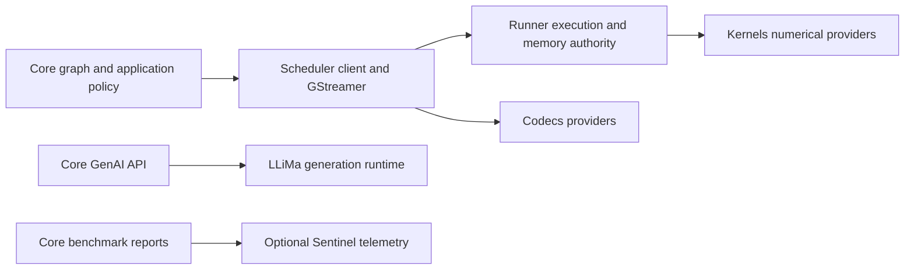

# リポジトリのアーキテクチャと設計

このページは、ライブラリの構造、各コンポーネントの役割、およびモジュールとランタイムの整合性を損なうことなくフレームワークを拡張する方法を理解する必要があるコントリビューターを対象としています。

## コンパイル済み Scheduler 境界

Core は `SimaScheduler::frontend` と、独立した所有者を持つ `simaai::scheduler::client` 型を使用します。数値演算の記述、検査、動的選択、停止中のグラフへの接続、選択したメモリへのアクセス、動画レイアウトの問い合わせは、このコンパイル済み境界を通ります。Core は Runner セッションを開かず、Kernels や Codecs の実装インターフェースをインクルードしません。



Kernels は引き続き演算カタログと数値演算の受け入れ判定を管理します。Scheduler は Runner を介して汎用リクエストを転送します。Scheduler と Core のどちらも、ファームウェア ID や演算別のディスパッチテーブルを管理しません。Core は公開ノード API、幾何ポリシー、ワイヤ形式を保持します。コホート検証後、Scheduler が新しいアダプター／リゾルバーファクトリをインスタンス化します。キャッシュされた動的選択は演算を保持しつつ、現在のフレームのメモリにバインドします。

GenAI は Runner や Scheduler の GenAI アダプターを介さず、LLiMa を直接呼び出します。MLA プロファイリングはデフォルトで無効な別のパスです。Core は Scheduler のクライアントを呼び出し、Runner がインストール済みの `mla-rt` コマンドラインツールを実行します。他の MLA 処理がないアイドル状態の DevKit が必要です。

## GStreamer インターフェースの所有権

Scheduler は、インストールされる `gst/SimaaiGstErrors.h` ヘッダーを含め、GStreamer の転送と構造化エラーのインターフェースを所有します。Core はこれらを利用し、別の実装は保持しません。Core `0.6.0` には、このファイル所有権の移行が含まれます。対応する Core/Scheduler パッケージ一式を同時に更新してください。このパッケージバージョンは、プラットフォームや数値演算の契約を変更しません。

## フレームワークと環境

「Neat」という言葉は、関連性はあるものの、それぞれ異なる2つの問題に対して使用されます。

- **Neat Library:** このリポジトリにある C++/Python ライブラリおよびランタイムです。モデルを読み込みます。
  パッケージ化、パイプラインの構築、コントラクトの検証、Modalix ハードウェア上での実行、およびパブリック API の公開を行います。
- **Palette SDK / 環境:** フレームワークを中心としたコンテナ化された開発ワークフロー。
  DevKit Sync、共有ワークスペース、およびエージェントツールなど。

このリポジトリを変更する際は、人間とエージェントの両方をサポートするフレームワークのプロパティを最適化してください。具体的には、明確な API、決定的な動作、構造化された診断、厳格な検証、および安定した公開インターフェースです。

## このライブラリの目的は何ですか。

### 主な利用者

以下のことを実現したい開発者：
- 再利用可能な構成要素からパイプラインを組み立てます（生のGStreamerのテンプレートコードを記述する必要はありません）。
- パイプラインを早期に検証し（CIに対応）、問題発生時に迅速に原因を特定できるようにする。
- C++で`appsink`を使用して、パイプラインを実行し、フレームを処理します。
- オプションとして、RTSP（`gst-rtsp-server` を介して）を通じてパイプラインを配信できます。
- テンソル処理に適した形式で出力することで、機械学習コードをパイプライン処理し、GStreamer の複雑な設定を記述することなく、機械学習モデルにデータを供給します。

## パッケージの所有権

選択した Core アーティファクトが、まとめてインストールする Core、LLiMa、および対応する Scheduler 依存パッケージの信頼できる情報源です。Core は依存バージョンを選び直したり書き換えたりせず、そのアーティファクトの依存関係全体を引き渡します。含まれないパッケージはプラットフォームが所有します。互換性のないプラットフォームは Core や LLiMa で修復せず、更新してください。

Core はインストール済みの `SimaScheduler` クライアントコンポーネントを使用し、下位の CMake 開発インターフェースは使用しません。Scheduler の依存関係コーディネーターは、選択された Kernels/Runner/Codecs 一式を検証し、正確な来歴を保持します。メタデータのみの `SimaRuntime` 互換エイリアスは別の実装を所有しません。ビルドエントリーポイントは引き続き、Kernels → Runner → Scheduler → Core の順で兄弟ソースを準備するか、明示的に選択されたパッケージを再利用します。これはビルドの調整であり、ランタイム実行やファームウェアの有効化ではありません。[ローカル依存関係ビルド](../build-test/local-dependencies.md)を参照してください。

### レンダラーとオプションのバックエンドプロバイダー

Core はボックス／マスクの公開ポリシーを所有します。既存の軸に平行な BBOX ペイロードは int32 座標を使います。別形式の `BBOX_OBB_V1` は FP32 の回転ボックスジオメトリを保持し、軸に平行なボックス用レンダラーでは拒否されます。Scheduler は caps、ライフサイクル、初期準備時のプロバイダー受け入れを所有します。本番構成にはレンダラーの型付き int32 機能が必要です。値を float として解釈し直したり、フレームごとの変換を追加したりしません。Kernels は標準 A65 `render` 演算を所有し、Runner は実行と ReadWrite 画像の使用完了処理を所有します。Scheduler は検証済み演算と、使用した Kernels/Runner の識別情報を記録します。Core はこのコホートを検証し、`a65apps` アーカイブなしで通常の依存関係を構成します。

Runner はプラットフォーム所有のプロバイダーを再配布可能な依存関係とは分けて記録します。Core はそのレシートを保持し、インストール済みプラットフォームを検証します。プラットフォームのビルド番号だけで互換性を判断したり、プラットフォームの DSO を利用側パッケージへ同梱したりしません。プロバイダーの受け入れと構成は[ローカル依存関係](../build-test/local-dependencies.md)を参照してください。

### ランタイム転送の所有権

Core はインストール済みの `SimaScheduler` パッケージを使用します。`SimaScheduler::elements` は、GObject 型とプロセス内の登録を含め、`neatcamerabridge`、`neatmultipartjpegdemux`、`neatlatestbystreammux` を所有します。Core の `src/gst/` エントリーポイントは互換性のための転送処理であり、別の実装ではありません。これらの要素は数値演算エグゼキューターを使用せず、Kernels も必要としません。

Core は公開 C++/Python API、Node オプション、グラフの低レベル化、Sample/Tensor オブジェクト、グラフ専用クレジットを保持します。`src/pipeline/gst/RealtimeMuxCredits.cpp` は、Scheduler の値のみの借用インターフェースを通じて、それらのクレジットを投影します。mux 借用レジストリと共有入力フレームカウンターの所有者は、単一の Scheduler です。カメラ ABI のレイアウトは、Core 内部のコピーではなく、対応するアロケーターヘッダーから取得します。

mux の公平性／バックプレッシャー、multipart 解析、キャプチャ親オブジェクトの寿命に関する実装テストは Scheduler にあります。Core は公開 API、グラフクレジット、エンドツーエンドのデバイステストを保持します。Core をビルドする前に、対応する Runner と Scheduler パッケージをインストールしてください。Core の内部テストは、その転送ターゲットに直接リンクします。プロバイダーなしのホストテストで、ハードウェアキャプチャやコンパクト TensorBuffer メタデータを検証済みとしないでください。

### 数値演算カーネルの追加

既存のテンソルと実行の契約で表現できる演算の場合、開発対象は **Kernels と Core のみ**です。

1. Kernels に、演算固有の型付きリクエスト、検証済みプラン、数値演算実装、実行ファイルファクトリ、名前付きリクエストデコーダーを追加します。Kernels 所有のカタログに演算を一度登録し、正しさのテストを追加します。
2. Core に Node を追加し、そのオプションを標準リクエストへ変換します。演算、明示的なターゲット、入出力仕様、型付きパラメーターを含めます。Scheduler の汎用準備 API を呼び出し、演算ファクトリを直接呼び出したり、Runner や Scheduler に演算の分岐を追加したりしないでください。
3. **Kernels → Runner → Scheduler → Core** の順で再ビルド／インストールします。EV カタログの変更には、Runner ソースが変わらない場合でも、対応するファームウェアを明示的に組み合わせる必要があります。排他的なデバイス手順を使って検証してください。

準備は **Core → Scheduler → Runner → Kernels** の順に進みます。Kernels が数値演算を検証し、Runner が汎用ゲートウェイになります。初期検証ではハードウェアを開かず、実行リソースも確保しません。返された検証済み実行ファイルを保持し、ステージ全体を受け入れる前に標準要件を確認してください。ストリーミングでは演算名を再度デコードせず、同じ実行ファイルを使用します。

動的バリアントは、セットアップ時にバインドされる、カーネル所有のオプション機能を使用します。Core はグラフ／メタデータのポリシーと既存の上限付きキャッシュを保持します。キャッシュミス時には不変パラメーターを具体化でき、プロバイダーが、正確なテンソル契約とリソースを共有できるか、完全な再検証が必要かを証明します。キャッシュヒットで別の演算を作成したり、カメラ／コーデックのフレーム借用を保持したりしません。

Runner は実行、リソース、コヒーレンシ、使用完了処理を所有し、Scheduler は Gst キャリア、プラグイン、転送統合を所有します。標準のインストール済みパッケージは `SimaRunner` と `SimaScheduler` です。メタデータのみの `SimaRuntime` 互換パッケージは、従来のターゲットを同じ実装に転送します。ヘッダーのエイリアスは標準 Kernels 型を再利用し、静的リンク依存関係は推移的に残る場合があります。別のテンソルスキーマ、アロケーター、実行キュー、数値演算レジストリはありません。

数値演算ステージは `neatkernelrunner` を生成します。廃止された ProcessCVU プラグインへの切り替えやフォールバックはありません。Core が所有する公開出力のパッキングは、元のメトリクス境界を保つ依存ホスト演算です。Codecs は独立したエンコード／デコードバックエンドであり、Gst ラッパーは Runner や数値 Kernels ではなく Scheduler が所有します。

ビルドレシートは、正確なインストール済みバイト列と使用した依存関係の識別情報を結び付けます。ハードウェアや性能の検証結果ではありません。対応していないパッケージのヘッダー、アーカイブ、ファームウェア、Codecs を混在させないでください。

新しい転送方式、テンソル表現、実行機能はフレームワークの拡張であり、Runner の変更が必要になる場合があります。Kernels/Core のみという保証は、そのような変更には適用されません。タイムアウトやキャンセルは DMA の使用完了を証明しません。確定した完了または検証済みのプラットフォーム復旧まで、既存の割り当て所有者を存続させる必要があります。

Core はファームウェアのグラフ ID ではなく、意味的な名前で演算を選択します。Kernels は演算名とコンパイル済みターゲットの不変カタログを公開し、Runner と Scheduler は別の演算レジストリを持たずにそれを転送します。Core は必須の `DetessCast` と `DetessDequant` の融合を含め、型付きグラフ書き換え規則を所有します。必要な融合実装が利用できない場合、別々のカーネルへ分割するのではなく準備に失敗します。Core のステージが 1 つの演算に対応する必要はありません。TrackKLT は引き続き既存の複合リクエストを準備します。

TrackKLT の公開テンソルリストは位置順で、前の画像、現在の画像、整数のシード点を渡します。省略可能な名前はその役割を確認するもので、ストレージの順序を変更しません。Core はシードの推論前とキュー受け入れ前に、テンソルデータをマップまたはコピーせず、記述された入力契約を確認します。名前のないテンソルも位置順です。このポリシーは明示的に記述された直接の公開入力だけに適用され、内部ステージ間リンクやモデル入力の変換には適用されません。

トラッカーのリクエストが数値品質の制御と省略可能な残差の公開を所有します。Core は点、ステータス、要求された特徴点の後に残差を追加します。ステータスを無条件の追跡信頼度とは解釈しません。検出を無効にすると、その演算と出力割り当てを除去します。Kernels はバージョン付きネイティブパケットと数値検証を所有し、Runner と Scheduler は引き続き汎用の検証済みリクエストを転送してバインドします。

### ダイレクトドライバーの復旧

`deps/manifest.json` は Scheduler と LLiMa を選択します。Scheduler のインストール済みコーディネーターが対応する Kernels、Runner、Codecs の依存関係全体を検証し、Core は下位のプラットフォーム検証を重複実装せず、検証済みコホートを使用します。

復旧は、ディスパッチャーのエラー照合ではなく、選択したプラットフォームの責任です。Core は推論失敗後に AppComplex を起動したり、ディスパッチャーサービスを再起動したり、リモートプロセッサーをリセットしたりしません。Runtime はドライバー契約を通じて完了と使用完了を報告します。完了が不明であることは、DMA ストレージの再利用を許可するものではありません。プラットフォーム起動時の MLA 初期化は、引き続きプラットフォーム依存関係です。

### メモリの所有権

Core は Scheduler の割り当てとマッピングのインターフェースを使い、メタデータから付加した物理アドレス、`libsimaaimem`、別の割り当てレジストリは使いません。CPU アクセス、マッピングの寿命、インポートメモリ、親バッチの制約は、[メモリモデル](../../advanced-concepts/data-model-contracts/memory_model.md)を参照してください。

Core はグラフトポロジーからキャッシュコヒーレンシのモードを選びません。`RunAdvancedOptions::prepare_output_cpu_visible` はオプションのレイアウト互換性のために残されています。実際のマッピング前に冗長な先行同期は行いません。ソース互換の `defer_output_invalidate` オプションは true のままにする必要があります。false は、生成側の遅いパスを復活させるのではなく拒否されます。

非同期 MLA 送信と順序付き出力は、別々の既存パスを使います。完了コールバックは終端状態を記録し、出力処理は CPU キャッシュのメンテナンスなしで結果を公開します。送信パスは、上限付きレーン容量と独立した割り当て所有権の条件下で、出力処理中に後続フレームを受け入れられます。完了だけでは受け入れクレジットは戻りません。完了済みスロットは、出力処理が解放するまで所有されたままです。出力プールの借用はその解放より長く残る場合があり、引き続きストレージの再利用を防ぎます。

この重なりによってキャッシュのメンテナンスがなくなったり、1 フレーム内の依存チェーンが短くなったりすることはありません。同期ワーカーを追加せずに、独立した CPU とデバイスの処理が直列のパイプライン停止として現れるのを避けます。グラフ構築時に上限を一度設定するため、フレームごとの演算固有スケジューリングポリシーは不要です。

### FrameLayout によるメモリ計画

Core はビルド内で 1 つの計画経路を使います。

1. モデル経路を選択し、呼び出しの識別を維持します。
2. 検証済みレシピをコンパイルし、各実行先を一度だけ決定します。
3. ルートキャリア、ビュー、消費者、所有権グループを解決します。
4. ヒープを選び、共通の物理 DAG 寿命証明に基づいて配置します。
5. ステージごとの `FrameLayout` と公開情報を確定し、配置を修復せず一度だけレンダリングします。

EV74 のアクセス、または明示的な `OutputOptions::placement = OutputPlacement::EV74Compatible` 出力には CMA が必須です。所有する MLA／A65 専用キャリアは DMS を使います。条件を満たす新規 A65 公開終端は HostCpu を使用できます。インポートしたストレージ、オフセット、形状、生成元の貸与は固定です。ファンアウトは全消費者を考慮し、ビューはルートキャリアを共有します。

`AllocationPolicy::PreferDmsThenCma` は、対象の所有 DMS 割り当てが容量不足になった場合に CMA へフォールバックする明示的な指定です。通常の Linux メモリは選びません。プール境界、Queue 境界、独立した呼び出し、保持された出力が寿命の再利用を制約します。

Scheduler は Runner を通じて各レイアウトの割り当てグループを準備します。インデックスとオフセットはバッファーグループ内の値です。異なるグループの同じオフセットは重複しません。Core と Scheduler は対応するパッケージを一緒に再ビルドしてください。

### デフォルトのデバイスから CPU へのコヒーレンシ

準備済みメモリエンジンは 1 つです。`SIMA_CORE_DEMAND_COHERENCY_V1` と Runner の実験的ビルドオプションは削除されています。新しいビルドでは設定しないでください。環境変数による明示的な有効化や、グラフ全体の Legacy への格下げは残っていません。Core は Scheduler の割り当て、マッピング、ステージインターフェースだけを使います。公開テンソルの幾何情報、Kernels リクエスト、数値動作は変わりません。

共有のアクセス取得と寿命の契約は、[メモリモデル](../../advanced-concepts/data-model-contracts/memory_model.md)で定義しています。

#### DMA に裏付けられた論理テンソルのマッピング

公開 `Tensor::map()` とその `view()` エイリアスは、既存のストレージマッピング契約を維持します。`byte_offset` を一度適用し、末尾のバッキング領域を公開する場合があります。名前付きセグメントの境界とアプリケーションのマッピングコールバックが引き続き正となります。`TensorBuffer::map()` は引き続きストレージを直接マップします。

形状で範囲を制限する内部コンシューマーは、代わりに `map_dense_tensor_read()` を使用します。現在の幾何情報に対して正のストライドとオーバーフローを検証し、ストライドの隙間を含む物理テンソル範囲だけを公開します。Core 所有の DMA ストレージは、その正確な範囲を許可できます。ラップされたコールバックやカスタムコールバックは、既存のマッピングと後処理動作を維持します。ヘルパーは返された範囲を検証してから、論理ビューを狭めます。可変のテンソルビューをまたいで幾何情報をキャッシュしません。複合画像、エンコード済みの幾何、未解決の幾何は既存のマッピングパスを使用します。密な論理範囲が、ほかのプレーンへのアクセスを許可するわけではありません。

Scheduler は、正確なビューについて Runner がすでに検証した現在世代の可視性を再利用できます。デバイス書き込み後の最初の読み取り、未包含範囲、未検証の取り込みでは、エクスポーター同期を維持します。アクティブな書き込み側、保留中のデバイス処理、隔離状態は引き続きエラーです。マッピングは CPU アクセス終了まで、元の Gst サンプルと、現在の公開ストレージ／生成元の借用の両方を保持します。所有権モード、ペイロードコピー、WRITE-END クリーン処理、公開オブジェクトのレイアウトは変更しません。

カーネルステージの `resource_busy` エラーは、必ずしも送信容量の枯渇を意味しません。無害化され、長さが制限された `Reason` は、元のアクセス、登録、所有権、容量の診断を保持します。同時処理数を変える前にその原因を確認してください。所有権やデバイス完了が未解決の間は、バッファーを再利用しないでください。

### コーデックの所有権

Scheduler は `neatdecoder`、`neatencoder` とその GStreamer アダプターを所有します。Codecs はデコーダー／エンコーダーのセッションと数値実装を所有します。対応するインストール済みヘッダーとライブラリを使用し、バックエンドコードを Runner にコピーしたり、異なるバックエンド ABI のラッパーと組み合わせたりしないでください。

### ハードウェアエンコーダーの設定

`SimaEncode` と生入力の `VideoSender` は、ネゴシエートされた入力 caps から解像度を導出します。実行中は解像度を固定し、変更には新しい実行が必要です。エンコーダーオプションに幅や高さは含まれず、入力アダプターはリサイズせずに表示ジオメトリを保持します。入力寸法が不明な場合、上流入力から得られるまでビルド時の出力コントラクトでも不明のままです。

`SimaEncode` は生入力を一度だけ準備し、コーデック固有のオプションを `neatencoder` に対応付けます。Scheduler は GStreamer の適合処理と出力公開を、Codecs はエンコーダーセッションを所有します。Runner はメモリの所有権と同期の権限を維持します。Core はエンコーダー実行スレッドを追加しません。従来の `H264EncodeSima` は、エンコーダープロパティの生成を共有しつつ、アダプターを持たない入力契約を維持します。公開クラスのレイアウト変更は ABI 6 と再ビルドしたバイナリコンシューマーに含まれ、既存のソースエントリーポイントは引き続き利用できます。

### 一般的なワークフロー

- **デコード/取り込み:** ファイルまたは RTSP → デペイロード/デマルチプレックス/解析 → デコード → 変換/キャプチャ → アプリシンク → C++ コンシューマー
- **検証:** ビルド、解析、およびプレロール（一時停止）を実行し、早期にネゴシエーションの問題を検出します。
- **RTSPストリームの送信:** `appsrc` を使用して、合成フレームをRTSPサーバーのパイプラインにプッシュします。
- **画像/動画テンソルアダプター:** 画像/動画/RTSP -> デコード -> 変換/スケーリング -> `add_output_tensor(...)` -> `Run::pull_tensors()`
- **チュートリアル:** 実行可能で、段階的に学習を進められるように構成されたチュートリアルは、[チュートリアル](/tutorials) から始めてください。

### 標準的なプロダクションパイプライン（信頼できる情報源）

このリポジトリにおける標準的な「本番環境の処理フロー」は次のとおりです。
**入力 → 前処理 → MLA → 後処理**。 正確な情報源は次の場所にあります。
`tests/e2e_pipelines/obj_detection/sync_yolov8_test.cpp`.

このテストが変更された場合は、READMEとアーキテクチャを更新して、ドキュメントの一貫性を保ってください。

### メンタルモデル（ビジネスロジックとパイプラインの連携）

お客様のアプリケーションはビジネスロジックを保持し、フレームワークがパイプラインを構成する役割を担います。

```text
Business logic
    |
    v
Nodes/Graph fragments  ->  GStreamer fragments  ->  caps negotiation  ->  runtime (Run)
    |                                                           |
    +-----------------------------------------------------------+
                                Sample / Tensor
```

---

## 主要な概念

このフレームワークは、意図的に少数の概念を中心に構成されています。ほとんどのユーザーコードが扱うのは、`Model`、`Graph`、`Run`、`Tensor`、`Sample` だけです。低レベルの作業を行うコントリビューターは、`Node`、再利用可能なグラフフラグメント、MPK コントラクトの解析、グラフ内部も扱います。

| コンセプト | 役割 |
| --- | --- |
| モデルアーカイブ | MPK推論コントラクト、プラグイン専用の設定ファイル、モデルのバイナリファイル、およびカーネルのアーティファクトを含む、密封された`.tar.gz`形式のアーティファクト。 |
| `Model` | `.tar.gz` モデルアーカイブ用のパブリックローダーです。MPKコントラクトを解析し、経路計画を実行し、モデルの各段階を公開し、シンプルな `run(...)` / `Graph` 構成のエントリーポイントを提供します。 |
| `Tensor` | データ型、形状、レイアウト、ストレージ、デバイス、およびセマンティックメタデータとともに型指定された数値ペイロード。 |
| `Sample` | テンソル、テンソルのリスト、またはバンドルを囲むランタイム/メディアの範囲。フィールドを読み取る前に、`Sample::kind` を確認してください。 パイプライン境界では、バンドル全体を 1 フレームとして保持します。 |
| `Node` | 決定的な結果を出力するアトミックパイプラインステージ GStreamer フラグメントと所有する要素の名前。 |
| 再利用可能なグラフフラグメント | デコード済み RTSP 入力やモデルステージなど、複数のノードへ展開される構築済みの `Graph`。 |
| `Graph` | アセンブリと検証の境界。ノード、モデル、再利用可能なグラフフラグメントを、ネゴシエーション済みでビルド可能なパイプラインにします。 |
| `Run` | `Graph::build(...)` によって返される、アクティブなパイプラインのハンドル。このハンドルは、データのプッシュ、プル、およびランタイムのライフサイクルを管理します。 |
| グラフ | 1 つのパイプライン内で DAG（有向非巡回グラフ）を構成するには、ビルダーグラフを使用します。複数のパイプラインにまたがるステージや実行を調整するには、ランタイムグラフを使用します。 |

左から右へ関係性を読み取ってください。

```text
model archive on disk -> Model -> Graph fragments/Nodes -> Graph -> Run
                                           |
                                           v
                                  Tensor/Sample flow
```

`Model` は、初心者向けの最初のステップですが、独立した実行エンジンではありません。これは、`Graph` に追加できるモデルのグラフ断片/ノードを解決します。`Graph` は、中心となる組み立ての概念です。`Run` は、構築後のライブオブジェクトです。

## コントリビューター向けの設計原則

これらは、フレームワークの基盤となる耐荷重構造の原則です。実装方法を決定する際に、これらの原則を参考にしてください。

- **決定性こそが重要です。** 要素名、生成されたパイプライン文字列、シリアライズされたパイプラインデータを保持してください。
  レポートの項目と、再現可能なテストを記載します。診断とエージェントのループは、安定した識別子に依存します。
- **デバッグのしやすさが最優先事項です。** 障害が発生した場合は、文字列だけでなく、構造化されたデータを出力するようにしてください。
  `GraphReport.error_code`、`repro_note`、バスメッセージ、および再現可能なバックエンドパイプライン。
- **無音での代替処理は行わないでください。** モデルへの入力に関するバグや、ハードウェアまたはランタイムの障害を、音を立てずに隠蔽しないでください。
  フォーマットの変換、グラフの種類変更、CPUへのフォールバック、またはプラグインのエラーの処理など。
- **実行前に検証する。** ランタイム前に、構造、大文字・小文字、形状、および契約に関する検証を優先する。
  スレッドが開始されるか、ハードウェアリソースが割り当てられます。
- **MPK契約は、信頼できる情報源のモデルです。** コアルーティング、データ型、形状、量子化など。
  ステージごとの決定は、`mpk.json`/`*_mpk.json` から行われる必要があります。ステージごとの JSON ファイルは、プラグイン専用です。
- **Detess の論理ランクとランタイム形状は別です。** MPK が定義した `frame_shape` を保持し、バイト範囲から形状を一意に特定できる場合だけランク 2 の NC/HW 解釈を認めます。融合 DetessDequant は両方の記述子を単一のフレーム単位コントラクトで運びます。タイルランクがカーネルランクを決め、先頭のバッチ次元は独立したままで、意味的な軸、バイト範囲、ストライド、明示的なタイル格納エンコーディングが権威を持ちます。Core はこれらの標準型付きコントラクトを Scheduler 経由で渡し、Kernels が選択した演算とエンコーディングを検証します。DSO 境界で ProcessCVU の準備済み要求を再構築しないでください。
- **数値演算バックエンドのポリシーには唯一の権威があります。** 検証済み機能が対応ターゲットと AUTO の優先順位を決定します。ステージやセッションの明示的ターゲットは、要求した対応バックエンドで実行されるか失敗します。後段の役割別上書きでその判断を覆してはいけません。
- **公開 API は安定性を維持します。** `include/*` に含まれる公開ヘッダーがインストールされ、サポートされます。
  既存のインターフェースを破壊する変更よりも、段階的な変更や非推奨化のプロセスを優先する。内部公開範囲を制御する定義で公開オブジェクトのレイアウトを変更してはならない。不透明な実装ハンドルは条件付きにせず保持する。
- **並行処理は、範囲を限定し、監視可能でなければなりません。** ストリーミング処理を行うスレッドは、軽量であるべきです。
  プローブ側の診断処理には、アトミック演算またはそれに相当するスレッドセーフな処理が必要です。また、終了処理中にプログラムが停止してはいけません。

## モデルの実行パス

モデルを基盤とするパイプラインの場合、大まかな手順は次のとおりです。

```text
input Sample/Tensor
  -> optional preprocessing / format normalization
  -> MLA inference stages selected from MPK contract
  -> optional postprocessing / box decode
  -> output Sample/Tensor
```

ユーザーから見てわかる`Model`の仕様は、MLAハードウェアの仕様よりも、より使いやすいように意図的に設計されています。MLAはINT8/BF16やテッセレーションされたレイアウトを必要とする場合がありますが、ユーザーコードは通常、FP32と通常のテンソルのレイアウトで動作します。フレームワークは、マニフェスト駆動のアダプターステージを使用して、このギャップを埋めます。

前処理と後処理は、フレームワークの明示的なステージ/オプションです。フォーマットの不一致、必要な前処理メタデータの欠落、選択したハードウェア転送機構が利用できないこと、無効なモデルアーカイブまたはMPKコントラクト、またはキャップネゴシエーションの失敗は、隠れたランタイムでの修正ではなく、対処可能な構造化されたエラーとして表示されるべきです。

### 公開実行プラン

`Model::execution_plan(...)` は、同じ引数の `build(...)` が実行する内容を返します。モデルのグラフノードをパイプライン順に並べ、各ノードの実行場所（`A65`、`EV74`、`MLA`）と、ノード間のエッジを流れるテンソルを示します。スタートアップのプリフライトを無効にして `build(...)` を呼び出し、ビルドが配置と公開メタデータの計画後に `DiagCtx` に記録したプランを読み取ってから、パイプラインを閉じます。そのため、`build(...)` と同じデバイスが必要です。これは公開の診断ビューであり、後述する内部の `ModelExecutionPlan` とは別のものです。JSON コントラクトは `schemas/execution_plan_v1.schema.json` です。`schema_version` は、既存の読み取り側を壊す変更のときにのみ変わります。 メモリ概要は所有する割り当てを一度ずつ集計し、`CMA`、`DMS`、`HostCpu`、または `Mixed` と表示します。明示的な DMS フォールバックは優先ヒープで表示します。

### ボードテレメトリ

`TelemetryMonitor` は、ボードテレメトリデーモンである Sentinel から、`/run/simaai-sentinel/api.sock` 上の HTTP API を通じて電力とボードのテレメトリを読み取ります。Core が電力モニタチップを直接読むことはありません。`start()` は Sentinel のサンプルキャッシュを 1 回読み取り、メトリクスの定義、サンプル間隔、最新のサンプルを取得します。この最新のサンプルは測定期間より前のものなので、集計には含めません。その後、ワーカースレッドが各サンプルの取得予定時刻の少し前に最新のサンプルを問い合わせ、新しいサンプルをタイムスタンプで識別して、それぞれ 1 回だけ累積サマリーに集計します。タイムスタンプが最後に集計したサンプルのちょうど 1 間隔後でない場合、ワーカーは取りこぼしたサンプルをキャッシュから集計します。このキャッシュは Sentinel の最新 240 サンプルを保持しています。モニタは Sentinel 内に何も作成しないため、任意の数のモニタを同時に実行でき、プロセスが強制終了されても何も残りません。

既定のモニターは上記のソケットを使います。明示的な `TelemetryMonitor(socket_path)` は、そのインスタンスだけに別の Sentinel Unix ソケットを選びます。`Model::benchmark()` は既定の接続先を維持します。

`Model::benchmark()` は別のトレースエンジンではなく、同じモニターを使用します。スループットタイマーの開始前に接続と待機ワーカーを準備し、測定開始後に区間を有効化し、必要な出力がすべて完了した後、測定停止前に区間を確定します。有効化と確定では割り当て、mutex の取得、join、Sentinel への通信を行いません。その後で初めてワーカーを join し、キャッシュを最終読み取りします。進行中のポーリングには停止確認より前の UTC 読み取りによる上限があるため、区間の確定後に新しいサンプルが入ることはありません。ベンチマークへの帰属では UTC サンプル時刻と UTC／単調時計の境界ペアを検証します。時計の不連続を検出した場合は、測定スループットを変更せずにテレメトリを無効にします。単独のモニターは、時計が巻き戻った後もキャッシュ順序による復旧を維持します。

Sentinel はおよそ 2 秒ごとにサンプリングするため、スループット測定パスは少なくとも `BenchmarkOptions::min_duration_ms`（デフォルトは 10 秒）の間実行されます。レイテンシ測定パスも同じ下限に従うため、両方のパスは同じ規則で停止します。Sentinel が動作していない、または測定期間にサンプルがない場合でも、ベンチマークはレイテンシと FPS を返します。この場合、電力フィールドは 0 になり、`telemetry.status` が理由を示します。`tools/install_neat_framework.sh` のボードモードは、Sentinel をインストールするか、最新の本番ビルドにアップグレードします。失敗した場合、インストーラは警告を出して続行します。後で `sima-cli neat install sentinel` を実行するか、CI と同様に `NEAT_INSTALLER_SENTINEL_REQUIRED=ON` を設定して失敗をエラーにしてください。非推奨の `Run` 電力モニタ（`RunOptions::power_monitor`）も Sentinel から値を取得します。Core は Sentinel の最新サンプルをポーリングし、I2C 経由で電力モニタチップを読むことはありません。

MLA プロファイリングは、デフォルトが false の 2 つの `BenchmarkOptions` フィールド `include_mla_layer_stats` と `include_mla_stage_stats` で明示的に有効にします。レイテンシとスループットのランナーが終了した後、Core は Scheduler のクライアントを通じて展開済みモデルの MLA 実行ファイルを測定し、プロファイリングパスを 1 つずつ順に行います。MLA レイヤー統計は、終端ポリシーを適用した推論ルート内の MLA ステージだけを測定します。Runner は実行ファイルごとに別プロセスで `mla-rt` を実行します。MLA レイヤー統計はコンパイラの統計 YAML も使います。MLA ステージ統計は各 MLA 実行ファイルを中断なしで 200 回実行し、`mla-rt` の統計ファイルから `tile.lat` の平均を読み取ります。Runner は入力と出力を検証し、一時ファイルを削除します。1 回の実行が 120 秒を超えた場合は `mla-rt` を停止します。MLA-RT はハードウェアのプロファイリングとカーネル実行への制御の引き継ぎを担当します。プロファイリングは他の MLA ワークロードと重複させないでください。ベンチマークのゲートが直列化するのはベンチマーク呼び出しだけであり、ほかの推論 API やアプリケーションではありません。

失敗、クラッシュ、または停止した `mla-rt` の実行は MLA の処理を未完了のまま残す可能性があるため、Runner はそのプロセスで `mla-rt` をそれ以上起動しません。以降のプロファイリングパスは、MLA の回復が必要であることを報告します。MLA の回復を確認するまで、DevKit をアイドル状態に保ってください。

プロファイリングはベストエフォートです。`mla-rt` が見つからない、失敗する、タイムアウトする、または使用できない出力を書き込んだ場合、Core は主要な測定値を保持し、該当するリストを空のままにして警告を出力し、`mla_layer_stats.status` または `mla_stage_stats.status` に理由を設定します。それ以外の場合、ステータスは `"not requested"` または `"ok"` です。

`BenchmarkReport::mla_layer_stats` には、コンパイル済みの各 MLA レイヤーのゼロ始まりの実行ステージ番号、名前、レイヤーごとに 1 回のプロファイリングパスで測定したマイクロ秒単位のハードウェアレイテンシが含まれます。`BenchmarkReport::mla_stage_stats` には、同じ番号付けによる各 MLA ステージの番号と、マイクロ秒単位のハードウェアレイテンシの平均が含まれます。これらの測定には別のプロファイリングパスを使うため、レイヤーのレイテンシの合計はステージのレイテンシや全体のレイテンシとは一致しません。`BenchmarkReport::save(file_path)` は、公開フィールド名と単位を使い、完全なレポートを明示的に保存します。`.json` は JSON、`.yaml` とその他の末尾は YAML を選択します。テレメトリと両方のステータスが含まれ、プロファイリングが無効の場合は MLA のリストが空になります。存在しない親ディレクトリを作成し、既存の保存先ファイルをアトミックに置き換えます。

廃止済み PreparedRunner オプションは既定値のままにします。並行実行には `processcvu.async` と `GraphOptions::async_queue_depth` を使います。旧逆量子化・プロファイリングフラグに直接の代替はありません。`advanced_execution.defer_output_cache_sync=true` を維持し、出力への CPU アクセスには Tensor/GstMemory マッピングを使います。`RunOptions::advanced.prepare_output_cpu_visible` は互換用の無操作フィールドであり、事前のキャッシュ同期を要求しません。

### コンパイル済みモデルの実行コントラクト

DMA-BUF ドライバーへの移行では、モデルの意味とフレームごとのストレージを区別します。Core はモデル読み込み時の事実を、変更不可の内部 `ModelExecutionPlan` にコンパイルします。

- 値は、正確な名前、必要バイト数、任意の論理型情報、任意のルート相対読み取り式 `{source ValueId, byte offset,
  byte strides}` を含みます。
- 操作は、順序が確定した正確な接続と、操作固有の設定を含みます。
- MLA バックエンドのポートは、ELF／モデルの順序、正確な必要バイト数、アラインメントの根拠、アクセス方向を含みます。
- 公開出力は、公開順序と公開する値のみを含みます。

MPK マニフェストは `MpkDecoder` を使用します。`MpkDecoder::load` はマニフェストの唯一の入口です。モデルの読み込み、準備済みランタイムの構築、PCIe ホストは、これを通じて `mpk.json` を一度だけ読み込みます。また、受け入れ判定でデコードするのと同じバイト列から、意味的な `MpkContract` を構築します。任意の `model_sdk_version` 文字列は由来の記録として保持され、受け入れを制限しません。デコーダーは登録済みの正確な `(processor, kernel)` 語彙だけを受け付け、完全なテンソル名を解決し、操作のバイト数の等式を検証します。また、MPK の各 MLA ステージを、その正確な ELF IFM/OFM トポロジーと個別に照合します。実行ファイルの根拠を結び付ける際は、コンパイラーが記述した論理ステージ ID と、マニフェストの実行ファイルトークンの両方を使用します。アーカイブの順序やファイル名の拡張子は、意味を決める根拠ではありません。生成された変更不可のプランは、各 MLA 操作について検証済みの `{stage index, op ID, logical stage ID, executable}` キーと、事前に索引化された順序付きポート範囲を公開します。曖昧さ、スロットの欠落、根拠の矛盾はモデル読み込みエラーになります。付随 JSON、部分文字列の照合、環境の状態、ランタイムバッファーは根拠として扱いません。

対応が一意であれば、Core は入力と出力の異なるバッファー順序を照合できます。バッチ入力と出力も対象です。アプリケーションには、モデルの公開テンソル名、順序、サンプル順序が維持されます。

通常の空間ストレージを持つ単一入力、バッチ 1 のモデルでは、入力チャネルの自動パディングを使用できます。アプリケーションにはモデルの論理テンソル形状が維持されます。独自の空間ストレージパディングはサポート範囲外です。

`.so` で終わる AFE アーティファクトは MPK ステージで分類します。`processor="MLA"` では、Core はホストプロセスにロードせず ELF トポロジーを検証し、アーティファクトを MLArt に渡します。コンパイラーの `input_names`、`input_types`、`output_types` を持つ A65 ホストモジュールは型付き TVM プログラムになります。従来の EVO アラインメントは明示的な 4096 バイトの `LegacyPolicy` のままです。新しい型付き契約は独自のアラインメントを宣言します。

ランタイムフレームは静的プランをコピーしません。直接経路は標準 DMA-BUF の所有権、検証済みの絶対 `{fd, offset, length}` ビュー、制限されたフレームスロットの寿命を保持します。Unpack と Slice は、ランタイム操作ではなく、コンシューマーの読み取り式です。デコーダーは、正確なオフセット、バイトストライド、物理範囲を検証した後でのみ、これらを 1 つの実体化されたルートキャリアに合成します。Pack、テッセレーション、精度変換は、下位変換で正確なバックエンド出力や同等の融合を証明できない限り、生成側／計算の意味を維持します。これにより、ストレージの配置が MLA ポートの数やモデルの動作を暗黙的に変更することを防ぎます。

`FrameLayout` は各ステージのストレージ契約で、割り当てリスト、割り当て内の範囲、入力経路、出力の所有権を持ちます。`ReuseInput` は識別済み入力の割り当てグループを保持します。Core は所有キャリアを一度だけ配置し、Scheduler は Runner を通じてプールを準備します。MLA のパディング済み物理容量は論理公開バイト数と別です。インポートしたストレージと生成元の貸与は固定です。

Core の不変 MPK パッケージが、推論契約の信頼できる情報源です。公開論理形状は、ネイティブ MLA サンプル範囲、バッチ全体の CVU 実行ビュー、バッキング容量とは別のままです。ランク 2 の Detess ビューは、実際の入出力バイト幾何が実行形状を一意に示す場合にのみ正規化します。融合は意味的な演算検出で選択し、Core 所有のグラフ ID テーブルで選ぶことはありません。

#### 標準識別情報と選択した出力の公開

Core はコンパイル済み契約を構築する際に、数値演算ステージの識別情報を確定します。対応するモデル表記を正規化し、演算、ファミリー、ファミリー列挙値の不一致を拒否します。従来のグラフ ID と記述子 ID は実行権限ではありません。識別情報の正規化によって不完全なセマンティック契約が完全とされることはなく、演算の検出と数値演算の受け入れは引き続き Kernels が所有します。

モデル管理の Preproc 引き渡しでは、画像の幾何情報とストレージ範囲は別の情報です。タイルのパディングによって、必要ストレージが密なスカラー数より大きくなる場合があります。Core は、取り込まれた変換チェーンを型付きモデルプランに対して検証し、キャリア配置と選択出力ルートを確定してから、公開出力ビューを構築します。ランタイム記述子、ルート、公開ビューは、同じ確定済みストレージを参照する必要があります。親の割り当てが大きくても、小さすぎる論理ビューが許可されるわけではなく、バイト数が等しくても幾何情報の一致は証明されません。

単独のパック形式 Preproc は、情報の公開やアリーナの割り当て前に、標準の検証済み実行ファイルへ必要ストレージを問い合わせます。論理寸法の積からパック形式の容量を導きません。複数 ROI の容量は公開形状にバッチ軸を保持し、単一画像の単独ビューは既存の HWC 形状を保持します。

型付きモデル記述子は、バッチ次元を含むテンソル全体を表します。明示的にバッチ化されたランク 4 の HWC テンソルでは、先頭の軸は N です。実行の繰り返し回数は 1 です。意味的なバッチサイズは、テンソル全体の繰り返し実行を要求しません。パックされて交互に配置されたバッチの各ヘッドは、サンプルごとにバインドされ、ヘッドごとに完全なテンソルとして公開され、順序を保つ単一次元軸ビューを保持します。バッチサイズだけを理由に DetessCast や DetessDequant の融合を無効にはしません。融合された DetessCast と DetessDequant は、公開ランクが実行幾何と異なる場合、明示的に証明された内部の単一次元軸ビューを保持します。

この単一次元の引き渡し規則は、KLT ステータスの公開のように、意図的に絞り込んだ出力ビューを置き換えません。変更はフレーム実行時ではなく準備時に行います。融合演算、明示的なオフセット、量子化メタデータを保持してください。契約の不一致を、ステージングコピーや数値演算のフォールバックで修復しないでください。

#### 型付き変換の準備

Core はグラフ準備時に、外部 dtype 名と MPK テンソル記述子を一度解決します。引き渡すのは、入力ごとの精度を含む標準 `TensorSpec` と `DType` 契約を持つ検証済み実行ファイルです。Runner と Scheduler は演算固有の dtype 文字列を再解析しません。Core の公開情報とキャリアメタデータは、数値型の権限情報とは別に明示的なままです。

実行形状と公開形状は同一でなくても構いません。Core は、セマンティック出力契約から単一次元軸ビューを、コンパイル済みモデルの転送契約からパックされた物理ストレージビューを明示的に許可します。Scheduler は準備時に、dtype、レイアウト、ストライド、ストレージ境界を含め、各出力バインディングをその関係に対して検証します。バイト数が等しいだけでは reshape は許可されません。これらのビューは元の割り当てを保持し、テンソルコピーや数値変換を追加しません。出力契約の変更には、動的に準備するバリアントを含め、新たな検証が必要です。

同等の dtype 表記は大文字・小文字を区別せずに受け付けます。未知の名前や矛盾した記述子は実行前に失敗します。従来の共有 BF16/INT16 エンコーディングには、明示的な意味上の型が必要です。リクエストエラーは、詳細な GStreamer 診断を有効にしなくても理由を示します。

#### 検証済み数値演算ステージ

`FrameSpan` のオフセットは割り当てとバッファーグループ内の値で、グラフ全体のアドレスではありません。異なるグループの同じオフセットは重複しません。BoxDecode と ArgMax は、ヘッド相対のテンソルオフセットをストレージオフセットと分離します。直接メモリ入力と実行時物理バインディング入力は、それぞれのアドレス方式を維持します。

Core は ArgMax、BoxDecode、SuperPoint、LiDAR/BEV カーネルノード（SimaVoxelize、SimaPillarScatter、SimaBEVPoolPlan、SimaBEVPool）を含む Preproc、変換、ビジョンステージを、標準リクエストと明示的なテンソルポートマッピングへ低レベル化します。Scheduler の汎用テンソルステージエンジンは GStreamer のバインディングと公開を所有し、Runner は依存関係、非同期実行、実行時バッファーの寿命を所有します。Core はキャリア容量を上流の割り当て契約または入力ストレージから取り込み、論理形状だけから求めることはありません。BoxDecode と SuperPoint の数値出力は非公開のままで、依存する Core のワイヤシリアライズ実行ファイルが、デコード演算を重複実装せずに公開 BBOX と特徴ペイロードを保持します。 回転ボックスには、同じ数値演算完了依存関係を持つ、独立したバージョン付き `BBOX_OBB_V1` シリアライザーを使います。数値演算が失敗した場合、古い結果を公開してはなりません。

不変のカーネルレシピは、型付きノード契約の変換後も、生成側が定義したテンソルのワイヤ形式を保持します。コールドパスの公開処理は、新規とキャッシュ済みの両方の caps にその形式を適用し、カーネル名やバイト形状から意味を推測しません。公開 OBB テンソルは、`BBOX_OBB_V1` の意味を持つ密なランク 1 の UInt8 のままです。

InputStream は、所有コピーとキャッシュ済みメタデータの経路を含め、Sample を公開する前に、定義済みの形式を各返却テンソルに反映します。そのため、生の `Sample.tensors` と `TensorList` の便利 API は同じ検出セマンティクスを持ちます。

検証済みの MLA タイル形式の数値出力では、形状と dtype が検証済みの生成側と一致する場合に限り、Core は各論理出力に物理レイアウトを付加します。InputStream はデコードキャッシュの初期化時にこの不変の caps メタデータを読み取り、キャッシュされた Tensor テンプレートに保持します。生バイトのエイリアスと、バイト列がすでに密な NHWC と一致する INT8 セルタイルは変更しません。`TessSpec::storage_bytes` は、明示的なタイル形式のストレージと、形式のみを示す従来の注釈を区別します。`copy_payload_bytes()` と `clone()` は格納バイト、パディング、レイアウトを保持します。一方、密なコピー、型付きアクセス、DLPack は明示的なタイル形式のストレージを拒否します。レイアウト対応のグラフコンシューマーは、暗黙の変換なしに検証済みレイアウトを受け取ります。

画像サイズが変わる場合、バインド前に、不変でリソース互換の準備済み BoxDecode バリアントを選択します。処理中のフレームが使う演算を変更しません。RCNN ステージ 1 は、レベル別 top-K の件数と FP16 の提案グループを保持します。Core が廃止された objectdecode プラグインをフォールバックとしてロードしてはいけません。

A65 は実行ターゲットであり、GStreamer のメモリドメインではありません。プラグインは引き続き DMA-BUF キャリアを取り込みます。テンソルの直接入力には、たとえば `Tensor::from_vector(values, shape, TensorMemory::EV74)` のような共有 CMA 割り当てを使います。選択された実行ファイルは引き続き A65 上で動作します。

---

## リポジトリの構成

### 上位構造

- `include/` - パブリックヘッダー（サポートされているAPIの範囲）
- `src/` - 実装
- `docs/` -- ドキュメント（このファイル）
- `examples/` -- 実行可能な簡単なサンプルコード
- `tests/` -- ユニットテスト／統合テスト
- `python/`：`pyneat` パッケージのソースコード、nanobind バインディング、および Python テスト。
- `old_*` - 過去のモノリシックな実装のスナップショット。参照や移行のために保存。

### パブリックヘッダーツリー (`include/`)

パブリックなヘッダーファイルは、`include/<module>/...` ディレクトリに格納されます。
例：`include/pipeline/Graph.h`、`include/model/Model.h`。

パブリックな利便性エントリーヘッダー：
- `include/neat.h`（傘）
- `include/neat/runtime.h`
- `include/neat/models.h`
- `include/neat/nodes.h`
- `include/neat/node_groups.h`

意図的に、公開されている包括的なヘッダーファイル（`include/neat/graph.h`）は存在しません。より低レベルのグラフ構造を必要とするランタイム/コンパイラテストでは、直接、限定的なヘッダーファイル（`include/graph/...`）を使用します。アプリケーション、サンプル、および公開ドキュメントでは、`<neat.h>`から提供される単一の公開グラフクラス（`simaai::neat::Graph`）を使用する必要があります。

### 内部ヘッダーとランタイムプラグインのパス

`include/` ディレクトリにあるパブリックヘッダーはインストールされ、安定した API として扱われます。
`src/**/internal` ディレクトリにある内部ヘッダーはインストールされません。サンプルやチュートリアルでは、パブリック API のみを使用する必要があります。

Core の共有 CMake ターゲットは C++20 と公開 GStreamer、OpenCV、JSON 要件をエクスポートします。Core はインストール済み Scheduler frontend と LLiMa に対してビルドします。下位ランタイムライブラリは配備時の依存関係であり、Core が直接使う開発インターフェースではありません。静的リンクの利用側は Static コンポーネントを明示的に要求し、実装のリンク依存関係を用意します。

ランタイム環境に関する注意事項：

- インストール済み Scheduler プラグインは `${CMAKE_INSTALL_PREFIX}/${CMAKE_INSTALL_LIBDIR}/neat/gst-plugins` にあります。システム以外のプレフィックスでは、そのディレクトリを `GST_PLUGIN_PATH` または `GST_PLUGIN_PATH_1_0` に含めます。
- Runner ランタイムライブラリは `${CMAKE_INSTALL_PREFIX}/${CMAKE_INSTALL_LIBDIR}/neat/runtime` にあります。ビルドツリーのライブラリではなく、インストール済み CMake ターゲットを使用します。
- システム全体のプラグインを更新したら、システムの GStreamer キャッシュを再構築します。

Core とそのインストール済みコンシューマーは、選択した LLiMa パッケージと ABI 互換の JSON ヘッダーバージョンでビルドしてください。LLiMa は JSON を含む C++ メソッドをエクスポートします。ソースの構文に互換性があるだけでは、リンク互換性は証明されません。SDK／ライブラリのレシートと実際のリンク検証は、パッケージに記載された広い最小バージョン条件より優先されます。

---

## 計画段階と安定版（APIのインターフェース）

| エリア／API | 状況 | 備考 |
| --- | --- | --- |
| 主要なパイプライン API（`Graph`、`Run`、`Tensor`、`Sample`） | 安定した | 主にサポートされている C++ のインターフェース。 |
| ビルダーの内部構造（`Node`、プライベートなノードベクターヘルパー、`GraphPrinter`）。 | 内部 | STL形式のみに対応し、GStreamerによる合成処理を事前に行うことができます。 |
| モデル API（`Model`、再利用可能なグラフフラグメント） | 安定 | 標準モデルアーカイブ統合パス。 |
| `include/policy/*` | 安定した | 検証済みの最小限のポリシー契約とデフォルト設定（`Decoder`、`Encoder`、`Memory`、`RTSP`）。 |
| `include/nodes/groups/ImageToH264RtspGroup.h` | 計画された | 空のプレースホルダーグループ。 |
| Python用バインディング (`python/`、`pyneat`) | ベータ版 | Nanobind をベースとしたバインディングとパッケージは、リポジトリ内に配置されています。API の主な機能は、`Tensor`、`Graph/Run`、`Model`、および主要なノード/グループヘルパーです。 |

---

## モジュールと役割

### `builder/`：ノード間の契約と、プライベートな線形合成のサポート（GStreamerは使用しません）。

**目的:** パイプラインが論理的な構成要素からどのように組み立てられるかを定義します。

主な種類：
- `Node` - 各パイプラインの構成要素で実装されるインターフェース
- ノードベクトルを扱うための内部関数と、`GraphPrinter` -- グラフの表示や診断を行うためのユーティリティ

**ルール:** ビルダーは、基本的に STL のみを使用するようにしてください。GStreamer ランタイムオブジェクトを所有してはなりません。

### `nodes/` - 型付きのパイプライン構築モジュール

**目的:** 決定的なGStreamerフラグメントを出力する、すぐに使用できるノードの実装を提供します。

`VideoRate()` は、ソースグループによって挿入された場合も含めて、常に `videorate drop-only=true` を発行します。これにより、プールされたデコーダーメモリを共有する出力ヘッダーの重複を回避し、ソースのタイムスタンプを保持します。C++ の `VideoRate()` と Python の `video_rate()` ファクトリーは引数を取らず、フレームを複製しません。

例：
- `nodes/io/HttpSource`, `nodes/io/RTSPInput`, `nodes/io/StillImageInput`
- `nodes/common/*`（キャプチャ、キュー、出力など）
- `nodes/sima/*`（SiMa.ai：デコード／エンコード／解析／決済ノード）
- `nodes/rtp/*`（ペイロード処理関連のヘルパー関数）
- `nodes/groups/*`（一般的な複数ノードのレシピ）

**契約:**
各ノードは、以下のものを生成しなければなりません。
- `backend_fragment(index)` - 指定されたインデックスにおける、このノードの GStreamer フラグメント。
- `element_names(index)` - このノードが所有する、決定的な要素名（診断および強制に使用）。

LiDAR/BEV ノードでは、オプション、ポートの記述、副作用のない数値リクエストの
構築を `nodes/` に置きます。既存の `NodeContractProvider` コンパイルフックの実装は
`pipeline/internal/sima/LidarBevNodeContracts.cpp` にあります。このコンパイラーは
Scheduler の既存の `check_kernel(...)` API に演算名を渡し、通常のステージレシピと
`FrameLayout` の実行経路を使います。`StaticSpecBuilders.cpp` は、メタデータのみを
扱う入力の投影と直接入力のバインディングを `SimaArgMax` と共有します。これらの
ヘルパーはカーネルの準備やスケジューリングを行いません。LiDAR/BEV ノードの
ファイルはパイプライン内部の実装ヘッダーをインクルードしません。この分離によって
フレームごとの処理やペイロードのコピーが追加されることはありません。

単独の `Cast` は型付きビューを、Kernels が検証する標準 `cast` 要求にコンパイルします。論理識別、ストライド、テンソル相対オフセットを明示的に保持します。意味コンパイルは配置前に MLA 入力ポートの順序を調整し、レンダリングは検証済み契約を維持します。実行容量のデフォルトは非同期で 4、同期で 1 で、保持用の出力キャリアは別です。部分集合や並べ替えた TensorSet は、親を保持するメタデータエンベロープを使い、保持済みの公開情報やペイロードを変更しません。

#### 型付き画像フロントエンドと複数プレーンの公開

`Resize`、`ColorConvert`、`Normalization` は、既存の final `Preproc` ノードを使う薄いファクトリです。既存ホルダー内の不変かつ実装内部のポリシーが、公開 Preproc や PreprocOptions のレイアウトを変更せずに、フロントエンドの意味を分離します。モデル固有の ROI／ソーステンプレート動作は、引き続き従来の融合モードに限定されます。Resize は出力寸法を固定したまま上限付きの動的入力幾何を受け付け、色変換と正規化は実行ごとに幾何を固定します。

生画像の契約は、検証済みのプレーン記述子と 1 つの画像キャリアを保持します。配置後、Core は割り当て内のプレーンオフセット、ストライド、境界を `GstVideoMeta` と動的な `GstSimaMeta` に投影します。メタデータ照会は不変のプレーン相対形状を使い、アダプターやデバイス割り当てを必要としません。名前付きセレクターは検証され、生画像にテンソルセット記述子は作りません。Normalization は BF16 テンソルを公開し、NV16 は全高の UV プレーンと画像所有者を維持します。

新しい画像ステージは、初期段階のステージローカルな OutputSpec 投影で、既知の上流時間情報 caps を保持します。OutputSpecProvider のない境界は、この厳密な投影で継承したレートだけを無効にします。後段の明示的な caps プロバイダーで復元できます。内部ペイロードは得られた分数を生画像の公開へ渡します。未知のレートは省略したままで、ウォーム状態のフレーム処理やレート推測を追加しません。従来のベストエフォートな OutputSpec 投影は変わりません。

ネイティブ画像レイアウトは隙間を保持します。エンコーダー互換の NV12 は、インストール済み Runner の動画レイアウト管理と、明示的な InitializeStorage カーネルポリシーを使用します。EV の書き込み側は呼び出しごとに宣言されたピッチ末尾とストレージ行を初期化します。割り当てやページの余剰領域が、暗黙の書き込み可能なパディングになることはありません。Core はペイロードのパディングを初期化せず、A65 上で出力を再パックしません。既存の融合 Preproc ディスパッチ、メタデータ互換性、BF16 演算は変わりません。

---

### `gst/` -- 軽量な GStreamer ユーティリティ

**目的:** よく使用される GStreamer のパターンを扱うための、小さなラッパー/ヘルパー関数。

例：
- 初期化 (`GstInit`)
- 解析起動文字列 (`GstParseLaunch`)
- バスのデータ抽出/文字列化 (`GstBusWatch`)
- Capsヘルパー / 要素の内部構造の調査 (`GstHelpers`, `GstIntrospection`)
- パッドタップ／プローブヘルパー (`GstPadTap`)

**ルール:** `gst/` は、`pipeline/` に依存してはならない（依存関係の循環や「ユーティリティ層」の肥大化を防ぐため）。

### `pipeline/` - ランタイムのオーケストレーションと公開 API

**目的:** ランタイムのライフサイクル全体を管理する：ビルド → 解析 → 実行 → 処理 → 終了、および診断機能の実装。

主要な型：
- `Graph` - ユーザーの主なアクセスポイント
- `Run` - パイプラインの実行処理を、プッシュ/プル API を使用して管理します。
- `Sample` - プル操作によって返される構造化された出力ペイロード
- `GraphReport` - 障害、停止、および再現に関する構造化された診断情報
- `Errors` - レポートを埋め込む例外 (`NeatError`)

#### エラーのセマンティクスに関する契約

`GraphReport.error_code` は、機械によるトリアージの標準的なフィールドです。フレームワークのランタイム/ビルド/IO パスは、ターミナルでのエラーを安定したコードファミリーにマッピングします。

- `misconfig.pipeline_shape`
- `misconfig.caps`
- `misconfig.input_shape`
- `misconfig.input_capacity`
- `misconfig.media_caps`
- `misconfig.tensor_dtype_missing`
- `misconfig.option_out_of_range`
- `build.parse_launch`
- `build.pipeline_syntax`
- `build.plugin_missing`
- `build.property_invalid`
- `runtime.pull`
- `runtime.element_failed`
- `runtime.output_timeout`
- `io.parse`
- `io.open`
- `io.file_not_found`
- `io.permission_denied`
- `io.rtsp_connection_failed`
- `io.camera_not_found`
- `codec.*`、`resource.*`、`infra.*`、および`internal.*`

GStreamerのエラーは、1つの内部パーサー、分類器、およびレンダラーを通過します。
分類では、バージョン管理されたNeatの診断IDが優先され、次にネイティブのGStreamerドメイン/コードと要素ファクトリ、そして古いプラグインに対するより限定的な互換性マッピングが使用されます。不明なエラーが発生した場合、`runtime.element_failed`が使用されます。これは、実際にネゴシエーションが失敗した場合を除き、`misconfig.media_caps`として報告されません。パイプラインで複数のエラーが発生した場合、最も具体的な根本原因がレンダリングされ、すべてのエラーがバスログに保持されます。

`GraphReport.repro_note`は、人間が理解しやすい要約です。本番レンダリングには、平易な言葉で記述された原因、関連する観測/期待される値、具体的なユーザーアクション、および安定した診断IDが含まれます。生のプラグインストリング、ソースの場所、およびGStreamerドメイン/コードは、デバッグ専用です。括弧で囲まれた公開コードは、`NeatError`が構築されたときに1回追加されます。
`GraphReport.bus`は、プラグイン/ランタイムエラーの詳細に関する信頼できる情報源です。
ビルド（入力）フローの場合、`GraphReport.build_adaptation`は、解決された形状ポリシー/機能、シード/最大値の起源、バイトガードの起源、および適用/スキップされた適応アクションを記録します。
例外をスローしないランタイムプルの場合、`PullError.code`は同じ分類を使用します。入力ストリームワーカーのエラーは、型付きエラーコードを保持し、ワーカーthreadの境界を越えて報告されるため、`Run::pull()`とPython例外トランスレーターは、同じ`NeatError`を伝達します。

サポートの優先順位は次のとおりです。
1. バケット形式で`error_code`
2. `repro_note` を読んでください。
3. まず最初のターミナルを検査します。 `bus` エラー
4. `repro_gst_launch` を使って再生する

エラーラッパーは、診断レポートを移譲する前に診断メッセージを整形します。別々のコンストラクター引数でレポートの整形と move を行うと、引数評価順によって元のメッセージが失われる可能性があるため安全ではありません。後処理では例外メッセージと構造化レポートの両方を保持する必要があります。

##### 数値演算 Runner の診断

デフォルトの `neatkernelrunner` パスは、バージョン付き GStreamer エラー詳細を通じて、Runtime の標準エラーカテゴリー、フェーズ、フィールド、任意のカーネル規則／原因を保持します。グラフ準備も同じ診断マッピングを使用します。Core はこれらの失敗を提示し、カーネル検証を重複実装したり、エラー文からサポート状況を推測したりしません。リクエスト、未対応実装、バインディング、依存関係の失敗には、それぞれ異なる `misconfig.kernel_request`、`misconfig.kernel_unsupported`、`runtime.kernel_binding`、`runtime.kernel_dependency` コードがあります。欠けている規則やフェーズの情報は取得不可のままです。タイムアウトはデバイスの使用完了ではなく、バッファーの再利用を許可しません。

#### 内部パイプライン診断

`src/pipeline/internal/`（社内のみ）：
- `Diagnostics.h` - ランタイムで使用される、共通の診断情報型：
  - `DiagCtx`（バスログ＋ノードレポート＋境界／要素カウンタ）
  - `BoundaryFlowCounters`（ストリーミングスレッドから更新されるアトミックカウンター）
  - `ElementTimingCounters`（各要素ごとのアトミックな計算時間計測）
  - `ElementFlowCounters`（各要素ごとのアトミックなフロー統計）
- `GstDiagnosticsUtil.h` -- フォーマットおよび収集を行うためのユーティリティ関数。GStreamer の診断情報を扱います。

#### 型付き Scheduler ステージ契約 {#sima-static-manifest-context-contract}

Core はインストール済み Scheduler クライアント経由で不変の `StageRequest` を渡します。各要求はフレーム配置、出力公開情報、検証済みカーネル、MLA または TVM プログラムを所有します。Scheduler は接続前に停止中のステージ群を検証し、実行中もそれらの所有者を保持します。

##### モデルの実行と受け入れ

`ModelPack` は不変の `ModelExecutionPlan`、アーティファクトの識別、`PhysicalExecutionPlan` の事実をキャッシュします。選択した実行先や仮の配置はキャッシュしません。メタデータ検査はデバイスメモリを割り当てず、アダプターも生成しません。

各ビルドは経路を選択し、検証済みの実行先を一度だけ決定します。選択したフラグメントはコンパイラーの前処理／推論／後処理の境界を維持します。配置前に、ファンアウト、ビュー、インポート、保持された公開出力のアクセスと寿命を考慮します。独立した呼び出しは所有権グループを維持します。

デバイス転送と InputStream の割り当ては、標準 DMA-BUF メモリと解決済みの CMA/DMS 配置を使用します。共有 TensorSet エンベロープは、CPU 側の別フィールドのパックが必要な場合も、各ソースメモリ、親バッファー、既存の借用クレジットを保持します。明示的な CPU メモリと Owned 出力は引き続きサポートされます。必須のデバイス割り当ては、CPU メモリに暗黙的にフォールバックせず失敗します。アプリケーションがメモリバックエンドを選択したり、GStreamer を初期化したりする必要はありません。

入力割り当ての優先設定とランタイムの受け入れは、別の判断です。Core はビルド時に、宣言された `Input` とその実行可能な下流経路から両方を解決します。`Auto` を明示的なデバイス要件に書き換えることはありません。`PreferDeviceZeroCopy` はデバイス割り当てを優先しますが、既存の CPU ベースの入力を拒否しません。明示的な EV74/DMS0 ポリシーとデバイス専用経路は、デバイスから見える入力の検査を維持します。デバイスを優先する経路は、呼び出し側が所有する `Tensor` と `Sample` のストレージを CPU 画像へ往復変換せずに転送します。互換性のある DMA-BUF 入力はゼロコピーを維持します。CPU 入力は、`neatencoderinput` など既存のデバイス入力境界で実体化が必要な場合があります。

`try_compile_dmabuf_plan()` は、ストレージを選ばず MPK と正確な MLA／TVM アーティファクトを検証します。オフラインの `neat-dmabuf-plan-audit` は、`--mpk <mpk.json>` と繰り返し指定可能な `--mla-artifact <stage-id> <manifest-executable> <resolved-file>` を受け付けます。`--elf` は一意な単一 MLA ステージ用です。共通プランナーを使用しますが、デバイスメモリやアダプターファクトリーは生成しません。バージョン付き JSON は理由コード、位置、ベース名を維持します。`source_digest` は不変のモデル事実、`plan_digest` はデフォルト実行先の確定済みレイアウトを識別します。失敗時に従来の実行器を選ぶことはありません。

検証済みレシピが揃うと、Core は生成側／消費側のキャリアと所有権を解決し、共通の寿命を考慮したパッカーで一度だけ配置します。割り当て内の範囲と公開情報を確定し、レンダリングはその決定を維持します。Scheduler はそれを検証して実行します。

`cv::Mat` 入力を Tensor として実体化する際、未解決の `Auto` 配置では所有型 Tensor のデフォルトを使い、EV74 から見える DMA-BUF に裏付けられた DDR へ直接コピーします。接続されたグラフの構築と、名前付き／デフォルトの push は、この変換を共有します。明示的な `SystemMemory`（または `Auto` と `use_simaai_pool=false`）は借用ホストビューを保持し、明示的な DMS 配置は変わりません。公開 `from_cv_mat_view()` API を変更したり、借用ホストストレージをデバイス互換にしたりするものではありません。

`Tensor` のデバイス間コピーは、選択したビューを独立したストレージへコピーし、キャッシュを同期します。共有入力は各 DMA-BUF、検証済みビュー、生成元の貸与を保持します。CPU フィールドのパッキングで DMA 側の兄弟フィールドをコピーしません。`DirectMemory`、`PhysicalBinding`、`KnownFrameSpan` は入力の表現です。再利用は、エイリアスを含む実際のストレージ識別と入力の割り当てグループで決まり、タグだけで所有権は与えられません。

実体化しないコンポーネント形式の Pack は、キャリアの割り当て前に生成側の配置を確立します。書き込み可能な生成側出力は、共有親領域の最終的なコンポーネント範囲を使用します。割り当て、寿命解析、デバイスコマンドは、この単一のストレージ関係を使用します。親の基底アラインメントは、内部の各コンポーネントにページアラインメントを要求しません。この配置は、外部が所有する割り当てを結合したり、ランタイムコピーを挿入したりしません。

無効な DMA ビューは、分割された割り当てやエンベロープ全体の実体化へフォールバックせず失敗します。明示的な Owned 出力と CPU／デバイス間の転送は、引き続き意図的なコピー操作です。

厳密ステージの境界では、論理ペイロードサイズと物理アドレス範囲は異なる事実です。MPK から導出された型付き操作が形状／レイアウトと必要アドレス範囲を所有し、TensorBuffer メタデータが検証済みの DMA-BUF メモリ、オフセット、使用可能な物理範囲を所有します。たとえば、C16 ストライドの 12 バイトの論理値が、192 バイトの MLA OFM のバイト 176 までにアクセスする場合があります。そのため、ProcessMLA の直接バインディングは、順序付き IFM/OFM の対応 `{tensor_slot, parent_carrier}` を維持します。この単一の真偽値は、より大きな物理ポートに対するゼロオフセットの論理アンカーを識別し、レイアウトを重複させません。ProcessMLA は冗長な `padded`、`strided`、`contiguous` フラグを追加しません。

パックされた単一 IFM／単一 OFM モデルでは、Core は、上流の論理出力が 1 つの完全な IFM キャリアの順序付き子であることを検証します。下流の Unpack/Slice 値は、1 つの OFM キャリアの論理読み取りとして公開します。ProcessMLA は、引き続き各方向に物理ポートを正確に 1 つ送信します。消費する CVU カーネルは、コンパイル済みのオフセット／ストライド式を直接使用し、unpack ジョブや中間コピーを必要としません。

複数の MLA OFM は、1 つの割り当ての論理ビューになれます。同じ割り当ての記述子は親セグメントを保持します。論理名／バックエンド名はポートの識別を、割り当て内の範囲は各ビューを維持します。公開情報は確定済み `FrameLayout` を記述し、パック済み出力を再構築しません。

実行ビューが同じバイトにアクセスする場合、Core は内部変換記述子のサイズ 1 のバッチ次元を簡略化することがあります。モデルのテンソル形状、バッチルーティング、公開 API は変わりません。

##### 直接ランタイム実行

検証済み数値ステージは、テンソル経路と `FrameLayout` を Scheduler 経由で Runner に渡します。Kernels は数値受け入れを、Runner は実行、メモリアクセス、完了、退役を管理します。`ReuseInput` は識別済み入力グループと貸与を維持します。準備や実行の失敗時に ConfigManager やディスパッチャーへフォールバックしません。

ProcessMLA は、MLA ディスパッチャー、MLASHM、分割された割り当て、M4 を使わず、`/dev/mla` 上のカーネルドライバー MLArt 経由で送信します。未移行グラフのために、複数経路を持つプラグインに従来のライブラリがリンクされている場合があります。リンクされていることは、フォールバックの許可にはなりません。厳密経路を選択した後の実行器、マッピング、同期のエラーは、すべて終端エラーです。

##### 設定の解決

`StageTransformRuleRegistry`（内部）は、リゾルバーがどの非MLAステージがMLA入力からテンソルコントラクトを継承し、MLA出力からテンソルコントラクトを継承するか、また、出力量子化がいつ伝播されるかを指示する、単一のマッピングテーブルです。これにより、前処理/後処理の処理が明確になり、テスト可能になります。

コンパイル済み数値経路は、明示的なソースバインディングとテンソルポートマッピングを Scheduler frontend 経由で渡します。従来の入力バッファー名は実行の根拠ではありません。利用側は検証済みの現在フレームのバインディングを使用します。

記述された MPK BoxDecode 終端と公開 `SimaBoxDecode` ノードは、どちらも `neatkernelrunner` を使用します。キャリア容量、数値演算リクエスト、出力公開、動的画像幾何について、グラフ構築時の受け入れ判定を共有します。モデル寸法は検出ヘッドの形状ではなく、MLA 入力契約または明示的な入力メタデータから取得します。バックエンド更新時は、対応する Kernels と Runtime パッケージをデプロイし、Core を再ビルドしてください。既存の公開出力形式は互換性を維持します。回転ボックスのデコードには専用の C++ と Python の型付きパースヘルパーを使います。

##### YOLOv5 と YOLO26 の BoxDecode クラス数の契約

YOLOv5 検出は、標準アンカーを用いる固定プロファイルです。Core は、ストライド 8/16/32 の順に並んだ未加工のパックテンソルをちょうど 3 つ必要とし、それぞれの論理深さは `3 * (num_classes + 5)` でなければなりません。スコアの定義域をシグモイドに正規化し、矛盾するクラス数は下位変換の前に拒否します。ランタイムは、モデルとヘッドのジオメトリから矩形の x/y ストライドを導出し、標準の YOLOv5 アンカーテーブルを適用します。カスタムの AutoAnchor テーブルは、この契約の対象外です。

モデルによって管理される YOLO26 の検出、ポーズ推定、セグメンテーション、回転ボックスの処理において、MPK クラスヘッドの深さが、クラス数の決定的な値となります。`Model::Options::num_classes = 0` は、その推測された値を選択します。正の値は、この値と一致する必要があります。一致しない場合、契約の構築時にエラーが発生し、設定された値、MPK から導出された値、およびデコードタイプが報告されます。これにより、無効なクラス数が、グループ化された生のヘッドレイアウトの解釈に使用されることが防止されます。SSD および YOLO26 以前のポーズ推定を行わない YOLO ファミリーは、既存の明示的なオーバーライド動作を維持し、ポーズ推定および SuperPoint デコーダーは、それぞれのファミリー固有のルールを維持します。

##### YOLO26 の回転ボックス契約

`BoxDecodeType::YoloV8Obb` は、64 チャネルの DFL ボックスと角度ロジットを持つ `yolo_dfl_obb_v1` を使用します。回転ジオメトリと出力経路を共有し、DFL、角度の活性化、回転 Fast-NMS は Kernels が担当します。

`BoxDecodeType::YoloV26Obb` は、名前付き数値演算プロファイル `yolo26_obb_v1` に低レベル化されます。ストライド 8、16、32 の役割別にグループ化した FP32、BF16、または INT8 ヘッド 9 個が必要です。4 チャネル距離ヘッド 3 個、同じ完全なクラス数（1–256）のクラスロジットヘッド 3 個、生のラジアン角度を持つ 1 チャネルヘッド 3 個です。Core は役割の矛盾、確率スコアドメイン、クラス数の不一致、ゼロ以外のフレーム単位 NMS を拒否します。Kernels は sigmoid、2 段階のアンカー／クラス選択、回転ジオメトリ、厳密なスコアフィルタリングを所有し、Core はこれらの数値演算を重複実装しません。

INT8 ヘッドには、正の有限値を持つテンソル単位の量子化メタデータと INT8 のゼロポイントが必要です。BF16 と FP32 のヘッドでは整数量子化メタデータを使いません。 Core は検証済みのネイティブ dtype とバイトストライドを保持します。INT8 では FP32 の逆数 `1.0F / float(divisor)` とゼロポイントを Kernels に渡します。ヘッド全体の FP32 テンソルは実体化せず、必要な MLA デテッセレーションは明示的に行い、dtype を保持します。

ジオメトリには、X/Y スケールが正で等しく、せん断のない、モデル座標から元画像座標への明示的で有限な変換が必要です。モデルサイズのタイルにも明示的な恒等変換が必要です。Core はメタデータを FP32 に狭める前に、正規のスケールが等しいことを確認します。フレームごとの変更では、不変でリソース互換の `image_geometry` バリアントを選択します。変換がない場合や異方的な場合は、回転矩形を近似せずに失敗します。

ソース駆動グラフでは、Core は検証済みの上流 Preproc 契約から初期準備用のジオメトリを導出します。これは準備用の初期値にすぎません。各フレームには引き続き、有限で正の一様なアフィン変換と、モデルに一致するキャンバス寸法が必要です。フレームの変換がない場合はエラーとなり、恒等変換にフォールバックしません。

数値出力は非公開の FP32 `[K,5]` ジオメトリ、FP32 `[K]` スコア、INT32 `[K]` クラス ID、INT32 `[1]` 件数です。依存するシリアライザーは、32 バイトのヘッダーと `K` 個の 32 バイトレコードからなる `BBOX_OBB_V1` を公開し、未使用レコードをゼロにします。ジオメトリは `cx, cy, width, height, angle_radians` のままで、符号付きの有限な寸法をクリップせずに保持します。所有権を持つ結果を提供する `decode_obb_tensor` と `decode_obb` ヘルパーは、バージョン付きキャリアを検証し、独立した型付きテンソルを返します。従来の BBOX パーサーと軸に平行なボックス用レンダラーはこの形式を拒否します。タイルの復元とタイル間のポリゴン抑制はアプリケーションの責任です。設定と Python の使用方法は、[YOLO26 の回転ボックス](../../../reference/boxdecode_decode_types.md#yolo26-oriented-boxes)を参照してください。

##### SuperPoint BoxDecodeコントラクト

SuperPointは、他のモデル管理型のBoxDecodeファミリーと同様に、MPK から検証済みカーネルへの境界を使用しますが、以下の追加の不変条件があります。

- MPKレコードは、検出器のロジットと記述子グリッドのテンソル識別子、およびストレージを所有します。
  表現、dtype/形状に関する情報、数値プロファイル、およびオプションの明示的なNMS（非最大抑制）と境界制御。コアは、これらの役割をテンソルの値から識別することはありません。
- Coreは、各ロールに正確に1つのテンソルを割り当て、プロファイルフィンガープリントとサポートされているものを検証します。
  表現、明示的な`Model::Options::superpoint`による上書きの適用、および省略されたプロファイル設定のデフォルトのみの解決を行います。プロファイルを変更すると、その派生したデフォルトが再計算され、MPKまたはAPIによって明示的に作成された設定は維持されます。
- Core は解決済み契約を、`neatkernelrunner` に接続する検証済みカーネルプログラムで渡します。準備済みステージは不変の記述データを保持します。
- 生成された出力は、`FEATURE_POINTS_V1` ワイヤー形式を使用し、特徴に関する意味的なメタデータを格納します。
  `FEATURE_POINTS_LEGACY_A65_V0` は、互換性のために明示的に選択した場合にのみ利用可能です。
ユーザーは、バッファーのサイズからどちらの形式であるかを推測してはなりません。

##### YOLOX セグメンテーション + ポーズの BoxDecode 契約

`yolox-seg-pose` は、他の BoxDecode ファミリーと同じ MPK から検証済みカーネルへの経路を使用します。

- 入力は 13 個のテンソルです。ボックス 3 個、クラスヘッド 3 個、マスク係数ヘッド 3 個、キーポイントヘッド 3 個、最後にマスクプロトタイプ 1 個です。各グループはストライド 8/16/32 の順です。
- `Auto` は `GroupedByRoleLogit` を選択します。`GroupedByRole` と `GroupedByRoleLogit` のみを受け付け、スコアにはシグモイドを適用します。
- クラスヘッドは、1 個の物体性チャネルと、それに続くクラスチャネルで構成されます。Core は深さから 1 を引いてクラス数を求め、明示された数が一致しなければ拒否します。
- モデル管理経路とスタンドアロン経路は、同じレイアウト、活性化関数、クラス数を解決します。
- 出力には、それぞれ `top_k` 個のスロットを持つボックス、マスク、キーポイントが含まれます。`decode_segmentation_pose(...)` は 3 つすべてを返し、`decode_bbox(...)` と `BoxDecodeResults(...)` は先頭のボックスを読み取ります。

出力には 4 バイトの個数ヘッダーがあります。各スロットは、ボックスに 24 バイト、マスクに `160*160` バイト、17 個のキーポイントに 204 バイトを使用します。ヘルパーは次の式で容量を求めます。

```text
capacity = (buffer_bytes - 4) / (24 + 160*160 + 204)
```

互換性のない形式タグと不完全なレコードは拒否します。タグなしバッファーはランク 1 の `UInt8` の場合のみ受け付け、検出数を容量以下に制限します。3 つの領域は同じ容量を使用する必要があります。従来の a65 `boxrender` はボックススロットが 20 個であると仮定するため、異なる容量を正しく読み取れません。

`Model::Options::yolox_seg_pose.pose_classes` は、型付きペイロードまたは JSON の `pose_classes` フィールドを通じてバックエンドに渡されます。Core はクラス ID とデコーダーの対応状況を検証します。バックエンドは除外されたクラスのキーポイントと可視性を 0 にし、Core は結果をそのままコピーします。リストを設定しない場合、すべてのクラスにキーポイントが生成されます。

YOLOX のセグメンテーション／ポーズは、件数、ボックス、スコア、クラス、マスク、キーポイントの 6 出力を持つ 1 つの標準数値演算リクエストを使います。Core は不変の幾何バリアントごとに、生成元のモデル座標から元画像座標への軸に平行なアフィン変換と、元画像の範囲を保持します。明示的な画像寸法を指定しても、クロップ／パディングのオフセットは失われません。クロップの受け入れには、信頼できる前処理アフィンメタデータが必要です。カーネルは 1–17 個のキーポイントを出力しますが、Core の互換性公開形式は常に検出ごとに 17 スロットを持ち、未使用スロットをゼロにします。任意のポーズクラスフィルターは準備時に検証・ソートされ、グラフのシリアライズとステージのキャッシュ識別情報に含まれ、Scheduler による個別ディスパッチなしで汎用的に転送されます。`decode_bbox()` は、後ろにマスクやキーポイントが続いていても、読み取り範囲をボックス領域に制限します。複合ヘルパーは対応のそろったボックス、マスク、キーポイントを返します。

---

### `contracts/` -- 検証ルール

**目的:** 「gst_parse_launch が成功した」というだけでなく、「有効なパイプラインがどのようなものか」を明確に定義する。

例：
- バリデーターのインターフェースとレジストリ
- 構造化された`ValidationReport`

このレイヤーは、CI（継続的インテグレーション）に使用したり、ランタイム前に問題を検出するために使用したりできます。

### `policy/` -- ユーザーが調整可能な動作

**目的:** チューニング可能なパラメータ（デフォルト値、メモリ制限、エンコーダー/デコーダー/RTSPポリシーの選択肢など）を一元管理する。

目標は、「調整可能な設定」を明示的かつ容易にアクセスできるようにし、コードのあちこちに隠された状態にしないようにすることである。

---

### モデルアーカイブとの統合

**目的:** `Model` で `.tar.gz` モデルアーカイブを読み込み、解析した MPK 推論コントラクトをルーティング可能なグラフフラグメントへ変換します。

セキュアなアーカイブローダーは、内部実装の詳細です。アプリケーションコードは、`Model` を構築し、`model.graph()` またはステージ固有の断片を構成する必要があります。

一般的な使用例：

```cpp
simaai::neat::Model model("resnet_50.tar.gz");
simaai::neat::Graph graph;
graph.add(model.graph());
```

---

### モデルのステージフラグメント

**目的:** `Model` によって公開される、前処理、推論、後処理、または完全な処理フローを、内部のアーカイブローダーを公開せずに構成します。

主要な API:
- `Model::preprocess()`
- `Model::inference()`
- `Model::postprocess()`
- `Model::graph()`

これは、前処理を一度だけ行い、MLA/BoxDecodeを別のグラフまたはスレッドで実行するハイブリッドフローで使用されます。

フレームアリーナの計画は、モデルが所有する後処理ノードも含め、1 回のモデル呼び出しの連続した領域を結び付けます。完全な経路、または前処理／推論の再開始は、同じモデルソースを共有していても別の呼び出しを開始します。1 回の呼び出し内で分割したステージは配置の判断元を 1 つに維持し、繰り返し呼び出しはコマンド選択とアリーナ所有権を分離します。これはビルド時の区別であり、テンソルのペイロードをコピーしたり、非同期実行を変更したりしません。

---

### どの処理がどのユニット（CPU／CVU／MLA）で実行されるか

プロセッサのルーティングは、MPKコントラクト（モデルアーカイブで定義されているCVU/MLAステージ）と、オプションのランタイムによるオーバーライドによって決定されます。

* `Model::Options` は、前処理、後処理、命名、およびバッファリングに関する設定を制御します。
* `SIMA_MLA_NEXT_CPU` は、特定の構成において、MLA の次の段階を上書きすることができます。
* パイプラインのノード自体は宣言的であり、実際の実行は次の段階で行われます。
  GStreamer のプラグインとそれらの設定。

実用的な影響：より多くのバッファーと明示的なルーティングを使用することで、スループットを向上させることができます。一方、Caps の不一致や、バッファーのサイズが不十分な場合、ネゴシエーション中にすぐにエラーが発生します。

## ランタイムモデル（プログラムの実行方法）

### 初期化

すべてのランタイムのエントリーポイントは、単一の安全な初期化ルーチンを呼び出します。
- `gst_init_once()`（スレッドセーフ、`std::call_once`）

さらに、ランタイムパスは、必要なプラグインがインストールされているかどうかを確認することができます。
- `require_element("appsink", ...)`など。

### パイプラインの構築

`Graph` は、`Node` オブジェクトと再利用可能なグラフフラグメントを追加して構築します。RTSP ではコーデック対応フラグメントを使用し、デコード前にソースをデパケット化して解析します。

```cpp
simaai::neat::nodes::groups::RtspDecodedInputOptions source;
source.url = "rtsp://example/live";
source.codec = simaai::neat::nodes::groups::RtspCodec::H265;
source.source_fps = 30;

simaai::neat::Graph graph;
graph.add(simaai::neat::nodes::groups::RtspDecodedInput(source));
graph.add(simaai::neat::nodes::Output());
```

社内では：

1. グラフは、論理的な構成の各頂点に対して、1つのノードオブジェクトのみを強制します。`connect()` の繰り返し呼び出し。
   そのインデックス化された頂点を、ファンアウト処理で再利用できます。
2. コンポジションの変更は、まとめて適用されるか、完全にロールバックされます。
3. グラフは、各ノードに対して`backend_fragment(i)`を要求し、その結果得られたフラグメントを`!`で連結します。
4. オプションとして、ノード間に**境界マーカー**を挿入します。

   * `identity name=sima_b<i> silent=true`
5. これは、正確な`name=`バインディングを分析し、GStreamerを使用して一度解析を行い、構築されたものを一覧化します。
   オブジェクトツリー。重複または欠落した名前があると、後続の構成処理が失敗します。
6. これは、`DiagCtx` を構築します。

   * 再現性を確保するための`node_reports`。
   * `boundaries` を、`BoundaryFlowCounters`（アトミック変数）として。

通常のグラフ構築では検証済みレシピ、格納配置、出力公開情報の順に確定します。`prepare_and_attach_stages()` は接続前に、停止中の候補 bin 全体、pad、メンバー順序、リソース上限を検証します。失敗時は元の診断を保持します。

YOLO26 セグメンテーションでは、数値演算メンバーが公開出力バッファーのマスク用末尾領域にマスクを直接書き込みます。依存するシリアライザーは、件数とボックスレコードの先頭領域だけを書き込みます。Core は明示的なパック済みストレージビューを宣言します。Scheduler は引き続き、すべての書き込み元、全バイトの書き込み範囲、境界、キャッシュラインの依存関係を検証し、割り当てが所有する単一のアクセスエポックを保持します。

小さな数値演算結果はプライベートバッファーに保持します。ワイヤーフォーマットは変わりません。メンバーの処理またはアクセスの終了に失敗した場合、下流への公開を抑止しますが、未公開のバッファーが変更されていないことは保証しません。

Core が所有する Preproc のフレームアダプターは、動的な画像／ROI の幾何情報とメタデータを保持します。上限 2 エントリーのキャッシュは不変演算と公開情報を保持し、現在のバッファーや生成元の借用は決して保持しません。独立した準備には新しいアダプターを渡します。Scheduler は汎用のバインディング、割り当て、完了、公開パスを維持します。不変定数は準備時に一度だけコピーし、フレームごとにアップロードしません。

### プッシュ/プル ランタイムモデル

`Run` は、入力/出力キューと入力スレッドを所有します。

* `push(...)` は、入力データをキューに追加します（`RunOptions::overflow_policy` に基づいて、キューがいっぱいになった場合に、処理をブロックするか、入力を破棄するかを決定します）。
* `pull(...)` は、appsink からの `Sample` 出力をキューから取り出します。
* `try_push(...)` はノンブロッキング処理であり（キューが一杯の場合は false を返します）。

これは、完全に非同期のパイプライン（プロデューサー/コンシューマー分割）と、
一度限りのフローの両方をサポートします。`Graph::run(...)`).

### 単独ステージの受け入れと再利用

単独ステージは実際の入力メタデータから入力 caps と任意のソースラベルを構築します。ソースラベルはコンシューマーの入力名ではありません。複数の論理ヘッドは、個々の識別情報を失わずに 1 つの物理キャリアを共有できます。初回のステージ構築では、ヘッドのオフセット、ルーティング、ストレージ所有権を含む完全な入力 `Sample` を受け取り、実行ファイルの受け入れを判定します。

Runtime メタデータの検査は数値演算カーネルを準備しません。MLA 入力の情報は、正確に選択されたモデルフラグメントのスケジュールから取得します。MLA の前に変換がある場合、初期情報を与えたコンパイラーは、アプリケーション入力のバイト数を内部 MLA テンソルと比較するのではなく、最初のコンシューマーを検証します。前処理と ROI の投影は、既存のコンパイル済み前処理契約を使います。コンパイルに失敗するとプロバイダーの診断を保持し、プラグインの解析前に拒否します。

テンソルステージのキャッシュ済みプランには、有効なモデルオプションの一致と、値のみで構成された完全な入力レイアウト署名が必要です。署名にはすべてのヘッド、物理バインディング、可視容量、共有トポロジーが含まれますが、割り当てアドレス、ペイロードデータ、保持された生成元の借用は含まれません。メタデータの検査はペイロードをマップもコピーもしません。同等の新しい割り当てはプランを再利用できます。非対応の表現には、キャッシュを再利用せず、初期情報を与えた厳密なコンパイルを行います。受け入れ時に使用した固定リサイズポリシーと幾何情報はキーに残ります。幾何情報に依存するステージでキーの外で変化できるのは、SuperPoint 以外の BoxDecode リゾルバーが扱う元画像の寸法だけです。新しい幾何バリアントには、そのリゾルバー内で準備が必要な場合があります。

固定 MPK 推論ステージ（`Infer` と `MLA`）は、前処理の ROI とアフィンメタデータを準備時の入力ではなく、フレームごとの値として扱います。出力には現在のフレームのアフィン情報と画像寸法が付随します。他のステージは幾何情報に基づく受け入れ判定を維持します。共有エンベロープの情報は、実際のバッファーと caps の契約ごとに一度だけ記述します。単独ステージのキャッシュは最大 16 エントリーを保持し、最後の使用から最も時間が経ったものを削除します。削除時はミューテックスの外でキャッシュの参照だけを解放し、呼び出し元が保持する実行を強制終了しません。この上限は保持するエントリー数に対するものであり、アクティブな実行数や総バイト数を制限するものではありません。

RTP JPEG の場合、`rtpjpegdepay` の後に配置された互換性プローブが、解析の前に不足している JPEG の終端マーカーを追加します。正しく終端された画像はそのまま通過します。これはパケットロスやその他の不正な JPEG データを修復するものではありません。

アプリケーション入力の割り当てと既存バッファーの所有権は、別のコントラクトです。入力メモリポリシーは新しい割り当てのストレージを選択します。CPU 対応のコンシューマーのために、既に DMA-BUF を使う画像を暗黙的に実体化することはありません。このような画像は、同期実行と非同期実行で既存の Sample 保持経路を使用します。明示的な入力コピーと互換性のない形式／caps 要求は、それぞれのコントラクトを維持します。CPU のみの TensorSet は、ゼロコピーのエンベロープで表現できない場合、従来のパック／実体化によるフォールバックを維持します。選択したテンソルのいずれかが DMA ベースの場合、暗黙的なパックは禁止されます。通常の成功するゼロコピー経路は変わりません。

CPU が受け入れ可能な入口では、新しい割り当てがデバイスメモリを優先する場合も、`advanced.copy_input=true` はキューへの受け入れ時に保護用コピーを行います。厳密なデバイス可視入力の要件は、この割り当ての優先設定とは異なります。

#### 検証済みレシピと実行インスタンス

再利用可能な Core レシピと、可変の実行状態を分離してください。レシピは検証済み実行ファイル、バインドされた幾何機能、テンソルルート、定数、公開ポリシーを所有します。ファクトリコールバック内を含め、受け入れ済みセッション、準備済み演算キャッシュ、現在のフレーム、生成元の借用をキャプチャしてはいけません。

Core は不変ファクトリを呼び出さず、新しいリクエストごとに渡します。コホートの事前検証後、Scheduler はその準備のためにファクトリを一度呼び出します。内部コピーはその状態を保持し、別の準備や再試行では新しい可変アダプターとリゾルバーを作成します。Preproc は、不変の検証済みポリシーを再利用し、アクティブなアダプターをリセットしたり、変更のない数値演算の意味を再検証したりしません。BoxDecode インスタンスは独立した上限付き幾何キャッシュを持つため、別ステージの準備で兄弟ステージのウォーム済みバリアントが追い出されることはありません。新しい幾何情報には引き続き、検証済みバリアントの準備を行います。

構築中は、正常な引き渡しまで RAII がパイプラインとステージ要求を所有します。構築の失敗は未引き渡しの所有者を解放し、使用中のアダプターをリセットしたり、無関係な共有 Runtime ドメインを停止したりしません。ホストオブジェクトの破棄だけでは DMA の使用終了を証明できません。

### DMA-BUF 出力の所有権

ハードウェアデコードは、固定の標準 DMA-BUF プールにデコード済みフレームを直接割り当てます。ネイティブの `VideoInputGroup` ファイル出力は生成側のメモリを保持し、任意の末尾 caps メモリ制約のデフォルトは `Any` です。明示的な形式変換や SystemMemory 要求は、ネイティブのゼロコピー経路ではなく互換操作です。

公開出力では、`OutputMemory::Auto` は同期モードと非同期モードで、実際の標準 DMA-BUF ペイロードと、フレームワークが認証した CPU 専用の終端出力プールを保持します。その他の CPU メモリ上のペイロードはプリセット／モードのポリシーに従います。明示的な `Owned` と Auto のみに作用する所有出力の環境変数による上書きは、コピーの意味を維持します。混在する出力エンベロープは、他のフィールドのメモリ型ではなく、選択したペイロードごとにポリシーを決定します。DMA の認識には `GstDmaBufMemory` を使用します。CPU 専用プールの認識には、選択したキャリア、割り当て世代、範囲を Runtime が認証する必要があります。ホストアロケーターの名前や保持された兄弟フィールドだけでは不十分です。CPU 専用ストレージは CPU ストレージのままであり、DMA-BUF ではありません。

`OutputMemory::Owned` は論理出力の投影後に、公開出力を GStreamer 組み込みのシステムアロケーター (A65 HostCpu 終端プールと同じアロケーター) による独立したシステムメモリへ実体化します。各物理キャリアは pull ごとに一度コピーされ、ヘッドオフセット、パディング付きストライド、プレーン、数値メタデータを保持します。実体化されるのは選択出力に必要なキャリアだけです。混在する Auto 出力では、保持対象ではない CPU メモリ上のヘッドをコピーしても、保持されているフレームワークの兄弟ヘッドはコピーされません。コピーの計画とエイリアスの重複排除はその出力操作内に限られます。コピーを共有するには、割り当て識別情報と検証済みビュー範囲の両方が一致する必要があります。コピー済みエンベロープに含まれるのは選択したキャリアだけです。`memory_index` セレクターとセグメントテーブルは一緒に再マッピングされます。`physical_index` と物理オフセットは、宛先スロット順ではなく、引き続き生成ステージの契約を識別します。新しいキャリアは、生成元プールの借用も親バッファーのメタデータも保持しません。`StorageKind::GstSample` は借用プールではなく GStreamer キャリアを識別し、`Sample::owned` が独立出力と保持された生成元出力を区別します。Core は割り当てと Sample/Tensor の投影を所有します。Owned 出力はアプリケーションの CPU メモリであり CMA を使わないため、保持した出力がデバイスメモリを使い切ることはありません。デバイスから参照可能な入力は、ほかの CPU テンソルと同様にこれを拒否します。呼び出し側は `ZeroCopy` か、明示的な `Tensor::to(...)` によるコピーを使います。`Auto`/`ZeroCopy` は互換性のある DMA-BUF 出力を保持し、明示的な `.cpu()` と `.clone()` は引き続きホストメモリのコピーを作成します。割り当てエラーは pull のエラーになります。

Core は、正確に識別された型付き公開終端に限り、新しいネイティブテンソルアリーナ用の CPU 専用プールを選択できます。すべてのメンバーと物理領域が CPU 専用で、エイリアス、エクスポート要件、下流のデバイスコンシューマーがないことが必要です。明示された割り当て要件は再解釈しません。Scheduler は停止中の終端接続を独立して検証し、容量が制限されたプールを所有します。選択された CPU 専用割り当ての失敗はエラーとなり、別のストレージドメインへフォールバックしません。保持されたテンソルと開いているマッピングは、Run を閉じた後もプール世代を存続させます。最後の公開借用が解放されるまで、生成元のクレジットは保持されます。DMA 割り当ての既存のアクセス完了処理とキャッシュ同期は変わりません。

出力デコードがキャッシュするのはメタデータであり、フレームペイロードの所有権や最終的なコピーポリシーではありません。初回とウォーム状態のどちらのフレームでも、論理出力の投影を所有権の実体化より先に行います。コンパクトな不変公開情報は、識別情報ベースの高速パスを維持します。可変の従来記述子では、テンプレート再利用前に記述子、量子化、名前、セグメント、caps の完全な互換性が必要です。メタデータがキャッシュ済みテンプレートに一致しても、現在のフレームの物理バインディングと範囲が正となります。

出力デコードは、Runtime が受け入れた論理記述子と物理セグメントテーブルの両方を保持します。生成元の `physical_index`、現在のキャリアセレクター、GstMemory の親序数は、それぞれ異なる識別情報です。公開出力の上書きで論理名またはルートが正確に一致する場合、受け入れ済みの現在のバインディングと生成元の来歴を保持します。過去の上書き名やインデックスで別の参照先へ変更することはできません。一致しない汎用転送では、実際の名前を優先した解決を維持します。論理引き渡しエイリアスは、物理アロケーター名と異なる場合があります。

キャッシュが保持するのは互換性のある不変記述子プランと必要な範囲であり、借用 Runtime ハンドルや最初のフレームの容量ではありません。各フレームは、キャリアごとに一度、現在のストレージと可視キャリア範囲を再バインドします。未使用キャリアの追加や削除で古いプランは非互換になりますが、初回デコードで現在のテーブルを再構築し、それ以外は有効なフレームを拒否しません。コンパクトなウォームデコードは論理ヘッドごとの Runtime 受け入れを繰り返しません。バインディングの更新と投影でペイロードのマップやコピーは増えません。保持された `Auto`/`ZeroCopy` キャリアはそのまま保持し、`Owned` は操作内のエイリアス重複排除を行いながら、選択したキャリアだけをコピーします。

Core は通常の複数 GstMemory キャリアと、名前付き子を持つ 1 つの Runtime 親をサポートします。単一の子を持つ共有ビューは、追加の GstMemory オフセットと可視境界を保持します。オフセットゼロで切り詰めたビューや空のウィンドウも含まれます。CPU アクセスはビューの検証済みストレージマッパーを使い、アロケータールートへの直接アクセスでそのバインディングを置き換えることはできません。論理オフセットは可視ウィンドウからの相対値のままなので、共有メモリのオフセットは一度だけ合成されます。ビューの取り出しや再バインドは遅延処理のままで、それ自体がペイロードをマップまたはコピーすることはありません。複数の Runtime 子親や、複数の名前付き子にまたがる部分ビュー（非ゼロのオフセットまたは切り詰められた可視ウィンドウ）は、ペイロードのマッピングやコピー前に失敗します。平坦な子セレクターの親を推測したり、曖昧なオフセットを合成したりしません。完全な Runtime 子サブセットのルートは、独自の検証済み可視範囲を保持します。保持する子が少ないだけでは、部分ビューにはなりません。

コピー回数と所有権の契約は FPS の保証ではありません。スループットを比較する際は、同等の出力ポリシーと検証設定でベンチマークしてください。

DMA-BUF を保持する出力は、重複を除いた保持クレジットを消費します。キュー／クレジットの負荷は、ペイロードコピーへのフォールバックを有効にしたり、`Block` を暗黙的に破棄ポリシーへ変更したりできません。明示的な `ZeroCopy` も、負荷によるコピーへのフォールバックを無効にします。明示的な破棄ポリシーは引き続き観測でき、停止はブロック中の操作を起こします。意図的な `Owned`、`clone()`、入力コピー、ソフトウェア変換は別の境界です。計算ステージは、転送のためだけに入力をコピーすることなく、別の DMA-BUF に結果を割り当てることができます。

同期経路では、appsink は次のフレームを待つ間、直前のサンプルを保持する場合があります。保持の許容量は、そのサンプルのストレージを実際に割り当てるステージに属します。Core は型付きの `ReuseInput` バインディングをたどって割り当て元を特定し、実行レーン、同期の事前投入、アプリケーションの借用クレジットとは別に、出力プールを調整します。アプリケーションが追加の出力を保持すると、引き続き設定済みの制限容量を消費します。

単独の ROI 前処理は、受け入れ済みコントラクトのコピーを、ソース画像数と ROI 出力容量について個別に特殊化します。モデルのコントラクトは変更不可のままです。返される各 ROI は、正確なスロットオフセットにある単一メンバーのビューです。割り当てのパディングはスロットストライドに含まれません。論理テンソル名は出力を識別し、セグメント名は物理的な元のストレージを識別します。

ネイティブ出力プールの上限は実行スロットとは別に設定します。アクティブなフレームに、既存の保持サンプルウィンドウと、appsink がキャッシュする現在のサンプル用キャリア 1 個を加えます。コピー専用出力は公開保持サンプルのクレジットを予約しません。同じ出力アリーナを共有する論理テンソルビューによってキャリア数が増えることはありません。上限はグラフ作成時に一度検証され、EV の同時処理数やスクラッチ容量を増やしません。キューは引き続き上限付きのバックプレッシャーを適用し、呼び出し側は既存の公開借用上限内でゼロコピーサンプルを解放する必要があります。

`SIMA_CORE_COMPACT_METADATA=1` は、グラフ所有の runner から appsink への直接エッジで、コンパクトな TensorSet と型付きの現在フレームのメタデータも許可します。appsink は ALLOCATION クエリでバージョン 2 を通知します。拡張を表現できない場合は、バージョン 1（コンパクト TensorSet と従来の動的メタデータ）も受け付けます。機能の合意がなければ、プロバイダーは従来のメタデータを公開します。未知のコンシューマー、tee、その他のトポロジーは、この明示的な有効化を継承しません。

Core は不変の公開情報所有者を上限付きデコードキャッシュに保持しますが、再利用前に現在の各バッファーのストレージ範囲を検証します。現在の相関情報と検証済み Preproc 情報は、キャッシュ済みの静的テンソルレイアウトではなく、フレームから直接読み取ります。公開 appsrc 境界へ再入力する場合は、従来の書き込み処理が動く前に、ペイロードを共有する書き込み可能なエンベロープ上に両方のメタデータ形式を実体化します。

選択はグラフが停止している間に行います。挿入された境界や既存のデバッグ／フロープローブが従来のメタデータ契約を必要とする場合、コンパクトな公開は無効になります。標準の所有権管理されたステージ／要素のタイミングプローブは有効のままで、どちらのメタデータ表現からも現在の相関情報を読み取ります。所有権管理されたエッジが有効になった後に、任意の従来形式専用オブザーバーを接続することは、この明示的な有効化の契約外です。

### 直接デコーダーのライフサイクル

デコーダープラグインがハードウェアコーデックセッションを開き、所有します。Core はデコーダーデーモンによる容量予約や別の受け入れリースの保持を行いません。セッション起動時のハードウェアエラーは既存のパイプラインエラー経路で報告し、終了処理でセッションと出力プールを解放します。

デコーダーの割り当てポリシーは、次の読み取り側がアプリ、CVU、MLA のどれかには依存しません。型付きのハードウェアデコードは、一貫して直接 DMA-BUF 出力を要求します。一方、明示的なソフトウェアアダプターの末尾は、公開するメモリのコントラクトを別途通知します。明示的なプールとチューニングのオプションはデコーダーに渡され、デコーダーがハードウェアプールの要件を適用します。

### リアルタイムでのファンイン数の削減

アプリケーションは、通常の `Graph::connect(...)` を使用してリアルタイムのエッジを記述し、通常の `Graph::build(...)` を使用してそれらを具現化します。`GraphLinkOptions` は、ストリームごとの最新ポリシー、ストリームID、予約されたキューの深さフィールド、およびオプションの生のフレーム許容制限を伝達します。ストリームごとの最新ポリシーは、常にストリームごとに1つの保留中のサンプルを保持します。

実行グラフコンパイラ（アプリケーションではなく）が、ライブのマルチソースファンインを1つの GStreamer パイプラインに統合できるかどうかを決定します。対象となるプライベートで入力のないソースブランチは、ストリームごとの多重化およびコンシューマとともに、デコードされたデバイスバッファが appsink/appsrc の境界を越えないように、統合されます。対象とならないストリームごとの最新のトポロジーは、セグメントされたままになります。すでに統合されたネストされたソースセグメントは、そのブランチが再帰的に保持できるまで、対象とならないままになります。

コンパイラは、Default リンクの `SimaDecode` と `async=false` のエンコード済みパススルー `VideoSender` に分岐する RTSP ソースも、デコーダーの後段のリンクに関係なく、`tee` を使った1つのソースパイプラインに統合します。`async=true` の送信側は、セグメント化された `FanOut` を維持します。

### 内部境界タイミング

1つの論理的な`Graph`は、複数のGStreamerパイプラインセグメントに分割できます。コアは、それらの間の各内部境界に`appsrc`を挿入します。

**挿入された境界は、渡されたタイムラインを伝送し、タイムスタンプを生成することはありません。タイムスタンプを生成するのは、公開され、アプリケーションが所有する`Input`のみです。**

`appsrc`は、自身のセグメントの実行時間からタイムスタンプを生成するため、タイムスタンプを生成する境界は、ファンアウトの各部分に異なるクロックを与えます。これにより、同じフレームを記述するモデル出力メタデータとの間で、Video RTPの整合性が失われ、どのアプリケーションもそれを修正できません。分割処理では、アプリケーションによって宣言された`Input`ノードが消費されるため、アプリケーションによって設定された`InputOptions`は、挿入された境界に到達することはありません。

セグメントの具現化パスを追加する場合：

* `injected_boundary_input_options(...)` を使用して、注入されたオプションを構築します。
  これは、この不変量の唯一の定義場所です。
* `is_live = true` の状態を維持してください。これをクリアすると、ライブセグメントの処理が停止します。
* 公開されている`InputOptions::do_timestamp`のデフォルト設定は変更しないでください。
  PTS（プレゼンテーション・タイムスタンプ）を持たない`cv::Mat`であっても、入力時に1つ受信します。

境界を越える際に、保持されている`GstBuffer`はゼロコピーで転送されるため、すでに存在するタイムスタンプはそのまま維持されます。タイムスタンプの作成を拒否しても、それを削除することはできません。

### 入力契約の専門化

いくつかの複合パイプラインノードは、複数の安全なバックエンド表現を持つ。
グラフコンパイラは、静的に確立された`OutputSpec`からそれらのノードを特殊化する。これにより、パブリックグラフが変更されたり、最初のランタイムサンプルから永続的なトポロジーが推測されることはない。`Derived`または`Authoritative`コントラクトは、最適化された表現を選択できる。`Hint`、不明なフォーマット/メモリ、または不足しているバックエンド機能は、保守的な表現を選択する。

たとえば、`SimaEncode` と生入力の `VideoSender` は、NV12 画素形式とエンコーダーストレージの互換性を区別します。画素が既に NV12 であるだけでは、SystemMemory を直接インポートできません。エンコーダー入力境界は、互換性のある DMA-BUF を保持するか、エンコード前に最終的な DMA サーフェスへ変換／アップロードします。明示的な Auto NV12 入力では、互換エンコーダーがデバイス割り当てを選択します。単独の `SimaEncode` は、非公開のパイプライン層を通じて内蔵アダプターを特殊化します。インストールされる公開ヘッダーにはコンパイラーフックがありません。

生ビデオのジオメトリと物理ストレージのレイアウトは、別のコントラクトです。`OutputSpec` と caps は表示される幅と高さを記述します。Core は、これらの値をコーデックブロック、DMA ピッチ、サーフェス高さのアラインメントに丸めません。エンコーダー入力境界は、`GstVideoMeta` または `GstVideoInfo` から物理プレーンのオフセットとストライドを導出します。共有のビデオレイアウトヘルパーは、最終的なサーフェスのピッチ、ストレージ高さ、範囲を定義します。CPU 変換は、検証済み DMA-BUF WRITE 区間内で、そのサーフェスに直接書き込みます。エンコーダーは互換性のある DMA-BUF ビューのみをインポートし、完了まで保持します。隠れたアップロードや再パックは行いません。表示ジオメトリと公開グラフ API は、デバイス固有のストレージアラインメントに依存しません。

### 公開入力の受け入れと数値記述子の権限

Core は、公開入力の受け入れ、KeepLatest による置換、画像からデバイスへの変換の前に、メタデータで証明できるソース制限、型／幾何情報、宣言されたバッキング範囲を検証します。複数入力の推論項目は、いずれかの入力分岐を実行する前に全体を検証します。Sample リスト内の独立した項目は、引き続き順に受け入れます。呼び出し側の不正なメタデータには、レポート付きの `NeatError` を同期的に送出します。その項目は受け入れられず、出力も生成せず、Run を異常状態にしません。`try_push` は引き続き、容量が利用できない場合や入力が閉じている場合に false を返します。

純粋な幾何正規化処理は、完全な転送仕様ビルダーにも情報を供給します。ペイロードのマッピング、デバイス所有権の取得、フレームのクローン、GStreamer caps の構築は行いません。Image/Preproc の制限は、モデルのリサイズ済み MLA 入力ではなく、元のソース宣言から取得します。テンソルルートは標準の論理形状を使用し、1 以外のバッチ次元と、既存の単一バッチ／単一チャネルの簡便ビューを保持します。元の値は公開の寿命契約に従って借用されたままです。

事前受け入れは、デバイス実行全体のトランザクションではありません。プロバイダーのマッピング範囲、不透明なキャリア／エンベロープのバイト、caps 状態遷移、実行エラーには、引き続き順序付きのランタイム検証が必要です。そのような失敗は終端状態のままです。Core は診断文を解析したり、Run のエラー状態を消したりして復旧しません。

Core 内部で記述するテンソル記述子は、ワイヤ幾何情報とともに数値スカラーの意味を保持します。BF16 と INT16 は従来のワイヤコードを共有するため、バイトキャリアや公開 dtype から演算の意味を推測できません。コピー、グループ化、幾何情報だけの投影は型付きレコードを保持し、シリアライズのみが生の ABI 記述子へ投影します。融合カーネルの選択と公開記述子 ABI は変わりません。

### 解析と起動

この図書館では主に以下のものを使用しています。

* `gst_parse_launch(pipeline_string, &err)`

これにより、柔軟性とデバッグの容易性が向上します（正確な文字列を`gst-launch-1.0`で再実行できます）。

### 実行中

一般的な処理の流れ（`Graph::build()` / `Run`）：

1. 契約を履行させる（例：`build()` + プルリクエストに対して、「最後にマージする」というルールを適用する）。
2. パイプライン文字列を構築します（オプションで境界を追加できます）。
3. 解析パイプライン
4. 必要に応じて、要素の命名規則を強制する。
5. オプションの境界プローブを取り付けてください。
6. パイプラインを`PLAYING`に設定します。
7. を返す `Run` 押し引き操作用のハンドル

### フレームの寿命（平易な言葉で）

1. **構築:** ノードが、決定的な gst-launch 文字列に変換されます。
2. **ネゴシエート:** GStreamer は、要素間で caps（フォーマット、サイズ、メモリ）を調整します。
3. **実行:** 入力データがパイプラインに投入される（または、ソースからパイプラインに引き込まれる）。
4. **サンプル:** Appsink は、`Sample` / `Tensor` をあなたのコードに返します。
5. **エラー:** 交渉の失敗やランタイムの障害が発生した場合、`NeatError` が発生し、`GraphReport` が生成されます。

Capsネゴシエーションは自動的に行われ、エラーが発生した場合は、検証/プリロール段階の早い段階で、またはランタイム中に診断情報とともに再現可能になります（`describe_backend()` + レポート）。

### カメラの割り当て権限

`CameraInput` は、カメラのキャプチャ機能の直後に、そしてライブキューの前に `neatcamerabridge` を配置します。Neat はカメラのメモリを所有しません。物理的に連続した DMA-BUF であればどれも有効な EV74 入力であり、CMA ヒープまたはカメラの連続キャプチャアロケーター（`videobuf2_dma_contig`）に由来する場合は、Neat の EV74 受け入れチェックがそれを受け入れます。ネゴシエーション中、ブリッジは上流の `GST_QUERY_ALLOCATION` を通じて `GstVideoMeta` を要求するだけで、`libcamerasrc` は自身のキャプチャバッファーを保持します。ブリッジは、各プレーンが1つの DMA-BUF 内で連続して並んでいるフレームを単一のメモリとして転送し、すべてのコンシューマーが解放するまでプロデューサーのバッファーを保持します。厳密モードでは、この方法で転送できないフレームはすべて拒否されます。CMA DMA-BUF への CPU コピーは、明示的な互換性のあるフォールバックとして残ります。

アプリケーション向けのキャプチャ深度は、カーネルのプライベートな CSI-to-ISP RAW トランジットリングと、後続の GStreamer キューの両方とは独立しています。オプションの `capture_buffer_count` 引数は、`CameraInputWithCaptureBuffers` に渡され、ISP 出力、libcamera、およびアプリケーション間で保持されるバッファーを制御します（Platform 3.0 では `libcamerasrc` に `buffer-count` がないため、`0` のままにする必要があります）。`queue_depth` と `leaky_queue` は、それぞれ下流の遅延とフレームドロップポリシーを個別に制御します。オプションの互換性コピープールは、必要に応じて最大 128 バッファーまで拡張され、そのキュー深度によって制限されないため、リーキーキューは、上流のブリッジが最初に停止することなく、ドロップポリシーを適用できます。

`nodes::UsbCameraInput` は `v4l2src io-mode=dmabuf-import`、JPEGのcapsfilter、`neatcapturepool`、ドライバーが破損とマークしたフレームを破棄する `identity`、任意のキューで構成されます。`neatcapturepool` がカメラのアロケーションクエリーにCMA DMA-BUFで応答するため、カメラはエンコード済みの各JPEGフレームを `neatdecoder` がその場で読み取るメモリーにキャプチャーし、キャプチャーからデコードまでの間にコピーは発生しません。これらのフレームは `VideoSender` のパススルー（MJPEG）と `SimaDecode`（MJPEG）の両方に渡せます。デコーダーはカメラ本来のレイアウトでデコードし、4:2:0はNV12、4:2:2はNV16になります。

MJPEG の `VideoSender` は、そのファクトリーが登録されている場合は内部の `JpegRtpUdpSink`（`neatjpegudpsink`）単体になり、登録されていない場合は `JpegParse`、`JpegPacketize`（`rtpjpegpay`）、`UdpOutput` になります。`VideoSender` はグラフの構築時にレジストリーを確認します。このシンクは各フレームの JPEG ヘッダーを自身で読み取りますが、その caps には幅と高さが必要なため、`JpegRtpUdpSink` は入力仕様に応じて特殊化されるノードです。仕様に寸法を持つ入力ではシンク単体をレンダリングし、それ以外の入力ではノードのグラフフラグメント内に `jpegparse` を残します。どちらかのシンクで終わるセグメントは、生成元のキャプチャバッファーと貸与を保持せず、エンコード済み入力をコピーします。

### 解体

Teardown は、意図的に防御的な処理を行うように設計されています。
一部のプラグインの組み合わせでは、状態の変化によって処理が停止することがあります。そのため、ランタイムは、ホストプロセスや CI のデッドロックを回避するように設計されています。

一般的なパターンは次のとおりです。

* EOSを送信
* `GST_STATE_NULL` を設定します。
* 参照されていないオブジェクト
* タイムアウトによる安全策を適用する（必要に応じて、プログラムがフリーズする代わりに、エラーを発生させる）。

push/appsrc パイプラインは、通常は遅延終了処理を使用します。ドライバーを使う CVU または MLA ステージを含むパイプラインは、受け入れ済みの非同期投入を `Run::close()` が戻る前に回収するため、時間制限付きの同期 `NULL` 遷移を使用します。

### グラフ転送のライフサイクル同期

グラフ転送の待機側は mutex と条件変数を共有します。その mutex の下でビルド準備完了状態と転送された完了状態を公開し、その後で通知してください。アトミック状態だけでは、述語の確認と休止の間に通知が入り込むことを防げません。グラフ全体の停止や公開入力の close では、既存のグローバル状態を公開してそのロックを解放し、各転送 mutex を取得・解放してから通知します。転送 mutex の取得中に公開入力 mutex を保持してはいけません。

下流への完了伝播、パイプラインの構築と終了処理は、転送ロックの外で行ってください。これらは停止を要求するコールバックを呼び出す場合があります。構築中に停止要求が来ても、新しく構築した子をグラフ所有下に公開し、通常の終了処理で閉じられるようにします。投機的な事前構築に失敗しても、後で実際の入力サンプルを用いた既存の試行は可能である必要があります。これらはライフサイクルと初期構築の操作であり、フレーム実行にペイロードコピーを追加しません。

---

## SimaAI の同時実行処理

SimaAIプラグインは、1つのプロセスで複数のパイプラインをサポートします。複数のパイプラインを同時に実行する場合は、`GraphOptions`または`Model`のサフィックス/プレフィックスを使用して要素名に一意性を与え、GStreamerにおける名前の衝突を回避してください。

---

## 制約と安全性

* **入力形式は、大文字と小文字を区別して一致させる必要があります**：`InputOptions`とモデルの設定は、形式、幅、高さに関して一致している必要があります。
  ネゴシエーション中や入力のプッシュ時に、不一致が発生すると、すぐに処理が中断されます。
  モデルに直接接続された形式未指定の画像 `Input` は、`cv::Mat` またはテンソルの初期入力をラップする前に、モデル入口の形式を採用します。これは渡されたストレージにラベルを付けるもので、画素を変換しません。明示的な入力形式が優先されます。
* **機能による制限付きの動的入力**: ランタイムでの再ネゴシエーションは、構築されたグラフが動的な機能をアドバタイズする場合にのみ許可されます。`FullyDynamic` グラフは、生のビデオのジオメトリ、フォーマット、フレームレート、メディアの制限を再ネゴシエーションできます。`IngressDynamicCvuOnly` は、ジオメトリの変更を許可し、ビルド時の下流コントラクトチェックで安定した出力動作が確認された場合にのみ、フォーマットの変更を許可します。
* **効果的な範囲内での動的な調整**: `max_*` は絶対的な上限値です。`max_*` が設定されていない場合、`width/height/depth` が暗黙的な上限値として機能します。
* **モデルとグラフのデフォルト値**: どちらのフローも、現在は `src/pipeline/internal/InputPolicy.*` を通じて、シード/最大値/バイトガードポリシーを解決します。`Model` は、ドキュメントに記載されているメタデータに基づいたデフォルト値（例：1920x1080 の上限）を適用し続けますが、`Graph` は、設定されていない限り、ノードオプションによって制御されます。
* **シード付き Model 画像ビルド**：シードは現在の形状と形式を設定し、モデルの解決済み `input_max_*` 容量は独立して入力ノードに引き継がれます。OpenCV、Tensor、Sample のシードは、シードなしのビルドと同じ容量を維持します。その容量を超えるシードは拒否されます。
* **`caps_override`** は、設定されると、再ネゴシエーションがブロックされ、形状の変更には再構築が必要になります。

| 流れ | デフォルトのシード値 | 最大値のデフォルト設定 | バイトガードのデフォルト設定 |
| --- | --- | --- | --- |
| `Model` | 事前にメタデータを処理します（存在する場合）。存在しない場合は、ユーザーの形式や設定から推測します。 | 明示的な `input_max_*`；それ以外の場合は、ポリシーのデフォルト設定が適用されます（例： `1920x1080`（フォーマットから派生した奥行き） | 明示的に`RunOptions.max_input_bytes`を指定するか、それ以外の場合は、`InputPolicy`に基づいて、上限値または動的なデフォルト値を使用します。 |
| `Graph` | 入力ノードのオプション、および／または入力サンプル（シード） | 明示的に指定された場合、`max_*` となります。そうでない場合は、シードが与えられたときに、`width/height/depth` から暗黙的に決定されます。 | 明示的に`RunOptions.max_input_bytes`を指定するか、それ以外の場合は、`InputPolicy`に基づいて、上限値または動的なデフォルト値を使用します。 |

* **SimaAI の同時実行性**: 複数のパイプラインをプロセス内で実行できます。要素名が重複しないようにしてください。

---

## フレームごとの属性伝播

ソースは、`GstSimaMeta` 内にネストされた構造として `Sample::attributes` をアタッチします。バッファーを保持する要素は、メタデータを自然に持ちます。コア境界は、バッファーを割り当てたり再利用したりする際に、属性をディープコピーし、古い値をクリアします。`neatdecoder` は、投入前に各入力のフレームコンテキストを保存し、プロセス内のコーデックが返したフレーム識別子を使って復元します。破棄された識別子は終了扱いとし、以前のセッション世代の完了通知は拒否します。これにより、並べ替えられたバッファーや再利用されたバッファーが、別のフレームの属性を継承することを防ぎます。

サポートされているユーザー向けのパスと制限は、[フレームごとの属性](../../advanced-concepts/data-model-contracts/frame_attributes.md) に記載されています。

## スレッドと所有権モデル

### スレッド

* **GStreamer ストリーミングスレッド**: パッドプローブ、デコード、スケジューリング
* **ユーザー スレッド**: `appsink` ポーリング + 定期的なバスのデータ読み出し
* **RTSPサーバーのスレッド**: `gst-rtsp-server`モードにおけるGLibのメインループ。

Core は新しいデバイス接続を開く前に、すべてのステージの数値演算レシピ、配置、ルーティング、公開契約を検証します。同じグラフ内のステージは、ハードウェアバックエンドごとにグラフ所有の実行ドメインを共有します。A65 処理が EV サービスレーンで実行されることはありません。EV 受け入れでは、各ステージが要求するファームウェア機能の和集合と、上限付きの合計ジョブ予約を使用します。各ステージは引き続き、保持出力の上限と、その配置に必要な出力プールを所有します。

`GraphOptions::kernel_runner_a65_workers` はグラフの A65 ワーカー数を選択します（デフォルト **2**、有効範囲 **1–64**。Python プロパティも同名です）。A65 ステージのないグラフでは A65 ワーカーを作成しません。上限付きプールはグラフ準備時に作成され、呼び出しやフラッシュをまたいで再利用され、グラフ所有のコンテキストとともに解放されます。アイドルワーカーはポーリングせずに条件変数で休止し、CPU コアを予約しません。ワーカーを増やして重ねられるのは、独立していてリソースの準備ができた処理だけです。カーネルの演算を並列化したり、依存関係、実行スロット、出力保持の制限を上書きしたりしません。

### 所有権に関するルール（GStreamerオブジェクト）

* GStreamerオブジェクトは、参照カウント方式で管理されます。
* もし、あなたが～を保存すると `GstObject*` 取得範囲を超えて、あなたは～しなければなりません。 `gst_object_ref()` それ。
* 処理が完了したら、必ず `gst_object_unref()` を一度だけ実行してください。

### 診断機能におけるスレッドセーフティ（重要）

パッドプローブはストリーミングスレッド上で実行されるため、**プローブから更新された診断情報は、ロックフリーでなければなりません**。

設計は以下のとおりです。

* `BoundaryFlowCounters` は **アトミック変数** を格納します。
* パッドプローブは、原子レベルでのみ `fetch_add()` / `store()` を実行します。
* レポート作成では、アトミック変数を`BoundaryFlowCounters::snapshot()`を使用して、通常の整数型である`BoundaryFlowStats`に変換します。

これにより、データ競合を回避しつつ、プローブのコストを低く抑えることができます。

## 診断と可視化

### 数値演算ステージの測定

Core レシピは、準備済み Runtime ステージとともに不変の `StageMetrics` 付帯情報を接続できます。Kernels は数値演算実行を、Core は意味的なタイミング境界の命名を担当し、Runtime は依存順の端点を検証して実行を観測します。別の数値演算レシピにタイミング測定を追加するために、演算固有の Runner 分岐を設ける必要はありません。付帯情報はテンソルの公開や実行ファイル ABI を変更しません。

BoxDecode は、バージョン付きの A65 実時間コンポーネントを 2 つ公開します。

| フェーズ／コンポーネント | 境界 |
| --- | --- |
| `Run/boxdecode_backend_wall_v2.execution_envelope_wall` | 実際のデコード呼び出しの開始から、依存するワイヤ公開の完了まで。端点間のスケジューリングの空白を含み、それ以前の変換ヘルパーは含みません。 |
| `Exec/boxdecode_stage_wall_v2` | 出力取得前のフレーム全体の受け入れから、使用完了、終了、入力解放まで。そのフレーム自身の下流への push は含みません。 |

外側の区間には、プール待ち、バインディング、出力順序待ちの滞留時間が含まれます。前のフレームに対する下流のバックプレッシャーで、その滞留が延びる場合があります。どちらも CPU の実稼働時間やデバイスのみの実行時間ではありません。従来の同期プラグインのコンポーネントの別名ではないため、同じコンポーネントバージョンで比較してください。

SSD 性能プロファイルには、バックエンド p99 が 0.7 ms 以下、ステージ p99 が 0.93 ms 以下、各コンポーネントで少なくとも 1,000 サンプル、少なくとも 99 FPS が必要です。測定対象の各フレームは、必須コンポーネントごとに完全な区間を正確に 1 つ提供する必要があります。欠落、重複、曖昧、不完全な観測では検証条件を満たしません。

測定では、有効な識別情報スナップショットを確定する前にコレクターを開始します。各フレームは観測終了までそのスナップショットを保持します。停止時には、Core は収集を停止する前に新しいトレースの受け入れを無効にします。ネイティブ処理を排出したりキャンセルしたりしません。独立した測定エポックによって、論理グラフや実行識別情報を変えずに繰り返し区間を区別します。

オフライン解析で受け入れるのは、設定されたセッションインスタンスと、記録された測定対象グラフ入力の識別情報だけです。既存のトレースプロバイダーは、元の入力シーケンス、入力シーケンス、またはフレーム ID を、ストリームと対になる `message_id` に投影します。種類の異なる数値の衝突は曖昧なものとして扱い、エイリアスと推測しません。ペアリング前にウォームアップフレームと前セッションの終了を取り除きます。早期停止をまたぐ選択区間は、不完全な証拠のままです。既存のグラフタイミング記録を使用し、別のホットパス履歴やテンソルコピーは追加しません。

無効時の実行パスには、時計の読み取り、シンク呼び出し、フレームごとの割り当て、テンソルメモリ操作を追加しません。有効時の観測には、保持されたセッションと、事前割り当て済みの上限付きスロットを使います。オーバーヘッドとスループットはターゲット上で検証してください。ソース検査だけでは性能が変わっていないことを証明できません。

### `DiagCtx` が取得する情報：

* パイプライン文字列（再現用）
* ノードレポート（各ノードが生成した内容）
* バスメッセージ（ミューテックス下で）
* 境界を越えるフローカウンタ（アトミック変数）
* 要素のタイミングとフローカウンター（アトミック変数）

### 境界流れプローブ

有効にすると、ランタイムは境界にパディングプローブをアタッチします。 `identity` 要素。
追跡対象：

* バッファーのカウント（入力／出力）
* 前回確認された PTS（ナノ秒）
* 最後に確認された時刻（経過時間、マイクロ秒）

これは、「可能性のある問題点」の概要を生成するために使用されます。

* 「前回、境界線Xにおいて、時刻Tに何らかの活動（進入または退出）があったのを確認しました」

### 要素のタイミングを測定するプローブ

有効にすると（`SIMA_GST_ELEMENT_TIMINGS=1`）、ランタイムは各要素の**すべてのパッド**（静的、動的、およびリクエスト）にシンク+ソースパッドプローブをアタッチし、バッファーごとに`src_ts - sink_ts`を記録します。これにより、プラグインによる計測に依存せずに、要素ごとの計算時間を算出できます。

バッファーを置き換える要素の場合、実装は`GstSimaMeta`相関（フレームID/ストリームID）にフォールバックし、`missed_in`/`missed_out`カウンターを記録します。

### エレメントフロープローブ

有効になっている場合（`SIMA_GST_FLOW_DEBUG=1`), ランタイムは、各要素のパディングプローブをアタッチして、バッファー/バイト数の追跡や変更の監視を行い、グラフ内のすべてのプラグインに対してスループットのコンテキストを提供します。

### バスのログ記録とエラー

ランタイムは、バスメッセージを`DiagCtx`に書き込みます。
エラーメッセージ（`GST_MESSAGE_ERROR`）が発生した場合、`GraphReport`と再現手順を含む`NeatError`をスローします。

### DOT形式のファイル

有効になっている場合、ランタイムは、`gst_debug_bin_to_dot_file_with_ts(...)` を使用して、設定されたディレクトリに DOT 形式のグラフを出力できます。

### デバッグ手順書（本番環境用）

1. **パイプラインを再現する**: `Graph::describe_backend()` または `last_pipeline()`。
2. **レポートをキャプチャ**: `MeasureReport::to_text()` または `NeatError::report()`。
3. **特定のプローブを有効にする**:
   - 失速局部の特定のための`SIMA_GST_BOUNDARY_PROBES=1`
   - 要素ごとのタイミング設定用：`SIMA_GST_ELEMENT_TIMINGS=1`
   - 各要素ごとのフローカウンタに対する `SIMA_GST_FLOW_DEBUG=1`。
4. **DOT形式のグラフを生成する**: `SIMA_GST_DOT_DIR` を設定し、再実行してください。
5. **検証を厳格化する**: `SIMA_GST_ENFORCE_NAMES=1` を実行し、プリロールのタイムアウトを検証します。

---

## 出力処理

`Run::pull()` を実行すると、`Sample` が生成され、これには以下のものが含まれる可能性があります。

* `Tensor` ペイロード（`SampleKind::Tensor`、テンソル）
* 複数の出力の束`SampleKind::Bundle`)

使用 `Run::pull_tensors(...)` テンソル形式のペイロードを使用したい場合に、機械学習に特化したワークフローで、完全な形式の代わりにこれを使用します。 `Sample` 封筒。

## パイプラインのシリアライズ（保存／読み込み）

パイプラインは JSON 形式で保存および復元できます。

* `Graph::save(path)` は、ノードの種類、ラベル、フラグメント、要素を含む、バージョン管理された JSON 形式のファイルを書き出します。
* `Graph::load(path)` は、`ConfiguredNode` ラッパーを通じてノードを再構築します。

現在のスキーマは、意図的に最小限かつ再現しやすい構成になっており、後になってより高度なノード設定に拡張できます。また、これは将来の連携やツールのための橋渡しとしても機能します。

## UXを支援するツール

* `Graph::describe()` は、人が読みやすいノードのリストを生成するために、`GraphPrinter` を使用します。
* `Graph::describe_backend()` は、迅速なデバッグのために、gst-launch コマンド文字列を返します。

---

## 要素の命名と決定論

決定的な要素名は、以下の理由から、基本的な設計原則となっています。

* シンクや主要な要素に対する`gst_bin_get_by_name()`。
* 安定したプローブ固定機構
* 安定した診断と再現性
* オプションの命名規則の強制（「すべての要素は、いずれかのノードに属する」）。

**Nodeの作成者は、以下の点を確実に守る必要があります**:

* フラグメントには、要素を確実に取得できるように、安定した `name=` フィールドが含まれます。
* `element_names()` は、フラグメントが生成するすべての明示的な要素名を返します。
* 宣言と名前付きパッド参照は常に同期された状態を保ちます。

名前の整合性は、`build()` の一部であり、それ以前の `validate()` の呼び出しに依存しません。名前は、フレームワークの検索で再帰的な短い名前を使用するため、マテリアライズされたパイプラインセグメント内で一意です。個別に解析された接続されたセグメントは、同じ名前を再利用できます。フレームワークは、名前がパディングやルーティング式で使用される可能性があるため、名前の変更ではなく、名前の衝突を拒否します。

入力に依存する接続されたセグメントは、最初の入力でマテリアライズできます。したがって、そのビルドの失敗は、最初の `push()` または `pull()` で報告され、元の `GraphReport` が保持されます。

---

## ステージの命名と配線

Core は確定済みの各 `StageRequest` を決定的な GStreamer 要素名に対応付けます。名前変換は Scheduler の受け入れ判定前に完了します。各要求はプログラム、`FrameLayout`、出力公開情報を所有します。

## 検証と契約

検証は、ランタイムよりも早い段階で問題を検出するために存在します。

* `validate()` は、解析と事前ロールバック（一時停止）を行い、交渉の停滞を検知できます。
* `contracts/` は、「パイプラインの整合性」を検証するための構造化されたバリデーターを提供します。

必須の最終的なローンチ名チェックも、通常のビルドパスで実行されます。`ValidateOptions` は、名前の整合性が強制されるかどうかではなく、追加の検証作業を制御します。

接続されたグラフの場合、`validate()` はエンドポイントのトポロジーをコンパイルしますが、入力に依存するセグメントのローンチ文字列は生成しません。各セグメントは、実際の入力コントラクトが利用可能になり、セグメントが実際に作成されたときに、必須のチェックを受けます。

意図された動作：

* ランタイムは、重大なエラーが発生した場合に例外をスローします。
* 検証プロセスは、構造化されたレポートを返します（CI ツールとの連携に最適）。

### SSD BoxDecode の契約解除

SSDモデルパックは、正確な術後の頭部コントラクトのプライベートレジストリに対して検証されます。これは、グラフのコンパイル中に実行されます。リゾルバーは、順序付けられたすべての論理的な位置情報と信頼度、H/W/C形状を比較します。レベルをソートしたり、モデル名を使用したり、一般的なSSDのようなフォールバックを受け入れたりすることはありません。現在登録されているレシピは、SSD300-v1、SSD-Mobile-300-v1、SSD-Mobile-320-v1、およびSSDlite-Mobile-320-v1です。

解決されたレシピは、スコア活性化、信頼度チャネルの順序、背景クラス、許可されたクラスの選択、必要な300x300または320x320モデルフレーム、およびStretchによる前処理を所有します。コアは、レシピを内部の`SsdRecipeId`として保持します。パブリックおよびプラグインABIデコードタイプは、`BoxDecodeType::Ssd` / `ssd`のままです。これは、デプロイされたオブジェクトデコーダーによってサポートされるトークンです。サポートされていない、または不正な形式の頭部ジオメトリ、競合する活性化、無効なクラスの選択、Stretch以外のリサイズ、または誤ったモデルフレームの場合、パイプラインの起動前にエラーが発生します。レシピの検出は、コンパイル時にのみ行われ、フレームごとに実行される処理は追加されません。

## RTSPサーバーモード

`run_rtsp()` は、`gst-rtsp-server` を使用します。

* サーバーは、GLibのメインループを持つ専用のスレッドで実行されます。
* `media-configure`において、コードは名前によって`appsrc`を特定し、その機能やプロパティを設定します。
* フレームは、一定の間隔で（タイマーに基づいて）明確なタイムスタンプとともに送信されます。

各クライアントは、ファクトリの構成に応じて、それぞれ独自のメディアインスタンスを取得できます。

## 環境／設定項目

ランタイムは、環境に依存するデバッグ設定をサポートしています。

* `SIMA_GST_DOT_DIR` -- 失敗時のグラフやデバッグ用のDOT形式のグラフを生成します。
* `SIMA_GST_BOUNDARY_PROBES` - 境界フローカウンタを有効にする。
* `SIMA_GST_STAGE_TIMINGS` -- ステージタイミングプローブを有効にする
* `SIMA_GST_ELEMENT_TIMINGS` - 要素タイミングプローブを有効にする。
* `SIMA_GST_FLOW_DEBUG` -- 要素ごとのフローカウンタを有効にする
* `SIMA_GST_ENFORCE_NAMES` -- 名前付け規則を強制する。
* `SIMA_GST_RUN_INPUT_TIMEOUT_MS` - 実行/ビルドの入力パスに対する入力タイムアウト。
* `SIMA_GST_VALIDATE_TIMEOUT_MS` -- プリロールの検証タイムアウト
* `SIMA_GST_VALIDATE_INSERT_BOUNDARIES` -- validate() の実行中に境界線を挿入します
* `SIMA_GST_RUN_INSERT_BOUNDARIES` -- ビルド時または run() 実行時に境界を挿入します。
* `SIMA_GST_TEARDOWN_TIMEOUT_MS` - NULL状態になるまで待機する時間（ミリ秒）
* `SIMA_GST_TEARDOWN_REAPER_MS` - reaper の再試行間隔（ミリ秒）
* `SIMA_GST_TEARDOWN_ASYNC` -- 待機をスキップし、後処理を reaper に委ねる。

これらの設定項目は、意図的に公開 API の外に配置されているため、再コンパイルすることなく、CI 環境や実際の運用環境で有効にすることができます。

`src/pipeline/internal/*` には、追加の低レベルのデバッグフラグ（入力ストリームのログ記録、サンプルデータのダンプ、プールデバッグなど）があります。これらのフラグは、詳細な診断が必要な場合を除き、ユーザー向けのドキュメントには含めないでください。

## PCIeホストのランタイム境界

個別にパッケージ化された PCIe ホスト API には、次の 2 つの公開レベルがあります。

* `pcie::Model` は、特定のモデルに対して、ソース互換性のある便利な API です。
* `pcie::Runtime` は、カードの範囲内で動作するマルチモデルコーディネーターであり、軽量な OAAX C ABI アダプターをサポートするように設計されています。

ランタイムは、論理モデルID、呼び出し元が提供するリクエストID、ノンブロッキングエンキュー、任意のモデルからの取得、バッチロード、独立したアンロード、およびべき等なクリーンアップを公開します。ハードウェアキューIDは、実装の詳細として残ります。現在の Modalix 実装では、ロードされたモデルを正確に1つずつ、6つのPCIeデータキュー（0–5）のそれぞれに割り当て、仮想イーサネットのSSH/SCP制御パスを介してモデルアーカイブの転送を継続します。

推論リクエストの相関関係は、符号付き32ビットのOAAXリクエストIDを使用して、エンコードされます。 `GstSimaHostMeta.frame-id` PCIe/カード間の往復処理全体にわたって。ビットパターンは不透明であり、パブリック完了時に変更されない状態で復元する必要があります。ランタイムは、モデルとキューのレジストリを管理し、各キューの結果を集約します。カード側 `pcie-pipeline-builder` キューごとに、プロセスとモデルグラフは1つだけです。

カードの転送経路は、従来の名前を持つ `GstSimaMeta.pcie-buffer-id` フィールドに、不透明な論理相関トークンを格納します。符号なし 32 ビットのリクエスト ID に 1 を加えて符号化することで、ID ゼロも保持します。これはアドレスでも、保持中のドライバーリクエストでもありません。通常のプラグインは変更せずに転送する必要があります。`neatpciesink` はこれを復号し、独立した戻り DATA メッセージをリクエストに対応付けます。`stream-id` は出力ストリームを選択し、`frame-id` はフレームの相関を表します。入力転送の完了と推論の完了は別であり、カードで入力を処理している間、ドライバーリクエストを保持しません。

出力転送では、パディングや領域間の空きを含む物理バッファーレイアウトを保持します。最初の戻り DATA メッセージの前に、`neatpciesink` は、生バッファーのバイト範囲と公開出力順の論理テンソル領域を記述した、バージョン付きの戻り CAPS エンベロープを送信します。ホストプラグインは既存の `si_mla_read()` によるコピーを GStreamer 受信バッファーに行い、そのレイアウトを CAPS で公開します。`HostPcieChannel` はモデルのテンソル領域をストライドも含めて MPK 契約と照合します。テンソルと BBOX のビューは、追加の並べ替えコピーなしで、合意されたオフセットを使用します。

受信容量は、ホストが PCIe キューを開く前に設定する必要があります。カードグラフの構築後、`pcie-pipeline-builder` は出力元の確定済み `FrameLayout` の割り当て容量を合計し、`output_buffer_bytes` を SSH 経由の準備完了ステータスで報告します。最初の入力時に、ホストは 512 KiB、パックされたモデル入出力サイズ、投入されたペイロードサイズ、およびこの上限の最大値を選びます。戻りメタデータは設定済み容量に対して検証され、稼働中のキューのサイズ変更には使用されません。ホストとカードには対応するパッケージが必要です。

`ModelOptions::mla_only` は実行境界を移動します。カードは MLA ステージのみを実行し、その前段の量子化も後段の逆量子化も行わないため、両方の変換はアプリケーションが担当します。`Model::info()` はそのために必要な情報を公開します。INT8 アーカイブでは、すべての `TensorInfo` が 1 つのスケールと 1 つのゼロ点を持つ `quant` を保持します。BF16 アーカイブは両方の境界でキャストを行い、これを公開しません。このルートは INT8 または BF16 の入力しか受け付けないため、FP32 テンソルは暗黙的に変換されるのではなく拒否されます。

このオプションは、モデルオプション JSON の `execution.mla_only` としてカードに渡されます。`InputKind::Tensor` が必要であり、このルートが実行しないステージを構成する前処理オプションとボックスデコードオプションは拒否されます。

対応する MLA-only アーカイブでは、出力ヘッドにチャネルパディングや非連続のストライドが含まれる場合があります。すべてのヘッドが連続していれば、ホストは受信バッファーへのビューを公開します。いずれかのヘッドに密な配置への変換が必要な場合は、公開前にすべてのヘッドの論理要素を 1 つの密なメモリー領域へコピーし、パディングを除去します。公開テンソルは論理形状と INT8 または BF16 の dtype を保持します。既存の `si_mla_read()` 受信コピーに加わるホストコピーは最大 1 回で、`libsimaaipcie.so` の新しいシンボルは不要です。

標準化されたOAAX `runtime_*` Cシンボルは、このネイティブAPIよりも上位にあるアダプターの境界です。OAAXの所有権ルール、ステータスコード、および最終エラーの保存は、C++ APIではなく、そのアダプターに属します。

PCIe はホスト対応の `SimaScheduler::pcie_host` ターゲットを使用します。Core は論理ペイロード／容量ポリシーを保持し、Scheduler は Gst チャネル、不変のストリーム記述、バージョン付き caps、実際の戻りストレージレイアウトを所有します。Core はホストプラグインや ABI ヘッダーの別コピーをインストールしません。独立した GenAI サービス／RPC パスは、引き続き LLiMa を使う Core ワーカーで終端します。

### PCIe GenAI の転送契約

Core は `pcie::genai::GenAIModel`、Python バインディング、共有プロトコル
`shared/pcie_genai`、モデルごとの `neat-pcie-genai-worker` プロセスを所有します。
ワーカーは既存の Core ローカル GenAI API で LLM、VLM、ASR を実行します。
LLiMa に残るのは汎用アセットプロバイダーとローカル実行です。ホストは完全な Core や LLiMa にリンクしません。

SSH は識別情報を検証したワーカーの起動と停止にだけ使用します。モデルのアセット、メディア、
リクエスト、結果は、変更していないプラットフォームデーモンの PCIe ファイル転送と通知サービスを使用します。
セッションごとに一意のタグと専用パスを使用します。
コンストラクターは、アプリケーションの作業ディレクトリを基準にホストモデルのパスを解決します。ワーカーは専用のセッションチャネルで個々の資産を要求し、ホストはモデルからの相対名を検証して、既存のデーモンサービスで各ファイルをワーカー専用の受信ディレクトリに送信します。ホスト側のモデル配信ルートやステージングコピーは不要です。資産の応答は再送されますが、消費済みのファイルは再送信されません。ホスト側の待機には期限があり、終了時に中断されます。ホストとカードで GenAI プロトコルのバージョンが一致している必要があります。メディアには引き続きホストデーモンに設定された配信ルートを使用します。
受信ルート全体のロック、共有レジストリ、
暗黙的な会話履歴はありません。
モデル資産は、プラットフォームの既定の受信ルートに合わせて `/tmp/neat-genai/<session>/model` に配置されます。アプリケーションで受信ディレクトリを設定する必要はありません。
リクエストには履歴を明示し、Core の検証と出力セマンティクスを再利用します。

ワーカーごとにアクティブなリクエストは一つです。イベントはセッション、リクエスト、シーケンスの ID を持ち、
上限のあるウィンドウ内で確認応答、重複排除、再送を行います。欠落したイベントは成功した部分回答として扱わず、
明示的なエラーにします。リースの期限、リクエストの期限、明示的な close がセッション所有期間を制限しますが、
ブロッキングするプラットフォーム呼び出しとモデル読み込みは即時キャンセルできません。
通常の終了では所有ファイルだけを削除します。強制終了では専用ファイルや診断ログが残る場合があります。

移植可能な結果型は `GenAIValueTypes.h` で共有します。ホストの画像と音声には Core Tensor ではなく
PCIe Tensor を使用します。VLM の画像はメモリ内で渡し、転送用のステージングは内部で行います。画像ファイルの読み込みはアプリケーションが担当します。サービスチャネルの選択はプラットフォームが担当し、既存の vision キューと
ビルダーのライフサイクルは変更しません。独立したワーカーは複数モデルを分離しますが、同時モデル数や
混在処理のスループットを保証しません。このリモート API は LoRA の切り替えをサポートしません。

ホストは Core のモデルディレクトリ検査を再利用し、ターゲットと任意のドラフトを識別します。スコープ付きファイルプロバイダーは、各モデルのアセットリクエストにプレフィックスを付け、セッションの転送チャネルを共有します。両モデルは単一のワーカー内にあり、ローカルの投機的デコーディングとキャンセルを再利用します。

## ライブラリを拡張する方法

### 新しいノードを追加する

1. `include/nodes/<category>/<YourNode>.h` にヘッダーを作成します。
2. `src/nodes/<category>/<YourNode>.cpp` に実装してください。
3. 確認してください：

   * `backend_fragment(i)` は有効であり、結果が常に一定です。
   * 重要なすべての要素には名前が付けられ、`element_names(i)` によって返されます。
4. テストを追加してください（理想的には、以下のいずれか1つ）。

   * 解析/検証テスト
   * 単純なソース/シンクのパイプラインを使用して、テストの実行/ビルドを行う。

### ランタイム診断機能の追加

* `DiagCtx` および `GraphReport` にフィールドを追加することを推奨します。
* ストリーミングスレッドから更新が発生する場合、**アトミック操作**（または別のロックフリーなメカニズム）を使用してください。
* レポート用に、プレーンなスナップショット形式に変換します。

---

## 依存関係ルール（変更不可）

* `builder/` は、GStreamer や `pipeline/` に依存すべきではありません。
* `gst/` は、`pipeline/` に依存すべきではありません。
* `nodes/` は、`pipeline/` に依存すべきではありません（ノードはビルド時の記述であり、ランタイムのオーケストレーターではありません）。
* `pipeline/` はオーケストレーターであり、`gst/`、`builder/`、`nodes/`、`contracts/`、`policy/`、およびモデルの内部構造に依存します。

これにより、アーキテクチャはモジュール性を維持し、循環依存を防ぐことができます。

## テストとサンプル

* `examples/` は、一般的なエンドツーエンドの利用パターンを示しています。

  * RTSPをデコードする
  * モデルアーカイブを実行
  * RTSPサーバーを実行する
* `tests/` は、重要な動作を検証します。

  * ファイル読み込みパス
  * グループ拡張等価性（入力グループ）
  * テンソル出力パス + 保存/読み込みの往復処理
  * `model_resnet50_multi_test` は、複数のグラフ/実行インスタンスを使用して、モデルの精度を検証します。

機能を追加する際には、以下のテストを追加することを優先してください。

* パイプライン文字列を確実に再現する。
* 上限交渉の前提条件を検証する
* エラーが発生した場合に、役立つ`GraphReport`の診断情報が生成されるようにする。

契約テストは、本番のセマンティックプラン、物理プラン、アリーナ低レベル化のパスを使用し、フィクスチャの期待値は独立して記述します。ソースのアーキテクチャ検査はホストで実行します。インストール済みコンシューマーの起動テストは、分離されたプラグイン検出で別に実行するため、ソース監査をランタイムの受け入れ検証の代わりにはできません。

---

## ドキュメントの変更監視

ドキュメントとコードを整合させる：

* 公開ヘッダーを変更した場合（`include/*`)、README およびアーキテクチャを更新。
* 標準的なプロダクションパイプラインテストを変更した場合
  (`tests/e2e_pipelines/obj_detection/sync_yolov8_test.cpp`)、ドキュメントを両方とも更新してください。
* 新しい環境変数を追加する場合は、「環境／設定項目」セクションに追加してください。

---

## ネイティブ MLA テンソルビュー

Core は生成側の貸し出しを保持しながら共有バッキングメモリのスロットを再利用し、所有元が混在する入力では共有記述子のインポートを省略します。検証済みの恒等ホストモジュールは A65 を実行せずにネイティブな出力の型と形状を保持します。これには INT32 ArgMax の結果と、推論前の `Model::output_specs()` メタデータも含まれます。

## Core のオフライン配布

スタンドアロン Core と PCIe のオフラインバンドルは、同じ変更不可の Core 配布物、依存関係収集処理、チェックサム検証、プラットフォーム適合確認処理を使用します。DevKit のインストールは隔離されたネットワーク名前空間を使用し、SDK sysroot へのインストールはファイル専用の APT メソッドを使用します。どちらも共有インストールロックを使用します。CI はネットワークを無効にした未変更のセットアップ済みベースラインでパッケージと Python のインポートを検証します。スタンドアロンと全 4 種類の PCIe バリアントが合格した後にのみ、オフラインメタデータを公開します。

PCIe オフラインインストールでは、SSH 設定前にすべてのカードを検出します。既存のオンライン用 `pcie-setup.sh` を変更せずに同梱し、実行ユーザーとして呼び出して、検出した各アドレスを `--hosts` で渡します。検出と直接ルートの確認は設定前に行い、その後で PCI 所有インターフェースを使用した厳密な SSH 検証を行います。ホストキーの登録は共通スクリプトの既存の動作に従います。自動登録は `~/.ssh/known_hosts` を使用し、独自の信頼ファイルは事前に設定する必要があります。事前チェックのみのモードでは SSH を設定しません。SSH 設定とすべてのホスト・カードの事前チェックが成功するまで、パッケージのインストールは開始しません。

スタンドアロン Core は、ランタイムバンドルと追加パッケージを含む `offline/metadata.json` と、ランタイムバンドルのみを含む `offline/metadata-minimal.json` を公開します。

インストーラーは Neat eLxr SDK またはセットアップ済みの Modalix DevKit のみを受け入れます。`/etc/sdk-release` または `/etc/buildinfo` をアーカイブ内のパッケージマニフェストと照合するため、ダウンロードした公開用メタデータは不要です。他の環境や互換性のない Platform バージョンでは、インストール前に停止します。SDK では Core を `/opt/toolchain/aarch64/modalix` にコピーします。`DEVKIT_SYNC_DEVKIT_IP` が設定されていれば、同じオフラインバンドルを SSH 経由でペアリング済みの DevKit に転送します。インストール開始前に両方の環境が事前チェックに合格する必要があります。DevKit 上ではローカルにインストールします。

オフラインインストールでは、オンラインインストールと同じ Python パスを使用します。PCIe ホストは `~/pyneatpcie` を使用します。DevKit は、インストールするユーザーが `/media/nvme` に書き込める場合は `/media/nvme/pyneat` を使用し、それ以外は `~/pyneat` を使用します。NVMe へのインストールでは、`~/pyneat` はその環境へのリンクになります。`~/pyneat` に別の環境がある場合、インストーラーはリンクを作成する前にホームディレクトリの `pyneat-before-offline-*` ディレクトリに保存します。

## PCIe ホストとカードの状態

`sima-pcie-host` パッケージは Ubuntu にも `neat` をインストールします。`neat` または `neat --json` で、ホストのインストール済みパッケージ、PyNeatPCIe、各 SiMa PCIe カードのボード情報とソフトウェアを確認できます。カードは PCI アドレスとインターフェースで表示します。PCI アドレスは現在の接続を示し、永続的なボードシリアル番号ではありません。

カードの照会には `pcie-setup.sh` と同じ、設定済みのホストインターフェース `10.0.N.1` とカードアドレス `10.0.N.2` を使用します。ネットワーク接続と信頼済み SSH キーを事前に設定してください。このコマンドはインターフェース設定、ホストキー登録、パスワード入力、カード上の sudo、パッケージ変更を行いません。インターフェースの欠落、標準外のアドレス、SSH エラー、ソフトウェア情報の取得失敗はカードごとに表示し、接続可能なカードのバージョンは引き続き表示します。

JSON は `sima.neat.status.v1` を維持し、`components.pcieHost`、`components.pcieScheduler`、`components.pyneatpcie`、`pcie` を追加します。`pcie` にはホストのソフトウェア、PCI アドレス・インターフェース・アドレス・状態・ソフトウェア・エラーを持つ `cards` 配列、トポロジーエラーが含まれます。リモートのソフトウェア情報が取得できない場合は、バージョンを推測せず `null` を返します。

PyNeat と PyNeatPCIe の状態には、検出した各インストールのバージョンと仮想環境のパスが表示されます。別々の環境は、バージョンの競合ではなく複数の環境として表示されます。仮想環境の外にあるパッケージには、代わりにパッケージディレクトリを表示します。状態の取得では、ネイティブモジュールをインポートせずにパッケージメタデータを読み取ります。

JSON の各 Python エントリーに `installations` 配列が追加されます。各レコードには `version`、`environment`、`path`（パッケージディレクトリ）が含まれます。仮想環境の外では `environment` は `null` です。インストール済みバージョンが異なる場合、要約の `version` は `null` になります。複数のインストールがあるだけでは `error` は設定されません。同じインストールを指すシンボリックリンクのパスは一度だけ表示されます。
