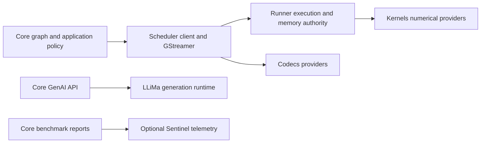

# 저장소 아키텍처 및 설계

이 페이지는 라이브러리의 구조, 책임 범위, 그리고 모듈 및 런타임 계약을 깨뜨리지 않고 프레임워크를 확장하는 방법을 이해해야 하는 기여자들을 위한 것입니다.

## 컴파일된 Scheduler 경계

Core는 `SimaScheduler::frontend`와 독립적으로 소유되는
`simaai::scheduler::client` 타입을 사용합니다. 수치 연산 작성과 검사, 동적 선택,
정지된 그래프 연결, 선택된 메모리 접근, 비디오 레이아웃 조회는 이 컴파일된 경계를
통과합니다. Core는 Runner 세션을 열거나 Kernels 또는 Codecs 구현 인터페이스를 포함하지 않습니다.



Kernels는 연산 카탈로그와 수치 연산 허용 판정의 권한을 유지합니다.
Scheduler는 Runner를 통해 범용 요청을 전달하며, Scheduler와 Core 모두 펌웨어 ID나
연산별 디스패치 테이블을 유지하지 않습니다. Core는 공개 노드 API, 형상 정책과
와이어 형식을 담당합니다. Scheduler는 코호트 검증 후 새로운 어댑터/리졸버 팩터리를
인스턴스화합니다. 캐시된 동적 선택은 연산을 유지하되 현재 프레임의 메모리를 바인딩합니다.

GenAI는 Runner나 Scheduler GenAI 어댑터를 거치지 않고 LLiMa를 직접 호출합니다. MLA 프로파일링은 기본적으로 비활성화된 별도의 패스입니다. Core는 Scheduler 클라이언트를 호출하고, Runner가 설치된 `mla-rt` 명령줄 도구를 실행합니다. 다른 MLA 작업이 없는 유휴 DevKit이 필요합니다.

---

## GStreamer 인터페이스 소유권

Scheduler는 설치된 `gst/SimaaiGstErrors.h` 헤더를 포함해 GStreamer 전송 및 구조화된
오류 인터페이스를 소유합니다. Core는 이를 사용하며 별도 구현을 유지하지 않습니다.
Core `0.6.0`에는 이 파일 소유권 이전이 포함됩니다. 일치하는 Core/Scheduler
패키지를 함께 업그레이드하십시오. 이 패키지 버전은 플랫폼이나 수치 계약을 변경하지 않습니다.

## 프레임워크 대 환경

"Neat"이라는 용어는 관련되어 있지만 분리된 두 가지 측면을 나타내는 데 사용됩니다.

- **Neat Library:** 이 저장소의 C++/Python 라이브러리 및 런타임입니다. 모델 패키를 로드하고, 파이프라인을 구성하고, 계약을 검증하고, Modalix 하드웨어에서 실행하며, 공개 API를 제공합니다.
- **Palette SDK / 환경:** 프레임워크를 중심으로 구축된 컨테이너화된 개발 워크플로로, DevKit Sync, 공유 작업 공간 및 에이전트 도구를 포함합니다.

이 저장소를 변경할 때, 사람과 에이전트 모두를 지원하는 프레임워크 속성을 최적화하십시오. 즉, 명시적인 API, 결정론적 동작, 구조화된 진단, 엄격한 검증 및 안정적인 공개 계약을 제공해야 합니다.

---

## 이 라이브러리의 용도

### 주요 사용자

다음 작업을 수행하려는 개발자:
- 재사용 가능한 빌딩 블록에서 파이프라인을 조립합니다(원시 GStreamer 보일러플레이트 코드를 작성하지 않고).
- 파이프라인을 조기에 검증하고(CI에 적합) 오류를 빠르게 이해합니다.
- `appsink`를 통해 C++에서 파이프라인을 실행하고 프레임을 소비합니다.
- 선택적으로 RTSP를 통해 파이프라인을 제공합니다(`gst-rtsp-server` 사용).
- GStreamer 파이프라인 코드를 작성하지 않고 텐서 친화적인 출력을 통해 ML 코드를 공급합니다.

## 패키지 소유권

선택한 Core 아티팩트는 함께 설치할 Core, LLiMa 및 일치하는 Scheduler 의존성 패키지의 단일 진실 공급원입니다. Core는 의존성 버전을 다시 선택하거나 수정하지 않고 해당 아티팩트의 전체 의존성을 전달합니다. 아티팩트 외부 패키지는 플랫폼이 소유합니다. 호환되지 않는 플랫폼은 Core나 LLiMa로 복구하지 말고 업데이트하세요.

Core는 하위 CMake 개발 인터페이스가 아니라 설치된 `SimaScheduler` 클라이언트 컴포넌트를
사용합니다. Scheduler 의존성 코디네이터는 선택한 Kernels/Runner/Codecs 집합을 검증하고
정확한 출처를 유지합니다. 메타데이터 전용 `SimaRuntime` 호환 별칭은 다른 구현을 소유하지
않습니다. 빌드 진입점은 여전히 Kernels → Runner → Scheduler → Core 순서로 형제 소스를
준비하거나 명시적으로 선택한 패키지를 재사용합니다. 이는 빌드 조정이지 런타임 실행이나
펌웨어 활성화가 아닙니다. [로컬 의존성 빌드](../build-test/local-dependencies.md)를 참조하십시오.

### 렌더러 및 선택적 백엔드 제공자

Core는 박스/마스크 게시 정책을 소유합니다. 기존 축 정렬 BBOX 페이로드는 int32 좌표를 사용합니다. 별도의 `BBOX_OBB_V1` 회전 박스 형식은 FP32 기하 정보를 유지하며 축 정렬 렌더러에서는 거부됩니다. Scheduler는 caps,
수명 주기와 준비 단계의 제공자 허용 판정을 담당합니다. 프로덕션 구성에는 렌더러의
타입이 지정된 int32 기능이 필요합니다. 값을 float로 재해석하거나 프레임별 변환을
추가하지 않습니다. Kernels는 표준 A65 `render` 연산을, Runner는 실행과 ReadWrite
이미지 접근의 안전한 종료를 소유합니다. Scheduler는 검증된 연산과 사용한 Kernels/Runner
식별 정보를 기록합니다. Core는 이 코호트를 검증하고 `a65apps` 아카이브 없이 일반 의존성을 구성합니다.

Runner는 플랫폼 소유 제공자를 재배포 가능한 의존성과 별도로 기록합니다. Core는 해당 영수증을 보존하고 설치된 플랫폼을 검사하며, 플랫폼 빌드 번호로 호환성을 추정하거나 플랫폼 DSO를 소비자 패키지에 포함하지 않습니다. 제공자 허용 검사와 구성은 [로컬 의존성](../build-test/local-dependencies.md)을 참조하세요.

### 런타임 전송 소유권

Core는 설치된 `SimaScheduler` 패키지를 사용합니다. `SimaScheduler::elements`는
`neatcamerabridge`, `neatmultipartjpegdemux`, `neatlatestbystreammux`와 그 GObject
타입 및 프로세스 내부 등록을 소유합니다. Core의 `src/gst/` 진입점은 호환성 전달자이며
별도 구현이 아닙니다. 이 요소들은 수치 실행기를 사용하거나 Kernels를 요구하지 않습니다.

Core는 공개 C++/Python API, Node 옵션, 그래프 lowering, Sample/Tensor 객체와 그래프
전용 크레딧을 유지합니다. `src/pipeline/gst/RealtimeMuxCredits.cpp`는 Scheduler의
값 전용 대여 인터페이스를 통해 크레딧을 투영합니다. mux 대여 레지스트리와 공유 입력
프레임 카운터에는 단일 Scheduler 소유자가 있습니다. 카메라 ABI 레이아웃은 Core 전용
복사본이 아니라 일치하는 할당자 헤더에서 가져옵니다.

mux 공정성/백프레셔, multipart 파싱과 캡처 부모 수명 구현 테스트는 Scheduler에
있습니다. Core는 공개 API, 그래프 크레딧과 종단 간 장치 테스트를 유지합니다.
Core 빌드 전에 일치하는 Runner와 Scheduler 패키지를 설치하십시오. Core 내부 테스트는
전송 타깃을 직접 링크합니다. 제공자가 없는 호스트 테스트로 하드웨어 캡처나 compact
TensorBuffer 메타데이터를 검증했다고 판단하지 마십시오.

### 수치 커널 추가

기존 텐서 및 실행 계약으로 표현할 수 있는 연산의 개발 범위는 **Kernels와 Core뿐**입니다.

1. Kernels에서 연산별 타입 요청, 검증된 계획, 수치 구현, 실행 객체 팩터리와 명명된
   요청 디코더를 추가합니다. Kernels 소유 카탈로그에 연산을 한 번 등록하고 정확성 테스트를 추가합니다.
2. Core에서 Node를 추가하고 옵션을 표준 요청으로 변환합니다. 연산, 명시적 타깃,
   입력/출력 명세와 타입 매개변수를 포함하십시오. Scheduler의 범용 준비 API를 호출하며,
   연산 팩터리를 직접 호출하거나 Runner/Scheduler에 연산 분기를 추가하지 마십시오.
3. **Kernels → Runner → Scheduler → Core** 순서로 다시 빌드하고 설치합니다.
   EV 카탈로그 변경에는 Runner 소스가 같아도 명시적으로 구성된 일치하는 펌웨어가
   필요합니다. 독점 장치 절차로 검증하십시오.

준비 경로는 **Core → Scheduler → Runner → Kernels**입니다. Kernels가 수치 검증을
수행하며 Runner는 범용 게이트웨이입니다. 준비 단계 검사는 하드웨어를 열거나 실행 자원을
프로비저닝하지 않습니다. 반환된 검증된 실행 객체를 유지하고 전체 단계 허용 전에 표준
요구사항을 검사하십시오. 스트리밍은 연산 이름을 다시 디코딩하지 않고 같은 실행 객체를 사용합니다.

동적 변형은 설정 시 바인딩된 커널 소유 선택적 기능을 사용합니다. Core는 그래프/메타데이터
정책과 기존 유한 캐시를 유지합니다. 캐시 미스는 불변 매개변수를 구체화할 수 있으며,
제공자가 정확한 텐서 계약/자원 공유 가능 여부나 전체 재검사 필요성을 입증합니다.
캐시 적중은 별도 연산을 만들거나 카메라/코덱 프레임 대여를 유지하지 않습니다.

Runner는 실행, 자원, 일관성과 안전한 종료를 소유하며 Scheduler는 Gst 캐리어, 플러그인과
전송 통합을 소유합니다. 표준 설치 패키지는 `SimaRunner`와 `SimaScheduler`입니다.
메타데이터 전용 `SimaRuntime` 호환 패키지는 이전 타깃을 동일한 구현으로 전달합니다.
헤더 별칭은 표준 Kernels 타입을 재사용하며 정적 링크 의존성은 전이적으로 남을 수 있습니다.
별도의 텐서 스키마, 할당자, 실행 큐 또는 수치 레지스트리는 없습니다.

수치 단계는 `neatkernelrunner`를 생성하며 폐기된 ProcessCVU 플러그인으로 전환하거나 폴백하지 않습니다. Core 소유 공개 출력 패킹은 기존 메트릭 경계를 유지하는 종속 호스트 연산입니다. Codecs는 별도의 인코딩/디코딩 백엔드이며 Gst 래퍼는 Runner나 수치 Kernels가 아닌 Scheduler가 소유합니다.

빌드 영수증은 정확한 설치 바이트와 사용한 의존성 식별 정보를 묶습니다.
하드웨어나 성능 검증은 아닙니다. 일치하지 않는 패키지의 헤더, 아카이브, 펌웨어, Codecs를 섞지 마십시오.

새 전송, 텐서 표현 또는 실행 기능은 프레임워크 확장이며 Runner 변경이 필요할 수 있습니다.
Kernels/Core만 변경한다는 보장은 여기에 적용되지 않습니다. 시간 초과나 취소는 DMA의
안전한 종료를 입증하지 않습니다. 확정적인 완료 또는 검증된 플랫폼 복구까지 기존 할당
소유자를 유지해야 합니다.

Core는 펌웨어 그래프 ID가 아니라 의미 이름으로 연산을 선택합니다. Kernels는 연산 이름과
컴파일된 타깃의 불변 카탈로그를 공개하며, Runner와 Scheduler는 별도 레지스트리를 유지하지
않고 전달합니다. Core는 필수 `DetessCast`, `DetessDequant` 융합을 포함한 타입 기반 그래프
재작성 규칙을 소유합니다. 필수 융합 구현이 없으면 연산을 개별 커널로 나누지 않고 준비가
실패합니다. Core 단계가 항상 한 연산에 해당하지는 않습니다. TrackKLT는 기존 복합 요청을 준비합니다.

TrackKLT의 공개 텐서 목록은 이전 이미지, 현재 이미지, 정수 시드 점의 위치 순서를 따릅니다. 선택적 이름은 해당 역할을 확인할 뿐, 저장소 순서를 바꾸지 않습니다. Core는 시드 추론 전과 큐 수용 전에 텐서 데이터를 매핑하거나 복사하지 않고 작성된 입력 계약을 확인합니다. 이름 없는 텐서도 위치 순서를 따릅니다. 이 정책은 명시적으로 작성된 직접 공개 입력에만 적용되며, 내부 단계 연결이나 모델 입력 변환에는 적용되지 않습니다.

추적기 요청이 수치 품질 제어와 선택적 잔차 공개를 소유합니다. Core는 점, 상태, 요청된 특징 뒤에 잔차를 덧붙이며, 상태를 무조건적인 추적 신뢰도로 재해석하지 않습니다. 검출을 끄면 해당 연산과 출력 할당이 제거됩니다. Kernels는 버전이 지정된 네이티브 패킷과 수치 검증을 소유하며, Runner와 Scheduler는 계속 일반적인 검증된 요청을 전송하고 바인딩합니다.

### 직접 드라이버 복구

`deps/manifest.json`은 Scheduler와 LLiMa를 선택합니다. 설치된 Scheduler 코디네이터가 일치하는 Kernels, Runner, Codecs 의존성 전체를 검증합니다. Core는 하위 플랫폼 검사를 중복 구현하지 않고 검증된 코호트를 사용합니다.

복구는 선택된 플랫폼의 책임이며 디스패처 오류 일치 판정에 속하지 않습니다.
Core는 추론 실패 후 AppComplex를 시작하거나 디스패처 서비스를 재시작하거나 원격
프로세서를 재설정하지 않습니다. Runtime은 드라이버 계약으로 완료와 안전한 종료를
보고합니다. 완료 불명확 상태는 DMA 저장소 재사용을 허용하지 않습니다.
플랫폼 부팅 시 MLA 초기화는 여전히 플랫폼 의존성입니다.

### 메모리 소유권

Core는 Scheduler의 할당 및 매핑 인터페이스를 사용하며, 메타데이터에서 붙인 물리 주소나 `libsimaaimem`, 별도 할당 레지스트리를 사용하지 않습니다. CPU 접근, 매핑 수명, 가져온 메모리 및 부모 배치 제약은 [메모리 모델](../../advanced-concepts/data-model-contracts/memory_model.md)을 참조하십시오.

Core는 그래프 토폴로지로 캐시 일관성 모드를 선택하지 않습니다. `RunAdvancedOptions::prepare_output_cpu_visible`은 옵션 레이아웃 호환성을 위해 남아 있으며 실제 매핑 전에 중복된 선행 동기화를 실행하지 않습니다. 소스 호환 `defer_output_invalidate` 옵션은 true여야 하며, false는 생산자 측 느린 경로를 복원하는 대신 거부됩니다.

비동기 MLA 제출과 순서 있는 출력 방출은 별개의 기존 경로를 사용합니다. 완료 콜백은
종료 상태를 기록하고 방출기는 CPU 캐시 유지보수 없이 결과를 게시합니다. 방출 중에도
제출 경로는 유한 레인 용량과 독립 할당 소유권 조건 아래 후속 프레임을 허용할 수 있습니다.
완료만으로 허용 크레딧을 반환하지 않습니다. 완료 슬롯도 방출이 해제할 때까지 소유됩니다.
출력 풀 대여는 그 해제 이후에도 남아 저장소 재사용을 막을 수 있습니다.

이 중첩은 캐시 유지보수를 제거하거나 한 프레임 내 의존성 체인을 줄이지 않습니다.
별도 동기화 워커 없이 독립 CPU/장치 작업이 직렬 파이프라인 정체로 드러나는 것을 피합니다.
그래프 구성 시 예산을 한 번 정하며 프레임별 연산 전용 스케줄링 정책은 필요하지 않습니다.

### FrameLayout 메모리 계획

Core는 빌드마다 하나의 계획 경로를 사용합니다.

1. 모델 경로를 선택하고 호출 식별을 유지합니다.
2. 검증된 레시피를 컴파일하고 각 실행 대상을 한 번만 결정합니다.
3. 루트 캐리어, 뷰, 소비자 및 소유권 그룹을 해석합니다.
4. 힙을 선택하고 공통 물리 DAG 수명 증명에 따라 패킹합니다.
5. 단계별 `FrameLayout`과 게시 정보를 확정하고 배치를 수정하지 않고 한 번 렌더링합니다.

EV74 접근에는 CMA가 필요하며 소유한 MLA/A65 전용 캐리어는 DMS를 사용합니다. 조건을 충족하는 새 A65 공개 종단은 HostCpu를 사용할 수 있습니다. 가져온 저장 공간, 오프셋, 형상 및 생산자 대여는 고정됩니다. 팬아웃은 모든 소비자를 포함하고 뷰는 루트 캐리어를 공유합니다.

`AllocationPolicy::PreferDmsThenCma`는 해당 소유 DMS 할당의 용량이 부족할 때 CMA 폴백을 명시적으로 허용합니다. 일반 Linux 메모리를 선택하지 않습니다. 풀 경계, Queue 경계, 독립 호출 및 유지된 출력이 수명 재사용을 제한합니다.

Scheduler는 Runner를 통해 각 레이아웃의 할당 그룹을 준비합니다. 인덱스와 오프셋은 버퍼 그룹에 속하며 서로 다른 그룹의 같은 오프셋은 겹치지 않습니다. 일치하는 Core와 Scheduler 패키지를 함께 다시 빌드합니다.

### 기본 장치-CPU 일관성

준비된 메모리 엔진은 하나입니다. `SIMA_CORE_DEMAND_COHERENCY_V1`과 Runner의 실험적
빌드 옵션은 제거됐으므로 새 빌드에서는 사용하지 마십시오. 환경 활성화나 전체 그래프
Legacy 하향 전환은 더 이상 없습니다. Core는 Scheduler의 할당, 매핑과 단계 인터페이스만
사용합니다. 공개 텐서 형상, Kernels 요청과 수치 동작은 바뀌지 않습니다.

공유 접근 획득 및 수명 계약은 [메모리 모델](../../advanced-concepts/data-model-contracts/memory_model.md)에 정의되어 있습니다.

#### DMA 기반 논리 텐서 매핑

공개 `Tensor::map()`과 별칭 `view()`는 기존 저장소 매핑 계약을 유지합니다.
`byte_offset`을 한 번 적용하며 뒤쪽 backing 바이트를 노출할 수 있습니다. 명명된 세그먼트
경계와 애플리케이션 매핑 콜백이 최종 기준입니다. `TensorBuffer::map()`은 계속 저장소를 직접 매핑합니다.

형상으로 제한된 내부 소비자는 대신 `map_dense_tensor_read()`를 사용합니다. 현재 형상에
대해 양수 스트라이드와 오버플로를 검사한 뒤 스트라이드 간격을 포함한 물리 텐서 범위만
노출합니다. Core 소유 DMA 저장소는 그 정확한 범위를 허용할 수 있습니다. 래핑된/사용자
콜백은 기존 매핑과 정리 동작을 유지하며 헬퍼는 반환 범위를 검증한 뒤 논리 뷰를 좁힙니다.
가변 텐서 뷰 사이에서 형상을 캐시하지 않습니다. 복합 이미지와 인코딩되었거나 미해결인
형상은 기존 매핑 경로를 유지합니다. 밀집 논리 범위가 다른 평면 접근까지 허용하지 않습니다.

Scheduler는 정확한 뷰에 대해 Runner가 이미 검증한 현재 세대 가시성을 재사용할 수
있습니다. 장치 쓰기 뒤 첫 읽기, 범위 밖 접근 또는 검증되지 않은 가져오기는 내보내기
제공자 동기화를 유지합니다. 활성 작성자, 대기 장치 작업과 격리는 계속 오류입니다.
매핑은 CPU 접근 종료까지 원래 Gst 샘플과 현재 공개 저장소/생산자 대여를 모두 유지합니다.
소유권 모드, 페이로드 복사, WRITE-END 정리나 공개 객체 레이아웃 변경은 없습니다.

커널 단계 `resource_busy` 오류가 반드시 제출 용량 소진을 뜻하지는 않습니다. 정제되고
제한된 `Reason`은 원래 접근, 등록, 소유권 또는 용량 진단을 유지합니다. 동시성을 바꾸기
전에 원인을 확인하십시오. 소유권이나 장치 완료가 미해결인 동안 버퍼를 재사용하지 마십시오.

### 코덱 소유권

Scheduler는 `neatdecoder`, `neatencoder`와 GStreamer 어댑터를 소유합니다. Codecs는 디코더/인코더 세션과 수치 구현을 소유합니다. 일치하는 설치된 헤더와 라이브러리를 사용하고, 백엔드 코드를 Runner에 복사하거나 다른 백엔드 ABI의 래퍼와 결합하지 마세요.

### 하드웨어 인코더 구성

`SimaEncode`와 원시 `VideoSender`는 협상된 입력 caps에서 해상도를 구합니다. 해상도는 한 실행 안에서 고정되며 바꾸려면 새 실행이 필요합니다. 인코더 옵션에는 너비나 높이가 없으며 입력 어댑터는 크기 조정 없이 표시 크기를 유지합니다. 빌드 시 출력 계약에서 알 수 없는 입력 크기는 상위 입력이 제공하기 전까지 미상으로 유지됩니다.

`SimaEncode`는 원시 입력을 한 번 준비하고 코덱별 옵션을 `neatencoder`로 매핑합니다.
Scheduler는 GStreamer 어댑테이션과 출력 게시를, Codecs는 인코더 세션을 소유합니다.
Runner는 메모리 소유권과 동기화 권한을 유지합니다. Core는 인코더 실행 스레드를 추가하지
않습니다. 레거시 `H264EncodeSima`는 인코더 속성 생성을 공유하면서 어댑터 없는 입력
계약을 유지합니다. 공개 클래스 레이아웃 변경은 ABI 6에 포함되며 바이너리 소비자를 다시
빌드해야 합니다. 기존 소스 진입점은 계속 제공됩니다.

### 일반적인 워크플로

- **디코딩/수집:** 파일 또는 RTSP -> 디페이/디멀티플렉스/파싱 -> 디코딩 -> 변환/캡스 -> appsink -> C++ 소비자
- **검증:** 빌드 + 파싱 + 프리롤(PAUSED)을 통해 초기 협상 문제를 감지
- **RTSP 제공:** `appsrc`를 사용하여 합성 프레임을 RTSP 서버 파이프라인으로 푸시
- **이미지/비디오 텐서 어댑터:** 이미지/비디오/RTSP -> 디코딩 -> 변환/스케일 -> `add_output_tensor(...)` -> `Run::pull_tensors()`
- **튜토리얼:** [튜토리얼](/tutorials)에서 실행 가능한 순서대로 학습 경로를 시작합니다.

### 표준 프로덕션 파이프라인(단일 진실 공급원)

이 저장소의 표준 "프로덕션 경로"는 다음과 같습니다.
**입력 -> 전처리 -> MLA -> 후처리**. 단일 진실 공급원은 `tests/e2e_pipelines/obj_detection/sync_yolov8_test.cpp`입니다.

이 테스트가 변경되면 README + 아키텍처를 업데이트하여 문서가 일관되게 유지되도록 합니다.

### 정신적 모델(비즈니스 로직 <-> 파이프라인 연결)

애플리케이션은 비즈니스 로직을 유지하고, 프레임워크는 파이프라인 연결을 담당합니다.

```text
Business logic
    |
    v
Nodes/Graph fragments  ->  GStreamer fragments  ->  caps negotiation  ->  runtime (Run)
    |                                                           |
    +-----------------------------------------------------------+
                                Sample / Tensor
```

---

## 핵심 개념

이 프레임워크는 몇 가지 핵심 개념을 중심으로 구성되어 있습니다. 대부분의 사용자 코드는 `Model`, `Graph`, `Run`, `Tensor` 및 `Sample`와만 상호 작용합니다. 더 낮은 수준의 개발자는 `Node`, 재사용 가능한 그래프 조각, MPK 계약 파싱 및 그래프 내부 요소와 함께 작업합니다.

| 개념 | 역할 |
|---|---|
| 모델 아카이브 | MPK 추론 계약, 플러그인 전용 구성, 모델 바이너리 및 커널 아티팩트를 포함하는 밀봉된 `.tar.gz` 아티팩트입니다. |
| `Model` | `.tar.gz` 모델 아카이브의 공개 로더입니다. MPK 계약을 파싱하고, 경로 계획을 실행하며, 모델 단계를 노출하고, 간단한 `run(...)` / `Graph` 구성 진입점을 제공합니다. |
| `Tensor` | dtype, shape, 레이아웃, 스토리지, 장치 및 의미 메타데이터를 포함하는 형식화된 숫자 페이로드입니다. |
| `Sample` | 텐서, 텐서 목록 또는 번들을 둘러싼 런타임/미디어 컨테이너입니다. 필드를 읽기 전에 `Sample::kind`를 확인하십시오. 파이프라인 경계는 번들을 하나의 프레임으로 유지합니다. |
| `Node` | 결정적인 GStreamer 조각과 소유된 요소 이름을 출력하는 원자적 파이프라인 단계입니다. |
| 재사용 가능한 그래프 조각 | 디코딩된 RTSP 입력 또는 모델 단계와 같이 여러 노드로 확장되는 미리 만들어진 `Graph`입니다. |
| `Graph` | 어셈블리 및 검증 경계입니다. 노드, 모델 및 재사용 가능한 그래프 조각은 협상되고 빌드 가능한 파이프라인이 됩니다. |
| `Run` | `Graph::build(...)`에서 반환된 활성 파이프라인 핸들입니다. 푸시/풀/런타임 라이프사이클을 소유합니다. |
| 그래프 | 단일 파이프라인 내에서 DAG 구성을 위해 빌더 그래프를 사용하고, 파이프라인 간의 단계/실행을 조정하기 위해 런타임 그래프를 사용합니다. |

왼쪽에서 오른쪽으로 관계를 읽으십시오.

```text
model archive on disk -> Model -> Graph fragments/Nodes -> Graph -> Run
                                           |
                                           v
                                  Tensor/Sample flow
```

`Model`은 초보 사용자를 위한 진입점 역할을 하지만, 별도의 실행 엔진은 아닙니다. 이는 `Graph`에 추가할 수 있는 모델 그래프 조각/노드로 해결됩니다. `Graph`는 핵심 조립 개념이며, `Run`은 빌드 후의 활성 객체입니다.

---

## 기여자 대상 설계 원칙

다음은 프레임워크의 기반이 되는 핵심 아키텍처 원칙입니다. 구현 옵션을 결정할 때 이를 활용하십시오.

- **결정성이 최우선입니다.** 요소 이름, 생성된 파이프라인 문자열, 직렬화된 파이프라인 데이터, 보고서 필드 및 테스트를 재현 가능하게 유지합니다. 진단 및 에이전트 루프는 안정적인 식별자에 의존합니다.
- **디버깅 가능성이 가장 중요합니다.** 오류 발생 시 문자열만 반환하는 것이 아니라 구조화된 데이터를 반환해야 합니다. `GraphReport.error_code`, `repro_note`, 버스 메시지 및 재현 가능한 백엔드 파이프라인을 제공해야 합니다.
- **자동 대체는 허용되지 않습니다.** 모델 입력 오류 또는 하드웨어/런타임 오류를 조용히 형식 변환, 그래프 패밀리 변경, CPU로 대체하거나 플러그인 오류를 무시하여 숨기지 마십시오.
- **실행 전에 검증합니다.** 런타임 스레드가 시작되거나 하드웨어 리소스가 할당되기 전에 구조, 캡, 모양 및 계약 검증을 우선적으로 수행합니다.
- **MPK 계약은 모델의 단일 진실 공급원입니다.** Core의 라우팅, dtype, 형상, 양자화 및 단계 결정은 `mpk.json` / `*_mpk.json`에서 가져와야 합니다. 단계별 JSON 파일은 플러그인 전용입니다.
- **Detess 논리 랭크와 런타임 기하 정보는 별개입니다.** MPK가 작성한 `frame_shape`를 보존하고, 바이트 범위가 하나의 명확한 기하 정보를 식별할 때만 랭크 2 NC/HW 해석을 허용합니다. 융합 DetessDequant는 두 디스크립터를 하나의 프레임별 계약으로 전달합니다. 타일 랭크가 커널 랭크를 결정하고 선행 배치 차원은 분리되며, 의미 축, 바이트 범위, 스트라이드 및 명시적 타일 저장 인코딩이 권위를 유지합니다. Core는 이 표준 타입 계약을 Scheduler로 전달하고 Kernels가 선택된 연산과 인코딩을 검증합니다. DSO 경계를 넘는 ProcessCVU 준비 요청을 재구성하지 마세요.
- **수치 백엔드 정책에는 하나의 권위만 있습니다.** 검증된 기능이 지원 타깃과 AUTO 우선순위를 소유합니다. 명시적인 단계 또는 세션 타깃은 요청된 지원 백엔드에서 실행되거나 실패해야 하며, 이후 역할 기반 재정의가 그 결정을 뒤집어서는 안 됩니다.
- **공개 API는 안정적으로 유지되어야 합니다.** `include/*` 아래의 공개 헤더는 설치 및 지원됩니다. 서명을 변경하는 대신 점진적인 변경 및 사용 중단 경로를 선호합니다.
- **동시성은 제한되고 관찰 가능해야 합니다.** 스트리밍 스레드 작업은 가벼워야 합니다. 프로브 측면 진단에는 원자 또는 이에 상응하는 스레드 안전 처리 기능이 필요합니다. 종료 시에는 프로세스가 중단되지 않아야 합니다.

---

## 모델 실행 경로

모델 기반 파이프라인의 경우, 상위 수준 경로는 다음과 같습니다.

```text
input Sample/Tensor
  -> optional preprocessing / format normalization
  -> MLA inference stages selected from MPK contract
  -> optional postprocessing / box decode
  -> output Sample/Tensor
```

사용자에게 보이는 `Model` 인터페이스는 MLA 하드웨어 인터페이스보다 더 사용자 친화적으로 설계되었습니다. MLA는 INT8/BF16 및 테셀레이션 레이아웃을 요구할 수 있지만, 사용자 코드는 일반적으로 FP32 및 일반 텐서 레이아웃으로 작동합니다. 프레임워크는 매니페스트 기반 어댑터 단계를 통해 이러한 격차를 해소합니다.

전처리와 후처리는 명시적인 프레임워크 단계/옵션입니다. 형식 불일치, 필수 전처리 메타데이터 누락, 선택한 하드웨어 전송의 사용 불가, 잘못된 모델 아카이브나 MPK 계약, caps 협상 실패는 숨겨진 런타임 수정 대신 조치할 수 있는 구조화된 오류로 표시해야 합니다.

### 공개 실행 계획

`Model::execution_plan(...)`은 같은 인수로 `build(...)`를 호출했을 때 실행될 내용을 반환합니다. 모델의 그래프 노드를 파이프라인 순서대로 나열하고, 각 노드가 실행되는 위치(`A65`, `EV74`, `MLA`)와 노드 사이 엣지를 흐르는 텐서를 보여 줍니다. 시작 프리플라이트를 끈 상태로 `build(...)`를 호출하고, 빌드가 배치 및 공개 메타데이터 계획 후 `DiagCtx`에 기록한 계획을 읽은 뒤 파이프라인을 닫습니다. 따라서 `build(...)`와 같은 디바이스가 필요합니다. 이는 공개 진단 뷰이며, 아래에서 설명하는 내부 `ModelExecutionPlan`과는 별개입니다. JSON 계약은 `schemas/execution_plan_v1.schema.json`이며, `schema_version`은 기존 읽기 측을 깨뜨리는 변경에서만 바뀝니다. 메모리 요약은 소유한 할당을 한 번씩 계산하여 `CMA`, `DMS`, `HostCpu` 또는 `Mixed`로 표시하며, 명시적인 DMS 대체 정책은 선호하는 힙으로 표시합니다.

### 보드 텔레메트리

`TelemetryMonitor`는 보드 텔레메트리 데몬인 Sentinel에서 `/run/simaai-sentinel/api.sock`의 HTTP API를 통해 전력과 보드 텔레메트리를 읽습니다. Core는 전력 모니터 칩을 직접 읽지 않습니다. `start()`는 지표 정의, 샘플링 간격, 최신 샘플을 얻기 위해 Sentinel의 샘플 캐시를 한 번 읽습니다. 이 최신 샘플은 측정 구간보다 앞서므로 집계하지 않습니다. 이후 워커 스레드는 각 샘플이 나올 시점 직전에 최신 샘플을 요청하고, 새 샘플을 타임스탬프로 식별하여 한 번씩만 누적 요약에 집계합니다. 타임스탬프가 마지막으로 집계한 샘플보다 정확히 한 간격 뒤가 아니면, 워커는 Sentinel의 최신 샘플 240개를 보관하는 캐시에서 누락된 샘플을 집계합니다. 모니터는 Sentinel에 아무것도 생성하지 않으므로 모니터를 몇 개든 동시에 실행할 수 있고, 프로세스가 강제 종료되어도 아무것도 남지 않습니다.

기본 모니터는 위 소켓을 사용합니다. 명시적 `TelemetryMonitor(socket_path)`는 해당 인스턴스에만 다른 Sentinel Unix 소켓을 선택하며, `Model::benchmark()`는 기본 엔드포인트를 유지합니다.

`Model::benchmark()`는 별도 추적 엔진이 아닌 같은 모니터를 사용합니다.
처리량 타이머 전에 연결과 대기 워커를 준비하고, 측정 시작 후 구간을 활성화하며,
모든 필수 출력 완료 후 측정을 멈추기 전에 구간을 봉인합니다. 활성화와 봉인은 할당,
뮤텍스 획득, 워커 합류 또는 Sentinel 통신을 수행하지 않습니다. 이후에만 워커를 합류시키고
캐시를 최종 읽습니다. 진행 중인 폴링은 중지 검사에 앞선 UTC 읽기로 제한되므로 봉인 후
샘플을 받아들이지 않습니다. 벤치마크 귀속은 UTC 샘플 타임스탬프와 쌍을 이룬 UTC/steady
경계를 검증합니다. 시계 불연속이 감지되면 측정 처리량을 바꾸지 않고 텔레메트리를
무효화합니다. 독립 모니터는 시계 롤백 후 캐시 순서 복구를 유지합니다.

Sentinel은 약 2초마다 샘플링하므로 처리량 패스는 최소 `BenchmarkOptions::min_duration_ms`(기본값 10초) 동안 실행됩니다. 지연 시간 패스도 같은 최솟값을 따르므로 두 패스는 같은 규칙으로 멈춥니다. Sentinel이 실행 중이 아니거나 측정 구간에 샘플이 없어도 벤치마크는 지연 시간과 FPS를 반환합니다. 이때 전력 필드는 0이며 `telemetry.status`가 이유를 알려 줍니다. `tools/install_neat_framework.sh`의 보드 모드는 Sentinel을 설치하거나 최신 프로덕션 빌드로 업그레이드합니다. 설치에 실패하면 설치 프로그램은 경고를 출력하고 계속 진행합니다. 나중에 `sima-cli neat install sentinel`을 실행하거나, CI처럼 `NEAT_INSTALLER_SENTINEL_REQUIRED=ON`을 설정해 실패를 오류로 처리하십시오. 더 이상 사용되지 않는 `Run` 전력 모니터(`RunOptions::power_monitor`)도 Sentinel에서 가져옵니다. Core는 Sentinel의 최신 샘플을 폴링하며 I2C로 전력 모니터 칩을 읽지 않습니다.

MLA 프로파일링은 기본값이 false인 두 `BenchmarkOptions` 필드 `include_mla_layer_stats`와 `include_mla_stage_stats`로 명시적으로 활성화합니다. 지연 시간 및 처리량 러너가 종료된 후 Core는 Scheduler 클라이언트를 통해 추출된 모델의 MLA 실행 파일을 측정하며, 프로파일링 패스를 하나씩 차례로 수행합니다. MLA 레이어 통계는 종료 정책이 적용된 추론 경로의 MLA 스테이지만 측정합니다. Runner는 실행 파일마다 별도 프로세스에서 `mla-rt`를 실행합니다. MLA 레이어 통계는 컴파일러 통계 YAML도 사용합니다. MLA 스테이지 통계는 각 MLA 실행 파일을 중단 없이 200회 실행하고 `mla-rt` 통계 파일에서 `tile.lat` 평균을 읽습니다. Runner는 입력과 출력을 검증하고 임시 파일을 정리합니다. 한 번의 실행이 120초를 넘으면 `mla-rt`를 중지합니다. MLA-RT는 하드웨어 프로파일링과 커널 실행으로의 제어권 반환을 담당합니다. 프로파일링은 다른 MLA 작업과 겹치지 않아야 합니다. 벤치마크 게이트는 벤치마크 호출만 직렬화하며, 다른 추론 API나 애플리케이션은 직렬화하지 않습니다.

실패했거나 비정상 종료되었거나 중지된 `mla-rt` 실행은 MLA 작업을 끝내지 못한 채 남길 수 있으므로, Runner는 해당 프로세스에서 더 이상 `mla-rt`를 시작하지 않습니다. 이후 프로파일링 패스는 MLA 복구가 필요하다고 보고합니다. MLA 복구가 확인될 때까지 DevKit을 유휴 상태로 두십시오.

프로파일링은 최선형(best effort)으로 수행됩니다. `mla-rt`가 없거나 실패하거나 시간 초과되거나 사용할 수 없는 출력을 쓰면 Core는 주요 측정값을 유지하고, 해당 목록을 비워 두며, 경고를 출력하고, `mla_layer_stats.status` 또는 `mla_stage_stats.status`에 그 이유를 설정합니다. 그 밖의 경우 상태는 `"not requested"` 또는 `"ok"`입니다.

`BenchmarkReport::mla_layer_stats`에는 컴파일된 각 MLA 레이어의 0부터 시작하는 실행 단계 인덱스, 이름, 레이어마다 한 번의 프로파일링 패스로 측정한 마이크로초 단위 하드웨어 지연 시간이 포함됩니다. `BenchmarkReport::mla_stage_stats`에는 같은 방식으로 번호를 매긴 각 MLA 스테이지의 인덱스와 마이크로초 단위 평균 하드웨어 지연 시간이 포함됩니다. 이 측정은 별도의 프로파일링 패스를 사용하므로 레이어 지연 시간의 합계는 스테이지 지연 시간이나 전체 지연 시간과 일치하지 않습니다. `BenchmarkReport::save(file_path)`는 공개 필드 이름과 단위를 사용하여 전체 보고서를 명시적으로 저장합니다. `.json`은 JSON을, `.yaml` 및 기타 끝부분은 YAML을 선택합니다. 텔레메트리와 두 상태를 포함하며 프로파일링이 비활성화된 경우 MLA 목록은 비어 있습니다. 없는 상위 디렉터리를 생성하고 기존 대상 파일을 원자적으로 교체합니다.

폐기된 PreparedRunner 옵션은 기본값으로 유지하세요. 동시성에는 `processcvu.async`와 `GraphOptions::async_queue_depth`를 사용합니다. 기존 역양자화와 프로파일링 플래그에는 직접 대체 기능이 없습니다. `advanced_execution.defer_output_cache_sync=true`를 유지하고 출력 CPU 접근에는 Tensor/GstMemory 매핑을 사용하세요. `RunOptions::advanced.prepare_output_cpu_visible`은 호환성용 무동작 필드이며 선제적 캐시 동기화를 요청하지 않습니다.

### 컴파일된 모델 실행 계약

DMA-BUF 드라이버 마이그레이션은 모델 의미와 프레임별 저장을 분리합니다. Core는 모델 로드 정보를 하나의 불변 내부 `ModelExecutionPlan`으로 컴파일합니다.

- 값은 정확한 이름, 필요한 바이트 수, 선택적 논리 타입 정보, 선택적 루트 상대 읽기 표현식 `{source ValueId, byte offset,
  byte strides}`를 포함합니다.
- 연산은 정확히 순서가 지정된 연결과 연산별 구성을 포함합니다.
- MLA 백엔드 포트는 ELF/모델 순서, 필요한 정확한 바이트 수, 정렬 기준, 접근 방향을 포함합니다.
- 공개 출력은 게시 순서와 노출하는 값만 포함합니다.

MPK 매니페스트는 `MpkDecoder`를 사용합니다. `MpkDecoder::load`는 유일한 매니페스트 진입점입니다. 모델 로드, 준비된 런타임 빌드, PCIe 호스트는 이를 통해 `mpk.json`을 한 번만 읽으며, 허용 판정에서 디코딩하는 것과 같은 바이트로 의미 기반 `MpkContract`를 만듭니다. 선택적 `model_sdk_version` 문자열은 출처 기록으로 유지되며 허용 여부를 제한하지 않습니다. 디코더는 정확히 등록된 `(processor, kernel)` 어휘만 받아들이고, 전체 텐서 이름을 해석하고, 연산 바이트 식을 검증하며, 각 MPK MLA 단계를 정확한 ELF IFM/OFM 토폴로지와 개별적으로 대조합니다. 컴파일러가 작성한 논리 단계 ID와 매니페스트 실행 파일 토큰을 모두 사용해 실행 증거를 연결합니다. 아카이브 순서와 파일명 접미사는 의미를 판단하는 근거가 아닙니다. 불변 계획은 검증된 `{stage index, op ID, logical stage ID, executable}` 키와 모든 MLA 연산의 미리 인덱싱된 순서 있는 포트 범위를 제공합니다. 모호함, 누락된 슬롯, 충돌하는 증거는 모델 로드 오류입니다. 사이드카 JSON, 부분 문자열 일치, 환경 상태, 런타임 버퍼는 근거로 사용하지 않습니다.

매핑이 명확하면 Core는 배치 입력과 출력을 포함해 서로 다른 입력/출력 버퍼 순서를 조정할 수 있습니다. 앱에는 모델의 공개 텐서 이름, 순서, 샘플 순서가 유지됩니다.

일반 공간 저장을 사용하는 단일 입력, 배치 크기 1 모델은 자동 입력 채널 패딩을 사용할 수 있습니다. 앱은 모델의 논리 텐서 형상을 유지합니다. 사용자 지정 공간 저장 패딩은 지원 범위에 포함되지 않습니다.

`.so`로 끝나는 AFE 아티팩트는 MPK 스테이지로 분류합니다. `processor="MLA"`에서 Core는 호스트 프로세스에 로드하지 않고 ELF 토폴로지를 검증한 뒤 MLArt에 전달합니다. 컴파일러의 `input_names`, `input_types`, `output_types`가 있는 A65 호스트 모듈은 타입형 TVM 프로그램이 됩니다. 기존 EVO 정렬은 명시적인 4096바이트 `LegacyPolicy`로 유지되며, 새 타입형 계약은 자체 정렬을 선언합니다.

런타임 프레임은 정적 계획을 복사하지 않습니다. 직접 경로는 표준 DMA-BUF 소유권, 검증된 절대 `{fd, offset, length}` 뷰, 제한된 프레임 슬롯 수명을 전달합니다. Unpack과 Slice는 런타임 연산이 아니라 소비자 읽기 표현식입니다. 디코더는 정확한 오프셋, 바이트 스트라이드, 물리 범위를 검증한 뒤에만 하나의 실체화된 루트 저장체로 합성합니다. Pack, 테셀레이션, 정밀도 변환은 하위 변환 단계가 정확한 백엔드 생성이나 동등한 융합을 증명하지 않는 한 생산자/연산 의미로 유지됩니다. 따라서 저장 배치가 MLA 포트 수나 모델 동작을 조용히 바꾸지 않습니다.

`FrameLayout`은 각 단계의 저장 공간 계약으로 할당 목록, 할당 내부 범위, 입력 경로 및 출력 소유권을 담습니다. `ReuseInput`은 식별된 입력 할당 그룹을 유지합니다. Core는 소유 캐리어를 한 번 패킹하고 Scheduler는 Runner를 통해 풀을 준비합니다. MLA의 패딩된 물리 용량과 논리 게시 바이트 수는 별개입니다. 가져온 저장 공간과 생산자 대여는 고정됩니다.

Core의 불변 MPK 패키지가 추론 계약의 권한입니다. 논리 공개 형상은 원시 MLA 샘플 범위,
전체 배치 CVU 실행 뷰와 backing 용량과 구분됩니다. rank-2 Detess 뷰는 실제 입력/출력
바이트 형상으로 명확한 실행 형상이 식별될 때만 정규화됩니다. 융합은 의미 연산 탐색으로
선택하며 Core 소유 그래프 ID 테이블을 사용하지 않습니다.

#### 표준 식별 정보와 선택된 게시

Core는 컴파일된 계약을 구성할 때 수치 단계 식별 정보를 확정합니다. 지원 모델 표기를
정규화하고 연산, 계열과 계열 enum의 불일치를 거부합니다. 레거시 그래프/디스크립터 ID는
실행 권한이 아닙니다. 식별 정규화가 불완전한 의미 계약을 완전한 것으로 만들지는 않습니다.
Kernels는 여전히 연산 탐색과 수치 허용 판정을 소유합니다.

모델 관리 Preproc 전달에서는 이미지 형상과 저장 범위가 별개입니다. 타일 패딩으로 필요한
저장소가 밀집 스칼라 수보다 커질 수 있습니다. Core는 흡수된 변환 체인을 타입 모델 계획과
대조하고 캐리어 배치와 선택된 출력 경로를 확정한 뒤 공개 출력 뷰를 구성합니다.
런타임 디스크립터, 경로와 공개 뷰는 같은 최종 저장소를 참조해야 합니다. 더 큰 부모 할당이
작은 논리 뷰를 허용하지 않으며 같은 바이트 수가 같은 형상을 증명하지도 않습니다.

독립 패킹 Preproc은 정보를 게시하거나 아레나를 할당하기 전에 표준 검증 실행 객체에 저장
요구량을 조회합니다. 논리 차원을 곱해 패킹 용량을 구하지 않습니다. 다중 ROI 용량은 공개
형상에서 배치 축을 유지하며 단일 이미지 독립 뷰는 기존 HWC 형상을 유지합니다.

타입 모델 디스크립터는 배치 차원을 포함한 전체 텐서를 다룹니다. 명시적으로 배치된 4차원 HWC 텐서의 첫 번째 축은 N입니다. 실행 반복 횟수는 1이며
의미 배치 크기가 전체 텐서 반복 실행을 요청하는 것은 아닙니다. 교차 배치된 패킹 헤드는 샘플별로 바인딩되며 헤드마다 완전한 텐서 하나를 게시하며 순서를 유지하는 단일 축 뷰를 보존합니다. 배치 크기만으로 DetessCast 또는 DetessDequant 융합을 비활성화하지 않습니다. 융합 DetessCast와
DetessDequant는 게시 rank가 실행 형상과 다를 때 명시적으로 입증된 비공개 단일 축 뷰를 유지합니다.

단일 축 전달 규칙은 KLT 상태 게시처럼 의도적으로 필터링된 출력 뷰를 대체하지 않습니다.
변경은 프레임 실행이 아닌 준비 중에 수행됩니다. 융합 연산, 명시적 오프셋과 양자화
메타데이터를 보존하십시오. 스테이징 복사나 수치 폴백으로 계약 불일치를 고치지 마십시오.

#### 타입 변환 준비

Core는 그래프 준비 중 외부 dtype 이름과 MPK 텐서 디스크립터를 한 번 해석합니다.
전달 데이터에는 입력별 정밀도를 포함한 표준 `TensorSpec`, `DType` 계약과 검증된 실행
객체가 들어갑니다. Runner와 Scheduler는 연산별 dtype 문자열을 재파싱하지 않습니다.
Core 게시/캐리어 메타데이터는 명시적으로 유지되며 수치 타입 권한과 분리됩니다.

실행 형상과 게시 형상이 같을 필요는 없습니다. Core는 의미 출력 계약에 따라 단일 축 뷰를,
컴파일된 모델 전송 계약에 따라 패킹 물리 저장 뷰를 명시적으로 허용합니다. Scheduler는
준비 시 dtype, 레이아웃, 스트라이드, 저장 경계를 포함해 각 출력 바인딩이 그 관계를
충족하는지 검사합니다. 바이트 수만 같다고 reshape를 허용하지 않습니다. 뷰는 기존 할당을
유지하며 텐서 복사나 수치 변환을 추가하지 않습니다. 동적으로 준비된 변형을 포함해
출력 계약 변경 시 새 검증이 필요합니다.

동등한 dtype 표기는 대소문자와 관계없이 허용됩니다. 알 수 없는 이름과 모순된 디스크립터는
실행 전에 실패합니다. 공통 레거시 BF16/INT16 인코딩에는 명시적 의미 타입이 필요합니다.
요청 오류는 자세한 GStreamer 진단을 켜지 않아도 원인을 보여 줍니다.

#### 검증된 수치 단계

`FrameSpan` 오프셋은 그래프 전체 주소가 아니라 해당 할당과 버퍼 그룹 내부 값입니다. 서로 다른 그룹의 같은 오프셋은 겹치지 않습니다. BoxDecode와 ArgMax는 헤드 상대 텐서 오프셋과 저장 공간 오프셋을 분리합니다. 직접 메모리 입력과 런타임 물리 바인딩 입력은 각 주소 지정 방식을 유지합니다.

Core는 Preproc, 변환과 ArgMax, BoxDecode, SuperPoint, LiDAR/BEV 커널 노드(SimaVoxelize, SimaPillarScatter,
SimaBEVPoolPlan, SimaBEVPool) 등의 비전 단계를 표준 요청과
명시적 텐서 포트 매핑으로 lowering합니다. Scheduler의 범용 텐서 단계 엔진은 GStreamer
바인딩과 게시를 소유하고, Runner는 의존성, 비동기 실행과 실행 중 버퍼 수명을 소유합니다.
Core는 논리 형상만이 아니라 상위 할당 계약이나 입력 저장소에서 캐리어 용량을 가져옵니다.
BoxDecode/SuperPoint 수치 출력은 비공개입니다. 종속 Core 와이어 직렬화 실행 객체가
디코드 수학을 중복하지 않고 공개 BBOX와 특징 페이로드를 보존합니다. 회전 박스는 같은 수치 연산 완료 의존성을 가진 별도의 버전 지정 `BBOX_OBB_V1` 직렬화기를 사용합니다. 수치 연산이 실패하면 이전 결과를 게시해서는 안 됩니다.

불변 커널 레시피는 타입이 지정된 노드 계약을 변환한 후에도 생산자가 정의한 텐서 와이어 형식을 유지합니다. 콜드 경로의 게시 처리는 새 caps와 캐시된 caps 모두에 이 형식을 적용하며, 커널 이름이나 바이트 형태로 의미를 추론하지 않습니다. 공개 OBB 텐서는 `BBOX_OBB_V1` 의미를 가진 조밀한 랭크 1 UInt8로 유지됩니다.

InputStream은 소유 복사 및 캐시된 메타데이터 경로를 포함하여 Sample을 게시하기 전에 정의된 형식을 각 반환 텐서에 반영합니다. 따라서 원시 `Sample.tensors`와 `TensorList` 편의 API는 같은 검출 의미를 가집니다.

검증된 MLA 타일 형식의 수치 출력에 대해 Core는 형상과 dtype이 검증된 생성자와 일치할 때만 각 논리 출력에 물리 레이아웃을 연결합니다. InputStream은 디코드 캐시를 초기화할 때 이 불변 caps 메타데이터를 해석한 뒤 캐시된 Tensor 템플릿에 보관합니다. 원시 바이트 별칭과 바이트 배열이 이미 조밀한 NHWC와 일치하는 INT8 셀 타일은 변경하지 않습니다. `TessSpec::storage_bytes`는 명시적 타일 저장 형식과 형식만 나타내는 기존 주석을 구분합니다. `copy_payload_bytes()`와 `clone()`은 저장된 바이트, 패딩 및 레이아웃을 보존합니다. 반면 조밀한 복사, 타입 지정 접근 및 DLPack은 명시적 타일 저장 형식을 거부합니다. 레이아웃을 지원하는 그래프 소비자는 숨겨진 변환 없이 검증된 레이아웃을 전달받습니다.

이미지 크기 변경은 바인딩 전에 불변이며 자원 호환적인 준비된 BoxDecode 변형을 선택합니다.
진행 중인 프레임의 연산을 수정하지 않습니다. RCNN 단계 1은 레벨별 top-K 카운트와 FP16
proposal 그룹을 유지합니다. Core는 폐기된 objectdecode 플러그인을 폴백으로 로드해서는 안 됩니다.

A65는 실행 타깃이지 GStreamer 메모리 도메인이 아닙니다. 플러그인은 계속 DMA-BUF
캐리어를 가져옵니다. 직접 텐서 입력은 예를 들어
`Tensor::from_vector(values, shape, TensorMemory::EV74)` 같은 공유 CMA 할당을
사용하며, 선택된 실행 객체는 계속 A65에서 실행됩니다.

---

## 저장소 레이아웃

### 상위 수준 구조

- `include/` -- 공개 헤더 (지원되는 API 표면)
- `src/` -- 구현
- `docs/` -- 문서 (이 파일)
- `examples/` -- 간단한 실행 가능한 예제
- `tests/` -- 단위/통합 테스트
- `python/` -- `pyneat` 패키지 소스, nanobind 바인딩 및 Python 테스트
- `old_*` -- 레거시 단일체 구현 스냅샷 (참조/마이그레이션을 위해 보관)

### 공개 헤더 트리 (`include/`)

공개 헤더는 `include/<module>/...` 아래에 있습니다.
예: `include/pipeline/Graph.h`, `include/model/Model.h`.

공개 편의 엔트리 헤더:
- `include/neat.h` (엄브렐라)
- `include/neat/runtime.h`
- `include/neat/models.h`
- `include/neat/nodes.h`
- `include/neat/node_groups.h`

의도적으로 `include/neat/graph.h` 공개 엄브렐라 헤더는 없습니다. 런타임/컴파일러 테스트에서 하위 수준 그래프 서브스트레이트가 필요한 경우 좁은 범위의 `include/graph/...` 헤더를 직접 포함합니다. 애플리케이션, 예제 및 공개 문서는 `<neat.h>`에서 제공하는 단일 공개 `simaai::neat::Graph`를 사용해야 합니다.

### 내부 헤더 및 런타임 플러그인 경로

`include/` 아래의 공개 헤더는 설치되고 안정적인 API로 처리됩니다. `src/**/internal` 아래의 내부 헤더는 설치되지 않습니다. 예제/튜토리얼은 공개 API만 사용해야 합니다.

Core 공유 CMake 타깃은 C++20과 공개 GStreamer, OpenCV, JSON 요구사항을 내보냅니다. Core는 설치된 Scheduler frontend와 LLiMa를 대상으로 빌드합니다. 하위 런타임 라이브러리는 배포 의존성이지 Core가 직접 사용하는 개발 인터페이스가 아닙니다. 정적 소비자는 Static 컴포넌트를 명시적으로 요청하고 구현 링크 의존성을 준비합니다.

런타임 환경 참고 사항:

- 설치된 Scheduler 플러그인은 `${CMAKE_INSTALL_PREFIX}/${CMAKE_INSTALL_LIBDIR}/neat/gst-plugins`에 있습니다. 비시스템 접두사를 사용하면 해당 디렉터리를 `GST_PLUGIN_PATH` 또는 `GST_PLUGIN_PATH_1_0`에 포함하세요.
- Runner 런타임 라이브러리는 `${CMAKE_INSTALL_PREFIX}/${CMAKE_INSTALL_LIBDIR}/neat/runtime`에 있습니다. 빌드 트리 라이브러리가 아닌 설치된 CMake 타깃을 사용하세요.
- 시스템 전체 플러그인 업데이트 후 시스템 GStreamer 캐시를 다시 빌드하세요.

Core와 설치 소비자는 선택된 LLiMa 패키지와 ABI 호환인 JSON 헤더 버전으로 빌드하십시오.
LLiMa는 JSON을 포함한 C++ 메서드를 공개하므로 소스 문법 호환만으로 링크 호환성을
입증할 수 없습니다. SDK/라이브러리 영수증과 실제 링크 검사는 패키지의 광범위한 최소
버전 표기보다 우선합니다.

---

## 계획된 것과 안정적인 것 (API 표면)

| 영역 / API | 상태 | 참고 사항 |
|---|---|---|
| 핵심 파이프라인 API (`Graph`, `Run`, `Tensor`, `Sample`) | 안정적 | 주요 지원 C++ 인터페이스입니다. |
| 빌더 내부 (`Node`, 비공개 노드-벡터 헬퍼, `GraphPrinter`) | 내부 | STL 전용이며, GStreamer 구성 지원 이전 버전입니다. |
| 모델 API (`Model`, 재사용 가능한 그래프 조각) | 안정적 | 표준 모델-아카이브 통합 경로입니다. |
| `include/policy/*` | 안정적 | 최소한 검증된 정책 계약 및 기본값 (`Decoder`, `Encoder`, `Memory`, `RTSP`). |
| `include/nodes/groups/ImageToH264RtspGroup.h` | 계획됨 | 빈 자리 표시자 그룹입니다. |
| Python 바인딩 (`python/`, `pyneat`) | 베타 | Nanobind 기반 바인딩 및 패키징은 저장소 내에 존재합니다. API 인터페이스는 `Tensor`, `Graph/Run`, `Model` 및 핵심 노드/그룹 헬퍼에 중점을 둡니다. |

---

## 모듈 및 책임

### `builder/` -- 노드 계약 및 비공개 선형 구성 지원 (GStreamer 없음)

**목적:** 파이프라인이 논리적 부분에서 어떻게 구성되는지 정의합니다.

주요 유형:
- `Node` -- 파이프라인 빌딩 블록을 구현하는 인터페이스
- 비공개 노드-벡터 헬퍼 및 `GraphPrinter` -- 구성 유틸리티 및 진단

**규칙:** 빌더는 대부분 STL 전용으로 유지되어야 합니다. GStreamer 런타임 객체를 소유해서는 안 됩니다.

---

### `nodes/` -- 유형화된 파이프라인 빌딩 블록

**목적:** 결정적인 GStreamer 조각을 출력하는 즉시 사용할 수 있는 Node 구현을 제공합니다.

`VideoRate()`는 소스 그룹이 삽입할 때도 항상 `videorate drop-only=true`를 생성합니다. 풀의 디코더 메모리를 공유하는 출력 헤더 복제를 피하고 소스 타임스탬프를 유지합니다. C++의 `VideoRate()`와 Python의 `video_rate()` 팩토리는 인수를 받지 않으며 프레임을 복제하지 않습니다.

예:
- `nodes/io/HttpSource`, `nodes/io/RTSPInput`, `nodes/io/StillImageInput`
- `nodes/common/*` (Caps, Queue, Output 등)
- `nodes/sima/*` (SiMa.ai 디코딩/인코딩/파싱/페이로드 노드)
- `nodes/rtp/*` (디페이/페이로드 헬퍼)
- `nodes/groups/*` (일반적인 다중 노드 레시피)

**계약:**
각 Node는 다음을 생성해야 합니다.
- `backend_fragment(index)` -- 주어진 인덱스에서 이 노드에 대한 GStreamer 조각
- `element_names(index)` -- 이 노드에서 소유한 결정적인 요소 이름 (진단 및 강제 적용용)

LiDAR/BEV 노드는 옵션, 포트 설명, 부작용 없는 수치 요청 구성을 `nodes/`에 둡니다.
기존 `NodeContractProvider` 컴파일 훅은
`pipeline/internal/sima/LidarBevNodeContracts.cpp`에 구현됩니다. 이 컴파일러는
Scheduler의 기존 `check_kernel(...)` API에 연산 이름을 전달하고 일반적인 스테이지
레시피와 `FrameLayout` 실행 경로를 사용합니다. `StaticSpecBuilders.cpp`는 메타데이터만
다루는 입력 투영과 직접 입력 바인딩을 `SimaArgMax`와 공유합니다. 이 헬퍼는 커널을
준비하거나 스케줄링하지 않습니다. LiDAR/BEV 노드 파일은 파이프라인 내부 구현 헤더를
포함하지 않습니다. 이 분리는 프레임별 작업이나 페이로드 복사를 추가하지 않습니다.

독립 `Cast`는 타입이 있는 뷰를 Kernels가 검증하는 표준 `cast` 요청으로 컴파일합니다. 논리 식별, 스트라이드 및 텐서 상대 오프셋을 명시적으로 유지합니다. 의미 컴파일은 패킹 전 MLA 입력 포트 순서를 맞추고 렌더링은 검증된 계약을 유지합니다. 실행 용량 기본값은 비동기 4, 동기 1이며 출력 유지용 캐리어는 별도입니다. 부분 또는 순서를 바꾼 TensorSet은 부모를 유지하는 메타데이터 엔벌로프를 사용하며 기존 게시 정보나 페이로드를 수정하지 않습니다.

#### 타입 이미지 프런트엔드와 다중 평면 게시

`Resize`, `ColorConvert`, `Normalization`은 기존 final `Preproc` 노드의 얇은 팩터리입니다.
기존 홀더의 불변 구현 전용 정책이 공개 Preproc/PreprocOptions 레이아웃 변경 없이
프런트엔드 의미를 구분합니다. 모델별 ROI/소스 템플릿 동작은 기존 융합 모드로 제한됩니다.
Resize는 고정 출력 크기에 대해 유한 동적 입력 형상을 허용하며, 색 변환과 정규화는 실행별
형상을 고정합니다.

원시 이미지 계약은 검증된 평면 디스크립터와 하나의 이미지 캐리어를 유지합니다. 배치 후 Core는 할당 내부 평면 오프셋, 스트라이드 및 경계를 `GstVideoMeta`와 동적 `GstSimaMeta`에 투영합니다. 메타데이터 쿼리는 불변 평면 상대 형상을 사용하며 어댑터나 장치 할당이 필요하지 않습니다. 이름 선택자는 검증되며 원시 이미지는 텐서 세트 디스크립터를 만들지 않습니다. Normalization은 BF16 텐서를 게시하며 NV16은 전체 높이 UV 평면과 이미지 소유자를 유지합니다.

새 이미지 단계는 준비 시 단계별 OutputSpec 투영으로 알려진 상위 시간 caps를 보존합니다.
OutputSpecProvider가 없는 경계는 이 엄격한 투영에서 상속된 프레임 속도만 무효화하며
후속 명시적 caps 제공자가 복원할 수 있습니다. 비공개 페이로드는 결과 분수를 원시 이미지
게시로 전달합니다. 미상 속도는 생략되며 워밍업 프레임 작업이나 속도 추론을 추가하지
않습니다. 기존 최선 노력 OutputSpec 투영은 그대로입니다.

원시 이미지 레이아웃은 빈 공간을 유지합니다. 인코더 호환 NV12는 Runner의 설치된 비디오
레이아웃 권한과 명시적 InitializeStorage 커널 정책을 사용합니다. EV 작성자는 호출마다
선언된 pitch 꼬리와 저장 행을 초기화합니다. 할당/페이지 여유 공간은 암묵적인 쓰기 가능
패딩이 아닙니다. Core는 A65에서 페이로드 패딩을 초기화하거나 출력을 다시 패킹하지
않습니다. 기존 융합 Preproc 디스패치, 메타데이터 호환성과 BF16 연산은 그대로입니다.

---

### `gst/` -- 간결한 GStreamer 유틸리티

**목적:** 일반적인 GStreamer 패턴에 대한 작은 래퍼/헬퍼입니다.

예:
- 초기화 (`GstInit`)
- 런칭 문자열 파싱 (`GstParseLaunch`)
- 버스 드레이닝/문자열화 (`GstBusWatch`)
- 캡 헬퍼 / 요소 검사 (`GstHelpers`, `GstIntrospection`)
- 패드 탭 / 프로브 헬퍼 (`GstPadTap`)

**규칙:** `gst/`는 `pipeline/`에 의존해서는 안 됩니다 (종속성 순환 및 "유틸리티 레이어" 팽창을 방지하기 위해).

---

### `pipeline/` -- 런타임 오케스트레이션 및 공개 API

**목적:** 런타임 수명 주기를 소유합니다: 빌드 -> 파싱 -> 실행 -> 소비 -> 정리, 진단 포함.

주요 유형:
- `Graph` -- 사용자를 위한 주요 진입점
- `Run` -- 푸시/풀 API가 있는 파이프라인 실행 핸들
- `Sample` -- 풀을 통해 반환되는 구조화된 출력 페이로드
- `GraphReport` -- 실패, 정지 및 재현에 대한 구조화된 진단
- `Errors` -- 예외 (`NeatError`)는 보고서를 포함합니다.

#### 오류 의미론 계약

`GraphReport.error_code`는 표준 머신 분류 필드입니다. 프레임워크 런타임/빌드/IO 경로가 터미널 오류를 안정적인 코드 계층으로 매핑합니다.

- `misconfig.pipeline_shape`
- `misconfig.caps`
- `misconfig.input_shape`
- `misconfig.input_capacity`
- `misconfig.media_caps`
- `misconfig.tensor_dtype_missing`
- `misconfig.option_out_of_range`
- `build.parse_launch`
- `build.pipeline_syntax`
- `build.plugin_missing`
- `build.property_invalid`
- `runtime.pull`
- `runtime.element_failed`
- `runtime.output_timeout`
- `io.parse`
- `io.open`
- `io.file_not_found`
- `io.permission_denied`
- `io.rtsp_connection_failed`
- `io.camera_not_found`
- `codec.*`, `resource.*`, `infra.*` 및 `internal.*`

GStreamer 오류는 하나의 내부 파서, 분류기 및 렌더러를 거칩니다. 분류는 버전이 지정된 Neat 진단 ID를 우선적으로 사용하고, 그 다음에는 기본 GStreamer 도메인/코드 및 요소 팩토리를 사용하며, 마지막으로 이전 플러그인에 대한 좁은 호환성 매핑을 사용합니다. 알 수 없는 오류는 `runtime.element_failed`를 사용합니다. 협상이 실제로 실패하지 않은 경우 `misconfig.media_caps`로 보고되지 않습니다. 파이프라인에서 여러 오류가 발생하면 가장 구체적인 근본 원인이 렌더링되고 모든 오류가 버스 로그에 유지됩니다.

`GraphReport.repro_note`는 사람이 읽을 수 있는 요약입니다. 프로덕션 렌더링에는 일반 언어로 된 원인, 관련 있는 관찰/예상 값, 구체적인 사용자 작업 및 안정적인 진단 ID가 포함됩니다. 원시 플러그인 문자열, 소스 위치 및 GStreamer 도메인/코드는 디버깅 전용입니다. 괄호로 묶인 공개 코드는 `NeatError`가 생성될 때 한 번 추가됩니다. `GraphReport.bus`는 플러그인/런타임 오류 세부 정보의 단일 진실 공급원입니다.

빌드(입력) 흐름의 경우 `GraphReport.build_adaptation`은 해결된 모양 정책/기능, 시드/최대 제한에 대한 원본, 바이트 가드 원본 및 적용/건너뛴 조정 작업을 기록합니다. 오류가 발생하지 않는 런타임 풀의 경우 `PullError.code`는 동일한 분류 체계를 사용합니다. 입력 스트림 작업자 오류는 유형이 지정된 오류 코드를 유지하고 작업자 스레드 경계를 통해 보고되므로 `Run::pull()` 및 Python 예외 변환기는 동일한 `NeatError`를 표시합니다.

지원 분류 순서는 다음과 같습니다.
1. `error_code`로 분류
2. `repro_note` 읽기
3. 첫 번째 터미널 `bus` 오류 검사
4. `repro_gst_launch`로 재현

오류 래퍼는 진단 보고서를 이동하기 전에 진단을 포맷합니다. 서로 다른 생성자 인수에서
보고서를 포맷하고 이동하면 인수 평가 순서 때문에 원래 메시지가 사라질 수 있어 안전하지
않습니다. 정리는 예외 메시지와 구조화된 보고서를 모두 유지해야 합니다.

##### 수치 Runner 진단

기본 `neatkernelrunner` 경로는 버전이 지정된 GStreamer 오류 상세 정보로 Runtime의
표준 오류 범주, 단계, 필드와 선택적 커널 규칙/원인을 보존합니다. 그래프 준비도 같은 진단
매핑을 사용합니다. Core는 오류를 표시하며 커널 검증을 중복하거나 오류 문구로 지원 여부를
추론하지 않습니다. 요청, 미지원 구현, 바인딩, 의존성 오류는 각각
`misconfig.kernel_request`, `misconfig.kernel_unsupported`, `runtime.kernel_binding`,
`runtime.kernel_dependency` 코드로 구분됩니다. 없는 규칙/단계 정보는 미상으로 남습니다.
시간 초과는 장치의 안전한 종료가 아니며 버퍼 재사용을 허용하지 않습니다.

#### 내부 파이프라인 진단

`src/pipeline/internal/` (내부 전용)에서:
- `Diagnostics.h` -- 런타임에서 사용하는 공유 진단 유형:
  - `DiagCtx` (버스 로그 + 노드 보고서 + 경계/요소 카운터)
  - `BoundaryFlowCounters` (스트리밍 스레드에서 업데이트되는 원자 카운터)
  - `ElementTimingCounters` (원자 단위의 요소별 계산 시간)
  - `ElementFlowCounters` (원자 단위의 요소별 흐름 통계)
- `GstDiagnosticsUtil.h` -- GStreamer 진단 형식 지정 및 수집을 위한 도우미

#### 타입형 Scheduler 스테이지 계약 {#sima-static-manifest-context-contract}

Core는 설치된 Scheduler 클라이언트로 불변 `StageRequest`를 전달합니다. 각 요청은 프레임 배치, 출력 게시 정보, 검증된 커널·MLA·TVM 프로그램을 소유합니다. Scheduler는 연결 전에 정지된 스테이지 그룹을 검증하고 실행 중에도 해당 소유자를 유지합니다.

##### 모델 실행과 허용 검사

`ModelPack`은 불변 `ModelExecutionPlan`, 아티팩트 식별 및 `PhysicalExecutionPlan` 정보를 캐시합니다. 선택한 실행 대상이나 임시 배치는 캐시하지 않습니다. 메타데이터 검사는 장치 저장 공간을 할당하거나 어댑터를 만들지 않습니다.

각 빌드는 경로를 선택하고 검증된 실행 대상을 한 번만 결정합니다. 선택한 조각은 컴파일러의 전처리/추론/후처리 경계를 유지합니다. 팬아웃, 뷰, 가져온 버퍼 및 유지된 공개 출력은 패킹 전 접근과 수명 근거에 반영됩니다. 독립 호출은 소유권 그룹을 유지합니다.

장치 전송과 InputStream 할당은 표준 DMA-BUF 메모리와 결정된 CMA/DMS 배치를 사용합니다. 공유 TensorSet 엔벨로프는 CPU 형제 필드에 패킹이 필요해도 각 소스 메모리, 부모 버퍼, 기존 대여 크레딧을 유지합니다. 명시적 CPU 메모리와 Owned 출력도 지원됩니다. 필수 장치 할당은 CPU 메모리로 조용히 대체되지 않고 실패합니다. 앱은 메모리 백엔드를 선택하거나 GStreamer를 초기화하지 않습니다.

입력 할당 선호와 런타임 허용 여부는 별개의 결정입니다. Core는 빌드 시 선언된 `Input`과 실행 가능한 하위 경로로 둘 다 결정하며 `Auto`를 명시적 장치 요구사항으로 바꾸지 않습니다. `PreferDeviceZeroCopy`는 기존 CPU 입력을 거부하지 않으면서 장치 할당을 선호합니다. 명시적인 EV74/DMS0 정책과 장치 전용 경로는 장치에서 보이는 입력 검사를 유지합니다. 장치 선호 경로는 호출자 소유 `Tensor`와 `Sample` 저장을 CPU 이미지 왕복 없이 전달합니다. 호환 DMA-BUF 입력은 제로카피를 유지합니다. CPU 입력은 `neatencoderinput`과 같은 기존 장치 입력 경계에서 실체화가 필요할 수 있습니다.

`try_compile_dmabuf_plan()`은 저장 공간을 선택하지 않고 MPK와 정확한 MLA/TVM 아티팩트를 검증합니다. 오프라인 `neat-dmabuf-plan-audit`는 `--mpk <mpk.json>`과 반복 가능한 `--mla-artifact <stage-id> <manifest-executable> <resolved-file>` 세 항목을 받으며 `--elf`는 명확한 단일 MLA 단계를 처리합니다. 공통 계획기를 사용하지만 장치 할당이나 어댑터 팩터리를 만들지 않습니다. 버전이 있는 JSON은 사유 코드, 위치 및 기본 파일명을 유지합니다. `source_digest`는 불변 모델 정보를, `plan_digest`는 기본 실행 대상의 최종 레이아웃을 식별합니다. 실패 시 레거시 실행기를 선택하지 않습니다.

검증된 레시피가 준비되면 Core는 생산자/소비자 캐리어와 소유권을 해석하고 공통 수명 기반 패커로 한 번 배치합니다. 할당 내부 범위와 게시 정보를 확정하며 렌더링은 이 결정을 유지합니다. Scheduler는 이를 검증하고 실행합니다.

`cv::Mat` 입력을 Tensor로 구체화할 때 미해결 `Auto` 배치는 소유 Tensor 기본값을
사용합니다. 즉, EV74에서 볼 수 있는 DMA-BUF 기반 DDR로 직접 복사합니다. 연결된
그래프 구성과 명명된/기본 푸시는 이 변환을 공유합니다. 명시적 `SystemMemory`
(또는 `Auto`와 `use_simaai_pool=false`)는 대여한 호스트 뷰를 유지하며 명시적 DMS
배치는 바뀌지 않습니다. 공개 `from_cv_mat_view()` API를 바꾸거나 대여한 호스트
저장소를 장치와 호환되게 만들지는 않습니다.

`Tensor` 장치 전송은 명시적인 캐시 동기화 복사입니다. 공유 입력은 각 DMA-BUF, 검증된 뷰 및 생산자 대여를 유지하며 CPU 필드를 패킹해도 DMA 기반 형제 필드를 복사하지 않습니다. `DirectMemory`, `PhysicalBinding`, `KnownFrameSpan`은 입력 표현입니다. 재사용은 별칭을 포함한 실제 저장 공간 식별과 입력 할당 그룹에 따르며 태그만으로 소유권을 부여하지 않습니다.

실체화하지 않는 컴포넌트 형태의 Pack은 저장체 할당 전에 생산자 배치를 정합니다. 쓰기 가능한 생산자 출력은 공유 부모 내의 최종 컴포넌트 범위를 차지하며 할당, 수명 분석, 장치 명령은 이 단일 저장 관계를 사용합니다. 부모의 기본 정렬은 모든 내부 컴포넌트에 페이지 정렬을 요구하지 않습니다. 이 배치는 외부 소유 할당을 합치거나 런타임 복사를 삽입하지 않습니다.

잘못된 DMA 뷰는 분할 할당이나 전체 엔벨로프 실체화로 대체되지 않고 실패합니다. 명시적 Owned 출력과 CPU/장치 전송은 의도적인 복사 연산으로 유지됩니다.

엄격한 단계 경계에서 논리 페이로드 크기와 물리 주소 범위는 서로 다른 정보입니다. MPK에서 파생된 타입 지정 연산은 형상/레이아웃과 필요한 주소 범위를 소유합니다. TensorBuffer 메타데이터는 검증된 DMA-BUF 메모리, 오프셋, 사용 가능한 물리 범위를 소유합니다. 예를 들어 C16 스트라이드의 논리 12바이트 값은 192바이트 MLA OFM에서 176바이트 오프셋까지 접근할 수 있습니다. 따라서 ProcessMLA 직접 바인딩은 순서 있는 IFM/OFM 대응 `{tensor_slot, parent_carrier}`를 유지합니다. 하나의 불리언 값은 더 큰 물리 포트를 위한 오프셋 0의 논리 기준점을 식별하며 레이아웃을 중복하지 않습니다. ProcessMLA에 중복된 `padded`, `strided`, `contiguous` 플래그를 추가해서는 안 됩니다.

IFM 하나와 OFM 하나를 패킹한 모델에서 Core는 상위 논리 출력이 하나의 완전한 IFM 저장체의 순서 있는 자식인지 검증합니다. 하위 Unpack/Slice 값은 하나의 OFM 저장체에 대한 논리 읽기로 게시됩니다. ProcessMLA는 여전히 각 방향에 물리 포트를 정확히 하나 제출합니다. 소비 CVU 커널은 별도 unpack 작업이나 중간 복사 없이 컴파일된 오프셋/스트라이드 표현식을 직접 사용합니다.

여러 MLA OFM은 하나의 할당에 대한 논리 뷰일 수 있습니다. 같은 할당의 디스크립터는 부모 세그먼트를 유지합니다. 논리/백엔드 이름은 포트 식별을, 할당 내부 범위는 각 뷰를 보존합니다. 게시 정보는 패킹 출력을 재구성하지 않고 최종 `FrameLayout`을 설명합니다.

실행 뷰가 같은 주소의 바이트를 유지하면 Core는 내부 변환 디스크립터에서 크기 1인 배치 차원을 단순화할 수 있습니다. 텐서 `Model::input_specs()`와 `output_specs()`는 배치 1을 포함해 MPK에 정의된 랭크를 유지합니다. 배치 1 모델은 HWC 입력 생략형도 계속 허용하며, 이미지 전처리는 동적 이미지 계약을 유지합니다.

##### 직접 런타임 실행

검증된 수치 단계는 텐서 경로와 `FrameLayout`을 Scheduler를 통해 Runner로 전달합니다. Kernels는 수치 검증을, Runner는 실행, 메모리 접근, 완료 및 종료를 관리합니다. `ReuseInput`은 식별된 입력 그룹과 대여를 유지합니다. 준비나 실행 실패 시 ConfigManager 또는 디스패처로 폴백하지 않습니다.

ProcessMLA는 MLA 디스패처, MLASHM, 분할 할당, M4 없이 `/dev/mla`의 커널 드라이버 MLArt를 통해 제출합니다. 아직 마이그레이션하지 않은 그래프를 위해 다중 경로 플러그인에 레거시 라이브러리가 링크될 수 있지만 링크 여부가 대체 경로 사용을 허용하지는 않습니다. 엄격한 경로를 선택한 뒤에는 실행기, 매핑, 동기화 오류가 모두 최종 오류입니다.

##### 구성 해석

`StageTransformRuleRegistry` (내부)는 해결기가 MLA 입력과 MLA 출력에서 텐서 계약을 상속받는 MLA가 아닌 스테이지와 출력 양자화가 전파되는 시기를 알려주는 단일 매핑 테이블입니다. 이를 통해 사전/사후 파생을 명시적이고 테스트 가능하게 유지합니다.

컴파일된 수치 경로는 명시적 소스 바인딩과 텐서 포트 매핑을 Scheduler frontend를 통해 전달합니다. 레거시 입력 버퍼 이름은 실행 권한이 아닙니다. 소비자는 검증된 현재 프레임 바인딩을 사용해야 합니다.

MPK로 작성한 BoxDecode 터미널과 공개 `SimaBoxDecode` 노드는 모두 `neatkernelrunner`를
사용합니다. 캐리어 용량, 수치 요청, 출력 게시와 동적 이미지 형상에 대해 그래프 빌드
허용 검사를 공유합니다. 모델 크기는 탐지 헤드 형상이 아니라 MLA 입력 계약 또는 명시적
입력 메타데이터에서 가져옵니다. 백엔드를 업그레이드할 때 일치하는 Kernels와 Runtime
패키지를 배포하고 Core를 다시 빌드하십시오. 기존 공개 출력 형식은 호환성을 유지합니다. 회전 박스 디코딩은 전용 C++ 및 Python 형식 지정 파싱 헬퍼를 사용합니다.

##### YOLOv5 및 YOLO26 BoxDecode 클래스 수 계약

YOLOv5 검출은 고정된 표준 앵커 프로파일입니다. Core는 stride 8/16/32 순서의 원시 패킹 P3/P4/P5 텐서를 정확히 3개 요구하며 각각의 논리 깊이는 `3 * (num_classes + 5)`여야 합니다. 점수 영역을 시그모이드로 정규화하고 모순되는 클래스 수는 하위 변환 전에 거부합니다. 런타임은 모델과 헤드 형상에서 직사각형 x/y stride를 구하고 표준 YOLOv5 앵커 테이블을 적용합니다. 사용자 지정 AutoAnchor 테이블은 이 계약의 범위 밖입니다.

모델에서 관리하는 YOLO26 감지, 자세, 분할 및 회전 박스 경로의 경우, MPK 클래스 헤드 깊이가 권한 있는 클래스 수입니다. `Model::Options::num_classes = 0`는 추론된 값을 선택합니다. 양수 값은 해당 값과 일치해야 합니다. 불일치가 발생하면 계약 구성 중에 오류가 발생하고 구성된 값, MPK에서 파생된 값 및 디코딩 유형이 보고됩니다. 이를 통해 잘못된 클래스 수가 그룹화된 원시 헤드 레이아웃을 해석하는 데 사용되지 않도록 방지합니다. SSD 및 사전 YOLO26 비-자세 YOLO 계열은 기존 명시적 재정의 동작을 유지하고, 자세 및 SuperPoint 디코더는 해당 계열별 규칙을 유지합니다.

##### YOLO26 회전 박스 계약

`BoxDecodeType::YoloV8Obb`는 64채널 DFL 박스와 각도 로짓을 갖는 `yolo_dfl_obb_v1`을 사용합니다. 회전 기하 정보와 출력 경로를 공유하며 DFL, 각도 활성화, 회전 Fast-NMS는 Kernels가 담당합니다.

`BoxDecodeType::YoloV26Obb`는 이름이 지정된 수치 프로파일 `yolo26_obb_v1`로 lowering됩니다. 스트라이드 8, 16, 32의 역할별 FP32, BF16 또는 INT8 헤드 9개가 필요합니다. 4채널 거리 헤드 3개, 전체 클래스 수(1–256)가 같은 클래스 로짓 헤드 3개, 원시 라디안 각도의 1채널 헤드 3개입니다. Core는 상충하는 역할, 확률 점수 도메인, 클래스 수 불일치, 0이 아닌 프레임별 NMS를 거부합니다. Kernels는 sigmoid, 2단계 앵커/클래스 선택, 회전 기하 연산과 엄격한 점수 필터링을 소유하며 Core는 이 수치 연산을 중복하지 않습니다.

INT8 헤드에는 양의 유한한 텐서별 양자화 메타데이터와 INT8 영점이 필요합니다. BF16 및 FP32 헤드는 정수 양자화 메타데이터를 사용하지 않습니다. Core는 검증된 네이티브 dtype과 바이트 스트라이드를 유지합니다. INT8의 경우 FP32 역수 `1.0F / float(divisor)`와 영점을 Kernels에 전달합니다. 전체 헤드를 FP32 텐서로 구체화하지 않으며, 필요한 MLA 디테셀레이션은 명시적으로 수행하고 dtype을 유지합니다.

기하 정보에는 모델 좌표에서 원본 좌표로의 명시적이고 유한한 변환이 필요하며, X/Y 배율은 양수로 같아야 하고 전단이 없어야 합니다. 모델 크기 타일에도 명시적인 항등 변환이 필요합니다. Core는 메타데이터를 FP32로 변환하기 전에 권한 있는 배율의 동일성을 검사합니다. 프레임별 변경은 불변이며 자원 호환적인 `image_geometry` 변형을 선택합니다. 변환이 없거나 비등방성이면 회전 사각형을 근사하지 않고 실패합니다.

소스 구동 그래프에서 Core는 검증된 업스트림 Preproc 계약으로부터 초기 준비용 지오메트리를 도출합니다. 이는 준비용 초기값일 뿐이며, 모든 프레임에는 유한하고 양수인 균일 아핀 변환과 모델에 일치하는 캔버스 크기가 여전히 필요합니다. 프레임 변환이 없으면 오류가 발생하며 항등 변환으로 폴백하지 않습니다.

수치 출력은 비공개 FP32 `[K,5]` 기하 정보, FP32 `[K]` 점수, INT32 `[K]` 클래스 ID와 INT32 `[1]` 개수입니다. 종속 직렬화기는 32바이트 헤더와 32바이트 레코드 `K`개로 구성된 `BBOX_OBB_V1`을 게시하며 미사용 레코드는 0으로 채웁니다. 기하 정보는 `cx, cy, width, height, angle_radians`로 유지되고, 부호가 있는 유한 크기를 자르지 않고 보존합니다. 소유권이 있는 결과를 제공하는 `decode_obb_tensor`와 `decode_obb` 헬퍼는 버전 지정 캐리어를 검증하고 별도의 형식 지정 텐서를 반환합니다. 기존 BBOX 파서와 축 정렬 렌더러는 이 형식을 거부합니다. 타일 복원과 타일 간 다각형 억제는 애플리케이션의 책임입니다. 설정과 Python 사용법은 [YOLO26 회전 박스](../../../reference/boxdecode_decode_types.md#yolo26-oriented-boxes)를 참조하십시오.

##### SuperPoint BoxDecode 계약

SuperPoint는 다른 모델에서 관리하는 BoxDecode 계열과 동일한 MPK에서 검증된 커널로의 경계를 사용하며, 다음과 같은 추가 불변 조건을 갖습니다.

- MPK 레코드는 검출기-로짓과 디스크립터-그리드 텐서의 식별자, 저장 표현, dtype/shape 정보, 숫자 프로필 출처, 그리고 선택적인 명시적 NMS 및 경계 제어를 소유합니다. 코어는 텐서 값을 통해 이러한 역할을 식별하지 않습니다.
- 코어는 각 역할에 정확히 하나의 텐서를 바인딩하고, 프로필 지문과 지원되는 표현을 검증하며, 명시적인 `Model::Options::superpoint` 재정의를 적용하고, 누락된 프로필 기본값만 해결합니다. 프로필을 변경하면 해당 프로필의 파생된 기본값이 다시 계산되지만, MPK 또는 API에서 명시적으로 작성된 제어는 유지됩니다.
- Core는 `neatkernelrunner`에 연결된 검증된 커널 프로그램으로 확정된 계약을 전달합니다. 준비된 스테이지는 불변 작성 데이터를 유지합니다.
- 프로덕션 출력은 `FEATURE_POINTS_V1` 와이어 형식과 특징 의미 메타데이터를 사용합니다. `FEATURE_POINTS_LEGACY_A65_V0`는 호환성을 위해 명시적으로 선택한 경우에만 사용할 수 있습니다. 소비자는 버퍼 크기를 통해 어떤 형식인지 추론해서는 안 됩니다.

##### YOLOX 분할 + 포즈 BoxDecode 계약

`yolox-seg-pose`는 다른 BoxDecode 계열과 동일한 MPK에서 검증된 커널로의 경로를 사용합니다.

- 입력은 텐서 13개입니다. 박스 3개, 클래스 헤드 3개, 마스크 계수 헤드 3개, 키포인트 헤드 3개, 마지막으로 마스크 프로토타입 1개입니다. 각 그룹은 스트라이드 8/16/32 순서를 사용합니다.
- `Auto`는 `GroupedByRoleLogit`을 선택합니다. `GroupedByRole`과 `GroupedByRoleLogit`만 허용되며 점수에는 시그모이드를 적용합니다.
- 클래스 헤드에는 객체성 채널 하나 뒤에 클래스 채널들이 있습니다. Core는 깊이에서 1을 빼 클래스 수를 구하고, 명시한 값이 다르면 거부합니다.
- 모델 관리 경로와 독립 실행 경로는 동일한 레이아웃, 활성화 함수 및 클래스 수를 결정합니다.
- 출력에는 각각 `top_k`개 슬롯을 갖는 박스, 마스크, 키포인트가 포함됩니다. `decode_segmentation_pose(...)`는 세 가지를 모두 반환하며, `decode_bbox(...)`와 `BoxDecodeResults(...)`는 앞부분의 박스를 읽습니다.

출력에는 4바이트 개수 헤더가 있습니다. 슬롯마다 박스에 24바이트, 마스크에 `160*160`바이트, 키포인트 17개에 204바이트를 사용합니다. 헬퍼는 다음 식으로 용량을 구합니다.

```text
capacity = (buffer_bytes - 4) / (24 + 160*160 + 204)
```

호환되지 않는 형식 태그와 불완전한 레코드는 거부합니다. 태그 없는 버퍼는 랭크 1 `UInt8`인 경우에만 허용하고 검출 개수를 용량 이하로 제한합니다. 세 영역은 모두 동일한 용량을 사용해야 합니다. 레거시 a65 `boxrender`는 박스 슬롯이 20개라고 가정하므로 다른 용량은 올바르게 읽을 수 없습니다.

`Model::Options::yolox_seg_pose.pose_classes`는 타입 지정 페이로드 또는 JSON `pose_classes` 필드를 통해 백엔드에 전달됩니다. Core는 클래스 ID와 디코더 지원 여부를 검증합니다. 백엔드는 제외된 클래스의 키포인트와 가시성을 0으로 설정하며 Core는 결과를 그대로 복사합니다. 목록을 설정하지 않으면 모든 클래스에 키포인트가 생성됩니다.

YOLOX 분할/포즈는 카운트, 박스, 점수, 클래스, 마스크와 키포인트라는 6개 출력을 가진
하나의 표준 수치 요청을 사용합니다. Core는 각 불변 형상 변형에 생산자의 모델-원본 축
정렬 affine과 원본 이미지 범위를 유지합니다. 명시적 이미지 크기가 crop/pad 오프셋을
없애지는 않습니다. crop 허용에는 신뢰할 수 있는 전처리 affine 메타데이터가 필요합니다.
커널은 1–17개 키포인트를 내보내지만 Core 호환 게시는 항상 탐지당 17슬롯이며 미사용
슬롯은 0입니다. 선택적 포즈 클래스 게이트는 준비 시 검사/정렬되고 그래프 직렬화와 단계
캐시 식별에 포함되며 Scheduler 디스패치 없이 범용으로 전달됩니다. `decode_bbox()`는
뒤에 마스크와 키포인트가 있어도 박스 영역으로 읽기를 제한합니다. 결합 헬퍼는 서로
정렬된 박스, 마스크와 키포인트를 반환합니다.

---

### `contracts/` -- 검증 규칙

**목적:** "gst_parse_launch가 성공했다"를 넘어 "유효한 파이프라인이 어떤 모습인지"를 인코딩합니다.

예시:
- 검증기 인터페이스 및 레지스트리
- 구조화된 `ValidationReport`

이 레이어는 CI에 사용하거나 런타임 전에 문제를 감지하는 데 사용할 수 있습니다.

---

### `policy/` -- 사용자 정의 가능한 동작

**목적:** 조정 가능한 매개변수(기본값, 메모리 제약 조건, 인코더/디코더/RTSP 정책 선택)를 중앙 집중화합니다.

목표는 "조정 가능한 매개변수"를 명시적이고 쉽게 찾을 수 있도록 하여 여기저기 흩어져 있는 코드에 숨겨진 상태로 두지 않는 것입니다.

---

### 모델 아카이브 통합

**목적:** `.tar.gz` 모델 아카이브를 `Model`을 통해 로드하고, 파싱된 MPK 추론 계약을 라우팅 가능한 그래프 조각으로 조정합니다.

안전한 아카이브 로더는 내부 구현 세부 사항입니다. 애플리케이션 코드는 `Model`을 구성하고 `model.graph()` 또는 단계별 특정 조각을 구성해야 합니다.

일반적인 사용법:

```cpp
simaai::neat::Model model("resnet_50.tar.gz");
simaai::neat::Graph graph;
graph.add(model.graph());
```

---

### 모델 단계 조각

**목적:** `Model`에서 전처리, 추론, 후처리 또는 전체 경로를 구성하되, 내부 아카이브 로더를 노출하지 않습니다.

주요 API:
- `Model::preprocess()`
- `Model::inference()`
- `Model::postprocess()`
- `Model::graph()`

이는 전처리가 한 번 수행되고 MLA/BoxDecode가 별도의 그래프 또는 스레드에서 실행되는 하이브리드 흐름에 사용됩니다.

프레임 아레나 계획은 모델 소유 후처리 노드를 포함해 한 모델 호출의 연속 영역을 연결합니다. 모델 소스가 공유되어도 전체 경로나 전처리/추론의 재시작은 별도 호출을 시작합니다. 한 호출 안의 분리 단계는 하나의 배치 기준을 유지하며 반복 호출은 별도 명령 선택과 아레나 소유권을 유지합니다. 이 구분은 빌드 시 이루어지며 텐서 페이로드를 복사하거나 비동기 실행을 바꾸지 않습니다.

---

### 작업이 실행되는 위치 (CPU / CVU / MLA)

프로세서 라우팅은 MPK 계약(모델 아카이브에 정의된 CVU/MLA 단계)과 선택적인 런타임 재정의에 의해 결정됩니다.

* `Model::Options`는 전처리, 후처리, 명명 및 버퍼링 옵션을 제어합니다.
* `SIMA_MLA_NEXT_CPU`는 일부 구성에서 MLA의 다음 단계를 재정의할 수 있습니다.
* 파이프라인 노드 자체는 선언적입니다. 실제 실행은 GStreamer 플러그인 및 해당 구성에서 발생합니다.

실질적인 영향: 더 많은 버퍼와 명시적인 라우팅은 처리량을 향상시킬 수 있지만, 캡 불일치 또는 버퍼 크기 부족은 협상 중에 빠르게 실패하게 됩니다.

---

## 런타임 모델 (실행 방식)

### 초기화

모든 런타임 진입점은 단일 안전 초기화 루틴을 호출합니다.
- `gst_init_once()` (스레드 안전, `std::call_once`)

또한 런타임 경로는 필수 플러그인이 존재하는지 확인할 수 있습니다.
- `require_element("appsink", ...)` 등

### 파이프라인 구축

`Graph`는 `Node` 객체와 재사용 가능한 그래프 조각을 추가하여 구축됩니다. RTSP의 경우 코덱을 인식하는 조각을 사용하여 소스가 디코딩되기 전에 언패킷되고 파싱되도록 합니다.

```cpp
simaai::neat::nodes::groups::RtspDecodedInputOptions source;
source.url = "rtsp://example/live";
source.codec = simaai::neat::nodes::groups::RtspCodec::H265;
source.source_fps = 30;

simaai::neat::Graph graph;
graph.add(simaai::neat::nodes::groups::RtspDecodedInput(source));
graph.add(simaai::neat::nodes::Output());
```

내부적으로:

1. 그래프는 논리적 구성 정점당 하나의 노드 객체를 강제합니다. 반복적인 `connect()` 호출은 팬아웃을 위해 해당 인덱싱된 정점을 재사용할 수 있습니다.
2. 구성 변경은 단일 단위로 커밋되거나 완전히 롤백됩니다.
3. 그래프는 각 노드에 대해 `backend_fragment(i)`를 요청하고 `!`를 사용하여 조각을 연결합니다.
4. 선택적으로 노드 사이에 **경계 마커**를 삽입합니다.

   * `identity name=sima_b<i> silent=true`
5. 정확한 `name=` 바인딩을 분석하고, GStreamer를 사용하여 한 번 파싱하고, 구성된 객체 트리를 나열합니다. 중복되거나 누락된 이름은 다운스트림 구성 전에 실패합니다.
6. `DiagCtx`를 빌드합니다.

   * 재현성을 위한 `node_reports`
   * `boundaries`를 `BoundaryFlowCounters` (원자)로 사용

일반 그래프 구성은 검증된 레시피, 저장 배치, 출력 게시 정보를 순서대로 확정합니다. `prepare_and_attach_stages()`는 연결 전에 정지된 전체 후보 bin, pad, 멤버 순서, 자원 예산을 검증합니다. 실패는 원래 진단을 유지합니다.

YOLO26 세그멘테이션에서는 수치 연산 멤버가 공개 출력 버퍼의 마스크 후미 영역에 마스크를 직접 씁니다. 종속 직렬화기는 개수와 박스 레코드의 앞부분만 씁니다. Core는 명시적인 패킹된 스토리지 뷰를 선언합니다. Scheduler는 계속해서 모든 쓰기 주체, 전체 바이트의 쓰기 범위, 경계와 캐시 라인 종속성을 검증하고 할당이 소유하는 단일 접근 에포크를 유지합니다.

작은 수치 연산 결과는 비공개 버퍼에 유지됩니다. 와이어 형식은 바뀌지 않습니다. 멤버 처리 또는 접근 종료가 실패하면 다운스트림 게시를 억제하지만, 게시되지 않은 버퍼가 변경되지 않았음을 보장하지는 않습니다.

Core 소유 Preproc 프레임 어댑터는 동적 이미지/ROI 형상과 메타데이터를 보존합니다.
두 항목으로 제한된 캐시는 불변 연산과 게시 정보만 유지하며 현재 버퍼나 생산자 대여는
유지하지 않습니다. 독립 준비는 새 어댑터를 받습니다. Scheduler는 범용 바인딩, 할당,
완료와 게시 경로를 유지합니다. 불변 상수는 준비 시 한 번만 복사하며 프레임마다 업로드하지 않습니다.

### 푸시/풀 런타임 모델

`Run`은 입력/출력 큐와 입력 스레드를 소유합니다.

* `push(...)`는 입력 큐에 입력을 추가합니다(`RunOptions::overflow_policy`에 따라 차단하거나 삭제).
* `pull(...)`은 앱싱크에서 `Sample` 출력을 큐에서 제거합니다.
* `try_push(...)`는 차단되지 않습니다(큐가 가득 차면 false를 반환합니다).

이를 통해 완전한 비동기 파이프라인(생산자/소비자 분할)뿐만 아니라 단일 실행 흐름(`Graph::run(...)`)도 지원합니다.

### 독립 단계 허용 및 재사용

독립 단계는 실제 입력 메타데이터로 입력 caps와 선택적 소스 레이블을 구성합니다.
소스 레이블은 소비자 입력 이름이 아닙니다. 여러 논리 헤드가 한 물리 캐리어를 공유해도
개별 식별 정보는 유지됩니다. 준비 단계 빌드는 실행 객체 허용을 위해 헤드 오프셋, 라우팅,
저장소 소유권을 포함한 전체 입력 `Sample`을 받습니다.

런타임 메타데이터 검사는 수치 커널을 준비하지 않습니다. MLA 입력 정보는 정확히 선택된
모델 조각 스케줄에서 가져옵니다. MLA 앞에 변환이 있으면 시드 컴파일러는 애플리케이션
입력 바이트를 내부 MLA 텐서와 비교하지 않고 첫 소비자를 검증합니다. 전처리와 ROI
투영은 기존 컴파일된 전처리 계약을 사용합니다. 컴파일 실패는 제공자 진단을 유지하며
플러그인 파싱 전에 거부됩니다.

캐시된 텐서 단계 계획에는 동일한 유효 모델 옵션과 완전한 값 전용 입력 레이아웃 서명이
필요합니다. 서명은 모든 헤드, 물리 바인딩, 가시 용량과 공유 토폴로지를 포함하지만 할당
주소, 페이로드 데이터나 유지된 생산자 대여는 포함하지 않습니다. 메타데이터 검사는
페이로드를 매핑하거나 복사하지 않습니다. 동등한 새 할당은 계획을 재사용할 수 있습니다.
지원되지 않는 표현은 캐시 재사용 없이 엄격한 시드 컴파일을 사용합니다. 허용 검사에 쓰인
고정 크기 조정 정책과 형상은 키에 남습니다. 형상에 의존하는 단계에서는 SuperPoint가 아닌 BoxDecode 리졸버가
처리하는 원본 이미지 크기만 키 밖에서 달라질 수 있으며, 새 형상 변형은 해당 리졸버
내부에서 추가 준비가 필요할 수 있습니다.

고정 MPK 추론 단계(`Infer`와 `MLA`)는 전처리 ROI 및 아핀 메타데이터를 준비 입력이 아닌 프레임별 값으로 취급하며, 출력에는 현재 프레임의 아핀 정보와 이미지 크기가 전달됩니다. 다른 단계는 형상에 따른 허용 검사를 유지합니다. 공유 엔벨로프 정보는 실제 버퍼/caps 계약마다 한 번만 기술합니다. 독립 실행 단계 캐시는 최대 16개 항목을 유지하며 가장 오래 사용되지 않은 항목을 제거합니다. 제거 시 뮤텍스 밖에서 캐시의 참조만 해제하며 호출자가 보유한 실행을 강제로 닫지 않습니다. 이 제한은 유지된 항목 수에 적용되며 활성 실행 수나 총 바이트 수를 제한하지 않습니다.

RTP JPEG의 경우 `rtpjpegdepay` 뒤의 호환성 프로브가 파싱 전에 누락된 JPEG 종료 마커를 추가합니다. 올바르게 종료된 이미지는 그대로 통과하며 패킷 손실이나 다른 잘못된 JPEG 데이터를 복구하지 않습니다.

앱 입력 할당과 기존 버퍼 소유권은 별도 계약입니다. 입력 메모리 정책은 새 할당의 저장을 선택하며 CPU를 사용할 수 있는 소비자를 위해 기존 DMA-BUF 이미지를 암묵적으로 실체화하지 않습니다. 해당 이미지는 동기 및 비동기 실행에서 기존 Sample 보유 경로를 사용합니다. 명시적 입력 복사와 호환되지 않는 형식/caps 요청은 자체 계약을 유지합니다. CPU 전용 TensorSet은 제로카피 엔벨로프로 표현할 수 없으면 기존 패킹/실체화 대체 경로를 유지합니다. 선택된 텐서 중 하나라도 DMA 기반이면 암묵적인 패킹은 허용되지 않습니다. 정상 제로카피 경로는 변경되지 않습니다.

CPU 입력을 허용하는 입력 경계에서 `advanced.copy_input=true`는 새 할당이 장치 메모리를 선호해도 큐 수락 시 보호 복사를 수행합니다. 엄격한 장치 가시 입력 요구사항은 이 할당 선호와 별개입니다.

#### 검증된 레시피와 실행 인스턴스

재사용 Core 레시피와 가변 실행 상태를 분리하십시오. 레시피는 검증된 실행 객체, 바인딩된
형상 기능, 텐서 경로, 상수와 게시 정책을 소유합니다. 허용된 세션, 준비 연산 캐시, 현재
프레임 또는 생산자 대여를 캡처해서는 안 됩니다. 팩터리 콜백 내부도 마찬가지입니다.

Core는 불변 팩터리를 호출하지 않고 각 새 요청으로 전달합니다. 코호트 사전 검사 후
Scheduler가 해당 준비에 대해 팩터리를 한 번 호출합니다. 내부 복사본은 상태를 유지하지만
별도 준비나 재시도는 새로운 가변 어댑터와 리졸버를 만듭니다. Preproc은 활성 어댑터를
재설정하거나 바뀌지 않은 수치 의미를 재검사하지 않고 불변 검증 정책을 재사용합니다.
BoxDecode 인스턴스에는 독립적인 유한 형상 캐시가 있으므로 다른 단계를 준비해도 형제
단계의 워밍업된 변형이 제거되지 않습니다. 새 형상은 여전히 검증된 변형 준비를 따릅니다.

구성은 성공적인 전달까지 RAII로 파이프라인과 스테이지 요청을 소유합니다. 실패한 구성은 전달되지 않은 소유자를 해제하며 사용 중인 어댑터를 초기화하거나 관련 없는 공유 Runtime 도메인을 중지하지 않습니다. 호스트 객체 소멸만으로 DMA 사용 종료가 입증되지는 않습니다.

### DMA-BUF 출력 소유권

하드웨어 디코딩은 디코딩된 프레임을 고정된 표준 DMA-BUF 풀에 직접 할당합니다. 네이티브 `VideoInputGroup` 파일 출력은 생산자 메모리를 유지하며 선택적 후단 caps 메모리 제약의 기본값은 `Any`입니다. 명시적 형식 변환이나 SystemMemory 요청은 호환 연산이며 네이티브 제로카피 경로가 아닙니다.

공개 출력에서 `OutputMemory::Auto`는 동기 및 비동기 모드에서 실제 표준 DMA-BUF 페이로드와 프레임워크가 인증한 CPU 전용 종단 출력 풀을 유지합니다. 다른 CPU 메모리 페이로드에는 프리셋/모드 정책이 적용됩니다. 명시적 `Owned`와 Auto에만 적용되는 소유 출력 환경 재정의는 복사 의미를 유지합니다. 혼합 출력 엔벨로프는 다른 필드의 메모리 유형이 아니라 선택된 페이로드별로 정책을 결정합니다. DMA 인식에는 `GstDmaBufMemory`를 사용합니다. CPU 전용 풀을 인식하려면 Runtime이 선택된 캐리어, 할당 세대 및 범위를 인증해야 합니다. 호스트 할당기 이름이나 유지된 형제 필드만으로는 충분하지 않습니다. CPU 전용 저장소는 CPU 저장소이며 DMA-BUF가 아닙니다.

`OutputMemory::Owned`는 논리 출력 투영 후 공개 출력을 GStreamer 내장 시스템
할당자(A65 HostCpu 종단 풀과 같은 할당자)의 독립적인 시스템 메모리로 구체화합니다. 출력을 가져올 때마다 각 물리 캐리어를 한 번 복사하고 헤드 오프셋, 패딩 스트라이드,
평면과 수치 메타데이터를 보존합니다. 선택된 출력에 필요한 캐리어만 구체화합니다.
혼합 Auto 출력에서 유지 대상이 아닌 CPU 기반 헤드를 복사해도 유지된 프레임워크 형제 헤드는 복사하지 않습니다. 복사 계획과 별칭 중복 제거는 해당 출력 연산 안에서만 수행합니다. 할당 식별
정보와 검증된 뷰 범위가 모두 일치해야 복사본을 공유합니다. 복사된 엔벨로프에는 선택된
캐리어만 들어갑니다. `memory_index` 선택자와 세그먼트 테이블은 함께 재매핑됩니다.
`physical_index`와 물리 오프셋은 대상 슬롯 순서가 아니라 생산 단계의 계약을 계속 식별합니다.
새 캐리어는 생산자 풀 대여나 부모 버퍼 메타데이터를 유지하지 않습니다.
`StorageKind::GstSample`은 대여한 풀 대여권이 아니라 GStreamer 캐리어를 뜻합니다.
`Sample::owned`는 독립 출력과 유지된 생산자 출력을 구별합니다. Core는 할당과
Sample/Tensor 투영을 소유합니다. Owned 출력은 애플리케이션의 CPU 메모리이며 CMA를
사용하지 않으므로, 보관한 출력이 장치 메모리를 고갈시키지 않습니다. 장치에서 접근하는
입력은 다른 CPU 텐서와 마찬가지로 이를 거부하며, 호출자는 `ZeroCopy` 또는 명시적
`Tensor::to(...)` 복사를 사용합니다. `Auto`/`ZeroCopy`는 호환 DMA-BUF 출력을
유지하고 명시적 `.cpu()`와 `.clone()`은 계속 호스트 메모리 복사본을 만듭니다.
할당 오류는 pull 오류가 됩니다.

Core는 정확하게 식별된 타입 지정 공개 종단에서만 새 네이티브 텐서 아레나용 CPU 전용 풀을 선택할 수 있습니다. 모든 멤버와 물리 영역이 CPU 전용이어야 하며 별칭, 내보내기 요구 사항 또는 하위 장치 소비자가 없어야 합니다. 명시된 할당 요구 사항을 재해석하지 않습니다. Scheduler는 정지된 종단 연결을 독립적으로 검증하고 용량이 제한된 풀을 소유합니다. 선택된 CPU 전용 할당의 실패는 오류이며 다른 저장소 도메인으로 폴백하지 않습니다. 유지된 텐서와 열린 매핑은 Run이 닫힌 뒤에도 풀 세대를 유지합니다. 마지막 공개 대여가 해제될 때까지 생산자 크레딧을 유지합니다. DMA 할당의 기존 접근 완료 처리와 캐시 동기화는 변경되지 않습니다.

출력 디코딩은 메타데이터를 캐시하며 프레임 페이로드 소유권이나 최종 복사 정책을 캐시하지
않습니다. 최초 프레임과 워밍업된 프레임 모두 소유권 구체화 전에 논리 출력을 투영합니다.
compact 불변 게시는 식별 정보 기반 빠른 경로를 유지합니다. 가변 레거시 디스크립터는
템플릿 재사용 전에 전체 디스크립터, 양자화, 이름, 세그먼트, caps 호환성이 필요합니다.
메타데이터가 캐시된 템플릿과 일치해도 현재 프레임 물리 바인딩과 범위가 최종 기준입니다.

출력 디코딩은 Runtime이 허용한 논리 디스크립터와 물리 세그먼트 테이블을 모두 유지합니다.
생산자 `physical_index`, 현재 캐리어 선택자, GstMemory 부모 순번은 별개 식별 정보입니다.
공개 출력 재정의의 정확한 논리 또는 경로 일치는 허용된 현재 바인딩과 생산자 출처를
유지합니다. 과거 재정의 이름이나 인덱스로 이를 다른 곳에 연결할 수 없습니다. 일치하지
않는 범용 전송은 실제 이름 우선 해석을 유지합니다. 논리 전달 별칭은 물리 할당자 이름과 다를 수 있습니다.

캐시는 호환되는 불변 디스크립터 계획과 필요 범위를 저장하며 대여한 Runtime 핸들이나
첫 프레임 용량을 저장하지 않습니다. 각 프레임은 캐리어마다 한 번 현재 저장소와 가시
범위를 재바인딩합니다. 사용하지 않는 캐리어 추가/제거는 기존 계획과 호환되지 않게
만듭니다. 초기 디코딩은 유효한 프레임을 거부하지 않고 현재 테이블을 다시 만듭니다.
compact 워밍업 디코딩은 논리 헤드마다 Runtime 허용 검사를 반복하지 않습니다. 바인딩
갱신과 투영은 페이로드 매핑이나 복사를 추가하지 않습니다. 유지된 `Auto`/`ZeroCopy`
캐리어는 그대로 유지하며 `Owned`는 연산 내 별칭 중복 제거를 거쳐 선택된 캐리어만 복사합니다.

Core는 일반적인 여러 GstMemory 캐리어와 하나의 Runtime 명명된 자식 부모를 지원합니다.
단일 자식 공유 뷰는 추가 GstMemory 오프셋과 가시 경계를 보존하며, 오프셋 0의 잘린 뷰나
빈 구간도 포함합니다. CPU 접근은 검증된 뷰 저장소 매퍼를 사용합니다. 할당자 루트를
직접 사용하는 지름길로 바인딩을 대체할 수 없습니다. 논리 오프셋은 가시 구간 기준이므로
공유 메모리 오프셋은 정확히 한 번 합성됩니다. 뷰 추출/재바인딩은 지연 수행되며 그 자체로
페이로드를 매핑하거나 복사하지 않습니다. 여러 Runtime 자식 부모 또는 여러 명명된 자식에
걸친 부분 뷰(0이 아닌 오프셋 또는 잘린 가시 구간)는 페이로드 매핑/복사 전에 실패합니다.
평면적 자식 선택자의 부모를 추측하거나 모호한 오프셋을 합성하지 않습니다. 완전한 Runtime
자식 부분집합 루트는 자체 검증된 가시 범위를 유지합니다. 자식을 적게 유지하는 것만으로
부분 뷰가 되지는 않습니다.

복사 횟수와 소유권 계약은 FPS 보장이 아닙니다. 처리량 비교 시 동등한 출력 정책과
검증 설정으로 벤치마크하십시오.

DMA-BUF를 유지하는 출력은 중복 제거된 보유 크레딧을 소비합니다. 큐/크레딧 압박은 페이로드 복사 대체 경로를 활성화하거나 `Block`을 조용히 드롭 정책으로 바꾸지 않습니다. 명시적 `ZeroCopy`도 압박에 따른 복사 대체를 비활성화합니다. 명시적 드롭 정책은 계속 관찰할 수 있으며 중지는 블로킹 연산을 깨웁니다. 의도적인 `Owned`, `clone()`, 입력 복사, 소프트웨어 변환은 별도 경계입니다. 연산 단계는 전송만을 위해 입력을 복사하지 않고 다른 DMA-BUF에 결과를 할당할 수 있습니다.

동기 경로에서 appsink는 다음 프레임을 기다리는 동안 이전 샘플을 유지할 수 있습니다. 보유 허용량은 해당 샘플의 저장을 실제로 할당하는 단계에 속합니다. Core는 타입 지정 `ReuseInput` 바인딩을 따라 할당자를 찾고 실행 레인, 동기 사전 채움, 앱 대여 크레딧과 독립적으로 출력 풀을 조정합니다. 앱이 추가 출력을 유지하면 설정된 제한 용량을 계속 소비합니다.

독립 ROI 전처리는 허용된 계약의 복사본에서 소스 이미지 수와 ROI 출력 용량을 별도로 특수화합니다. 모델 계약은 불변으로 유지됩니다. 반환된 각 ROI는 정확한 슬롯 오프셋에 있는 단일 멤버 뷰이며 할당 패딩은 슬롯 stride에 포함되지 않습니다. 논리 텐서 이름은 출력을 식별하고 세그먼트 이름은 물리 저장을 식별합니다.

원시 출력 풀 예산은 실행 슬롯과 별개입니다. 활성 프레임, 기존 유지 샘플 구간, appsink의
현재 샘플 캐시용 캐리어 하나를 합합니다. 복사 전용 출력은 공개 유지 샘플 크레딧을
예약하지 않습니다. 한 출력 아레나를 공유하는 논리 텐서 뷰가 캐리어 수를 늘리지는 않습니다.
예산은 그래프 생성 시 한 번 검사하며 EV 동시성이나 스크래치 용량을 늘리지 않습니다.
큐는 계속 유한 백프레셔를 적용하고 호출자는 기존 공개 대여 한도 내에서 제로카피 샘플을 해제해야 합니다.

`SIMA_CORE_COMPACT_METADATA=1`은 그래프 소유 runner-appsink 직접 경계에서 compact
TensorSet과 타입이 지정된 현재 프레임 메타데이터도 허용합니다. appsink는 ALLOCATION
쿼리로 버전 2를 알리며 확장을 표현할 수 없으면 버전 1(compact TensorSet과 레거시 동적
메타데이터)도 받아들입니다. 기능 합의가 없으면 제공자는 레거시 메타데이터를 게시합니다.
알 수 없는 소비자, tee와 다른 토폴로지는 이 선택을 상속하지 않습니다.

Core는 유한 디코드 캐시에 불변 게시 소유자를 유지하지만 재사용 전 현재 버퍼의 저장소
범위를 검사합니다. 현재 상관관계와 검증된 Preproc 정보는 캐시된 정적 텐서 레이아웃이
아니라 프레임에서 직접 읽습니다. 공개 appsrc 경계에 재진입할 때는 레거시 작성자가
실행되기 전에 쓰기 가능한 페이로드 공유 엔벨로프에 두 메타데이터 형식을 모두 구체화합니다.

선택은 그래프가 정지된 동안 이뤄집니다. 삽입된 경계나 기존 디버그/흐름 프로브가 레거시
메타데이터 계약을 요구하면 compact 게시를 끕니다. 표준 소유 단계/요소 타이밍 프로브는
계속 활성화되며 두 표현 모두에서 현재 상관관계를 읽습니다. 소유 경계 활성화 후 임의의
레거시 전용 관찰자를 붙이는 것은 이 선택 계약에 포함되지 않습니다.

### 직접 디코더 수명 주기

디코더 플러그인이 하드웨어 코덱 세션을 열고 소유합니다. Core는 디코더 데몬으로 용량을 예약하거나 별도의 승인 임대를 보유하지 않습니다. 세션 시작은 기존 파이프라인 오류 경로로 하드웨어 오류를 보고하며 종료는 세션과 출력 풀을 해제합니다.

디코더 할당 정책은 다음 독자가 앱, CVU, MLA 중 무엇인지에 의존하지 않습니다. 타입 지정 하드웨어 디코딩은 일관되게 직접 DMA-BUF 출력을 요청합니다. 명시적 소프트웨어 어댑터 후단은 대신 자체 노출 메모리 계약을 알립니다. 명시적 풀 및 튜닝 옵션은 디코더에 전달되며 디코더가 하드웨어 풀 요구사항을 적용합니다.

### 실시간 팬인 감소

애플리케이션은 일반 `Graph::connect(...)`를 사용하여 실시간 에지를 설명하고 일반 `Graph::build(...)`를 사용하여 이를 구체화합니다. `GraphLinkOptions`는 최신-스트림 정책, 스트림 ID, 예약된 큐 깊이 필드 및 선택적 원시 프레임 승인 제한을 포함합니다. 최신-스트림 감소는 항상 스트림당 하나의 보류 중인 샘플을 유지합니다.

실행 그래프 컴파일러(애플리케이션이 아님)는 실시간 다중 소스 팬인이 단일 GStreamer 파이프라인으로 융합될 수 있는지 결정합니다. 적격한 개인 입력 없는 소스 분기는 해당 스트림별 멀티플렉서 및 소비자와 함께 감소되어 디코딩된 장치 버퍼가 앱싱크/앱소스 경계를 넘지 않도록 합니다. 부적격한 최신-스트림 토폴로지는 분할된 상태로 유지됩니다. 이미 융합된 소스 세그먼트는 해당 분기를 재귀적으로 보존할 수 있을 때까지 부적격 상태로 유지됩니다.

컴파일러는 Default 링크로 연결된 `SimaDecode`와 `async=false`인 인코딩된 패스스루 `VideoSender`로 분기되는 RTSP 소스도 디코더 뒤의 링크와 관계없이 `tee`를 사용하는 하나의 소스 파이프라인으로 감소합니다. `async=true` 송신기는 분할된 `FanOut`을 유지합니다.

### 내부 경계 타이밍

하나의 논리적 `Graph`는 여러 GStreamer 파이프라인 세그먼트로 감소될 수 있습니다. 코어는 각 내부 경계에 `appsrc`를 삽입합니다.

**주입된 경계는 전달받은 타임라인을 전송하며 타임스탬프를 직접 생성하지 않습니다. 오직 공개되고 애플리케이션 소유의 `Input`만이 타임스탬프를 생성합니다.**

`appsrc`는 자체 세그먼트의 런타임에서 타임스탬프를 생성하므로, 타임스탬프를 생성하는 경계는 팬아웃의 각 부분에 서로 다른 클록을 제공합니다. 비디오 RTP는 동일한 프레임을 설명하는 모델 출력 메타데이터와 더 이상 일치하지 않으며, 어떤 애플리케이션도 이를 수정할 수 없습니다. 애플리케이션에서 선언한 `Input` 노드를 줄이면 `InputOptions`가 애플리케이션에서 설정되어도 주입된 경계에 도달하지 않습니다.

세그먼트 자료화 경로를 추가할 때:

* 이 불변성을 위한 유일한 위치인 `injected_boundary_input_options(...)`를 사용하여 주입된 옵션을 빌드합니다.
* `is_live = true`를 유지합니다. 이를 지우면 라이브 세그먼트가 중단됩니다.
* 공개 `InputOptions::do_timestamp`의 기본값을 그대로 두고, PTS가 없는 `cv::Mat`가 입력 시에도 PTS를 받도록 합니다.

경계는 보존된 `GstBuffer`를 제로 복사 방식으로 전달하므로, 이미 존재하는 타임스탬프는 전달 과정을 거쳐도 유지됩니다. 타임스탬프 생성을 거부한다고 해서 이를 제거할 수는 없습니다.

### 입력 계약 전문화

일부 복합 파이프라인 노드는 둘 이상의 안전한 백엔드 표현을 가집니다. 그래프 컴파일러는 정적으로 설정된 `OutputSpec`에서 이러한 노드를 전문화합니다. 공개 그래프를 변경하거나 첫 번째 런타임 샘플에서 영구적인 토폴로지를 추론하지 않습니다. `Derived` 또는 `Authoritative` 계약은 최적화된 표현을 선택할 수 있습니다. `Hint`, 알 수 없는 형식/메모리 또는 누락된 백엔드 기능은 보수적인 표현을 선택합니다.

예를 들어 `SimaEncode`와 원시 `VideoSender`는 NV12 픽셀 형식과 인코더 저장 호환성을 구분합니다. SystemMemory는 픽셀이 이미 NV12라는 이유만으로 직접 가져올 수 없습니다. 인코더 입력 경계는 호환 DMA-BUF를 유지하거나 인코딩 전에 최종 DMA 메모리로 변환/업로드합니다. 명시적 Auto NV12 입력은 호환 인코더가 장치 할당을 선택합니다. 독립 `SimaEncode`는 비공개 파이프라인 계층을 통해 내장 어댑터를 특수화하며 설치된 공개 헤더에는 컴파일러 훅이 없습니다.

원시 비디오 크기와 물리 저장 레이아웃은 별도 계약입니다. `OutputSpec`과 caps는 표시 너비와 높이를 설명합니다. Core는 이를 코덱 블록, DMA 피치, 저장 높이 정렬에 맞춰 반올림해서는 안 됩니다. 인코더 입력 경계는 `GstVideoMeta` 또는 `GstVideoInfo`에서 물리 평면 오프셋과 stride를 구합니다. 공유 비디오 레이아웃 헬퍼는 최종 메모리 피치, 저장 높이, 범위를 정의합니다. CPU 변환은 검증된 DMA-BUF WRITE 구간 안에서 이 메모리에 직접 기록합니다. 인코더는 호환되는 DMA-BUF 뷰만 가져와 완료까지 유지하며 숨겨진 업로드나 재패킹을 수행하지 않습니다. 표시 크기와 공개 그래프 API는 장치별 저장 정렬과 독립적입니다.

### 공개 입력 허용 및 수치 디스크립터 권한

Core는 공개 입력 수락, KeepLatest 교체 또는 이미지-장치 변환 전에 메타데이터로 입증
가능한 소스 한도, 타입/형상과 선언된 backing 범위를 검증합니다. 다중 입력 추론 항목은
어떤 입력 분기도 실행되기 전에 전체를 검사합니다. Sample 목록의 독립 항목은 계속 순차
허용됩니다. 잘못된 호출자 메타데이터는 보고서를 포함한 `NeatError`를 동기적으로 발생시킵니다.
그 항목은 수락되지 않고 출력도 없으며 Run 상태를 망가뜨리지 않습니다. 용량이 없거나 입력이
닫혔으면 `try_push`는 여전히 false를 반환합니다.

순수 형상 정규화기는 전체 전송 명세 빌더에도 정보를 제공합니다. 페이로드 매핑, 장치
소유권 획득, 프레임 복제나 GStreamer caps 생성을 하지 않습니다. 이미지/Preproc 한도는
모델의 크기 조정된 MLA 입력이 아닌 원본 소스 선언에서 옵니다. 텐서 경로는 표준 논리
형상을 사용하며 1이 아닌 배치 차원과 기존 단일 배치/단일 채널 편의 뷰를 보존합니다.
원래 값은 공개 수명 계약에 따라 계속 대여됩니다.

사전 허용은 장치 실행에 대한 트랜잭션이 아닙니다. 제공자 매핑 범위, 불투명 캐리어/
엔벨로프 바이트, caps 상태 전환과 실행 오류에는 순서 있는 런타임 검사가 여전히 필요합니다.
이런 실패는 종료 오류이며 Core는 진단 텍스트 파싱이나 Run 오류 상태 삭제로 복구하지 않습니다.

Core의 비공개 작성 텐서 디스크립터는 와이어 형상과 함께 수치 스칼라 의미를 유지합니다.
BF16과 INT16은 레거시 와이어 코드를 공유하므로 바이트 캐리어나 게시 dtype으로 산술을
추론해서는 안 됩니다. 복사, 그룹화와 형상 전용 투영은 타입 기록을 보존합니다. 직렬화만
원시 ABI 디스크립터를 투영합니다. 융합 커널 선택과 공개 디스크립터 ABI는 바뀌지 않습니다.

### 파싱 및 실행

라이브러리는 주로 다음을 사용합니다.

* `gst_parse_launch(pipeline_string, &err)`

이를 통해 유연성과 디버깅 가능성을 제공합니다(정확한 문자열을 `gst-launch-1.0`로 다시 재생할 수 있음).

### 실행

일반적인 흐름(`Graph::build()` / `Run`):

1. 계약을 적용합니다(예: `build()` + 풀에 대한 "sink last").
2. 파이프라인 문자열을 생성합니다(+ 선택적 경계).
3. 파이프라인을 파싱합니다.
4. 선택적으로 요소 이름 지정 계약을 적용합니다.
5. 선택적 경계 프로브를 연결합니다.
6. 파이프라인을 `PLAYING` 상태로 설정합니다.
7. 푸시/풀 제어를 위한 `Run` 핸들을 반환합니다.

### 프레임의 수명 주기(일반적인 설명)

1. **생성:** 노드가 결정적인 gst-launch 문자열이 됩니다.
2. **협상:** GStreamer가 요소 간의 캡(형식, 크기, 메모리)을 협상합니다.
3. **실행:** 입력이 파이프라인으로 푸시되거나(또는 소스에서 풀됩니다).
4. **샘플:** Appsink가 `Sample` / `Tensor`를 코드에 반환합니다.
5. **오류:** 협상 또는 런타임 실패 시 `NeatError`와 함께 `GraphReport`가 발생합니다.

캡 협상은 자동으로 이루어지며, 실패는 초기에(유효성 검사/프리롤) 또는 런타임에 진단 정보를 통해 발생하며, 이를 통해 문제를 재현할 수 있습니다(`describe_backend()` + 보고서).

### 카메라 할당 소유권

`CameraInput`은 카메라 캡 바로 뒤에 `neatcamerabridge`를 배치하고, 라이브 큐 앞에 배치합니다. Neat는 카메라 메모리를 소유하지 않습니다. 물리적으로 연속된 DMA-BUF는 모두 유효한 EV74 입력이며, Neat의 EV74 허용 검사는 해당 DMA-BUF가 CMA 힙 또는 카메라의 연속 캡처 할당자(`videobuf2_dma_contig`)에서 온 경우 이를 받아들입니다. 협상 중에 브리지는 상위 `GST_QUERY_ALLOCATION`을 통해 `GstVideoMeta`만 요청하며, `libcamerasrc`는 자체 캡처 버퍼를 유지합니다. 브리지는 평면들이 하나의 DMA-BUF 안에 연속으로 배치된 각 프레임을 단일 메모리로 전달하며, 모든 소비자가 해제할 때까지 생산자의 버퍼를 유지합니다. 엄격 모드에서는 이 방식으로 전달할 수 없는 모든 프레임을 거부합니다. CMA DMA-BUF로의 CPU 복사는 명시적인 호환성 폴백으로 남습니다.

애플리케이션에서 사용하는 캡처 깊이는 커널의 개인 CSI-to-ISP RAW 전송 링과 후속 GStreamer 큐 모두와 독립적입니다. `CameraInputWithCaptureBuffers`에 대한 선택적 `capture_buffer_count` 인수는 ISP 출력, libcamera 및 애플리케이션을 통해 유지되는 버퍼를 제어합니다(Platform 3.0에서는 `libcamerasrc`에 `buffer-count`가 없으므로 `0`으로 유지해야 합니다). `queue_depth` 및 `leaky_queue`는 다운스트림 지연 시간과 프레임 삭제 정책를 별도로 제어합니다. 선택적 호환성 복사 풀은 필요에 따라 최대 128개 버퍼까지 증가하며 해당 큐 깊이에 의해 제한되지 않으므로 누수 큐는 상위 브리지가 먼저 중단되지 않도록 삭제 정책을 적용할 수 있습니다.

`nodes::UsbCameraInput`은 `v4l2src io-mode=dmabuf-import`, JPEG capsfilter, `neatcapturepool`, 드라이버가 손상으로 표시한 프레임을 버리는 `identity`, 선택적 큐로 이루어집니다. `neatcapturepool`이 카메라의 할당 쿼리에 CMA DMA-BUF로 응답하므로, 카메라는 인코딩된 각 JPEG 프레임을 `neatdecoder`가 그 자리에서 읽는 메모리에 캡처하며 캡처와 디코딩 사이에 복사가 없습니다. 이 프레임은 `VideoSender` 패스스루(MJPEG)와 `SimaDecode`(MJPEG)에 모두 공급할 수 있으며, 디코더는 카메라 고유의 레이아웃으로 디코딩합니다(4:2:0은 NV12, 4:2:2는 NV16).

MJPEG `VideoSender`는 해당 팩토리가 등록되어 있으면 내부 `JpegRtpUdpSink`(`neatjpegudpsink`) 하나로만 구성되고, 그렇지 않으면 `JpegParse`, `JpegPacketize`(`rtpjpegpay`), `UdpOutput`으로 구성됩니다. `VideoSender`는 그래프가 생성될 때 레지스트리를 확인합니다. 이 싱크는 각 프레임의 JPEG 헤더를 직접 읽지만 caps에 너비와 높이가 필요하므로, `JpegRtpUdpSink`는 입력 사양에 따라 특수화되는 노드입니다. 사양에 크기가 있는 입력은 싱크만 렌더링하고, 그 밖의 입력은 노드의 그래프 조각 안에 `jpegparse`를 유지합니다. 두 싱크 중 하나로 끝나는 세그먼트는 생산자의 캡처 버퍼와 대여를 유지하지 않고 인코딩된 입력을 복사합니다.

### 종료

종료는 의도적으로 방어적입니다.
일부 플러그인 스택은 상태 변경 시 멈출 수 있습니다. 런타임은 호스트 프로세스/CI가 데드락되는 것을 피하는 것을 선호합니다.

일반적인 패턴은 다음과 같습니다.

* EOS 전송
* `GST_STATE_NULL` 설정
* 객체 해제
* 타임아웃 안전 장치 적용(필요한 경우 멈추는 대신 누수)

Push/appsrc 파이프라인은 보통 지연 종료를 사용합니다. 드라이버 기반 CVU 또는 MLA 단계를 포함한 파이프라인은 제한된 동기 `NULL` 전환을 사용하므로 `Run::close()`가 반환되기 전에 수락한 비동기 제출을 회수합니다.

### 그래프 전송 수명 주기 동기화

그래프 전송 대기자는 뮤텍스와 조건 변수를 공유합니다. 그 뮤텍스 아래에서 빌드 준비 완료와
전달 완료 상태를 게시한 뒤 알리십시오. 원자 상태만으로는 조건 검사와 수면 사이에 알림이
끼어드는 문제를 막지 못합니다. 그래프 전체 중지나 공개 입력 닫기에서는 기존 전역 상태를
게시하고 잠금을 해제한 뒤 각 전송 뮤텍스를 획득/해제하고 알립니다. 전송 뮤텍스를 얻을 때
공개 입력 뮤텍스를 보유해서는 안 됩니다.

다운스트림 완료 전파, 파이프라인 구성과 종료는 전송 잠금 밖에서 수행하십시오. 중지를
요청하는 콜백을 부를 수 있습니다. 구성 중 중지 요청이 와도 새 자식을 그래프 소유권에
게시해 정상 종료가 닫을 수 있게 하십시오. 추측 사전 빌드 실패 후에도 실제 입력 샘플을
이용한 기존 후속 시도를 허용해야 합니다. 이는 수명 주기/준비 빌드 작업으로, 프레임 실행에
페이로드 복사를 추가하지 않습니다.

---

## SimaAI 동시성

SimaAI 플러그인은 프로세스당 여러 파이프라인을 지원합니다. 여러 파이프라인을 동시에 실행하는 경우 `GraphOptions` 또는 `Model` 이름 접미사/접두사를 통해 요소 이름을 고유하게 지정하여 GStreamer 이름 충돌을 방지합니다.

---

## 제약 조건 및 안전

* **입력 형식은 caps와 일치해야 합니다**: `InputOptions` 및 모델 구성은 형식/너비/높이에 대해 일치해야 합니다. 불일치가 발생하면 협상 중 또는 입력이 전달될 때 즉시 오류가 발생합니다. 지정되지 않은 이미지 `Input`이 모델에 직접 연결되면 `cv::Mat` 또는 텐서 시드를 감싸기 전에 모델 입력 형식을 채택합니다. 이는 전달된 저장에 형식을 표시하며 픽셀 데이터를 변환하지 않습니다. 명시적 입력 형식은 계속 기준이 됩니다.
* **캡슐화된 동적 입력**: 런타임 재협상은 빌드된 그래프가 동적 기능을 광고할 때만 허용됩니다. `FullyDynamic` 그래프는 원시 비디오 지오메트리/형식/프레임 속도/미디어 caps를 재협상할 수 있습니다. `IngressDynamicCvuOnly`는 지오메트리 변경을 허용하고 빌드 시 다운스트림 계약 검사에서 안정적인 출력 동작이 입증될 때만 형식 변경을 허용합니다.
* **유효한 범위 내의 동적**: `max_*`는 엄격한 상한선입니다. `max_*`가 설정되지 않은 경우 `width/height/depth`가 암시적 상한선으로 작동합니다.
* **모델 대 그래프 기본값**: 이제 두 흐름 모두 `src/pipeline/internal/InputPolicy.*`를 통해 시드/최대/바이트 가드 정책을 확인합니다. `Model`은 여전히 문서화된 메타데이터 기반 기본값을 적용합니다(예: 1920x1080 상한선). `Graph`는 구성되지 않은 한 노드 옵션에 따라 작동합니다.
* **시드를 사용한 Model 이미지 빌드**: 시드는 현재 형태와 형식을 설정하며, 모델에서 결정된 `input_max_*` 용량은 별도로 입력 노드에 전달됩니다. OpenCV, Tensor, Sample 시드는 시드 없는 빌드와 동일한 용량을 유지합니다. 해당 용량을 초과하는 시드는 거부됩니다.
* **`caps_override`가 우선 적용됩니다**: 설정된 경우 재협상이 차단되고 모양 변경에는 재빌드가 필요합니다.

| 흐름 | 시드 기본값 | 최대 기본값 | 바이트 가드 기본값 |
|---|---|---|---|
| `Model` | (있는 경우) 전처리 메타데이터, 그렇지 않은 경우 사용자 형식/옵션에서 추론 | 명시적 `input_max_*`; 그렇지 않은 경우 정책 기본값(예: `1920x1080`, 형식에서 파생된 깊이) | 명시적 `RunOptions.max_input_bytes`, 그렇지 않은 경우 `InputPolicy`에서 파생된 제한된 추정치 또는 탄력적 기본값 |
| `Graph` | 입력 노드 옵션 및/또는 시드 입력 샘플 | 명시적 `max_*`; 그렇지 않은 경우 제공된 시드 `width/height/depth`에서 암시적 | 명시적 `RunOptions.max_input_bytes`, 그렇지 않은 경우 `InputPolicy`에서 파생된 제한된 추정치 또는 탄력적 기본값 |

* **SimaAI 동시성**: 여러 파이프라인을 프로세스 내에서 실행할 수 있습니다. 요소 이름을 고유하게 유지하십시오.

---

## 프레임별 속성 전파

소스는 `Sample::attributes`를 `GstSimaMeta` 안의 중첩 구조로 붙입니다. 버퍼를 유지하는 요소는 메타데이터도 자연스럽게 유지합니다. 버퍼를 할당하거나 재사용하는 Core 경계는 속성을 깊은 복사하고 오래된 값을 지웁니다. `neatdecoder`는 제출 전에 각 입력의 프레임 컨텍스트를 저장하고 프로세스 내 코덱이 반환한 프레임 식별자로 복원합니다. 버린 식별자는 폐기하고 이전 세션 세대의 완료는 거부하므로 재정렬되거나 재활용된 버퍼가 다른 프레임의 속성을 상속하지 않습니다.

지원되는 사용자 인터페이스 경로 및 제한 사항은 [프레임별 속성](../../advanced-concepts/data-model-contracts/frame_attributes.md)에 설명되어 있습니다.

---

## 스레딩 및 소유권 모델

### 스레드

* GStreamer 스트리밍 스레드: 패드 프로브, 디코딩, 스케줄링
* 사용자 스레드: `appsink` 폴링 + 주기적 버스 비우기
* RTSP 서버 스레드: `gst-rtsp-server` 모드의 GLib 메인 루프

Core는 새 장치 연결 전에 모든 단계의 수치 레시피, 배치, 라우팅, 게시 계약을 검사합니다.
한 그래프의 단계는 하드웨어 백엔드별 그래프 소유 실행 도메인을 공유합니다. A65 작업은
EV 서비스 레인에서 실행되지 않습니다. EV 허용은 단계들의 필수 펌웨어 기능 합집합과
유한한 총 작업 예약량을 사용합니다. 각 단계는 유지 출력 예산과 배치에 필요한 출력 풀을
계속 소유합니다.

`GraphOptions::kernel_runner_a65_workers`는 그래프의 A65 워커 수를 선택합니다
(기본값 **2**, 유효 범위 **1–64**, Python 속성도 같은 이름). A65 단계가 없는 그래프는
A65 워커를 만들지 않습니다. 유한 풀은 그래프 준비 시 생성되고 호출과 flush 간 재사용되며
그래프 소유 컨텍스트와 함께 해제됩니다. 유휴 워커는 폴링 없이 조건 변수에서 잠들며 CPU
코어를 예약하지 않습니다. 워커 증가는 독립적이고 자원이 준비된 작업의 중첩만 허용합니다.
커널 수학을 병렬화하거나 의존성, 실행 슬롯, 출력 유지 한도를 무시하지 않습니다.

### 소유권 규칙(GStreamer 객체)

* GStreamer 객체는 참조 횟수를 사용합니다.
* `GstObject*`를 획득한 범위를 벗어나 저장하는 경우, 해당 객체를 `gst_object_ref()`해야 합니다.
* 완료되면 항상 정확히 한 번 `gst_object_unref()`를 호출해야 합니다.

### 진단 스레드 안전성 (중요)

패드 프로브는 스트리밍 스레드에서 실행되므로, 프로브에서 업데이트된 진단 정보는 잠금 없이 사용할 수 있어야 합니다.

설계는 다음과 같습니다.

* `BoundaryFlowCounters`는 **원자 변수**를 저장합니다.
* 패드 프로브는 원자 `fetch_add()` / `store()` 연산만 수행합니다.
* 보고는 `BoundaryFlowCounters::snapshot()`을 사용하여 원자 변수를 `BoundaryFlowStats` (일반 정수)로 변환합니다.

이를 통해 데이터 경쟁을 방지하면서 프로브의 성능을 유지합니다.

---

## 진단 및 관측 가능성

### 수치 단계 측정

Core 레시피는 준비된 Runtime 단계에 불변 `StageMetrics` 사이드카를 붙일 수 있습니다.
Kernels는 수치 실행을 소유하고, Core는 의미 타이밍 경계에 이름을 부여하며, Runtime은
의존성 순서의 끝점을 검증하고 실행을 관찰합니다. 다른 수치 레시피의 타이밍 추가에
연산 전용 Runner 분기는 필요하지 않습니다. 사이드카는 텐서 게시나 실행 객체 ABI를 바꾸지 않습니다.

BoxDecode는 두 개의 버전 지정 A65 경과 시간 컴포넌트를 제공합니다.

| 단계/컴포넌트 | 경계 |
| --- | --- |
| `Run/boxdecode_backend_wall_v2.execution_envelope_wall` | 실제 디코드 호출 시작부터 종속 와이어 게시 완료까지. 끝점 사이 스케줄링 간격을 포함하며 앞선 변환 보조 작업은 제외합니다. |
| `Exec/boxdecode_stage_wall_v2` | 출력 획득 전 완전한 프레임 허용부터 안전한 종료, 마무리, 입력 해제까지. 해당 프레임 자체의 다운스트림 푸시는 제외합니다. |

외부 구간에는 풀 대기, 바인딩과 출력 순서 대기가 포함됩니다. 이전 프레임의 다운스트림
백프레셔가 대기를 늘릴 수 있습니다. 어느 지표도 CPU 사용 시간이나 장치 전용 실행 시간이
아닙니다. 레거시 동기 플러그인 컴포넌트의 별칭이 아니므로 같은 컴포넌트 버전을 비교하십시오.

SSD 성능 프로파일은 백엔드 p99 최대 0.7ms, 단계 p99 최대 0.93ms, 컴포넌트당 최소
1,000개 샘플과 최소 99 FPS를 요구합니다. 측정 프레임마다 필수 컴포넌트별 정확히 하나의
완전한 구간을 제공해야 합니다. 누락, 중복, 모호하거나 불완전한 관찰은 인정되지 않습니다.

측정은 활성 식별 스냅샷을 커밋하기 전에 수집기를 시작합니다. 각 프레임은 관찰이 끝날
때까지 스냅샷을 유지합니다. 중지 시 Core는 수집 종료 전에 새 추적 허용을 해제하며 원시
작업을 drain하거나 취소하지 않습니다. 별도 측정 epoch가 논리 그래프/실행 식별 정보를
바꾸지 않고 반복 구간을 구별합니다.

오프라인 파싱은 설정된 세션 인스턴스와 기록된 측정 그래프 진입 식별 정보만 허용합니다.
기존 추적 제공자는 원본 입력 순번, 입력 순번 또는 프레임 ID를 스트림과 짝지은
`message_id`로 투영합니다. 서로 다른 종류의 숫자 충돌은 모호함이지 추정 별칭이 아닙니다.
페어링 전에 워밍업 프레임과 이전 세션 종료를 제거합니다. 조기 중지를 가로지르는 선택된
구간은 불완전한 증거입니다. 이는 기존 그래프 타이밍 기록을 사용하며 별도 핫패스 기록이나
텐서 복사본을 만들지 않습니다.

비활성 실행 경로는 시계 읽기, 싱크 호출, 프레임별 할당이나 텐서 메모리 연산을 추가하지
않습니다. 활성 관찰은 유지된 세션과 유한한 사전 할당 슬롯을 사용합니다. 오버헤드와
처리량은 타깃에서 검증하십시오. 소스 검사만으로 성능 불변이 입증되지는 않습니다.

### `DiagCtx`는 다음을 캡처합니다.

* 파이프라인 문자열 (재현용)
* 노드 보고서 (각 노드가 생성한 내용)
* 버스 메시지 (뮤텍스 사용)
* 경계 흐름 카운터 (원자 변수)
* 요소 타이밍 + 흐름 카운터 (원자 변수)

### 경계 흐름 프로브

활성화되면 런타임은 경계 `identity` 요소에 패드 프로브를 연결합니다.
다음 사항을 추적합니다.

* 버퍼 수 (입력/출력)
* 마지막으로 확인된 PTS (ns)
* 마지막으로 확인된 월 타임 (단조 증가 시간, us)

이는 "가능성 있는 정체" 요약을 생성하는 데 사용됩니다.

* "마지막으로 경계 X에서 활동이 T 시점에 시작/종료되는 것을 확인했습니다."

### 요소 타이밍 프로브

활성화되면 (`SIMA_GST_ELEMENT_TIMINGS=1`), 런타임은 각 요소의 모든 패드 (정적, 동적 및 요청)에 싱크 + 소스 패드 프로브를 연결하고
`src_ts - sink_ts`를 버퍼별로 기록합니다. 이를 통해 플러그인 계측에 의존하지 않고 요소별 계산 시간을 얻을 수 있습니다.

버퍼를 대체하는 요소의 경우, 구현은 `GstSimaMeta` 상관 관계 (프레임 ID/스트림 ID)로 대체하고 `missed_in`/`missed_out` 카운터를 기록합니다.

### 요소 흐름 프로브

활성화되면 (`SIMA_GST_FLOW_DEBUG=1`), 런타임은 요소별 패드 프로브를 연결하여 버퍼/바이트 수 및 캡 변경 사항을 추적하고, 그래프의 모든 플러그인에 대한 처리량 컨텍스트를 제공합니다.

### 버스 로깅 및 오류

런타임은 버스 메시지를 `DiagCtx`로 드레인합니다.
오류 메시지 (`GST_MESSAGE_ERROR`)가 발생하면 `NeatError`를 발생시키고, 여기에는 `GraphReport` 및 재현 힌트가 포함됩니다.

### DOT 덤프

활성화되면 런타임은 `gst_debug_bin_to_dot_file_with_ts(...)`를 통해 구성된 디렉터리에 DOT 그래프를 출력할 수 있습니다.

### 디버깅 플레이북 (프로덕션)

1. **파이프라인 재현**: `Graph::describe_backend()` 또는 `last_pipeline()`.
2. **보고서 캡처**: `MeasureReport::to_text()` 또는 `NeatError::report()`.
3. **대상 프로브 활성화**:
   - `SIMA_GST_BOUNDARY_PROBES=1`: 정체 위치 파악
   - `SIMA_GST_ELEMENT_TIMINGS=1`: 요소별 타이밍
   - `SIMA_GST_FLOW_DEBUG=1`: 요소별 흐름 카운터
4. **DOT 그래프 생성**: `SIMA_GST_DOT_DIR`을 설정하고 재현합니다.
5. **검증 강화**: `SIMA_GST_ENFORCE_NAMES=1` 및 프리롤 시간 초과 검증.

---

## 출력 처리

`Run::pull()`은 `Sample`을 반환하며, 여기에는 다음이 포함될 수 있습니다.

* `Tensor` 페이로드 (`SampleKind::Tensor`)
* 여러 출력의 번들 (`SampleKind::Bundle`)

텐서 페이로드를 사용하고 전체 `Sample` 엔벨로프를 사용하지 않으려는 경우, ML 중심 워크플로에 대해 `Run::pull_tensors(...)`를 사용합니다.

---

## 파이프라인 직렬화(저장/로드)

파이프라인은 JSON으로 저장하고 복원할 수 있습니다.

* `Graph::save(path)`는 노드 유형/레이블/프래그먼트/요소를 포함하는 버전이 지정된 JSON을 작성합니다.
* `Graph::load(path)`는 `ConfiguredNode` 래퍼를 통해 노드를 다시 생성합니다.

현재 스키마는 의도적으로 최소화되고 재현 가능하며, 나중에 더 풍부한 노드 구성으로 발전할 수 있습니다. 또한 이는 향후 바인딩 및 도구에 대한 브리지 역할을 합니다.

---

## UX 도우미

* `Graph::describe()`는 `GraphPrinter`를 사용하여 사람이 읽을 수 있는 노드 목록을 렌더링합니다.
* `Graph::describe_backend()`는 빠른 디버깅을 위해 gst-launch 문자열을 반환합니다.

---

## 요소 이름 지정 및 결정성

결정적인 요소 이름은 핵심 설계 원칙이며, 이를 통해 다음이 가능합니다.

* 싱크 및 핵심 요소에 대한 `gst_bin_get_by_name()`
* 안정적인 프로브 연결
* 안정적인 진단 및 재현성
* 선택적인 이름 지정 계약 적용("모든 요소는 일부 노드에 속함")

**노드 작성자는 다음을 보장해야 합니다.**

* 요소가 검색 가능해야 하는 경우 프래그먼트에는 안정적인 `name=` 필드가 포함되어야 합니다.
* `element_names()`는 프래그먼트가 생성하는 모든 명시적 요소 이름을 반환해야 합니다.
* 선언 및 명명된 패드 참조는 동기화된 상태를 유지해야 합니다.

이름의 무결성은 `build()`의 일부이며, 이전 `validate()` 호출에 의존하지 않습니다. 이름은 재귀적 짧은 이름을 사용하는 프레임워크 조회 때문에 하나의 구체화된 파이프라인 세그먼트 내에서 고유합니다. 별도로 구문 분석된 연결된 세그먼트는 동일한 이름을 재사용할 수 있습니다. 프레임워크는 이름이 패드 및 라우팅 표현식에 참여할 수 있기 때문에 이름을 변경하는 대신 충돌을 거부합니다.

입력에 따라 연결된 세그먼트는 첫 번째 입력에서 구체화될 수 있습니다. 따라서 빌드 실패는 첫 번째 `push()` 또는 `pull()`에서 보고되며, 원래 `GraphReport`가 보존됩니다.

---

## 스테이지 이름 지정 및 연결

Core는 확정된 각 `StageRequest`를 결정적인 GStreamer 요소 이름에 연결합니다. 이름 변환은 Scheduler 허용 검사 전에 완료됩니다. 각 요청은 프로그램, `FrameLayout`, 출력 게시 정보를 소유합니다.

---

## 검증 및 계약

검증은 런타임보다 일찍 문제를 감지하기 위해 존재합니다.

* `validate()`는 구문 분석하고 사전 롤링(PAUSED)하여 협상 정체를 감지할 수 있습니다.
* `contracts/`는 "파이프라인 정확성"에 대한 구조화된 검증기를 제공합니다.

필수적인 최종 런타임 이름 검사도 일반적인 빌드 경로에서 실행됩니다. `ValidateOptions`는 이름 무결성이 적용되는지 여부가 아닌, 추가적인 검증 작업을 제어합니다.

연결된 그래프의 경우, `validate()`는 엔드포인트 토폴로지를 컴파일하지만 입력에 따라 달라지는 세그먼트에 대한 런타임 문자열을 생성하지 않습니다. 각 세그먼트는 실제 입력 계약이 사용 가능하고 세그먼트가 구체화될 때 필수적인 검사를 받습니다.

의도된 동작:

* 런타임 흐름은 치명적인 오류가 발생하면 예외를 발생시킵니다.
* 검증 흐름은 구조화된 보고서를 반환합니다(CI에 적합).

### SSD BoxDecode 계약 해결

SSD 모델 패키지는 그래프 컴파일 중에 정확한 수술 후 헤드 계약의 개인 레지스트리를 기준으로 검증됩니다. 해결기는 모든 순서가 지정된 논리적 위치 및 신뢰도 H/W/C 모양을 비교합니다. 레벨을 정렬하거나, 모델 이름을 사용하거나, 일반적인 SSD와 유사한 대체 방식을 허용하지 않습니다. 현재 등록된 레시피는 SSD300-v1, SSD-Mobile-300-v1, SSD-Mobile-320-v1 및 SSDlite-Mobile-320-v1입니다.

해결된 레시피는 점수 활성화, 신뢰도 채널 순서, 배경 클래스, 허용되는 클래스 선택, 필수 300x300 또는 320x320 모델 프레임 및 Stretch 전처리 방식을 소유합니다. 코어는 레시피를 내부 `SsdRecipeId`로 저장합니다. 공개 및 플러그인 ABI 디코딩 유형은 `BoxDecodeType::Ssd` / `ssd`로 유지되며, 이는 배포된 객체 디코더에서 지원하는 토큰입니다. 지원되지 않거나 잘못된 헤드 지오메트리, 충돌하는 활성화, 유효하지 않은 클래스 선택, Stretch가 아닌 크기 조정 또는 잘못된 모델 프레임은 파이프라인 시작 전에 실패합니다. 레시피 검색은 컴파일 시간에만 수행되며 프레임별 작업은 추가되지 않습니다.

---

## RTSP 서버 모드

`run_rtsp()`는 `gst-rtsp-server`를 사용합니다.

* 서버는 전용 스레드에서 GLib 메인 루프와 함께 실행됩니다.
* `media-configure`에서 코드는 이름을 기준으로 `appsrc`를 찾고 캡/속성을 구성합니다.
* 프레임은 명시적인 타임스탬프와 함께 주기적으로(타이머 기반) 푸시됩니다.

각 클라이언트는 팩토리 구성에 따라 자체 미디어 인스턴스를 가질 수 있습니다.

---

## 환경/구성 노브

런타임은 환경 기반 디버깅 노브를 지원합니다.

* `SIMA_GST_DOT_DIR` -- 실패/디버그에 대한 DOT 그래프 작성
* `SIMA_GST_BOUNDARY_PROBES` -- 경계 흐름 카운터 활성화
* `SIMA_GST_STAGE_TIMINGS` -- 단계 타이밍 프로브 활성화
* `SIMA_GST_ELEMENT_TIMINGS` -- 요소 타이밍 프로브 활성화
* `SIMA_GST_FLOW_DEBUG` -- 요소별 흐름 카운터 활성화
* `SIMA_GST_ENFORCE_NAMES` -- 명명 계약 적용
* `SIMA_GST_RUN_INPUT_TIMEOUT_MS` -- 런/빌드 입력 경로에 대한 입력 타임아웃
* `SIMA_GST_VALIDATE_TIMEOUT_MS` -- 프리롤에 대한 검증 타임아웃
* `SIMA_GST_VALIDATE_INSERT_BOUNDARIES` -- 검증() 중에 경계 삽입
* `SIMA_GST_RUN_INSERT_BOUNDARIES` -- 빌드/런() 중에 경계 삽입
* `SIMA_GST_TEARDOWN_TIMEOUT_MS` -- NULL 상태까지 대기(ms)
* `SIMA_GST_TEARDOWN_REAPER_MS` -- 리퍼 재시도 간격(ms)
* `SIMA_GST_TEARDOWN_ASYNC` -- 대기 건너뛰기, 리퍼에 위임

이러한 설정은 의도적으로 공개 API 외부에 있으므로 재컴파일하지 않고 CI 환경이나 실제 환경에서 활성화할 수 있습니다.
`src/pipeline/internal/*`에는 추가적인 저수준 디버그 플래그가 있습니다(입력 스트림 로깅, 샘플 덤프, 풀 디버그). 깊이 있는 진단이 필요하지 않은 경우 사용자에게 제공되는 문서에는 이러한 플래그를 포함하지 마십시오.

---

## PCIe 호스트 런타임 경계

별도로 패키징된 PCIe 호스트 API에는 두 가지 공개 레벨이 있습니다.

* `pcie::Model`은 단일 모델에 대한 소스 호환 편리 API입니다.
* `pcie::Runtime`은 얇은 OAAX C ABI 어댑터를 지원하기 위해 설계된 카드 범위의 다중 모델 코디네이터입니다.

런타임은 논리적 모델 ID, 호출자가 제공하는 요청 ID, 논블로킹 큐잉, 모든 모델에서 검색, 일괄 로드, 독립적인 언로드 및 멱등성 정리 기능을 제공합니다. 하드웨어 큐 ID는 구현 세부 정보로 유지됩니다. 현재 Modalix 구현은 여섯 개의 PCIe 데이터 큐(0–5) 각각에 정확히 하나의 로드된 모델을 할당하고 가상 이더넷 SSH/SCP 제어 경로를 통해 모델 아카이브를 계속 전송합니다.

추론 요청 상관 관계는 PCIe/카드 왕복 통신에서 `GstSimaHostMeta.frame-id`에 인코딩된 부호 있는 32비트 OAAX 요청 ID를 사용합니다. 비트 패턴은 불투명하며 공개 완료 시 변경되지 않은 상태로 복원해야 합니다. 런타임은 모델-큐 레지스트리를 소유하고 각 큐의 결과를 집계합니다. 카드 측 `pcie-pipeline-builder`는 큐당 하나의 프로세스와 하나의 모델 그래프로 유지됩니다.

카드 전송 경로는 기존 이름을 유지한 `GstSimaMeta.pcie-buffer-id` 필드에 불투명한 논리적 상관 토큰을 전달합니다. 부호 없는 32비트 요청 ID에 1을 더해 인코딩하므로 ID 0도 보존됩니다. 이 토큰은 주소나 보류 중인 드라이버 요청이 아닙니다. 일반 플러그인은 이를 변경 없이 전달해야 합니다. `neatpciesink`는 토큰을 디코딩하여 독립적인 반환 DATA 메시지를 요청과 연결합니다. `stream-id`는 출력 스트림을 선택하고 `frame-id`는 프레임 상관 관계를 나타냅니다. 입력 전송 완료와 추론 완료는 별개이며, 카드가 입력을 처리하는 동안 드라이버 요청을 유지하지 않습니다.

출력 전송은 패딩과 빈 공간을 포함한 물리적 버퍼 레이아웃을 보존합니다. 첫 번째 반환 DATA 메시지 전에 `neatpciesink`는 원시 버퍼의 바이트 범위와 공개 출력 순서의 논리적 텐서 영역을 설명하는 버전이 있는 반환 CAPS 메시지를 전송합니다. 호스트 플러그인은 기존 `si_mla_read()` 복사로 데이터를 GStreamer 수신 버퍼에 옮기고 CAPS에 레이아웃을 노출합니다. `HostPcieChannel`은 모델의 텐서 영역을 스트라이드를 포함한 MPK 계약과 대조합니다. 텐서와 BBOX 뷰는 추가 재정렬 복사 없이 협의된 오프셋을 사용합니다.

호스트가 PCIe 큐를 열기 전에 수신 용량을 설정해야 합니다. 카드 그래프를 빌드한 뒤 `pcie-pipeline-builder`는 출력 생성자의 확정된 `FrameLayout`에서 할당 용량을 합산하고 SSH 준비 상태를 통해 `output_buffer_bytes`를 보고합니다. 첫 입력에서 호스트는 512 KiB, 패킹된 모델 입력/출력 크기, 제출된 페이로드 크기, 이 상한 중 최댓값을 선택합니다. 반환 메타데이터는 설정된 용량을 기준으로 검증하며 활성 큐의 크기를 변경하는 데 사용하지 않습니다. 호스트와 카드에는 서로 일치하는 패키지가 필요합니다.

`ModelOptions::mla_only`는 실행 경계를 옮깁니다. 카드는 MLA 단계만 실행하며 전단 양자화나 후단 역양자화를 수행하지 않습니다. 앱이 두 변환을 담당합니다. `Model::info()`는 필요한 정보를 제공합니다. INT8 아카이브의 모든 `TensorInfo`는 스케일 하나와 영점 하나를 가진 `quant`를 포함합니다. BF16 아카이브는 양쪽 경계에서 캐스팅하며 이를 게시하지 않습니다. 이 경로는 INT8 또는 BF16 입력만 받으므로 FP32 텐서는 조용히 변환되지 않고 거부됩니다.

이 옵션은 모델 옵션 JSON의 `execution.mla_only`로 카드에 전달됩니다. `InputKind::Tensor`가 필요하며 이 경로가 실행하지 않는 단계를 구성하는 전처리 및 박스 디코딩 옵션은 거부됩니다.

지원되는 MLA-only 아카이브의 출력 헤드에는 채널 패딩이나 비연속 스트라이드가 포함될 수 있습니다. 모든 헤드가 연속적이면 호스트는 수신 버퍼의 뷰를 공개합니다. 하나라도 조밀한 배치로 변환해야 하면, 공개 전에 모든 헤드의 논리적 요소를 하나의 조밀한 메모리 할당으로 복사하여 패딩을 제거합니다. 공개 텐서는 논리적 형상과 INT8 또는 BF16 dtype을 유지합니다. 기존 `si_mla_read()` 수신 복사 외에 최대 한 번의 호스트 복사만 추가되며 새로운 `libsimaaipcie.so` 심볼은 필요하지 않습니다.

표준화된 OAAX `runtime_*` C 심볼은 이 기본 API 위에 있는 어댑터 경계입니다. OAAX 소유권 규칙, 상태 코드 및 마지막 오류 저장소는 C++ API 대신 해당 어댑터에 속합니다.

PCIe는 호스트 지원 `SimaScheduler::pcie_host` 타깃을 사용합니다. Core는 논리 페이로드/
용량 정책을, Scheduler는 Gst 채널, 불변 스트림 설명, 버전 지정 caps와 실제 반환 저장
레이아웃을 소유합니다. Core는 호스트 플러그인이나 ABI 헤더의 별도 복사본을 설치하지
않습니다. 별도 GenAI 서비스/RPC 경로는 계속 LLiMa를 사용하는 Core 워커에서 끝납니다.

### PCIe GenAI 전송 계약

Core는 `pcie::genai::GenAIModel`, Python 바인딩, 공유 프로토콜
`shared/pcie_genai`, 모델별 `neat-pcie-genai-worker` 프로세스를 소유합니다.
워커는 기존 Core 로컬 GenAI API로 LLM, VLM, ASR을 실행합니다.
LLiMa에는 범용 자산 제공자와 로컬 실행만 남습니다. 호스트는 전체 Core 또는 LLiMa와 링크하지 않습니다.

SSH는 소유 식별 정보를 확인한 워커의 시작과 종료에만 사용합니다. 모델 자산, 미디어, 요청과 결과는
변경하지 않은 플랫폼 데몬의 PCIe 파일 전송 및 알림 서비스를 사용합니다. 각 세션은 고유 태그와 전용 경로를 사용합니다.
생성자는 애플리케이션 작업 디렉터리를 기준으로 호스트 모델 경로를 해석합니다. 워커는 별도 세션 채널로 개별 자산을 요청하고, 호스트는 모델 기준 상대 이름을 검증한 뒤 기존 데몬 서비스를 통해 각 파일을 워커의 전용 수신 디렉터리로 보냅니다. 호스트 모델 제공 루트나 스테이징 복사본은 필요하지 않습니다. 자산 응답은 재전송하지만 이미 소비한 파일은 다시 업로드하지 않습니다. 호스트 대기에는 제한 시간이 있으며 종료 시 중단됩니다. 호스트와 카드의 GenAI 프로토콜 버전은 일치해야 합니다. 미디어는 계속 호스트 데몬에 설정된 제공 루트를 사용합니다.
수신 루트 전체의 잠금, 공유 레지스트리, 암묵적 대화 기록은 없습니다.
모델 자산은 플랫폼의 기본 수신 루트에 맞춰 `/tmp/neat-genai/<session>/model`에 저장됩니다. 애플리케이션에서 수신 디렉터리를 설정할 필요는 없습니다.
요청은 기록을 명시적으로 전달하며 Core의 검증과 출력 의미를 재사용합니다.

워커당 활성 요청은 하나입니다. 이벤트에는 세션/요청/시퀀스 ID가 있으며 제한된 윈도에서 확인 응답,
중복 제거 및 재전송을 수행합니다. 누락된 이벤트는 부분 답변을 성공으로 처리하지 않고 명시적으로 실패합니다.
리스 만료, 요청 기한, 명시적 close가 세션 소유 기간을 제한하지만 블로킹 플랫폼 호출과 모델 로딩은 즉시 취소되지 않습니다.
정상 정리는 소유한 파일만 제거하며 강제 종료 후에는 전용 세션 파일과 진단 로그가 남을 수 있습니다.

이식 가능한 결과 타입은 `GenAIValueTypes.h`에서 공유하며 호스트 이미지/오디오 입력에는 Core 텐서 대신
PCIe 텐서를 사용합니다. VLM 이미지는 메모리로 전달하며 전송을 위한 스테이징은 내부에서 수행합니다. 이미지 파일은 애플리케이션에서 읽습니다. 서비스 채널 선택은 플랫폼이 담당합니다. 기존 비전 큐와 빌더 라이프사이클은 바뀌지 않습니다.
분리된 워커는 독립 모델 실행을 허용하지만 특정 동시 모델 수나 혼합 워크로드 처리량을 보장하지 않습니다.
이 원격 API는 LoRA 전환을 지원하지 않습니다.

호스트는 Core의 모델 디렉터리 검사를 재사용하여 타깃과 선택적 드래프트를 식별합니다. 범위가 지정된 파일 프로바이더는 각 모델의 에셋 요청에 접두사를 붙이고 세션의 전송 채널을 공유합니다. 두 모델은 하나의 워커에서 실행되며 로컬 추측 디코딩과 취소 기능을 재사용합니다.

---

## 라이브러리 확장 방법

### 새 노드 추가

1. `include/nodes/<category>/<YourNode>.h`에 헤더 파일을 만듭니다.
2. `src/nodes/<category>/<YourNode>.cpp`에 구현합니다.
3. 다음을 확인합니다.

   * `backend_fragment(i)`가 유효하고 결정적입니다.
   * 모든 중요한 요소가 이름이 지정되고 `element_names(i)`에 의해 반환됩니다.
4. 테스트를 추가합니다(이상적으로 다음 중 하나):

   * 파싱/유효성 검사 테스트
   * 간단한 소스/싱크 파이프라인을 사용하여 실행/빌드 테스트

### 런타임 진단 추가

* `DiagCtx` 및 `GraphReport`에 필드를 추가하는 것을 선호합니다.
* 스트리밍 스레드에서 업데이트가 발생하는 경우 **원자(atomics)**(또는 다른 잠금 없는 메커니즘)을 사용합니다.
* 보고를 위해 일반 스냅샷 유형으로 변환합니다.

---

## 종속성 규칙(협상 불가)

* `builder/`는 GStreamer 또는 `pipeline/`에 의존해서는 안 됩니다.
* `gst/`는 `pipeline/`에 의존해서는 안 됩니다.
* `nodes/`는 `pipeline/`에 의존해서는 안 됩니다(노드는 런타임 오케스트레이터가 아닌 빌드 시 설명입니다).
* `pipeline/`은 오케스트레이터이며 `gst/`, `builder/`, `nodes/`, `contracts/`, `policy/`, 모델 내부 요소에 의존할 수 있습니다.

이렇게 하면 아키텍처의 모듈성을 유지하고 순환 종속성을 방지할 수 있습니다.

---

## 테스트 및 예제

* `examples/`는 일반적인 엔드투엔드 사용 패턴을 보여줍니다.

  * RTSP 디코딩
  * 모델 아카이브 실행
  * RTSP 서버 실행
* `tests/`는 중요한 동작을 확인합니다.

  * 파일 읽기 경로
  * 그룹 확장 동등성(입력 그룹)
  * 텐서 출력 경로 + 저장/로드 왕복 테스트
  * `model_resnet50_multi_test`는 여러 그래프/런 인스턴스를 사용하여 모델 정확도를 검증합니다.

기능을 추가할 때 다음을 수행하는 테스트를 추가하는 것이 좋습니다.

* 파이프라인 문자열을 결정적으로 재현합니다.
* 캡스 협상 가정을 검증합니다.
* 오류 발생 시 유용한 `GraphReport` 진단 정보를 생성하도록 합니다.

계약 테스트는 독립적으로 작성된 기대값과 프로덕션 의미 계획, 물리 계획, 아레나 lowering
경로를 사용합니다. 소스 아키텍처 검사는 호스트에서 실행합니다. 설치 소비자 시작 테스트는
격리된 플러그인 탐색으로 따로 실행하므로 소스 감사로 런타임 허용 검사를 대신할 수 없습니다.

---

## 문서 일관성 유지

문서와 코드를 일관되게 유지합니다.

* 공개 헤더(`include/*`)를 변경하는 경우 README 및 아키텍처를 업데이트합니다.
* 표준 프로덕션 파이프라인 테스트(`tests/e2e_pipelines/obj_detection/sync_yolov8_test.cpp`)를 변경하는 경우 문서 모두를 업데이트합니다.
* 새 환경 매개변수를 추가하는 경우 "환경/구성 매개변수" 섹션에 추가합니다.

---

## 네이티브 MLA 텐서 뷰

Core는 생산자의 대여 수명을 유지하면서 공유 기반 메모리 슬롯을 재사용하고, 소유자가 혼합된 입력에서는 공유 설명자 가져오기를 생략합니다. 검증된 항등 호스트 모듈은 A65 실행 없이 네이티브 출력 형식과 모양을 보존하며, INT32 ArgMax 결과와 추론 전 `Model::output_specs()` 메타데이터도 포함합니다.

## Core 오프라인 배포

독립 실행형 Core와 PCIe 오프라인 번들은 동일한 불변 Core 배포물, 의존성 수집기, 체크섬 검증 및 플랫폼 적합성 확인 절차를 사용합니다. DevKit 설치는 격리된 네트워크 네임스페이스를 사용하고 SDK sysroot 설치는 파일 전용 APT 메서드를 사용합니다. 두 방식 모두 공유 설치 잠금을 사용합니다. CI는 네트워크가 비활성화된 초기 프로비저닝 기준 환경에서 패키지와 Python 가져오기를 검증한 후, 독립 실행형 번들과 네 가지 PCIe 변형이 모두 통과해야 오프라인 메타데이터를 공개합니다.

PCIe 오프라인 설치는 SSH 설정 전에 모든 카드를 검색합니다. 기존 온라인 `pcie-setup.sh`를 변경 없이 번들에 포함하고 실행 사용자 권한으로 호출하여 검색된 각 주소를 `--hosts`로 전달합니다. 검색 및 직접 경로 확인은 설정 전에 수행하며 이후 PCI 소유 인터페이스에서 엄격한 SSH 검증을 수행합니다. 호스트 키 등록은 공유 스크립트의 기존 동작을 따릅니다. 자동 등록은 `~/.ssh/known_hosts`를 사용하며 사용자 지정 신뢰 파일은 미리 구성해야 합니다. 사전 검사 전용 모드는 SSH를 프로비저닝하지 않습니다. SSH 설정과 모든 호스트 및 카드 사전 검사를 통과하기 전에는 패키지 설치가 시작되지 않습니다.

독립 실행형 Core는 런타임 번들과 추가 패키지가 포함된 `offline/metadata.json` 및 런타임 번들만 포함된 `offline/metadata-minimal.json`을 게시합니다.

설치 프로그램은 Neat eLxr SDK 또는 프로비저닝된 Modalix DevKit만 허용합니다. `/etc/sdk-release` 또는 `/etc/buildinfo`를 아카이브에 포함된 패키지 매니페스트와 비교하므로 다운로드한 배포 메타데이터는 필요하지 않습니다. 다른 환경이나 호환되지 않는 Platform 버전에서는 설치 전에 중단합니다. SDK에서는 Core를 `/opt/toolchain/aarch64/modalix`에 복사합니다. `DEVKIT_SYNC_DEVKIT_IP`가 설정되어 있으면 SSH를 통해 동일한 오프라인 번들을 페어링된 DevKit에 전송합니다. 설치를 시작하기 전에 두 환경 모두 사전 검사를 통과해야 합니다. DevKit에서는 로컬로 설치합니다.

오프라인 설치는 온라인 설치와 같은 Python 경로를 사용합니다. PCIe 호스트는 `~/pyneatpcie`를 사용합니다. DevKit은 설치 사용자가 `/media/nvme`에 쓸 수 있으면 `/media/nvme/pyneat`를 사용하고, 그렇지 않으면 `~/pyneat`를 사용합니다. NVMe 설치에서는 `~/pyneat`가 해당 환경을 가리키는 링크입니다. `~/pyneat`에 다른 환경이 이미 있으면 설치 프로그램은 링크를 만들기 전에 홈 디렉터리의 `pyneat-before-offline-*` 디렉터리에 보관합니다.

## PCIe 호스트 및 카드 상태

`sima-pcie-host` 패키지는 Ubuntu에도 `neat`를 설치합니다. `neat` 또는 `neat --json`으로 호스트에 설치된 패키지, PyNeatPCIe 및 각 SiMa PCIe 카드의 보드와 설치된 소프트웨어를 확인합니다. 카드는 PCI 주소와 인터페이스로 표시됩니다. PCI 주소는 현재 연결을 나타내며 영구적인 보드 일련번호가 아닙니다.

카드 조회는 `pcie-setup.sh`와 동일하게 구성된 호스트 인터페이스 `10.0.N.1`과 카드 주소 `10.0.N.2`를 사용합니다. 네트워크 연결과 신뢰할 SSH 키를 먼저 설정하세요. 이 명령은 인터페이스 설정, 호스트 키 등록, 암호 입력, 카드에서의 sudo 실행 또는 패키지 변경을 수행하지 않습니다. 인터페이스 누락, 비표준 주소, SSH 오류 및 소프트웨어 정보 조회 실패는 카드별로 표시하며 연결 가능한 카드의 버전은 계속 표시합니다.

JSON은 `sima.neat.status.v1`을 유지하며 `components.pcieHost`, `components.pcieScheduler`, `components.pyneatpcie` 및 `pcie`를 추가합니다. `pcie`에는 호스트 소프트웨어, PCI 주소·인터페이스·주소·상태·소프트웨어·오류 필드가 있는 `cards` 배열 및 토폴로지 오류가 포함됩니다. 원격 소프트웨어 정보를 읽을 수 없으면 설치된 버전을 추정하지 않고 `null`을 반환합니다.

PyNeat 및 PyNeatPCIe 상태는 감지된 각 설치의 버전과 가상 환경 경로를 표시합니다. 별도 환경은 버전 충돌이 아닌 여러 환경으로 표시합니다. 가상 환경 외부의 패키지는 패키지 디렉터리를 대신 표시합니다. 상태 조회는 네이티브 모듈을 가져오지 않고 패키지 메타데이터를 읽습니다.

JSON의 각 Python 항목에 `installations` 배열이 추가됩니다. 각 레코드에는 `version`, `environment`, `path`(패키지 디렉터리)가 포함됩니다. 가상 환경 외부에서는 `environment`가 `null`입니다. 설치된 버전이 다르면 요약 `version`은 `null`이며, 여러 설치가 있다는 이유만으로 `error`를 설정하지 않습니다. 같은 설치를 가리키는 심볼릭 링크 경로는 한 번만 표시합니다.
