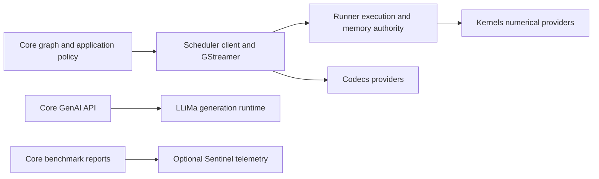

# Архітектура та проєктування репозиторію

Ця сторінка призначена для учасників розробки, яким потрібно зрозуміти, як структуровано бібліотеку, як розподілено відповідальність і як розширювати фреймворк, не порушуючи контрактів його модулів і середовища виконання.

## Скомпільована межа Scheduler

Core споживає `SimaScheduler::frontend` і типи `simaai::scheduler::client`, що мають окремого власника. Через цю скомпільовану межу проходять створення чисельних запитів, інспекція, динамічний вибір, приєднання зупиненого графа, вибраний доступ до пам’яті та запити розкладки відео. Core не відкриває сеанси Runner і не включає інтерфейси реалізації Kernels або Codecs.



Model та окремий Resize спільно використовують перелік `ResizeInterpolation`, що містить лише значення, і єдине зіставлення токенів семплера. Планування Model визначає необов’язковий типізований вибір перед наміром обробки зображення, проєкцією етапів і походженням графа; застарілі рядки залишаються межею сумісності.

Параметри Model і окремої обробки зображень перетворюються на той самий звичайний запит Preproc. Арифметика, зафіксована у вихідному коді, зберігає початкові межі масштабування FP32, середнього/дільника після зміни розміру та кроку квантування; це не інтерпретатор упорядкованих перетворень. Вхідний dtype, квантування та фізичну розкладку й далі визначає MPK. Нові параметри вмикаються явно; без них зберігаються старі байти. Core лише передає намір і геометрію, а чисельний допуск і виконання належать Kernels.

Kernels залишається авторитетним джерелом каталогу операцій і чисельного допуску. Scheduler передає узагальнені запити через Runner; ні Scheduler, ні Core не ведуть ідентифікаторів прошивки або таблиці диспетчеризації за операціями. Core зберігає публічні API вузлів, політику геометрії та форматування даних для передавання. Scheduler створює нові екземпляри фабрик адаптерів і розв’язувачів після перевірки когорти. Кешований динамічний вибір утримує свою операцію, але прив’язує пам’ять поточного кадру.

GenAI викликає LLiMa напряму, без Runner або GenAI-адаптера Scheduler. Профілювання MLA — окремий прохід, вимкнений за замовчуванням: Core викликає клієнт Scheduler, а Runner запускає встановлений інструмент командного рядка `mla-rt`. Він потребує вільного DevKit без іншої роботи MLA.

---

## Володіння інтерфейсами GStreamer

Scheduler володіє інтерфейсами транспорту GStreamer і структурованих помилок, включно зі встановленим заголовком `gst/SimaaiGstErrors.h`. Core споживає ці інтерфейси, а не зберігає другу реалізацію. Версія Core `0.6.0` містить цю зміну власника файлу. Оновлюйте узгоджений набір пакетів Core/Scheduler разом; ця версія пакета не змінює контракт платформи або чисельний контракт.

## Фреймворк і середовище

Слово «Neat» використовується для позначення двох пов’язаних, але різних аспектів:

- **Neat Library:** бібліотека C++/Python і середовище виконання з цього репозиторію. Вона завантажує пакети
  моделей, компонує конвеєри, перевіряє контракти, працює на апаратному забезпеченні Modalix і надає публічний API.
- **Palette SDK / середовище:** контейнеризований робочий процес розробки довкола фреймворку,
  зокрема DevKit Sync, спільні робочі простори та інструменти для агентів.

Змінюючи цей репозиторій, орієнтуйтеся на ті властивості фреймворку, які допомагають і людям, і агентам: явні API, детермінована поведінка, структурована діагностика, сувора перевірка та стабільні публічні контракти.

---

## Призначення бібліотеки

### Основні користувачі

Розробники, які бажають:
- Компонувати конвеєри з повторно використовуваних складових (без низькорівневого шаблонного коду GStreamer)
- Перевіряти конвеєри на ранніх етапах (зручно для CI) і швидко розуміти причини збоїв
- Запускати конвеєри й отримувати кадри в C++ через `appsink`
- За потреби надавати конвеєр через RTSP (за допомогою `gst-rtsp-server`)
- Передавати дані в код машинного навчання через виходи, зручні для роботи з тензорами, без написання сполучного коду GStreamer

## Володіння пакетами

Вибраний артефакт Core є джерелом істини для пакетів Core, LLiMa та узгоджених із ними пакетів залежностей Scheduler, які встановлюють разом. Core передає цей повний набір, не вибираючи й не переписуючи версії залежностей. Пакети поза артефактом належать платформі; несумісну платформу слід оновити, а не виправляти через Core чи LLiMa.

Core споживає встановлений клієнтський компонент `SimaScheduler`, а не нижчі інтерфейси розробки CMake. Координатор залежностей Scheduler перевіряє вибраний повний набір Kernels/Runner/Codecs і зберігає його точне походження. Псевдоніми сумісності `SimaRuntime`, що містять лише метадані, не володіють іншою реалізацією. Точка входу збірки й далі готує сусідні вихідні дерева або повторно використовує явно вибрані пакети в порядку Kernels → Runner → Scheduler → Core. Це координує збирання, а не виконання під час роботи чи активацію прошивки. Див. [збирання локальних залежностей](../build-test/local-dependencies.md).

### Рендерер і необов’язкові постачальники бекендів

Core володіє політикою публікації рамок і масок. Наявний вміст BBOX із рамками, паралельними осям, використовує координати int32; окремий формат орієнтованих рамок `BBOX_OBB_V1` зберігає геометрію FP32 і відхиляється рендерером рамок, паралельних осям. Scheduler володіє caps, життєвим циклом і холодним допуском постачальників. Виробниче компонування потребує типізованої можливості int32 рендерера; воно не переінтерпретовує ці значення як float і не додає перетворення на кожному кадрі. Kernels володіє канонічною операцією A65 `render`; Runner володіє виконанням і вивільненням зображення ReadWrite. Scheduler записує перевірену операцію та ідентичності використаних Kernels/Runner. Core перевіряє цю когорту й компонує звичайні залежності без архіву `a65apps`.

Runner записує постачальників, що належать платформі, окремо від залежностей, які можна розповсюджувати. Core зберігає цю квитанцію і перевіряє встановлену платформу; він не визначає сумісність за номером її збірки й не включає платформні DSO до пакета споживача. Допуск і компонування постачальників описано в [локальних залежностях](../build-test/local-dependencies.md).

### Володіння транспортом середовища виконання

Core споживає встановлений пакет `SimaScheduler`. `SimaScheduler::elements` володіє `neatcamerabridge`, `neatmultipartjpegdemux` і `neatlatestbystreammux`, включно з їхніми типами GObject та локальною реєстрацією в процесі. Точки входу Core у `src/gst/` — це перенаправлення для сумісності, а не другі реалізації. Ці елементи не використовують чисельний виконавець і не потребують Kernels.

Core зберігає публічні API C++/Python, параметри Node, пониження графа, об’єкти Sample/Tensor і приватні кредити графа. `src/pipeline/gst/RealtimeMuxCredits.cpp` проєктує ці кредити через інтерфейс позик Scheduler, що передає лише значення. Реєстр позик mux і спільний лічильник вхідних кадрів мають одного власника в Scheduler. Розкладки ABI камери походять з узгодженого заголовка розподільника, а не приватних копій Core.

Тести реалізації справедливості й зворотного тиску mux, розбору multipart та часу життя батьківського буфера захоплення належать Scheduler. Core зберігає тести публічного API, кредитів графа й наскрізні тести на пристрої. Встановіть узгоджені пакети Runner і Scheduler перед збиранням Core; внутрішні тести Core безпосередньо компонуються з його транспортною ціллю. Не кваліфікуйте апаратне захоплення або компактні метадані TensorBuffer хостовими тестами без постачальників.

### Додавання чисельних ядер

Для операції, яку можна виразити через наявні тензорні контракти й контракти виконання, розробка відбувається **лише в Kernels і Core**:

1. У Kernels додайте локальний типізований запит операції, перевірений план, чисельну реалізацію, фабрику виконуваного об’єкта й декодер іменованого запиту. Зареєструйте операцію один раз у каталозі Kernels і додайте тести правильності.
2. У Core додайте Node і перетворіть його параметри на канонічний запит: операцію, явну ціль, специфікації входів/виходів і типізовані параметри. Викликайте узагальнений API підготовки Scheduler; не викликайте фабрику операції та не додавайте перемикач операцій до Runner або Scheduler.
3. Перезберіть і встановіть **Kernels → Runner → Scheduler → Core**. Зміна каталогу EV потребує явно скомпонованої узгодженої прошивки, навіть якщо вихідний код Runner не змінився. Кваліфікуйте її за ексклюзивною процедурою роботи з пристроєм.

Підготовка проходить шлях **Core → Scheduler → Runner → Kernels**. Kernels виконує чисельну перевірку; Runner є узагальненим шлюзом. Холодна перевірка не відкриває апаратне забезпечення та не виділяє ресурсів виконання. Утримуйте повернений перевірений виконуваний об’єкт і перевіряйте його канонічні вимоги, перш ніж допустити повний етап. Потокове виконання використовує той самий об’єкт без повторного декодування назв операцій.

Динамічні варіанти використовують необов’язкову можливість ядра, прив’язану під час налаштування. Core зберігає політику графа/метаданих і наявні обмежені кеші. Промах кешу може уточнити незмінні параметри; постачальник доводить, чи спільні точний тензорний контракт і ресурси, чи потрібна повна повторна перевірка. Влучання кешу не створюють іншої операції та не утримують позик кадрів камери або кодека.

Runner володіє виконанням, ресурсами, когерентністю та вивільненням; Scheduler — носіями Gst, плагінами й інтеграцією транспорту. Їхні канонічні встановлені пакети — `SimaRunner` і `SimaScheduler`. Пакет сумісності `SimaRuntime`, що містить лише метадані, перенаправляє історичні цілі до тих самих реалізацій. Псевдоніми заголовків повторно використовують канонічні типи Kernels; залежності статичного компонування можуть залишатися транзитивними. Другої схеми тензорів, розподільника, черги виконання або чисельного реєстру немає.

Для чисельних етапів генерується `neatkernelrunner`; немає ні опційного ввімкнення, ні резервного переходу на виведений з використання плагін ProcessCVU. Пакування публічних виходів Core залишається залежною операцією хоста з початковою межею метрик. Codecs є окремим бекендом кодування/декодування; його обгортки Gst належать Scheduler, а не Runner чи чисельним Kernels.

Квитанції збірки прив’язують точні встановлені байти й ідентичності використаних залежностей. Вони не є кваліфікацією апаратного забезпечення або продуктивності. Не змішуйте заголовки, архіви, прошивки чи Codecs із неузгоджених пакетів.

Новий транспорт, представлення тензора або можливість виконання — це розширення фреймворку, яке може потребувати змін Runner. Гарантія «лише Kernels/Core» не охоплює такі зміни. Тайм-аут або скасування ніколи не доводить вивільнення DMA; наявний власник виділення пам’яті має зберігатися до остаточного завершення або перевіреного відновлення платформи.

Core вибирає операції за семантичною назвою, а не ідентифікатором графа прошивки. Kernels надає незмінний каталог назв операцій та їхніх скомпільованих цілей; Runner і Scheduler передають цей каталог без ведення іншого реєстру операцій. Core володіє типізованими правилами переписування графа, включно з обов’язковим об’єднанням `DetessCast` і `DetessDequant`. Якщо потрібна об’єднана реалізація недоступна, підготовка завершується помилкою замість розбиття операції на окремі ядра. Етап Core не обов’язково відповідає одній операції: TrackKLT і далі готує свій наявний складений запит.

Публічний список тензорів TrackKLT має позиційний порядок: попереднє зображення, поточне зображення, потім цілочисельні початкові точки. Необов’язкові імена підтверджують ці ролі, але не змінюють порядок сховища. Core перевіряє заданий контракт входу до виведення початкових точок і повторно перед допуском до черги, без відображення чи копіювання даних тензорів. Безіменні тензори залишаються позиційними. Ця політика стосується лише явно заданих прямих публічних входів, а не внутрішніх зв’язків між етапами чи перетворень входів моделі.

Запит трекера володіє засобами контролю чисельної якості та необов’язковою публікацією залишку. Core додає залишок після точок, статусу та запитаних ознак; він не трактує статус як безумовну впевненість у правильності відстеження. Вимкнення виявлення усуває цю операцію та виділення її вихідного буфера. Kernels володіє версійованим нативним пакетом і чисельною перевіркою; Runner і Scheduler далі передають та прив’язують загальні перевірені запити.

### Відновлення прямого драйвера

`deps/manifest.json` вибирає Scheduler і LLiMa. Встановлений координатор Scheduler перевіряє узгоджений набір Kernels, Runner і Codecs; Core використовує перевірений набір, не дублюючи низькорівневі перевірки платформи.

Відновлення належить вибраній платформі, а не зіставленню помилок диспетчера.
Core не запускає AppComplex, не перезапускає служби диспетчера й не скидає віддалені процесори після помилки інференсу. Середовище виконання повідомляє про завершення й вивільнення через контракт драйвера; невідоме завершення не дає дозволу повторно використовувати сховище DMA. Ініціалізація MLA під час завантаження платформи залишається залежністю платформи.

### Володіння пам’яттю

Core використовує інтерфейси виділення та відображення Scheduler, а не фізичні адреси з метаданих, `libsimaaimem` чи другий реєстр виділень. Правила доступу CPU, часу життя відображень, імпортованої пам’яті та батьківських пакетів наведено в [моделі пам’яті](../../advanced-concepts/data-model-contracts/memory_model.md).

Core не вибирає режим когерентності кешу з топології графа. `RunAdvancedOptions::prepare_output_cpu_visible` залишається для сумісності розкладки параметрів; перед фактичним відображенням немає надлишкової завчасної синхронізації. Сумісний за вихідним кодом параметр `defer_output_invalidate` має залишатися true; false відхиляється замість відновлення повільного шляху на стороні виробника.

Асинхронне подання MLA й упорядкована видача виходу використовують окремі наявні шляхи. Зворотний виклик завершення записує кінцевий стан; емітер публікує результат без обслуговування кешу CPU. Шлях подання може допустити наступний кадр, поки ця видача активна, за умови обмеженої кількості слотів каналу та незалежного володіння виділеннями. Саме завершення не повертає кредит допуску: завершений слот залишається у володінні, доки видача його не звільнить. Позики вихідного пулу можуть пережити це звільнення й далі перешкоджати повторному використанню сховища.

Це перекриття не усуває обслуговування кешу й не скорочує ланцюг залежностей усередині одного кадру. Воно не дає незалежній роботі CPU та пристрою виглядати як послідовні зупинки конвеєра, не додаючи ще одного обробника синхронізації. Побудова графа задає бюджети один раз; політика планування окремих операцій на кожному кадрі не потрібна.

### Планування пам’яті з FrameLayout

Core використовує один шлях планування в межах збирання:

1. Вибрати маршрути моделі та зберегти ідентичність викликів.
2. Скомпілювати перевірені рецепти й один раз визначити кожного виконавця.
3. Визначити кореневі носії, подання, споживачів і групи володіння.
4. Вибрати купи та спакувати за спільним доказом часу життя фізичного DAG.
5. Завершити формування локальних для етапів об’єктів `FrameLayout` і публікацію; один раз виконати рендеринг без виправлення розміщення.

Будь-який доступ EV74 потребує CMA; власні носії лише для MLA/A65 використовують DMS. Відповідні нові публічні виходи A65 можуть використовувати HostCpu. Імпортоване сховище, зсуви, геометрія й позики виробника залишаються закріпленими. Розгалуження враховує всіх споживачів; подання ділять кореневий носій.

`AllocationPolicy::PreferDmsThenCma` явно дозволяє відповідним власним DMS-виділенням перейти на CMA за браку ресурсу. Системна пам’ять Linux не вибирається. Межі пулів і Queue, незалежні виклики та утримані виходи обмежують повторне використання за часом життя.

Scheduler готує групи виділень кожної розкладки через Runner. Індекси й зсуви локальні для групи буферів; однакові зсуви різних груп не перекриваються. Перезбирайте узгоджені пакети Core і Scheduler разом.

### Когерентність від пристрою до CPU за замовчуванням

Існує один підготовлений механізм пам’яті. `SIMA_CORE_DEMAND_COHERENCY_V1` і експериментальний параметр збірки Runner видалено; налаштовуйте свіжі збірки без них. Не залишилося ввімкнення через середовище чи переходу всього графа на Legacy. Core використовує лише інтерфейси виділення, відображення та етапів Scheduler. Публічна геометрія тензорів, запити Kernels і чисельна поведінка не змінюються.

Спільний контракт отримання доступу та часу життя визначено в [моделі пам’яті](../../advanced-concepts/data-model-contracts/memory_model.md).

#### Відображення логічного тензора з DMA-сховищем

Публічний `Tensor::map()` і його псевдонім `view()` зберігають наявний контракт відображення сховища: застосовують `byte_offset` один раз і можуть надавати кінцеві байти базового сховища. Межі іменованих сегментів і зворотні виклики відображення застосунку залишаються авторитетними. `TensorBuffer::map()` і далі відображає сховище безпосередньо.

Внутрішні споживачі з обмеженням за формою натомість використовують `map_dense_tensor_read()`. Ця функція перевіряє додатні кроки й переповнення відносно поточної геометрії, а потім надає лише фізичний діапазон тензора, включно з проміжками кроків. DMA-сховище Core може дозволити цей точний діапазон. Обгорнуті або власні зворотні виклики зберігають наявну поведінку відображення й очищення; допоміжна функція перевіряє повернений ними діапазон перед звуженням логічного подання. Геометрія не кешується між змінюваними поданнями тензорів. Складені зображення та закодована або невизначена геометрія зберігають наявний шлях відображення; щільний логічний діапазон не дозволяє доступу до їхніх інших площин.

Scheduler може повторно використовувати вже кваліфіковану видимість поточного покоління Runner для точного подання. Перше читання після запису пристрою, непокритий діапазон або некваліфікований імпорт зберігає синхронізацію експортера. Активні записувачі, незавершена робота пристрою та карантин залишаються помилками. Відображення утримує і початковий зразок Gst, і поточне публічне сховище/позику виробника до завершення доступу CPU. Не змінюються режим володіння, копіювання вмісту, очищення WRITE-END або розкладка публічних об’єктів.

Помилка `resource_busy` етапу ядра не обов’язково означає вичерпання місткості подання. Її очищене й обмежене поле `Reason` зберігає початкову діагностику доступу, реєстрації, володіння або місткості. Перевірте цю причину перед зміною паралельності; не використовуйте буфери повторно, поки володіння або завершення пристрою не визначено.

### Володіння кодеками

Scheduler володіє `neatdecoder`, `neatencoder` та їхньою адаптацією до GStreamer. Codecs володіє сеансами декодера/енкодера й чисельними реалізаціями. Використовуйте узгоджені встановлені заголовки й бібліотеки; не копіюйте код бекенду до Runner і не поєднуйте обгортки з іншим ABI бекенду.

### Конфігурація апаратного енкодера

`SimaEncode` і сирий `VideoSender` виводять роздільність з узгоджених вхідних caps.
Роздільність фіксована протягом одного запуску; її зміна потребує нового запуску.
Параметри енкодера не містять ширини або висоти,
а вхідний адаптер зберігає видиму геометрію без масштабування.
Невідомі розміри входу залишаються невідомими в контракті виходу під час збирання,
доки попередній вхід їх не надасть.

`SimaEncode` готує сирий вхід один раз і відображає специфічні параметри кодека на `neatencoder`.
Scheduler володіє адаптацією GStreamer і публікацією виходу; Codecs володіє сеансом енкодера. Runner зберігає повноваження володіння пам’яттю та синхронізації. Core не додає потоку виконання енкодера.
Застарілий `H264EncodeSima` зберігає свій вхідний контракт без адаптера, використовуючи спільне формування властивостей енкодера. Зміни розкладки публічних класів включено до ABI 6, і вони потребують перезібраних бінарних споживачів; наявні точки входу вихідного коду залишаються доступними.

### Типові робочі процеси

- **Декодування / приймання:** файл або RTSP -> депакетизація/демультиплексування/розбір -> декодування -> перетворення/caps -> appsink -> споживач на C++
- **Перевірка:** збирання + розбір + preroll (PAUSED), щоб рано виявити проблеми узгодження
- **Надання через RTSP:** надсилайте синтетичні кадри в конвеєр RTSP-сервера за допомогою `appsrc`
- **Адаптер тензорів зображень/відео:** зображення/відео/RTSP -> декодування -> перетворення/масштабування -> `add_output_tensor(...)` -> `Run::pull_tensors()`
- **Навчальні матеріали:** почніть із розділу [Навчальні матеріали](/tutorials) — це впорядкований навчальний маршрут із прикладами, які можна запустити

### Канонічний виробничий конвеєр (джерело істини)

Канонічний «виробничий шлях» для цього репозиторію такий:
**вхідні дані -> попередня обробка -> MLA -> постобробка**. Джерело істини міститься у файлі:
`tests/e2e_pipelines/obj_detection/sync_yolov8_test.cpp`.

Змінивши цей тест, оновіть README і сторінку «Архітектура», щоб документація залишалася узгодженою.

### Концептуальна модель (бізнес-логіка ↔ сполучний код конвеєра)

Ваш застосунок містить бізнес-логіку, а сполучний код конвеєра належить фреймворку.

```text
Business logic
    |
    v
Nodes/Graph fragments  ->  GStreamer fragments  ->  caps negotiation  ->  runtime (Run)
    |                                                           |
    +-----------------------------------------------------------+
                                Sample / Tensor
```

---

## Основні поняття

Фреймворк навмисно побудовано навколо невеликого набору понять. Більшість коду, який пише користувач, стосується лише `Model`, `Graph`, `Run`, `Tensor` та `Sample`; учасники розробки, що працюють на нижчому рівні, також працюють з `Node`, повторно використовуваними фрагментами графа, розбором контрактів MPK і внутрішньою реалізацією Graph.

| Поняття | Роль |
| --- | --- |
| Архів моделі | Запечатаний артефакт `.tar.gz`, що містить контракт інференсу MPK, приватні конфігурації плагінів, бінарні файли моделі та артефакти ядер. |
| `Model` | Публічний завантажувач для архіву моделі у форматі `.tar.gz`. Він аналізує контракт MPK, виконує планування маршруту, надає доступ до етапів моделі та пропонує прості точки входу: `run(...)` і компонування через `Graph`. |
| `Tensor` | Типізований числовий вміст із dtype, формою, розкладкою, сховищем, пристроєм і семантичними метаданими. |
| `Sample` | Оболонка середовища виконання/медіа навколо тензорів, списків тензорів або наборів. Перевірте `Sample::kind` перед читанням полів. На межах конвеєра набір зберігається як один кадр. |
| `Node` | Атомарний етап конвеєра, який генерує детермінований фрагмент GStreamer та імена елементів, якими він володіє. |
| Повторно використовуваний фрагмент графа | Готовий `Graph`, який розгортається в кілька Node, наприклад декодований вхід RTSP або етапи моделі. |
| `Graph` | Межа компонування та перевірки. Node, Model і повторно використовувані фрагменти графа перетворюються на узгоджений конвеєр, придатний до збирання. |
| `Run` | Дескриптор активного конвеєра, який повертає `Graph::build(...)`; володіє життєвим циклом push/pull і виконання. |
| Граф | Використовуйте граф побудови для компонування DAG усередині одного конвеєра; використовуйте граф середовища виконання для координації етапів/запусків між конвеєрами. |

Читайте зв’язки зліва направо:

```text
model archive on disk -> Model -> Graph fragments/Nodes -> Graph -> Run
                                           |
                                           v
                                  Tensor/Sample flow
```

`Model` є початковою точкою для користувачів-початківців, але це не окремий рушій виконання. Він розгортається у фрагменти графа/Node моделі, які можна додати до `Graph`. `Graph` — центральне поняття компонування; `Run` — це активний об’єкт після збирання.

---

## Принципи проєктування для учасників розробки

Це ключові архітектурні принципи, на яких тримається фреймворк. Спирайтеся на них, обираючи між варіантами реалізації.

- **Детермінованість понад усе.** Забезпечуйте відтворюваність назв елементів, згенерованих рядків конвеєра, серіалізованих даних конвеєра,
  полів звітів і тестів. Діагностика та цикли роботи агентів залежать від стабільних ідентифікаторів.
- **Зручність налагодження — першочергова вимога.** У разі збою мають генеруватися структуровані дані, а не лише рядки:
  `GraphReport.error_code`, `repro_note`, повідомлення шини та конвеєри бекенду, які можна повторно запускати.
- **Жодних непомітних резервних переходів.** Не приховуйте помилки вхідних даних моделі або збої апаратного забезпечення/середовища виконання, мовчки
  перетворюючи формати, змінюючи сімейства графів, переходячи на CPU або приглушуючи помилки плагінів.
- **Перевіряйте до запуску.** Віддавайте перевагу перевірці структури, caps, форми та контрактів до того, як стартують потоки
  середовища виконання або буде захоплено апаратні ресурси.
- **Контракт MPK — джерело істини для моделі.** Рішення Core щодо маршрутизації, dtype, форми, квантування та
  етапів мають ґрунтуватися на `mpk.json` / `*_mpk.json`. JSON-файли окремих етапів є приватними для плагінів.
- **Логічний ранг Detess і геометрія виконання відокремлені.** Зберігайте визначений MPK `frame_shape`; інтерпретацію рангу 2 як NC/HW допускайте лише тоді, коли байтові діапазони однозначно визначають геометрію. Об’єднаний DetessDequant передає обидва дескриптори через один покадровий контракт: ранг плитки визначає ранг ядра, початкові пакетні виміри залишаються окремими, а семантичні осі, байтові діапазони, кроки та явне кодування плиткового сховища — авторитетними. Core передає ці канонічні типізовані контракти через Scheduler; Kernels перевіряє вибрану операцію й кодування. Не відтворюйте підготовлений запит ProcessCVU на межі DSO.
- **Політика чисельного бекенду має одне джерело істини.** Перевірена можливість визначає підтримувані цілі та перевагу AUTO. Явна ціль етапу чи сеансу або виконується на запитаному підтримуваному бекенді, або завершується помилкою; подальші перевизначення за роллю не можуть суперечити цьому рішенню.
- **Публічні API залишаються стабільними.** Публічні заголовні файли, що містяться в `include/*`, встановлюються та підтримуються.
  Віддавайте перевагу адитивним змінам і шляхам виведення з ужитку, а не змінам сигнатур, що порушують сумісність. Макровизначення внутрішньої видимості не повинні змінювати розкладку публічних об’єктів; непрозорі дескриптори реалізації мають бути безумовними.
- **Паралельність має бути обмеженою та відстежуваною.** Робота в потоці стримінгу має бути легкою;
  діагностика на боці зонда потребує атомарних операцій або рівноцінної потокобезпечної обробки; завершення роботи не повинно зависати.

---

## Шлях виконання моделі

Для конвеєрів, що базуються на моделях, загальна схема така:

```text
input Sample/Tensor
  -> optional preprocessing / format normalization
  -> MLA inference stages selected from MPK contract
  -> optional postprocessing / box decode
  -> output Sample/Tensor
```

Видимий для користувача контракт `Model` навмисно зручніший, ніж апаратний контракт MLA.
MLA може вимагати використання INT8/BF16 і тесельованих розкладок, тоді як код користувача зазвичай працює з FP32 і звичайними розкладками тензорів. Фреймворк усуває цю різницю за допомогою адаптерних етапів, керованих маніфестом.

Попередня обробка та постобробка є явними етапами/параметрами фреймворку. Невідповідність формату, відсутні обов’язкові метадані попередньої обробки, недоступний вибраний апаратний транспорт, недопустимий архів моделі або контракт MPK чи помилка узгодження caps мають проявлятися як структурована помилка з конкретними діями для усунення, а не як приховане виправлення під час виконання.

### Публічний план виконання

`Model::execution_plan(...)` повертає те, що виконав би `build(...)` з тими самими аргументами: вузли графа моделі в порядку конвеєра, де виконується кожен вузол (`A65`, `EV74` або `MLA`), і тензори на ребрах між ними. Він викликає `build(...)` з вимкненою стартовою перевіркою, зчитує план, який збирання записало в `DiagCtx` після планування розміщення та публікації, і закриває конвеєр, тому потребує того самого пристрою, що й `build(...)`. Це публічне діагностичне подання, окреме від внутрішнього `ModelExecutionPlan`, описаного нижче. Його JSON-контракт — `schemas/execution_plan_v1.schema.json`; `schema_version` змінюється лише тоді, коли зміна порушує сумісність з наявними читачами. Підсумок пам’яті враховує кожне власне виділення один раз і позначає його як `CMA`, `DMS`, `HostCpu` або `Mixed`; явний резервний перехід із DMS позначається бажаною купою.

### Телеметрія плати

`TelemetryMonitor` читає потужність і телеметрію плати з Sentinel, демона телеметрії плати, через його HTTP API на `/run/simaai-sentinel/api.sock`; Core не читає мікросхеми моніторингу живлення. `start()` один раз читає кеш зразків Sentinel, щоб отримати визначення метрик, інтервал між зразками та найновіший зразок, який передує вікну й не враховується. Потім робочий потік запитує останній зразок незадовго до появи кожного наступного й враховує кожен новий зразок у поточному зведенні рівно один раз, розпізнаючи його за позначкою часу. Якщо позначка часу не відстоїть від останньої врахованої рівно на один інтервал, робочий потік враховує пропущені зразки з кешу, який зберігає 240 останніх зразків Sentinel. Монітор нічого не створює в Sentinel, тож одночасно може працювати будь-яка кількість моніторів, а примусово завершений процес нічого по собі не залишає.

Монітор за замовчуванням використовує вказаний вище сокет. Явний `TelemetryMonitor(socket_path)` вибирає інший Unix-сокет Sentinel лише для цього екземпляра; `Model::benchmark()` зберігає кінцеву точку за замовчуванням.

`Model::benchmark()` використовує цей самий монітор, а не другий механізм трасування. Він заздалегідь готує з’єднання та робочий потік в очікуванні до запуску таймера пропускної здатності, активує вікно після початку вимірювання й закриває його після завершення всіх потрібних виходів, але до зупинки вимірювання. Активація та закриття нічого не виділяють, не захоплюють м’ютекс, не очікують завершення потоку й не звертаються до Sentinel. Лише потім бенчмарк очікує завершення робочого потоку й остаточно читає кеш. Поточні опитування обмежені читанням UTC перед перевіркою зупинки, тому закриття не може допустити пізніший зразок. Прив’язування даних бенчмарка перевіряє позначки часу UTC зразків і парні межі UTC/монотонного часу; виявлені стрибки годинника роблять телеметрію недійсною замість зміни виміряної пропускної здатності. Автономні монітори зберігають відновлення за порядком кешу після переведення годинника назад.

Sentinel робить зразок приблизно кожні 2 с, тому прохід вимірювання пропускної здатності триває щонайменше `BenchmarkOptions::min_duration_ms` (за замовчуванням 10 с). Прохід вимірювання затримки дотримується того самого мінімуму, тож обидва проходи зупиняються за одним правилом. Якщо Sentinel не запущено або у вікні немає зразків, бенчмарк усе одно повертає затримку та FPS; поля потужності дорівнюють нулю, а `telemetry.status` називає причину. Режим плати в `tools/install_neat_framework.sh` встановлює Sentinel або оновлює його до останньої виробничої збірки. Якщо це не вдається, інсталятор виводить попередження й продовжує роботу; пізніше виконайте `sima-cli neat install sentinel` або, як у CI, задайте `NEAT_INSTALLER_SENTINEL_REQUIRED=ON`, щоб збій став фатальним. Застарілий монітор потужності `Run` (`RunOptions::power_monitor`) також отримує дані із Sentinel: Core опитує його останній зразок і не читає мікросхеми моніторингу живлення через I2C.

Профілювання MLA явно вмикається через два поля `BenchmarkOptions`, які за замовчуванням мають значення false: `include_mla_layer_stats` і `include_mla_stage_stats`. Після закриття виконавців вимірювання затримки та пропускної здатності Core вимірює виконувані файли MLA розпакованої моделі через клієнт Scheduler, виконуючи проходи профілювання один за одним. Статистика шарів MLA охоплює лише етапи MLA у визначеному маршруті інференсу з урахуванням його термінальної політики. Runner запускає `mla-rt` в окремому процесі для кожного виконуваного файлу. Статистика шарів MLA також використовує YAML статистики компілятора; статистика етапів MLA запускає кожен виконуваний файл MLA 200 разів без перерви й зчитує середнє значення `tile.lat` із файлу статистики `mla-rt`. Runner перевіряє вхідні та вихідні дані й очищає тимчасові файли; він зупиняє `mla-rt`, якщо один запуск триває понад 120 с. MLA-RT відповідає за апаратне профілювання та передавання керування назад до виконання ядра. Профілювання не має перетинатися з іншими навантаженнями MLA. Шлюз бенчмарка серіалізує виклики бенчмарка, а не інші API інференсу чи застосунки.

Запуск `mla-rt`, який завершився з помилкою, аварійно завершився або був зупинений, може залишити роботу MLA незавершеною, тому Runner більше не запускає `mla-rt` у цьому процесі. Наступні проходи профілювання повідомляють, що MLA потребує відновлення. Тримайте DevKit вільним, доки відновлення MLA не буде перевірено.

Профілювання виконується в міру можливості. Якщо `mla-rt` відсутній, завершується з помилкою, перевищує час очікування або записує непридатний вивід, Core зберігає основні вимірювання, залишає відповідний список порожнім, виводить попередження й записує причину в `mla_layer_stats.status` або `mla_stage_stats.status`. В інших випадках статус має значення `"not requested"` або `"ok"`.

`BenchmarkReport::mla_layer_stats` містить для кожного скомпільованого шару MLA індекс виконуваного етапу з нульовою нумерацією, назву та апаратну затримку в мікросекундах з одного проходу профілювання на шар. `BenchmarkReport::mla_stage_stats` містить індекс кожного етапу MLA з такою самою нумерацією та його середню апаратну затримку в мікросекундах. Ці вимірювання використовують окремі проходи профілювання, тому сума затримок шарів не дорівнює ні затримці етапу, ні загальній затримці. `BenchmarkReport::save(file_path)` явно записує повний звіт, використовуючи публічні назви полів та одиниці вимірювання: `.json` вибирає JSON; `.yaml` та інші закінчення вибирають YAML. Звіт містить телеметрію, обидва статуси та порожні списки MLA, коли профілювання вимкнено. Метод створює відсутні батьківські теки й атомарно замінює наявний цільовий файл.

Виведені з використання параметри PreparedRunner мають зберігати значення за замовчуванням. Для паралельності використовуйте `processcvu.async` і `GraphOptions::async_queue_depth`; старі прапорці деквантування та профілювання не мають прямої заміни. Залиште `advanced_execution.defer_output_cache_sync=true` і використовуйте CPU-відображення Tensor/GstMemory для доступу до виходів. `RunOptions::advanced.prepare_output_cpu_visible` — поле сумісності без дії, а не запит завчасної синхронізації кешу.

### Контракт виконання скомпільованої моделі

Перехід на драйвер DMA-BUF відокремлює семантику моделі від сховища окремого кадру.
Core компілює факти завантаження моделі в єдиний незмінний внутрішній
`ModelExecutionPlan`:

- значення містять точні імена, потрібні байти, необов’язкові факти логічного типу
  та необов’язковий вираз читання відносно кореня `{source ValueId, byte offset,
  byte strides}`;
- операції містять точні впорядковані ребра та конфігурацію, специфічну для операції;
- порти бекенду MLA містять порядок ELF/моделі, точні потрібні байти, джерело вимог вирівнювання та напрям доступу; і
- публічні виходи містять лише порядок публікації та значення, яке вони надають.

Маніфести MPK використовують `MpkDecoder`. `MpkDecoder::load` — єдина точка входу для
маніфесту: завантаження моделі, підготовка етапів і хост
PCIe один раз читають `mpk.json` через неї, а семантичний `MpkContract` вона будує з
тих самих байтів, які декодує допуск. Необов’язковий рядок
`model_sdk_version` зберігається як інформація про походження й не обмежує допуск.
Декодер приймає лише точний зареєстрований словник `(processor, kernel)`,
розв’язує повні імена тензорів, перевіряє рівняння байтів операцій і окремо узгоджує кожен етап MLA MPK з точною топологією IFM/OFM його ELF.
Декодер поєднує свідчення виконуваних файлів і за логічним ID етапу від компілятора,
і за токеном виконуваного файлу маніфесту; порядок архіву та суфікси імен файлів не є семантичними свідченнями.
Отриманий незмінний план надає перевірений ключ
`{stage index, op ID, logical stage ID, executable}` і попередньо індексовані впорядковані діапазони портів для кожної операції MLA.
Неоднозначність, відсутні слоти або суперечливі свідчення є помилками завантаження моделі;
супровідний JSON, пошук підрядків, стан середовища та буфери часу виконання не є свідченнями.

Core може узгоджувати різні порядки вхідних і вихідних буферів за однозначного відображення,
зокрема пакетні входи та виходи. Застосунки зберігають публічні імена тензорів моделі, їхній порядок і порядок зразків.

Моделі з одним входом, розміром пакета 1 і звичайним просторовим зберіганням можуть використовувати автоматичне доповнення вхідних каналів.
Застосунки зберігають логічну форму тензора моделі; нестандартне доповнення просторового сховища не входить до підтримуваної області.

Артефакт AFE з розширенням `.so` класифікується за етапом MPK. Для `processor="MLA"` Core перевіряє топологію ELF без завантаження в хостовий процес і передає артефакт MLArt. Хостовий модуль A65 з `input_names`, `input_types` і `output_types` від компілятора стає типізованою програмою TVM. Застаріле вирівнювання EVO залишається явною 4096-байтовою політикою `LegacyPolicy`; нові типізовані контракти оголошують власне вирівнювання.

Кадри часу виконання не копіюють статичний план. Прямий шлях несе стандартне володіння DMA-BUF,
перевірені абсолютні подання `{fd, offset, length}` та обмежений час життя слота кадру.
Unpack і Slice є виразами читання споживача, а не операціями часу виконання:
декодер складає їх до одного матеріалізованого кореневого носія лише після доведення точних зсувів,
кроків у байтах і фізичних діапазонів. Pack, теселяція і перетворення точності залишаються
семантикою виробника/обчислень, якщо прохід пониження не доведе точне виробництво бекендом або рівнозначне об’єднання.
Це не дозволяє розміщенню сховища непомітно змінювати арність портів MLA чи поведінку моделі.

`FrameLayout` — контракт сховища етапу: список виділень, локальні для виділень діапазони, вхідні маршрути та володіння виходами. `ReuseInput` утримує визначену групу виділень входу. Core пакує власні носії один раз; Scheduler готує пули через Runner. Доповнений фізичний ресурс MLA відокремлений від логічних байтів публікації. Імпортоване базове сховище й позики виробника залишаються закріпленими.

Незмінний пакет MPK Core є авторитетним джерелом контракту інференсу. Логічні публічні форми залишаються відмінними від нативних діапазонів зразків MLA, подань виконання CVU для всього пакета й ресурсу базового сховища. Подання Detess другого рангу нормалізуються лише тоді, коли фактична байтова геометрія входу/виходу визначає однозначну форму виконання. Об’єднання вибирається через семантичний пошук операцій, а ніколи через таблицю ідентифікаторів графів Core.

#### Канонічна ідентичність і вибрана публікація

Core остаточно визначає ідентичність чисельного етапу під час створення скомпільованого контракту. Він нормалізує підтримувані написання моделей і відхиляє розбіжності між операцією, сімейством і переліком сімейств. Застарілі ідентифікатори графів і дескрипторів не є авторитетними для виконання. Нормалізація ідентичності не робить неповний семантичний контракт повним; Kernels і далі відповідає за пошук операцій і чисельний допуск.

Для передавання Preproc, керованого моделлю, геометрія зображення й розмір сховища — окремі відомості. Плиткове доповнення може робити потрібне сховище більшим за щільну кількість скалярів. Core перевіряє поглинутий ланцюг перетворень за типізованим планом моделі, завершує розміщення носіїв і вибраний маршрут виходу, а потім створює надане вихідне подання. Дескриптор середовища виконання, маршрут і публічне подання мають посилатися на те саме остаточно визначене сховище. Більше батьківське виділення не дозволяє замале логічне подання, а однакові кількості байтів не доводять відповідності геометрії.

Автономний упакований Preproc запитує вимоги до сховища в канонічного перевіреного виконуваного об’єкта перед публікацією відомостей або виділенням арени. Він не виводить упаковану місткість множенням логічних розмірів. Місткість для кількох ROI зберігає вісь пакета в публічній формі; автономні подання одного зображення зберігають наявну форму HWC.

Типізовані дескриптори моделі охоплюють повний тензор, включно з пакетним виміром. Для тензора HWC рангу 4 з явно заданим пакетом початкова вісь — N. Кількість повторень їхнього виконання дорівнює одиниці: семантичний розмір пакета не запитує повторного виконання всього тензора. Упаковані перемежовані голови пакета використовують прив’язки окремих зразків і публікують повний тензор для кожної голови, зберігаючи впорядковані подання з одиничними осями. Сам розмір пакета не вимикає об’єднання DetessCast або DetessDequant. Об’єднані DetessCast і DetessDequant зберігають явно доведене приватне подання з одиничною віссю, коли опублікований ранг відрізняється від геометрії виконання.

Це правило передавання з одиничною віссю не замінює навмисно відфільтровані вихідні подання, як-от публікацію статусу KLT. Зміни відбуваються під час підготовки, а не виконання кадру. Зберігайте об’єднані операції, явні зсуви й метадані квантування; не виправляйте невідповідність контракту проміжною копією або чисельним резервним варіантом.

#### Підготовка типізованих перетворень

Core один раз визначає зовнішні назви типів даних і дескриптори тензорів MPK під час підготовки графа. Передавання містить перевірені виконувані об’єкти з канонічними контрактами `TensorSpec` і `DType`, включно з точністю кожного входу. Runner і Scheduler не розбирають повторно рядки типів даних окремих операцій. Метадані публікації й носіїв Core залишаються явними та окремими від авторитетного джерела чисельних типів.

Форма виконання й опублікована форма не обов’язково однакові. Core явно дозволяє подання з одиничною віссю із семантичного контракту виходу та упаковані подання фізичного сховища з транспортного контракту скомпільованої моделі. Scheduler перевіряє кожну прив’язку виходу щодо цього зв’язку під час підготовки, включно з типом даних, розкладкою, кроками й межами сховища. Однакова кількість байтів сама по собі не дозволяє зміну форми. Ці подання зберігають базове виділення пам’яті; вони не додають копіювання тензора або чисельного перетворення. Зміни контракту виходу потребують нової перевірки, зокрема для динамічно підготовлених варіантів.

Еквівалентні написання типів даних приймаються без урахування регістру. Невідомі назви й суперечливі дескриптори відхиляються до виконання. Спільне застаріле кодування BF16/INT16 потребує явного семантичного типу. Помилки запиту показують причину без увімкнення докладної діагностики GStreamer.

#### Перевірені чисельні етапи

Зсуви `FrameSpan` локальні для виділення та групи буферів, а не є глобальними адресами графа. Однакові зсуви різних груп не перекриваються. BoxDecode й ArgMax відокремлюють зсуви тензора відносно голови від зсувів сховища. Входи з прямим доступом до пам’яті та входи з фізичними прив’язками часу виконання зберігають свій режим адресування.

Core понижує етапи Preproc, перетворень і комп’ютерного зору, включно з ArgMax, BoxDecode, SuperPoint, вузлами ядер LiDAR/BEV (SimaVoxelize, SimaPillarScatter, SimaBEVPoolPlan і SimaBEVPool) і ResizeArgMax, до канонічних запитів і явних відображень тензорних портів. Узагальнений механізм тензорних етапів Scheduler відповідає за прив’язування й публікацію GStreamer; Runner — за залежності, асинхронне виконання й час життя буферів під час виконання. Core імпортує ресурси носіїв із контракту виділення попереднього етапу або вхідного сховища, а ніколи лише з логічних форм. Чисельні виходи BoxDecode та SuperPoint залишаються приватними; залежний виконуваний об’єкт Core для серіалізації у формат передавання зберігає публічний вміст BBOX та ознак без дублювання математики декодування. Орієнтовані рамки використовують окремий версійований серіалізатор `BBOX_OBB_V1` із тією самою залежністю від завершення чисельних обчислень; невдалі обчислення не повинні публікувати застарілі результати.

Незмінний рецепт ядра зберігає визначений виробником формат передавання тензора після пониження типізованого контракту вузла. Публікація на холодному шляху застосовує цей формат і до нових, і до кешованих caps; семантика ніколи не виводиться з назви ядра чи форми байтів. Публічний тензор OBB залишається щільним UInt8 рангу один із семантикою `BBOX_OBB_V1`.

InputStream переносить визначений формат на кожен повернений тензор до публікації Sample, зокрема на шляхах власної копії та кешованих метаданих. Тому безпосередні `Sample.tensors` і допоміжний API `TensorList` мають однакову семантику виявлення.

Для перевірених чисельних виходів у плитковому форматі MLA Core додає фізичну розкладку до кожного логічного виходу лише тоді, коли його форма й dtype збігаються з перевіреним виробником. InputStream декодує ці незмінні метадані caps під час ініціалізації кешу декодування, а потім зберігає їх у кешованих шаблонах Tensor. Псевдоніми сирих байтів і плитки комірок INT8, байти яких уже відповідають щільному NHWC, залишаються без змін. `TessSpec::storage_bytes` відрізняє явно задане плиткове сховище від застарілих анотацій лише формату. `copy_payload_bytes()` і `clone()` зберігають байти, доповнення та розкладку; щільні копії, типізований доступ і DLPack відхиляють явно задане плиткове сховище. Споживачі графа, що підтримують розкладки, отримують перевірену розкладку без прихованого перетворення.

Зміни розміру зображення вибирають незмінні, сумісні за ресурсами підготовлені варіанти BoxDecode до прив’язування. Вони не змінюють операцію, яку використовує кадр в обробці. Перший етап RCNN зберігає для кожного рівня групи пропозицій top-K з лічильником і FP16. Core не має завантажувати виведений з використання плагін objectdecode як резервний варіант.

A65 — це ціль виконання, а не домен пам’яті GStreamer. Плагін і далі імпортує носії DMA-BUF. Прямий тензорний вхід використовує виділення зі спільною CMA, наприклад `Tensor::from_vector(values, shape, TensorMemory::EV74)`; вибраний виконуваний об’єкт і далі працює на A65.

---

## Структура репозиторію

### Загальна структура

- `include/` — публічні заголовні файли (підтримувана поверхня API)
- `src/` — реалізації
- `docs/` — документація (цей файл)
- `examples/` — невеликі приклади, які можна запустити
- `tests/` — модульні/інтеграційні тести
- `python/` — вихідні коди пакета `pyneat`, прив’язки nanobind і тести Python
- `old_*` — знімки застарілої монолітної реалізації, що зберігаються для довідки/міграції

### Дерево публічних заголовних файлів (`include/`)

Публічні заголовні файли розміщуються в `include/<module>/...`.
Приклади: `include/pipeline/Graph.h`, `include/model/Model.h`.

Публічні заголовні файли — зручні точки входу:
- `include/neat.h` (зведений)
- `include/neat/runtime.h`
- `include/neat/models.h`
- `include/neat/nodes.h`
- `include/neat/node_groups.h`

Публічного зведеного заголовного файлу `include/neat/graph.h` навмисно немає. Тести середовища виконання/компілятора, яким потрібна низькорівнева основа графа, безпосередньо підключають вузькі заголовні файли `include/graph/...`. Застосунки, приклади та публічна документація мають використовувати єдиний публічний `simaai::neat::Graph` з `<neat.h>`.

### Внутрішні заголовні файли та шляхи до плагінів середовища виконання

Публічні заголовні файли в `include/` встановлюються та розглядаються як стабільний API.
Внутрішні заголовні файли в `src/**/internal` не встановлюються; у прикладах/навчальних матеріалах слід використовувати лише публічний API.

Спільна ціль CMake Core експортує C++20 та свої публічні вимоги до GStreamer, OpenCV і JSON. Core збирається зі встановленим фронтендом Scheduler і LLiMa; нижчорівневі бібліотеки середовища виконання залишаються залежностями розгортання, а не прямими інтерфейсами розробки Core. Статичні споживачі явно запитують компонент Static і забезпечують його залежності компонування реалізації.

Примітки щодо середовища виконання:

- Встановлені плагіни Scheduler розташовані в `${CMAKE_INSTALL_PREFIX}/${CMAKE_INSTALL_LIBDIR}/neat/gst-plugins`. Для несистемного префікса додайте цю теку до `GST_PLUGIN_PATH` або `GST_PLUGIN_PATH_1_0`.
- Бібліотеки середовища виконання Runner розташовані в `${CMAKE_INSTALL_PREFIX}/${CMAKE_INSTALL_LIBDIR}/neat/runtime`; використовуйте встановлені цілі CMake, а не бібліотеки дерева збірки.
- Після загальносистемного оновлення плагінів перебудуйте системний кеш GStreamer.

Збирайте Core і його встановлених споживачів із версією заголовного файлу JSON, ABI-сумісною з вибраним пакетом LLiMa. LLiMa експортує методи C++, що містять JSON; сама сумісність синтаксису вихідного коду не доводить сумісності компонування. Квитанції SDK/бібліотек і реальні перевірки компонування мають перевагу над широкою позначкою мінімальної версії пакета.

---

## Заплановане й стабільне (поверхня API)

| Область / API | Статус | Примітки |
| --- | --- | --- |
| Основний API конвеєра (`Graph`, `Run`, `Tensor`, `Sample`) | Стабільний | Основна підтримувана поверхня C++. |
| Внутрішні компоненти builder (`Node`, приватні допоміжні засоби для векторів вузлів, `GraphPrinter`) | Внутрішній | Підтримка компонування лише на STL, до етапу GStreamer. |
| API моделі (`Model`, фрагменти графа, які можна повторно використовувати) | Стабільний | Канонічний шлях інтеграції архівів моделей. |
| `include/policy/*` | Стабільний | Мінімальні перевірені контракти та налаштування політики за замовчуванням (`Decoder`, `Encoder`, `Memory`, `RTSP`). |
| `include/nodes/groups/ImageToH264RtspGroup.h` | Запланований | Порожня група-заповнювач. |
| Прив’язки для Python (`python/`, `pyneat`) | Бета | Прив’язки та пакування на основі nanobind розміщено в репозиторії; поверхня API зосереджена на `Tensor`, `Graph/Run`, `Model` та основних допоміжних функціях для вузлів/груп. |

---

## Модулі та сфери відповідальності

### `builder/` — контракти вузлів і підтримка приватного лінійного компонування (без GStreamer)

**Мета:** Визначити, як конвеєри складаються з логічних частин.

Основні типи:
- `Node` — інтерфейс, реалізований кожною складовою конвеєра
- приватні допоміжні функції для роботи з векторами вузлів і `GraphPrinter` — утиліти компонування і засоби діагностики

**Правило:** builder має й надалі використовувати переважно лише STL. Він не повинен володіти об’єктами середовища виконання GStreamer.

---

### `nodes/` — типізовані складові конвеєра

**Мета:** Надати готові до використання реалізації Node, які генерують детерміновані фрагменти GStreamer.

`VideoRate()` завжди створює `videorate drop-only=true`, зокрема коли його додає група джерел. Це запобігає дублюванню вихідних заголовків, які спільно використовують пул пам’яті декодера, і зберігає мітки часу джерела. Фабрики `VideoRate()` у C++ та `video_rate()` у Python не приймають аргументів і не дублюють кадри.

Приклади:
- `nodes/io/HttpSource`, `nodes/io/RTSPInput`, `nodes/io/StillImageInput`
- `nodes/common/*` (Caps, Queue, Output тощо)
- `nodes/sima/*` (вузли SiMa.ai для декодування/кодування/розбору/пакетизації)
- `nodes/rtp/*` (допоміжні засоби для депакетизації/пакетизації RTP)
- `nodes/groups/*` (поширені рецепти з кількох вузлів)

**Контракт:**
Кожен Node має надавати:
- `backend_fragment(index)` — фрагмент GStreamer для цього вузла за вказаним індексом
- `element_names(index)` — детерміновані імена елементів, що належать цьому вузлу (для діагностики та забезпечення відповідності)

Вузли LiDAR/BEV зберігають параметри, описи портів і побудову чисельних запитів без
побічних ефектів у `nodes/`. Їхні наявні хуки компіляції `NodeContractProvider`
реалізовано в `pipeline/internal/sima/LidarBevNodeContracts.cpp`. Цей компілятор передає
назву операції наявному API `check_kernel(...)` у Scheduler і використовує звичайний
шлях виконання через рецепт етапу та `FrameLayout`. `StaticSpecBuilders.cpp` спільно
із `SimaArgMax` використовує проєкцію входу лише за метаданими та пряму прив’язку входу;
ці допоміжні функції не готують ядра й не планують їх виконання. Файли вузлів
LiDAR/BEV не включають внутрішні заголовки реалізації конвеєра. Цей поділ не додає
покадрової роботи чи копіювання вмісту. `ResizeArgMax` дотримується того самого поділу. `Model::Options::semantic_segmentation` замінює постобробку dequantize або cast моделі цим вузлом, який читає оцінки MLA через кроковане подання виробника; будь-яку іншу постобробку відхиляє конструктор `Model`.

Окремий `Cast` компілює типізовані подання в канонічний запит `cast`, перевірений Kernels. Логічна ідентичність, кроки та зсуви відносно тензора залишаються явними. Семантична компіляція узгоджує впорядковані порти MLA до пакування; рендеринг зберігає перевірені контракти. Кількість слотів виконання за замовчуванням — 4 в асинхронному режимі та 1 у синхронному, з окремими носіями для утримання виходів. Підмножини чи переставлені TensorSet використовують оболонки метаданих, що утримують батьківський об’єкт, не змінюючи збережену публікацію або вміст.

#### Типізовані інтерфейси зображень і багатоплощинна публікація

`Resize`, `ColorConvert` і `Normalization` — тонкі фабрики над наявним фінальним вузлом `Preproc`. Незмінна приватна політика реалізації в його наявному утримувачі відокремлює семантику інтерфейсів без зміни публічних розкладок Preproc або PreprocOptions. Специфічна для моделі поведінка ROI/шаблона джерела залишається доступною лише в застарілому об’єднаному режимі. Resize допускає обмежену динамічну геометрію входу з фіксованими розмірами виходу; перетворення кольору й нормалізація фіксують геометрію на один запуск.

Контракти сирого зображення зберігають перевірені дескриптори площин і один носій зображення. Після розміщення Core проєктує локальні для виділення зсуви площин, кроки й межі в `GstVideoMeta` та динамічний `GstSimaMeta`. Запити метаданих використовують незмінну геометрію відносно площини без адаптерів чи виділень пристрою. Іменовані селектори й далі перевіряються; сирі зображення не отримують дескрипторів набору тензорів. Normalization публікує BF16-тензор, а NV16 зберігає UV-площину повної висоти та власника зображення.

Нові етапи зображень зберігають відомі часові caps попередніх етапів у холодній, локальній для етапу проєкції OutputSpec. Межа без OutputSpecProvider робить недійсною лише успадковану частоту для цієї суворої проєкції; пізніший явний постачальник caps може її відновити. Приватний вміст передає отриманий дріб до публікації сирого зображення. Невідомі частоти залишаються пропущеними; роботи на прогрітому кадрі чи виведення частоти не додається. Застаріла проєкція OutputSpec, що виконується в міру можливості, не змінюється.

Нативні розкладки зображень зберігають проміжки; сумісний з енкодером NV12 використовує встановлене авторитетне джерело відеорозкладки Runner і явну політику ядра InitializeStorage. Записувач EV ініціалізує оголошені кінцеві частини рядків і рядки сховища під час кожного виклику; запас виділення/сторінки не є неявним доповненням, доступним для запису. Core ніколи не ініціалізує доповнення вмісту й не перепаковує вихід на A65. Наявна диспетчеризація об’єднаного Preproc, сумісність метаданих і арифметика BF16 не змінюються.

---

### `gst/` — тонкі утиліти GStreamer

**Призначення:** Невеликі обгортки/допоміжні функції для типових шаблонів GStreamer.

Приклади:
- ініціалізація (`GstInit`)
- розбір рядків запуску (`GstParseLaunch`)
- спорожнення шини / перетворення повідомлень на рядки (`GstBusWatch`)
- допоміжні функції для caps / інтроспекція елементів (`GstHelpers`, `GstIntrospection`)
- перехоплення даних на pad / допоміжні функції для зондів (`GstPadTap`)

**Правило:** `gst/` не повинен залежати від `pipeline/` (щоб уникнути циклічних залежностей і надмірного розростання «службового шару»).

---

### `pipeline/` — оркестрація середовища виконання та публічний API

**Мета:** Керувати життєвим циклом середовища виконання: збирання -> розбір -> запуск -> споживання -> завершення роботи, разом із діагностикою.

Основні типи:
- `Graph` — основна точка входу для користувачів
- `Run` — дескриптор запущеного конвеєра з API push/pull
- `Sample` — структурований вихідний вміст, який повертають виклики pull
- `GraphReport` — структурована діагностика збоїв, зависань і відтворення
- `Errors` — винятки (`NeatError`), що містять звіт

#### Контракт семантики помилок

`GraphReport.error_code` — канонічне поле для автоматизованої класифікації помилок. Шляхи виконання, збирання та введення-виведення у фреймворку відображають кінцеві збої на стабільні родини кодів:

- `misconfig.pipeline_shape`
- `misconfig.caps`
- `misconfig.input_shape`
- `misconfig.input_capacity`
- `misconfig.media_caps`
- `misconfig.tensor_dtype_missing`
- `misconfig.option_out_of_range`
- `build.parse_launch`
- `build.pipeline_syntax`
- `build.plugin_missing`
- `build.property_invalid`
- `runtime.pull`
- `runtime.element_failed`
- `runtime.output_timeout`
- `io.parse`
- `io.open`
- `io.file_not_found`
- `io.permission_denied`
- `io.rtsp_connection_failed`
- `io.camera_not_found`
- `codec.*`, `resource.*`, `infra.*` та `internal.*`

Помилки GStreamer проходять через один внутрішній парсер, класифікатор і модуль рендерингу.
Класифікація віддає перевагу версійованому ідентифікатору діагностики Neat, потім нативній області/коду GStreamer і фабриці елементів, а потім вузьким відображенням сумісності для старіших плагінів. Для невідомих збоїв використовується `runtime.element_failed`; про них не повідомляється як про `misconfig.media_caps`, хіба що узгодження справді завершилося невдало. Коли конвеєр надсилає кілька помилок, відображається найконкретніша першопричина, а кожна помилка зберігається в журналі шини.

`GraphReport.repro_note` — це зведення для людини. У виробничому режимі воно містить причину, викладену простою мовою, відповідні спостережувані/очікувані значення, конкретні дії користувача та стабільний ідентифікатор діагностики. Необроблені рядки плагінів, розташування у вихідному коді та область/код GStreamer призначені лише для налагодження. Публічний код у квадратних дужках додається один раз під час створення `NeatError`.
`GraphReport.bus` є джерелом істини для деталей помилок плагінів/середовища виконання.
Для сценаріїв build(input) `GraphReport.build_adaptation` фіксує визначену політику/можливість форми, походження початкових/максимальних обмежень, походження захисту байтів і застосовані/пропущені дії адаптації.
Для викликів pull під час виконання, які не генерують винятків, `PullError.code` використовує ту саму таксономію. Збої робочого потоку вхідного потоку даних зберігають типізований код помилки та звіт під час переходу через межу робочого потоку, тому `Run::pull()` і перекладач винятків Python відображають той самий `NeatError`.

Порядок розбору проблем у підтримці:
1. згрупуйте за `error_code`
2. прочитайте `repro_note`
3. перегляньте перші кінцеві помилки в `bus`
4. відтворіть за допомогою `repro_gst_launch`

Обгортки помилок форматують діагностику перед передаванням діагностичного звіту. Форматувати звіт і переміщувати його в окремих аргументах конструктора небезпечно, оскільки через порядок обчислення аргументів може загубитися початкове повідомлення. Очищення має зберігати і повідомлення винятку, і структурований звіт.

##### Діагностика чисельного Runner

Шлях `neatkernelrunner` за замовчуванням зберігає канонічні категорію помилки, фазу, поле й необов’язкове правило/причину ядра Runtime через версійовані деталі помилок GStreamer. Підготовка графа використовує те саме відображення діагностики. Core показує ці помилки; він не дублює перевірку ядра та не виводить підтримку з тексту помилки. Помилки запиту, непідтримуваної реалізації, прив’язування та залежностей мають окремі коди `misconfig.kernel_request`, `misconfig.kernel_unsupported`, `runtime.kernel_binding` і `runtime.kernel_dependency`. Відсутня інформація про правило чи фазу залишається недоступною. Тайм-аут не є вивільненням на пристрої та не дозволяє повторно використати буфер.

#### Внутрішня діагностика конвеєра

У `src/pipeline/internal/` (лише для внутрішнього використання):
- `Diagnostics.h` — спільні типи діагностичних даних, що використовуються в середовищі виконання:
  - `DiagCtx` (журнал шини + звіти вузлів + лічильники меж/елементів)
  - `BoundaryFlowCounters` (атомарні лічильники, що оновлюються з потоків стримінгу)
  - `ElementTimingCounters` (атомарний облік часу обчислень для кожного елемента)
  - `ElementFlowCounters` (атомарна статистика потоку для кожного елемента)
- `GstDiagnosticsUtil.h` — допоміжні функції для форматування та збору даних діагностики GStreamer

#### Типізований контракт етапу Scheduler {#sima-static-manifest-context-contract}

Core передає незмінні об’єкти `StageRequest` через встановлений клієнт Scheduler. Кожен запит володіє розкладкою кадру, публікацією виходу та перевіреною програмою ядра, MLA або TVM. Scheduler перевіряє зупинену групу перед приєднанням і утримує цих власників під час виконання.

##### Виконання та допуск моделі

`ModelPack` кешує незмінний `ModelExecutionPlan`, ідентичність артефактів і факти `PhysicalExecutionPlan`. Вибрані виконавці та спекулятивне розміщення не кешуються. Огляд метаданих не виділяє пам’ять пристрою й не створює адаптери.

Кожне збирання вибирає маршрути й один раз визначає перевірених виконавців. Вибрані фрагменти зберігають межі попередньої обробки, інференсу та постобробки компілятора. Розгалуження, подання, імпорти й утримані публічні виходи надають факти доступу та часу життя перед пакуванням. Окремі виклики зберігають власні групи володіння.

Передавання на пристрої та виділення пам’яті InputStream використовують стандартну DMA-BUF пам’ять
і визначене розміщення CMA/DMS. Спільні оболонки TensorSet утримують пам’ять кожного джерела,
її батьківський буфер і наявний кредит позики, навіть коли сусіднє CPU-поле потребує пакування.
Явна CPU-пам’ять і виходи Owned залишаються підтримуваними;
обов’язкове виділення для пристрою завершується помилкою замість непомітного переходу на CPU-пам’ять.
Застосунки не вибирають бекенд пам’яті й не ініціалізують GStreamer.

Передавання тензорів повторно використовує пули з одним буфером за купою пам’яті та класом місткості. Запити до 64 KiB округлюються вгору до системної сторінки; більші кешовані запити — до 64 KiB (або до системної сторінки, якщо вона більша). Близькі розміри використовують те саме виділення, але сховище та відображення тензора надають лише запитаний діапазон носія. Спільний для CMA і DMS LRU-кеш у межах процесу утримує не більш ніж 128 пулів і 256 MiB округленої місткості, враховуючи як позичені, так і вільні слоти. Зайнятий пул не чекає звільнення попереднього тензора: передавання виділяє інший слот. Витіснення деактивує найстаріший пул; вільний буфер звільняється негайно, а тензор, що ще використовується, утримує своє виділення до звільнення останнього посилання. Передавання, більші за ліміт байтів, отримують пам’ять без кешування. Якщо виділення DMA завершується помилкою `ENOMEM`, Core спочатку перевіряє, чи інший потік повернув придатний слот, потім очищає кешовані пули й повторює виділення не більш ніж один раз. Якщо помилка виділення зберігається, її отримує викликач. Класи розмірів усувають окремі виділення для близьких розмірів, але різні класи або одночасне використання понад ліміт усе ще можуть потребувати повторного виділення. Доступ із CPU повторно використовує відображення Runner, отримуючи та звільняючи квиток для кожного доступу.

Перевага виділення вхідної пам’яті та допуск під час виконання є окремими рішеннями.
Core визначає обидва з оголошеного `Input` і його виконуваного подальшого маршруту під час збирання;
він не переписує `Auto` на явну вимогу пристрою.
`PreferDeviceZeroCopy` надає перевагу пам’яті пристрою, не відхиляючи наявний CPU-вхід.
Явні політики EV74/DMS0 і маршрути лише для пристроїв зберігають перевірки того, що вхід видимий для пристрою.
Маршрути з перевагою пристрою передають сховище `Tensor` і `Sample`, що належить викликачеві,
без проміжного перетворення на CPU-зображення.
Сумісний DMA-BUF вхід залишається без копіювання; CPU-вхід і далі може потребувати матеріалізації
на наявній межі входу пристрою, наприклад `neatencoderinput`.

`try_compile_dmabuf_plan()` перевіряє MPK і точні артефакти MLA/TVM, не вибираючи сховище. Офлайн-інструмент `neat-dmabuf-plan-audit` приймає `--mpk <mpk.json>` та повторювані трійки `--mla-artifact <stage-id> <manifest-executable> <resolved-file>`; `--elf` обробляє один однозначний етап MLA. Він використовує спільний планувальник без виділень пристрою чи фабрик адаптерів. Версійований JSON зберігає коди причин, розташування та базові імена: `source_digest` визначає незмінні факти моделі, а `plan_digest` — остаточні розкладки для цільової платформи за замовчуванням. Збій ніколи не призводить до вибору застарілого виконавця.

Після підготовки перевірених рецептів Core визначає носії та володіння виробників/споживачів, а потім один раз пакує спільним пакувальником з урахуванням часу життя. Він остаточно визначає локальні для виділення діапазони й публікацію. Рендеринг зберігає ці рішення; Scheduler перевіряє та виконує їх.

Коли вхід `cv::Mat` матеріалізується як Tensor, невизначене розміщення `Auto` використовує поведінку за замовчуванням Tensor-власника: копіює безпосередньо в доступну EV74 DDR із підтримкою DMA-BUF. Побудова з’єднаного графа та виклики push з іменем або за замовчуванням використовують це саме перетворення. Явний `SystemMemory` (або `use_simaai_pool=false` з `Auto`) зберігає позичене хостове подання; явне розміщення DMS не змінюється. Це не змінює публічного API `from_cv_mat_view()` і не робить позичене хостове сховище сумісним із пристроєм.

Копії `Tensor` між пристроями використовують незалежне сховище для вибраного подання та синхронізують кеші. Спільний вхід утримує кожен DMA-BUF, перевірене подання й позику виробника; пакування поля CPU не копіює сусідні поля DMA. `DirectMemory`, `PhysicalBinding` і `KnownFrameSpan` — це представлення входу. Повторне використання залежить від визначеної ідентичності сховища та групи виділень входу, включно з псевдонімами; сам тег не надає володіння.

Нематеріалізувальний Pack у формі компонентів установлює розміщення виробника перед виділенням носія.
Придатні до запису виходи виробника займають кінцеві діапазони компонентів у спільному батьківському носії;
виділення пам’яті, аналіз життєвих циклів і команди пристрою використовують цей єдиний зв’язок сховища.
Вирівнювання бази батьківського носія не накладає вирівнювання сторінок на кожен внутрішній компонент.
Таке розміщення не об’єднує зовнішні виділення пам’яті й не додає копіювання під час виконання.

Недопустимі DMA-представлення завершуються помилкою, а не переходять до сегментованого виділення пам’яті
чи матеріалізації всієї оболонки. Явний вихід Owned і передавання CPU/пристрій залишаються свідомими операціями копіювання.

На суворих межах етапів логічний розмір вмісту і фізичний адресний діапазон є різними фактами.
Типізована операція, отримана з MPK, володіє формою/розкладкою і потрібним адресним діапазоном;
метадані TensorBuffer володіють перевіреною DMA-BUF пам’яттю, зсувом і доступним фізичним діапазоном.
Наприклад, логічне значення на 12 байтів із кроком C16 може торкатися зсувів до байта 176 у MLA OFM на 192 байти.
Тому пряма прив’язка ProcessMLA залишається впорядкованим дзеркалом IFM/OFM
`{tensor_slot, parent_carrier}`.
Єдиний булевий параметр визначає логічний якір із нульовим зсувом для більшого фізичного порту;
він не дублює розкладку.
ProcessMLA не повинен додавати надлишкові прапорці `padded`, `strided` або `contiguous`.

Для упакованої моделі з одним IFM/одним OFM Core доводить, що логічні виходи попереднього етапу
є впорядкованими дочірніми елементами одного повного носія IFM.
Значення подальших Unpack/Slice публікуються як логічні читання одного носія OFM.
ProcessMLA й далі подає рівно один фізичний порт у кожному напрямку;
CVU-ядро споживача використовує скомпільовані вирази зсуву/кроку безпосередньо,
без завдання розпакування або проміжної копії.

Кілька OFM MLA можуть бути логічними поданнями одного виділення. Дескриптори, що спільно використовують виділення, утримують його батьківський сегмент; логічні й бекендні імена зберігають ідентичність порту, а локальні діапазони — кожне подання. Публікація описує остаточний `FrameLayout`, не реконструюючи спаковані виходи.

Core може спрощувати одиничні пакетні виміри у внутрішніх дескрипторах перетворення,
коли представлення виконання зберігає ті самі адресовані байти. Тензорні `Model::input_specs()`
та `output_specs()` зберігають ранг із MPK, включно з пакетом розміру 1. Скорочений
вхід HWC залишається допустимим для моделей із пакетом розміру 1; попередня обробка зображень
зберігає динамічний контракт зображення.
`Model::compiled_batch_size()` читає оголошений розмір пакета MLA; ранг тензора не визначає пакетну вісь.

##### Пряме виконання під час роботи

Перевірені чисельні етапи передають маршрути тензорів і `FrameLayout` через Scheduler до Runner. Kernels керує чисельним допуском; Runner — виконанням, доступом до пам’яті, завершенням і вивільненням. `ReuseInput` зберігає визначену вхідну групу та її позики. Помилки підготовки чи виконання не спричиняють перехід до ConfigManager або диспетчера.

ProcessMLA подає через MLArt драйвера ядра на `/dev/mla`,
без диспетчера MLA, MLASHM, сегментованого виділення пам’яті або M4.
Застарілі бібліотеки можуть залишатися скомпонованими з багатомаршрутним плагіном для немігрованих графів;
наявність компонування не дає дозволу на резервний шлях.
Після вибору суворого маршруту будь-яка помилка виконавця, відображення або синхронізації є кінцевою.

##### Розв’язання конфігурації

`StageTransformRuleRegistry` (внутрішній) — це єдина таблиця відповідностей, яка вказує механізму розв’язання, які
не-MLA етапи успадковують контракти тензорів від входів MLA, а які — від виходів MLA, і коли поширюється квантування виходу. Так виведення попередніх/подальших етапів залишається явним і придатним до тестування.

Скомпільовані чисельні маршрути передають явні прив’язки джерел і відображення тензорних портів через фронтенд Scheduler. Застарілі назви вхідних буферів не є підставою для виконання; споживачі мають використовувати перевірені прив’язки поточного кадру.

І термінали BoxDecode, задані MPK, і публічні вузли `SimaBoxDecode` використовують `neatkernelrunner`. Вони мають спільний допуск під час збирання графа для місткості носіїв, чисельних запитів, публікації виходу та динамічної геометрії зображення. Розміри моделі походять із контракту входу MLA або явних метаданих входу, а не форм голів детекції. Під час оновлення бекенду розгортайте узгоджені пакети Kernels і Runtime та перезбирайте Core; наявні публічні формати виходу залишаються сумісними; орієнтоване декодування використовує власні типізовані допоміжні функції розбору C++ і Python.

##### Контракти кількості класів BoxDecode для YOLOv5 та YOLO26

Детекція YOLOv5 — це фіксований профіль зі стандартними якорями. Core вимагає рівно трьох необроблених упакованих тензорів P3/P4/P5 у порядку stride 8/16/32, кожен із логічною глибиною `3 * (num_classes + 5)`. Він нормалізує область оцінок до сигмоїди та відхиляє суперечливі значення кількості класів до пониження. Середовище виконання виводить прямокутні кроки x/y з геометрії моделі та голів і застосовує стандартну таблицю якорів YOLOv5. Власні таблиці AutoAnchor не входять до цього контракту.

Для маршрутів YOLO26 під керуванням моделі (детекція, поза, сегментація та орієнтовані рамки) глибина голови класів у MPK є авторитетною кількістю класів. `Model::Options::num_classes = 0` вибирає це виведене значення. Додатне значення має з ним збігатися; розбіжність спричиняє помилку під час побудови контракту з повідомленням про налаштоване значення, значення з MPK і тип декодування. Це запобігає використанню недійсної кількості класів для інтерпретації згрупованої розкладки сирих голів. SSD та інші родини YOLO без пози, старші за YOLO26, зберігають наявну поведінку з явним перевизначенням, а декодери поз і SuperPoint зберігають правила, специфічні для своїх родин.

##### Контракт орієнтованих рамок YOLO26

`BoxDecodeType::YoloV8Obb` використовує `yolo_dfl_obb_v1` із 64-канальними рамками DFL та логітами кутів. Він використовує спільний шлях орієнтованої геометрії та публікації; Kernels відповідає за DFL, активацію кутів і Fast-NMS для повернутих рамок.

`BoxDecodeType::YoloV26Obb` понижується до іменованого чисельного профілю `yolo26_obb_v1`. Він потребує дев’яти згрупованих голів FP32, BF16 або INT8: трьох чотириканальних голів відстаней, трьох голів логітів класів з однаковою повною кількістю класів (1–256) і трьох одноканальних голів необроблених кутів у радіанах, із кроками 8, 16 і 32. Core відхиляє суперечливі ролі, ймовірнісні області оцінок, розбіжності кількості класів і ненульове покадрове NMS. Kernels володіє сигмоїдою, двоетапним вибором якорів/класів, повернутою геометрією та строгим фільтруванням оцінок; Core не дублює ці чисельні операції.

Для голів INT8 потрібні додатні скінченні потензорні метадані квантування та нульова точка INT8. Голови BF16 і FP32 не використовують метадані цілочисельного квантування. Core зберігає перевірені нативний dtype та кроки в байтах. Для INT8 він передає Kernels обернене значення FP32 `1.0F / float(divisor)` і нульову точку. Повні тензори голів FP32 не матеріалізуються; необхідне розплиткування MLA залишається явним і зберігає dtype.

Геометрія потребує явного скінченного перетворення з координат моделі у вихідні координати з додатними однаковими масштабами X/Y і без зсувної деформації, включно з явним тотожним перетворенням для плиток розміру моделі. Core перевіряє рівність авторитетних масштабів перед звуженням метаданих до FP32. Покадрові зміни вибирають незмінні, сумісні за ресурсами варіанти `image_geometry`; відсутні чи анізотропні перетворення спричиняють помилку, а не наближення повернутого прямокутника.

У графах, керованих джерелом, Core виводить холодну геометрію допуску з перевіреного контракту попереднього Preproc. Це лише початкове значення для підготовки: кожен кадр і далі має містити скінченне додатне рівномірне афінне перетворення та розміри полотна, що відповідають моделі. Відсутність перетворення кадру є помилкою, а не приводом для підстановки тотожного перетворення.

Чисельні виходи є приватними: геометрія FP32 `[K,5]`, оцінки FP32 `[K]`, ID класів INT32 `[K]` і кількість INT32 `[1]`. Залежний серіалізатор публікує `BBOX_OBB_V1`: заголовок на 32 байти й `K` записів по 32 байти, з нульовими невикористаними записами. Геометрія залишається `cx, cy, width, height, angle_radians`; скінченні розміри зі знаком зберігаються без обрізання. Допоміжні функції `decode_obb_tensor` і `decode_obb`, що надають власне сховище результатів, перевіряють носій із версією та повертають окремі типізовані тензори. Застарілі парсери BBOX і рендерер рамок, паралельних осям, відхиляють цей формат. Відновлення плиток і міжплиткове придушення полігонів залишаються обов’язком застосунку. Налаштування та використання Python описані в розділі [Орієнтовані рамки YOLO26](../../../reference/boxdecode_decode_types.md#yolo26-oriented-boxes).

##### Контракт SuperPoint BoxDecode

SuperPoint використовує ту саму межу між MPK і перевіреним ядром, що й інші родини BoxDecode, якими керує модель, з такими додатковими інваріантами:

- Запис MPK володіє ідентичностями тензорів логітів детектора й сітки дескрипторів, представленнями
  сховища, фактами dtype/форми, походженням чисельного профілю та необов’язковими явними параметрами NMS і
  меж. Core ніколи не визначає ці ролі за значеннями тензорів.
- Core прив’язує рівно один тензор до кожної ролі, перевіряє відбиток профілю та підтримувані
  представлення, застосовує явні перевизначення `Model::Options::superpoint` і визначає лише
  пропущені значення профілю за замовчуванням. Зміна профілю повторно обчислює похідні значення за замовчуванням, зберігаючи
  параметри, явно задані в MPK або API.
- Core передає розв’язаний контракт у перевіреній програмі ядра, приєднаній до `neatkernelrunner`; підготовлений етап утримує незмінні авторські дані.
- У виробничому режимі вихід використовує формат передавання `FEATURE_POINTS_V1` і семантичні метадані ознак.
  `FEATURE_POINTS_LEGACY_A65_V0` доступний лише тоді, коли його явно вибрано для сумісності; споживачі не повинні виводити жоден із форматів із розміру буфера.

##### Контракт BoxDecode для сегментації та пози YOLOX

`yolox-seg-pose` використовує той самий шлях від MPK до перевіреного ядра, що й інші родини BoxDecode.

- Вхід містить 13 тензорів: три для рамок, три голови класів, три голови коефіцієнтів масок, три голови ключових точок і один прототип маски наприкінці. Кожна група має порядок кроків 8/16/32.
- `Auto` вибирає `GroupedByRoleLogit`. Підтримуються лише `GroupedByRole` та `GroupedByRoleLogit`; до оцінок застосовується сигмоїда.
- Голова класів містить один канал наявності об’єкта, за яким ідуть канали класів. Core визначає кількість класів як глибину мінус один і відхиляє явно задане значення, якщо воно не збігається.
- Шлях під керуванням моделі та автономний шлях визначають однакові розкладку, активацію та кількість класів.
- Вихід містить рамки, маски й ключові точки, кожен регіон має `top_k` слотів. `decode_segmentation_pose(...)` повертає всі три; `decode_bbox(...)` та `BoxDecodeResults(...)` читають рамки на початку буфера.

Вихід має 4-байтовий заголовок кількості. Кожен слот використовує 24 байти для рамки, `160*160` байтів для маски та 204 байти для 17 ключових точок. Допоміжна функція визначає місткість за формулою:

```text
capacity = (buffer_bytes - 4) / (24 + 160*160 + 204)
```

Вона відхиляє несумісні теги формату й неповні записи, приймає буфери без тегів лише як `UInt8` рангу 1 та обмежує кількість виявлень місткістю. Усі три регіони мають використовувати однакову місткість. Застарілий a65 `boxrender` очікує 20 слотів рамок і не може правильно читати буфери з іншою місткістю.

`Model::Options::yolox_seg_pose.pose_classes` передається до бекенду через типізований вміст або поле JSON `pose_classes`. Core перевіряє ID класів і підтримку декодером. Бекенд обнуляє ключові точки виключених класів, включно з видимістю; Core копіює результати без змін. Якщо список не задано, ключові точки отримують усі класи.

Сегментація/поза YOLOX використовує один канонічний чисельний запит із шістьма виходами: кількістю, рамками, оцінками, класами, масками та ключовими точками. Core зберігає вирівняне за осями афінне перетворення виробника з моделі до оригіналу й розмір початкового зображення в кожному незмінному варіанті геометрії. Явні розміри зображення не відкидають зсувів обрізання/доповнення. Допуск обрізання потребує авторитетних афінних метаданих попередньої обробки. Ядро видає 1–17 ключових точок; публікація сумісності Core завжди містить 17 слотів на детекцію з нульовими невикористаними слотами. Необов’язковий фільтр класів пози перевіряється й сортується під час підготовки, включається до серіалізації графа та ідентичності кешу етапу й передається узагальнено без диспетчеризації Scheduler. `decode_bbox()` обмежує читання областю рамок, навіть коли за нею йдуть маски й ключові точки. Комбінована допоміжна функція повертає вирівняні рамки, маски й ключові точки.

---

### `contracts/` — правила перевірки

**Мета:** Закодувати, «як виглядає коректний конвеєр», а не лише те, що «gst_parse_launch завершився успішно».

Приклади:
- інтерфейси та реєстри валідаторів
- структурований `ValidationReport`

Цей шар можна використовувати в CI і для виявлення проблем до виконання.

---

### `policy/` — поведінка, яку може налаштовувати користувач

**Мета:** Централізація параметрів налаштування (значення за замовчуванням, обмеження пам’яті, вибір політики для кодувальника/декодувальника/RTSP).

Мета полягає в тому, щоб зробити параметри налаштування явними та легкодоступними, а не прихованими в розрізненому коді.

---

### Інтеграція з архівом моделей

**Призначення:** Завантаження архівів моделей `.tar.gz` через `Model` та адаптація розібраного контракту інференсу MPK до фрагментів графа, придатних до маршрутизації.

Безпечний завантажувач архівів є внутрішньою деталлю реалізації; код застосунку має створювати `Model` і компонувати `model.graph()` або фрагменти, специфічні для певного етапу.

Типове використання:

```cpp
simaai::neat::Model model("resnet_50.tar.gz");
simaai::neat::Graph graph;
graph.add(model.graph());
```

---

### Фрагменти етапів моделі

**Мета:** Компонувати попередню обробку, інференс, постобробку або повний маршрут, які надає `Model`, не розкриваючи внутрішній завантажувач архіву.

Основні API:
- `Model::preprocess()`
- `Model::inference()`
- `Model::postprocess()`
- `Model::graph()`

Це використовується для гібридних сценаріїв, де попередня обробка виконується один раз, а MLA/BoxDecode запускаються в окремому графі або потоці.

Планування арени кадрів поєднує послідовні області одного виклику моделі,
зокрема вузли постобробки, що належать моделі. Повний маршрут або повторний запуск попередньої обробки/інференсу
починає окремий виклик, навіть якщо джерело моделі спільне.
Розділені етапи одного виклику зберігають єдине джерело рішень про розміщення;
повторні виклики зберігають окремий вибір команд і володіння аренами.
Це розрізнення під час збирання: воно не копіює вміст тензорів і не змінює асинхронне виконання.

---

### Де виконується робота (CPU / CVU / MLA)

Маршрутизацію між процесорами визначає контракт MPK (етапи CVU/MLA, визначені в архіві моделі), а також необов’язкові перевизначення під час виконання:

* `Model::Options` керує вибором попередньої обробки, постобробки, іменування та буферизації.
* `SIMA_MLA_NEXT_CPU` у деяких конфігураціях може перевизначати наступний етап після MLA.
* Самі вузли конвеєра декларативні; фактичне виконання відбувається в
  плагінах GStreamer та їхніх конфігураціях.

Практичне значення: більше буферів і явна маршрутизація можуть покращити пропускну здатність, тоді як невідповідність caps або замалі буфери спричинять швидкий збій під час узгодження.

---

## Модель середовища виконання (як відбувається виконання)

### Ініціалізація

Усі точки входу в середовище виконання викликають єдину безпечну процедуру ініціалізації:
- `gst_init_once()` (безпечний для використання в багатопотоковому середовищі, `std::call_once`)

Крім того, шляхи середовища виконання можуть перевіряти наявність потрібних плагінів:
- `require_element("appsink", ...)` тощо.

### Створення конвеєрів

`Graph` будують, додаючи об’єкти `Node` і повторно використовувані фрагменти графа. Для RTSP використовуйте фрагмент, що враховує кодек, щоб перед декодуванням джерело було депакетизоване й розібране:

```cpp
simaai::neat::nodes::groups::RtspDecodedInputOptions source;
source.url = "rtsp://example/live";
source.codec = simaai::neat::nodes::groups::RtspCodec::H265;
source.source_fps = 30;

simaai::neat::Graph graph;
graph.add(simaai::neat::nodes::groups::RtspDecodedInput(source));
graph.add(simaai::neat::nodes::Output());
```

Усередині:

1. Граф забезпечує один об’єкт Node на кожну логічну вершину композиції. Повторні виклики `connect()`
   можуть повторно використовувати цю проіндексовану вершину для розгалуження.
2. Зміна композиції фіксується як єдине ціле або повністю скасовується.
3. Граф запитує у кожного вузла `backend_fragment(i)` і об’єднує фрагменти за допомогою `!`.
4. За потреби він вставляє **маркери меж** між вузлами:

   * `identity name=sima_b<i> silent=true`
5. Він аналізує точні прив’язки `name=`, один раз виконує розбір за допомогою GStreamer та інвентаризує створене
   дерево об’єктів. Дублікати або відсутні назви спричиняють помилку ще до конфігурації нижче за потоком.
6. Він створює `DiagCtx`:

   * `node_reports` для відтворюваності
   * `boundaries` як `BoundaryFlowCounters` (атомарні змінні)

Звичайна побудова графа готує перевірені рецепти, остаточно формує сховище, а потім публікацію виходу. `prepare_and_attach_stages()` перевіряє весь зупинений bin-кандидат, його pad, порядок учасників і бюджети ресурсів перед приєднанням. Помилки зберігають початкову діагностику.

Для сегментації YOLO26 чисельний учасник записує маски безпосередньо в кінцеву область масок публічного вихідного буфера. Залежний серіалізатор записує лише початкову область із кількістю та записами рамок. Core оголошує явне подання упакованого сховища; Scheduler і далі перевіряє кожного записувача, повне покриття байтів записом, межі та залежності рядків кешу й утримує єдину епоху доступу, що належить виділенню пам’яті.

Невеликі чисельні результати залишаються в приватних буферах. Формат передавання не змінюється. Збій учасника або збій вивільнення блокує публікацію нижче за потоком, але не гарантує, що неопублікований буфер залишився незміненим.

Адаптер кадру Preproc, яким володіє Core, зберігає динамічну геометрію зображення/ROI та метадані. Його обмежений кеш на два записи містить незмінні операції й відомості публікації, але ніколи не містить поточних буферів або позик виробника. Незалежні підготовки отримують свіжі адаптери. Scheduler зберігає узагальнені шляхи прив’язування, виділення пам’яті, завершення та публікації; незмінні константи копіюються один раз під час підготовки, а не завантажуються на кожному кадрі.

### Модель push/pull у середовищі виконання

`Run` володіє чергами введення/виведення та потоком введення:

* `push(...)` чекає на вільне місце та додає зразок до вхідної черги
* `pull(...)` вилучає з черги вихідні `Sample` від appsink
* `try_push(...)` негайно застосовує `RunOptions::overflow_policy`, коли вхідна черга заповнена

Під час простою `Run` залишається придатним до роботи; терміни операцій обмежують очікування, а не паузи між поданнями даних.

Це підтримує повністю асинхронні конвеєри (розділення на виробника/споживача), а також одноразові сценарії (`Graph::run(...)`).

### Допуск і повторне використання автономних етапів

Автономні етапи створюють вхідні caps і необов’язкові мітки джерела з фактичних метаданих входу. Мітка джерела — не назва входу споживача: кілька логічних голів можуть спільно використовувати один фізичний носій без втрати власних ідентичностей. Холодне збирання етапу отримує повний вхідний `Sample`, включно зі зсувами голів, маршрутизацією та володінням сховищем, для допуску виконуваного об’єкта.

Інспекція метаданих середовища виконання не готує чисельні ядра. Відомості про вхід MLA походять із точного розкладу вибраного фрагмента моделі; якщо перед MLA стоїть перетворення, компілятор із заданим початковим входом перевіряє цього першого споживача, а не порівнює байти входу застосунку з внутрішнім тензором MLA. Проєкції попередньої обробки й ROI використовують наявний скомпільований контракт попередньої обробки. Помилки компіляції зберігають діагностику постачальника й відхиляються до розбору плагінів.

Кешовані плани тензорних етапів потребують рівних ефективних параметрів моделі та повної сигнатури розкладки входу, що містить лише значення. Сигнатура охоплює всі голови, фізичні прив’язки, видимі місткості й топологію спільного використання, але не містить адрес виділень, даних вмісту або утримуваних позик виробника. Інспекція метаданих не відображає й не копіює вміст. Еквівалентні свіжі виділення можуть повторно використовувати план; непідтримувані представлення використовують сувору компіляцію із заданим входом без повторного використання кешу. Фіксована політика зміни розміру й геометрія, використана під час допуску, залишаються в ключі. Для етапів, залежних від геометрії, поза ним можуть змінюватися лише розміри початкового зображення, які обробляє розв’язувач BoxDecode, окрім SuperPoint; новий варіант геометрії все одно може потребувати підготовки всередині цього розв’язувача.

Етапи інференсу з фіксованим MPK (`Infer` і `MLA`) трактують метадані ROI та афінних перетворень попередньої обробки як значення поточного кадру, а не вхідні дані підготовки; виходи несуть афінне перетворення та розміри зображення поточного кадру. Інші етапи зберігають допуск, чутливий до геометрії. Відомості про спільну оболонку описуються один раз для кожного фактичного контракту буфера/caps. Кеш автономних етапів утримує не більше 16 записів і витісняє той, що найдовше не використовувався. Витіснення звільняє лише посилання кешу поза його м’ютексом; запуски, які утримує викликач, не закриваються примусово. Це обмежує кількість утримуваних записів, а не активних запусків чи загальну кількість байтів.

Для RTP JPEG перевірка сумісності після `rtpjpegdepay` додає відсутній маркер кінця JPEG перед розбором. Коректно завершені зображення проходять без змін; це не виправляє втрату пакетів або інші пошкоджені дані JPEG.

Виділення пам’яті входу застосунку та володіння наявними буферами є окремими контрактами.
Політика пам’яті входу вибирає сховище для нових виділень;
вона не матеріалізує неявно зображення, уже розміщене в DMA-BUF, для споживача, здатного працювати з CPU.
Такі зображення використовують наявний шлях утримувача Sample в синхронних і асинхронних запусках.
Явне копіювання входу та несумісні запити формату/caps зберігають свої контракти.
TensorSet лише з CPU зберігають наявний резервний шлях пакування/матеріалізації,
коли їх неможливо подати оболонкою без копіювання.
Якщо будь-який вибраний тензор має DMA-пам’ять, неявне пакування залишається забороненим;
звичайні успішні шляхи без копіювання не змінюються.

На вході, що допускає CPU, `advanced.copy_input=true` робить захисну копію
під час приймання до черги, навіть якщо нові виділення надають перевагу пам’яті пристрою.
Сувора вимога, щоб вхід був видимим для пристрою, відрізняється від цієї переваги виділення.

#### Перевірені рецепти та екземпляри виконання

Відокремлюйте повторно використовувані рецепти Core від змінюваного стану виконання. Рецепт володіє перевіреними виконуваними об’єктами, прив’язаними можливостями геометрії, маршрутами тензорів, константами й політикою публікації. Він не має захоплювати допущений сеанс, кеш підготовлених операцій, поточний кадр або позику виробника, зокрема всередині фабричного зворотного виклику.

Core передає незмінні фабрики до кожного свіжого запиту, не викликаючи їх. Після попередньої перевірки когорти Scheduler викликає ці фабрики один раз для цієї підготовки. Внутрішні копії утримують її стан; окрема підготовка або повторна спроба створює свіжі змінювані адаптери й розв’язувачі. Preproc повторно використовує свою незмінну перевірену політику без скидання активного адаптера чи повторної перевірки незмінної чисельної семантики. Екземпляри BoxDecode мають незалежні обмежені кеші геометрії, тому підготовка іншого етапу не може витіснити прогріті варіанти сусіднього. Нова геометрія й далі проходить перевірену підготовку варіанта.

Побудова володіє конвеєром і запитами етапів через RAII до успішного передавання. Невдале збирання звільняє незафіксованих власників, не скидаючи вже спожитих адаптерів і не зупиняючи сторонній спільний домен Runtime. Саме знищення хостового об’єкта не доводить вивільнення DMA.

### Володіння DMA-BUF виходами

Апаратне декодування виділяє декодовані кадри безпосередньо у фіксованому стандартному пулі DMA-BUF.
Нативний файловий вихід `VideoInputGroup` зберігає пам’ять виробника
та за замовчуванням задає необов’язкове обмеження пам’яті кінцевих caps як `Any`.
Явні перетворення формату або запити SystemMemory залишаються операціями сумісності,
а не нативними шляхами без копіювання.

На публічних виходах `OutputMemory::Auto` утримує фактичний стандартний вміст DMA-BUF та сертифіковані фреймворком пули кінцевих виходів лише для CPU в синхронному й асинхронному режимах. Для іншого вмісту в пам’яті CPU діє політика пресету/режиму. Явний `Owned` і перевизначення на owned через змінну середовища, що діє лише для Auto, зберігають семантику копіювання. Змішані вихідні оболонки визначають політику для кожного вибраного вмісту окремо, а не за типом пам’яті іншого поля. DMA розпізнається через `GstDmaBufMemory`. Для розпізнавання пулу лише для CPU Runtime має сертифікувати вибраний носій, покоління виділення та діапазон. Назви хостового розподільника або утримуваного сусіднього поля недостатньо. Сховище лише для CPU залишається пам’яттю CPU, а не DMA-BUF.

`OutputMemory::Owned` матеріалізує публічні виходи в незалежну системну пам’ять, яку Core виділяє й обгортає як пам’ять GStreamer, після логічної проєкції виходу. Кожен фізичний носій копіюється один раз на отримання, зберігаючи зсуви голів, доповнені кроки, площини й чисельні метадані. Матеріалізуються лише носії, потрібні вибраним виходам. У змішаному виході Auto копіювання неутримуваної голови з CPU-сховищем не копіює її утримуваних сусідніх виходів фреймворку. Планування копіювання й дедуплікація псевдонімів локальні для цієї операції виходу; щоб копію можна було використати спільно, мають збігатися і ідентичність виділення, і перевірений діапазон подання. Скопійовані оболонки містять лише вибрані носії. Їхні селектори `memory_index` і таблиці сегментів перепризначаються разом; `physical_index` і фізичні зсуви й далі визначають контракт етапу-виробника, а не порядок цільових слотів. Новий носій не утримує позики пулу виробника чи метаданих батьківського буфера. Його `StorageKind::GstSample` визначає носій GStreamer, а не позичений буфер пулу. `Sample::owned` лише позначає сховище, яке не позичає виробник жодного Run; його мають і обгорнутий застосунком буфер пулу, і тензор пристрою. Тому публічне отримання розпізнає копію Owned за її сховищем і копіює кожен інший тензор на основі GStreamer. Core володіє виділенням пам’яті та проєкцією Sample/Tensor. Виходи Owned є CPU-пам’яттю застосунку й ніколи не використовують CMA, тому утримувані виходи не можуть вичерпати пам’ять пристрою. Вхід, видимий пристрою, відхиляє їх так само, як будь-який CPU-тензор; викликачі використовують `ZeroCopy` або явну копію `Tensor::to(...)`. `Auto`/`ZeroCopy` утримують сумісні виходи DMA-BUF. `.clone()` створює копію в хостовій пам’яті; `.cpu()` копіює лише тензор, який не може відобразити на CPU, і повертає вихід Owned без змін. Помилка виділення є помилкою отримання.

Core може вибрати пул лише для CPU для нової арени нативних тензорів тільки на точно визначеному типізованому публічному кінцевому виході. Усі учасники та фізичні області мають бути призначені лише для CPU, без псевдонімів, вимог експорту чи подальших споживачів на пристроях. Явно задані вимоги до виділення не переінтерпретовуються. Scheduler незалежно перевіряє з’єднання зупиненого кінцевого виходу та володіє обмеженим пулом. Збій вибраного виділення лише для CPU є помилкою, а не переходом до іншого домену пам’яті. Утримувані тензори й відкриті відображення підтримують існування покоління пулу після закриття Run; кредити виробника утримуються до звільнення останньої публічної позики. Наявні завершення доступу та синхронізація кешу для DMA-виділень не змінюються.

Декодування виходу кешує метадані, а не володіння вмістом кадру чи остаточну політику копіювання. Логічна проєкція виходу передує матеріалізації володіння і на холодних, і на прогрітих кадрах. Компактні незмінні публікації зберігають швидкий шлях на основі ідентичності. Змінювані застарілі дескриптори потребують повної сумісності дескриптора, квантування, імен, сегментів і caps перед повторним використанням шаблона. Фізичні прив’язки й діапазони поточного кадру залишаються визначальними, навіть коли метадані збігаються з кешованим шаблоном.

Декодування виходу зберігає і допущені логічні дескриптори Runtime, і його таблицю фізичних сегментів. `physical_index` виробника, селектор поточного носія та порядковий номер батьківського GstMemory — різні ідентичності. Точний логічний збіг або збіг маршруту в публічному перевизначенні виходу зберігає допущену поточну прив’язку й походження виробника; історичні імена чи індекси перевизначень не можуть її перенаправити. Незіставлений узагальнений транспорт зберігає розв’язання спочатку за фактичною назвою. Логічний псевдонім передавання може відрізнятися від фізичної назви розподільника.

Кеш зберігає сумісні незмінні плани дескрипторів і потрібні діапазони, а не позичені дескриптори (handles) Runtime чи ресурс першого кадру. Кожен кадр переприв’язує поточне сховище й видимі межі носіїв один раз на носій. Додавання або видалення невикористаного носія робить старий план несумісним; холодне декодування перебудовує поточну таблицю замість того, щоб відхилити кадр, який в іншому коректний. Компактне прогріте декодування не повторює допуск Runtime для кожної логічної голови. Оновлення прив’язок і проєкція не додають відображень або копій вмісту: утримувані носії `Auto`/`ZeroCopy` залишаються утримуваними, а `Owned` копіює лише вибрані носії з локальною для операції дедуплікацією псевдонімів.

Core підтримує звичайні множинні носії GstMemory та одного батьківського носія з іменованими дочірніми елементами Runtime. Спільне подання з одним дочірнім елементом зберігає його додатковий зсув GstMemory і видимі межі, включно зі скороченим поданням за нульового зсуву або порожнім вікном. Доступ CPU використовує перевірений відображувач сховища цього подання; прямий скорочений доступ до кореня розподільника не може замінити цю прив’язку. Логічні зсуви залишаються відносними до видимого вікна, тому зсув спільної пам’яті додається рівно один раз. Видобування або переприв’язування подання залишається лінивим і саме по собі не відображає й не копіює вміст. Кілька батьківських носіїв дочірніх елементів Runtime і часткові подання кількох іменованих дочірніх елементів (ненульовий зсув або скорочене видиме вікно) завершуються помилкою до відображення чи копіювання вмісту, а не вгадують батька плоского селектора дочірнього елемента чи складають неоднозначний зсув. Повні корені підмножин дочірніх елементів Runtime зберігають власний перевірений видимий діапазон; саме по собі утримання меншої кількості дочірніх елементів не робить подання частковим.

Контракти кількості копій і володіння не гарантують FPS. Порівнюючи пропускну здатність, вимірюйте еквівалентні політики виходу та налаштування перевірки.

Виходи зі збереженням DMA-BUF використовують дедупліковані кредити утримувачів.
Тиск черги/кредитів не може активувати резервний варіант копіювання вмісту
або непомітно змінити `Block` на політику відкидання.
Явний `ZeroCopy` також вимикає резервні варіанти копіювання через тиск.
Явні політики відкидання залишаються спостережуваними; зупинка пробуджує заблоковані операції.
Свідомі `Owned`, `clone()`, копіювання входу та програмні перетворення є окремими межами.
Обчислювальні етапи можуть виділяти результати в інших DMA-BUF,
не копіюючи входи лише задля транспорту.

У синхронному маршруті appsink може утримувати попередній зразок, чекаючи наступного кадру.
Дозвіл на утримання належить етапу, що фактично виділяє сховище цього зразка.
Core слідує типізованим прив’язкам `ReuseInput` до цього розподільника
й налаштовує його вихідний пул незалежно від каналів виконання,
синхронного попереднього заповнення та кредитів позик застосунку.
Утримання додаткових виходів застосунком і далі споживає налаштовану обмежену кількість слотів.

Автономна попередня обробка ROI спеціалізує копію допущеного контракту
окремо для кількості вхідних зображень і місткості ROI-виходів.
Контракт моделі залишається незмінним. Кожен повернутий ROI — подання з одного учасника
за точним зсувом його слота; доповнення виділеної пам’яті не входить до кроку слота.
Логічні імена тензорів визначають виходи, а імена сегментів — фізичне базове сховище.

Бюджет нативних вихідних пулів визначається окремо від слотів виконання: активні кадри плюс наявне вікно утримуваних зразків плюс один носій для кешованого поточного зразка appsink. Виходи лише з копіюванням не резервують публічних кредитів утримуваних зразків. Логічні подання тензорів, які спільно використовують одну вихідну арену, не множать цю кількість носіїв. Бюджет перевіряється один раз під час створення графа; він не збільшує паралельність EV або місткість робочої пам’яті. Черги й далі застосовують обмежений зворотний тиск, а викликачі мають звільняти зразки без копіювання в межах наявної публічної межі позик.

`SIMA_CORE_COMPACT_METADATA=1` додатково дозволяє компактний TensorSet і типізовані метадані поточного кадру на прямому ребрі runner-to-appsink, що належить графу. Appsink оголошує версію 2 через запит ALLOCATION; він також приймає версію 1 (компактний TensorSet плюс застарілі динамічні метадані), коли розширення неможливо представити. Без узгодження можливостей постачальник публікує застарілі метадані. Невідомі споживачі, tee та інші топології не успадковують це ввімкнення.

Core утримує незмінного власника публікації в обмеженому кеші декодування, але перевіряє межі сховища кожного поточного буфера перед повторним використанням. Поточна кореляція й перевірені відомості Preproc читаються безпосередньо з кадру, а ніколи з кешованої статичної розкладки тензорів. Повторний вхід через публічну межу appsrc матеріалізує обидві форми метаданих у доступній для запису оболонці зі спільним вмістом до запуску застарілих записувачів.

Вибір відбувається, поки граф зупинений. Компактна публікація вимикається, якщо вставлені межі або наявні налагоджувальні зонди чи зонди потоку потребують застарілого контракту метаданих. Стандартні власні зонди часу етапів/елементів залишаються ввімкненими й читають поточну кореляцію з будь-якого представлення метаданих. Приєднання довільних спостерігачів, що підтримують лише застарілі метадані, після активації власного ребра не входить до цього контракту ввімкнення.

### Життєвий цикл прямого декодера

Плагін декодера відкриває апаратний сеанс кодека та володіє ним.
Core не резервує ресурс через демон декодера й не утримує окрему оренду допуску.
Запуск сеансу повідомляє про апаратні помилки наявним шляхом помилок конвеєра,
а завершення роботи звільняє сеанс і його вихідний пул.

Політика виділення пам’яті декодера не залежить від того,
чи наступним читачем буде застосунок, CVU або MLA.
Типізоване апаратне декодування послідовно запитує прямий DMA-BUF вихід;
явний кінцевий програмний адаптер натомість оголошує власний відкритий контракт пам’яті.
Явні параметри пулу й налаштування передаються декодеру,
який застосовує вимоги свого апаратного пулу.

### Пониження fan-in реального часу

Застосунки описують ребра реального часу звичайним `Graph::connect(...)` і
матеріалізують їх звичайним `Graph::build(...)`. `GraphLinkOptions` містить
політику latest-by-stream, ідентифікатор потоку, зарезервоване поле глибини черги та
необов’язкові обмеження допуску сирих кадрів. Пониження latest-by-stream завжди зберігає один
зразок в очікуванні на кожен потік.

Компілятор графа виконання, а не застосунок, визначає, чи можна об’єднати
fan-in із кількох джерел реального часу в один конвеєр GStreamer. Придатні приватні
гілки джерел без входів понижуються разом із їхнім by-stream мультиплексором і споживачем, щоб
декодовані буфери пристрою не перетинали межу appsink/appsrc. Непридатна
топологія latest-by-stream залишається сегментованою. Вкладені вже об’єднані сегменти джерел
залишаються непридатними, доки їхні гілки не можна буде зберігати рекурсивно.

Компілятор також понижує джерело RTSP, розгалужене між `SimaDecode` зі зв’язком Default та закодованим наскрізним `VideoSender` з `async=false`, в один конвеєр джерела з `tee` незалежно від зв’язку після декодера; відправники з `async=true` зберігають сегментований `FanOut`.

### Часові мітки на внутрішніх межах

Один логічний `Graph` може понижуватися до кількох сегментів конвеєра GStreamer. Core вставляє `appsrc` на кожній внутрішній межі між ними.

**Вставлена межа переносить отриману часову шкалу й ніколи не створює мітку часу. Створює її лише публічний `Input`, яким володіє застосунок.**

`appsrc` ставить мітки часу за часом виконання (running time) власного сегмента, тому межа, що створює мітку часу, дає кожній гілці розгалуження інший годинник. Тоді відео RTP перестає узгоджуватися з метаданими виходу моделі, що описують той самий кадр, і жоден застосунок не може цього виправити: пониження поглинає оголошені застосунком вузли `Input`, тож `InputOptions`, задані застосунком, ніколи не доходять до вставленої межі.

Під час додавання шляху матеріалізації сегмента:

* Будуйте параметри вставленої межі за допомогою `injected_boundary_input_options(...)`, що
  є єдиним місцем цього інваріанта.
* Залишайте `is_live = true`. Якщо скинути цей прапорець, сегменти реального часу зависнуть.
* Не змінюйте значення за замовчуванням публічного `InputOptions::do_timestamp`, щоб надісланий
  `cv::Mat` без PTS усе одно отримував мітку часу на вході.

Межі пересилають утримуваний `GstBuffer` без копіювання, тому наявна мітка часу переживає перетин межі. Відмова створювати мітку часу ніколи не може її видалити.

### Спеціалізація вхідних контрактів

Деякі складені вузли конвеєра мають більше ніж одне безпечне представлення бекенду.
Компілятор графа спеціалізує ці вузли на основі статично визначеної
`OutputSpec`; він не змінює публічний граф і не виводить постійну топологію
на основі першого зразка під час виконання. Контракт `Derived` або `Authoritative` може
вибрати оптимізоване представлення. `Hint`, невідомий формат/пам’ять або відсутність
можливостей бекенду вибирають консервативне представлення.

Наприклад, `SimaEncode` і сирий `VideoSender` розрізняють формат пікселів NV12
та сумісність сховища енкодера. SystemMemory не можна імпортувати безпосередньо
лише тому, що пікселі вже у NV12.
Межа входу енкодера зберігає сумісний DMA-BUF або перетворює/завантажує у кінцеву DMA-поверхню перед кодуванням.
Для явного Auto NV12 входу сумісний енкодер вибирає виділення на пристрої.
Автономний `SimaEncode` спеціалізує вбудований адаптер через приватний шар конвеєра;
його встановлений публічний заголовок не містить механізмів компілятора.

Геометрія сирого відео та фізична розкладка сховища залишаються окремими контрактами.
`OutputSpec` і caps описують видимі ширину й висоту;
Core не повинен округлювати їх до вирівнювання блоків кодека, кроку рядка DMA або висоти поверхні.
Межа входу енкодера виводить фізичні зсуви та кроки площин із `GstVideoMeta` або `GstVideoInfo`.
Спільні допоміжні функції відеорозкладки визначають кінцеві крок рядка поверхні, висоту сховища та розмір.
CPU-перетворення записує безпосередньо в цю поверхню в межах перевіреної епохи DMA-BUF WRITE.
Енкодер імпортує лише сумісні подання DMA-BUF й утримує їх до завершення;
він не робить прихованого завантаження або перепакування.
Видима геометрія й публічний API графа залишаються незалежними від специфічного для пристрою вирівнювання сховища.

### Допуск публічного входу та повноваження чисельних дескрипторів

Core перевіряє довідні за метаданими межі джерела, тип/геометрію та оголошені діапазони базового сховища до прийняття публічного входу, заміни KeepLatest або перетворення зображення на пам’ять пристрою. Елемент багатовхідного інференсу перевіряється цілком до виконання будь-якої вхідної гілки. Незалежні елементи списку Sample залишаються послідовними допусками. Недопустимі метадані викликача синхронно породжують `NeatError` зі звітом; цей елемент не прийнято, він не створює виходу й не псує Run. `try_push` і далі повертає false, якщо немає вільного слота або вхід закрито.

Чистий нормалізатор геометрії також живить повний побудовник специфікації транспорту. Він не відображає вміст, не отримує володіння пристроєм, не клонує кадри й не створює caps GStreamer. Межі Image/Preproc походять із початкового оголошення джерела, а ніколи не з входу MLA моделі зі зміненим розміром. Тензорні маршрути використовують канонічну логічну форму, зберігаючи неодноелементні пакетні виміри та наявні зручні подання одиничного пакета/одного каналу. Початкові значення залишаються позиченими за публічним контрактом часу життя.

Попередній допуск не є транзакцією над виконанням пристрою. Межі відображення постачальника, непрозорі байти носія/оболонки, переходи стану caps і помилки виконання все ще потребують упорядкованих перевірок середовища виконання. Такі помилки залишаються термінальними; Core не відновлюється, розбираючи їхній діагностичний текст або очищаючи стан помилки Run.

Приватний явно заданий дескриптор тензора Core зберігає чисельне значення скаляра поряд із геометрією формату передавання. BF16 та INT16 мають спільний застарілий код формату передавання, тому байтові носії й типи даних публікації не можна використовувати для виведення арифметики. Копіювання, групування й проєкція лише геометрії зберігають типізований запис; лише серіалізація проєктує його сирий дескриптор ABI. Вибір об’єднаних ядер і публічний ABI дескриптора не змінюються.

### Розбір і запуск

У бібліотеці в основному використовуються:

* `gst_parse_launch(pipeline_string, &err)`

Це забезпечує гнучкість і зручність налагодження (точний рядок можна відтворити за допомогою `gst-launch-1.0`).

### Виконання

Типовий процес (`Graph::build()` / `Run`):

1. Перевірка контрактів (наприклад, «sink останнім» для `build()` + pull)
2. Побудова рядка конвеєра (+ необов’язкові межі)
3. Розбір конвеєра
4. За потреби — перевірка контракту іменування елементів
5. Приєднання необов’язкових зондів меж
6. Переведення конвеєра в стан `PLAYING`
7. Повернення дескриптора `Run` для керування push/pull

### Життя кадру (простими словами)

1. **Збирання:** вузли перетворюються на детермінований рядок для gst-launch.
2. **Узгодження:** GStreamer узгоджує caps між елементами (формат, розмір, пам’ять).
3. **Запуск:** входи надсилаються в конвеєр (або отримуються з джерел).
4. **Зразок:** appsink повертає `Sample` / `Tensor` у ваш код.
5. **Помилка:** будь-який збій узгодження або виконання стає `NeatError` із `GraphReport`.

Узгодження caps відбувається автоматично; збої виявляються рано (validate/preroll) або під час виконання з діагностикою, яку можна відтворити (`describe_backend()` + звіт).

### Володіння виділенням пам’яті камери

`CameraInput` розміщує `neatcamerabridge` одразу після caps камери та перед будь-якою чергою реального часу. Neat ніколи не володіє пам’яттю камери: будь-який фізично неперервний DMA-BUF є допустимим входом EV74, і перевірка допуску EV74 у Neat приймає його, якщо він походить із купи CMA або з неперервного розподільника буферів захоплення камери (`videobuf2_dma_contig`). Під час узгодження міст лише запитує `GstVideoMeta` через запит `GST_QUERY_ALLOCATION` вгору за потоком; `libcamerasrc` зберігає власні буфери захоплення. Міст передає кожен кадр, площини якого розташовані впритул одна за одною в одному DMA-BUF, як єдину пам’ять, утримуючи буфер виробника, доки всі споживачі його не звільнять. У суворому режимі будь-який кадр, який неможливо передати таким чином, відхиляється; копіювання засобами CPU в CMA DMA-BUF залишається явним резервним шляхом для сумісності.

Глибина захоплення, видима застосунку, не залежить ні від приватного транзитного кільця RAW CSI-to-ISP у ядрі, ні від пізнішої черги GStreamer. Необов’язковий аргумент `capture_buffer_count` для `CameraInputWithCaptureBuffers` керує буферами, що утримуються між виходом ISP, libcamera та застосунком (на Platform 3.0 `libcamerasrc` не має `buffer-count`, тому він має залишатися `0`). `queue_depth` і `leaky_queue` окремо керують затримкою нижче за потоком та політикою відкидання кадрів. Необов’язковий пул копій для сумісності збільшується за потреби до 128 буферів і не обмежується цією глибиною черги, тому черга з можливістю втрати кадрів може застосовувати свою політику відкидання, і міст вище за потоком не застопориться першим.

`nodes::UsbCameraInput` складається з `v4l2src io-mode=dmabuf-import`, capsfilter для JPEG, `neatcapturepool`, `identity`, що відкидає кадри, позначені драйвером як пошкоджені, і необов’язкової черги. `neatcapturepool` відповідає на запит виділення пам’яті від камери буферами CMA DMA-BUF, тож камера захоплює кожен закодований кадр JPEG у пам’ять, яку `neatdecoder` читає на місці, без копіювання між захопленням і декодуванням. Ці кадри можуть живити і наскрізний `VideoSender` (MJPEG), і `SimaDecode` (MJPEG), який декодує у нативну розкладку камери: NV12 для 4:2:0 і NV16 для 4:2:2.

MJPEG `VideoSender` складається лише з внутрішнього `JpegRtpUdpSink` (`neatjpegudpsink`), коли цю фабрику зареєстровано, а інакше — з `JpegParse`, `JpegPacketize` (`rtpjpegpay`) і `UdpOutput`. `VideoSender` перевіряє реєстр під час створення графа. Цей sink-елемент сам читає JPEG-заголовки кожного кадру, але його caps вимагають ширини й висоти, тому `JpegRtpUdpSink` спеціалізується за специфікацією входу: вхід, специфікація якого містить розміри, дає лише сам sink-елемент, а будь-який інший вхід зберігає `jpegparse` у фрагменті вузла. Сегмент, що завершується будь-яким із цих sink-елементів, копіює свій кодований вхід замість утримання буфера захоплення й позики виробника.

### Завершення роботи

Завершення роботи навмисно зроблено захисним.
Деякі набори плагінів можуть зависати під час зміни стану; середовище виконання намагається уникнути взаємного блокування процесу хоста/CI.

Найпоширеніша схема така:

* надіслати EOS
* встановити `GST_STATE_NULL`
* звільнити посилання на об’єкти (unref)
* застосувати запобіжний тайм-аут (за потреби допустити витік замість зависання)

Конвеєри push/appsrc зазвичай використовують відкладене завершення роботи.
Конвеєри з етапами CVU або MLA на основі драйверів використовують обмежений синхронний перехід у `NULL`,
щоб прийняті асинхронні подання були завершені й прибрані до повернення `Run::close()`.

### Синхронізація життєвого циклу транспорту графа

Потоки, що очікують на транспорт графа, спільно використовують м’ютекс і змінну умови. Публікуйте стан готовності збирання й переданого завершення під цим м’ютексом, а потім сповіщайте. Самого атомарного стану недостатньо, щоб сповіщення не потрапило між перевіркою предиката та засинанням. Для зупинки всього графа або закриття публічного входу опублікуйте наявний глобальний стан, звільніть його блокування, а потім захопіть і звільніть кожен транспортний м’ютекс перед сповіщенням. Ніколи не утримуйте м’ютекс публічного входу під час захоплення транспортного м’ютекса.

Тримайте поширення завершення нижче за потоком, побудову конвеєра та завершення його роботи поза транспортним блокуванням: вони можуть викликати зворотні виклики, що запитують зупинку. Публікуйте новостворений дочірній об’єкт у володіння графа, навіть якщо зупинка надійшла під час побудови, щоб звичайне завершення роботи могло його закрити. Невдале спекулятивне попереднє збирання все одно має дозволяти наявну пізнішу спробу зі справжнім вхідним зразком. Це операції життєвого циклу й холодного збирання; вони не додають копій вмісту до виконання кадру.

---

## Паралельна обробка в SimaAI

Плагіни SimaAI підтримують кілька конвеєрів в одному процесі. Якщо ви запускаєте кілька конвеєрів одночасно, зробіть назви елементів унікальними за допомогою суфіксів/префіксів назв у `GraphOptions` або `Model`, щоб уникнути конфліктів назв у GStreamer.

---

## Обмеження та безпека

* **Формати входу мають відповідати caps**: `InputOptions` і конфігурації моделі мають збігатися щодо формату/ширини/висоти.
  Невідповідності спричиняють негайну помилку під час узгодження або під час надсилання входів.
  `Input` зображення без заданого формату, безпосередньо підключений до моделі,
  переймає її вхідний формат, перш ніж обгорнути `cv::Mat` або початкові зразки-тензори.
  Це позначає надане сховище, а не перетворює піксельні дані. Явні формати входу зберігають пріоритет.
* **Динамічний вхід залежно від можливостей**: повторне узгодження під час виконання дозволене лише тоді, коли зібраний граф оголошує динамічну можливість. Графи `FullyDynamic` можуть повторно узгоджувати геометрію/формат/частоту кадрів/медіа-caps сирого відео; `IngressDynamicCvuOnly` дозволяє змінювати геометрію, а формат — лише тоді, коли перевірки контракту наступних етапів під час збирання доводять стабільну поведінку виходу.
* **Динамічність у межах чинних обмежень**: `max_*` — це жорсткі верхні межі; якщо `max_*` не задано, `width/height/depth` діють як неявні верхні межі.
* **Значення за замовчуванням для Model і Graph**: тепер обидва шляхи визначають політику початкового зразка/максимумів/захисту за байтами через `src/pipeline/internal/InputPolicy.*`; `Model` і далі застосовує задокументовані значення за замовчуванням на основі метаданих (наприклад, верхні межі 1920x1080), тоді як `Graph`, якщо його не налаштовано інакше, і далі керується параметрами вузлів.
* **Збирання Model для зображень із початковим зразком**: зразок задає поточну форму та формат, а визначений для моделі максимальний розмір `input_max_*` незалежно передається вхідному вузлу. Зразки OpenCV, Tensor і Sample зберігають той самий максимальний розмір, що й збирання без зразка; зразок, який перевищує цей максимальний розмір, відхиляється.
* **`caps_override` має пріоритет**: якщо його задано, повторне узгодження блокується, а зміна форми потребує повторного збирання.

| Шлях | Початковий зразок за замовчуванням | Максимуми за замовчуванням | Захист за байтами за замовчуванням |
| --- | --- | --- | --- |
| `Model` | метадані попередньої обробки (за наявності), інакше визначаються з формату/параметрів користувача | явно задані `input_max_*`; інакше значення політики за замовчуванням (наприклад, `1920x1080`, глибина, похідна від формату) | явно задане `RunOptions.max_input_bytes`, інакше обмежена оцінка або еластичне значення за замовчуванням з `InputPolicy` |
| `Graph` | параметри вхідного вузла та/або початковий вхідний зразок | явно задані `max_*`; інакше неявно з `width/height/depth` початкового зразка, якщо їх задано | явно задане `RunOptions.max_input_bytes`, інакше обмежена оцінка або еластичне значення за замовчуванням з `InputPolicy` |

* **Паралельна обробка в SimaAI**: в одному процесі можуть працювати кілька конвеєрів; назви елементів мають бути унікальними.

---

## Поширення атрибутів для кожного кадру

Джерела додають `Sample::attributes` як вкладену структуру до `GstSimaMeta`.
Елементи, що зберігають буфер, природно переносять метадані;
межі Core, що виділяють або повторно використовують буфер, глибоко копіюють атрибути та очищають застарілі значення.
`neatdecoder` зберігає контекст кадру кожного входу перед поданням
і відновлює його за ідентичністю кадру, повернутою кодеком, що працює в тому самому процесі.
Відкинуті ідентичності виводяться з ужитку, а завершення від попереднього покоління сеансу відхиляються,
тож перевпорядковані або повторно використані буфери не можуть успадкувати атрибути іншого кадру.

Підтримувані шляхи та обмеження, видимі для користувача, описано на сторінці [Атрибути для кожного кадру](../../advanced-concepts/data-model-contracts/frame_attributes.md).

---

## Модель потоків і володіння

### Потоки

* **Потоки стримінгу GStreamer**: зонди pad, декодування, планування
* **Потік користувача**: опитування `appsink` + періодичне спорожнення шини
* **Потік сервера RTSP**: основний цикл GLib для режиму `gst-rtsp-server`

Core перевіряє чисельний рецепт, розміщення, маршрутизацію та контракт публікації кожного етапу до відкриття нового з’єднання з пристроєм. Етапи одного графа спільно використовують домен виконання, що належить графу, для кожного апаратного бекенду; робота A65 ніколи не виконується на службовому каналі EV. Допуск EV використовує об’єднання потрібних етапам можливостей прошивки й обмежені сукупні резерви завдань. Кожен етап і далі володіє бюджетом утримуваного виходу й вихідним пулом, потрібним для його розміщення.

`GraphOptions::kernel_runner_a65_workers` вибирає кількість робочих потоків A65 графа (за замовчуванням **2**, допустимий діапазон **1–64**; властивість Python має ту саму назву). Графи без етапів A65 не створюють робочих потоків A65. Обмежений пул створюється під час підготовки графа, повторно використовується між викликами та скиданнями й звільняється разом із контекстом, що належить графу. Неактивні робочі потоки сплять на змінній умови без опитування; вони не резервують ядра CPU. Більша кількість робочих потоків лише дозволяє незалежній роботі з готовими ресурсами виконуватися з перекриттям. Вони не розпаралелюють обчислення ядра й не перевизначають межі залежностей, слотів виконання чи утримання виходу.

### Правила володіння (об’єкти GStreamer)

* Об’єкти GStreamer використовують механізм підрахунку посилань.
* Якщо ви зберігаєте `GstObject*` поза межами області, де його було отримано, ви маєте викликати для нього `gst_object_ref()`.
* Завжди викликайте `gst_object_unref()` рівно один раз, коли об’єкт більше не потрібен.

### Потокобезпечність діагностики (важливо)

Зонди pad виконуються в потоках стримінгу, тому **діагностика, що оновлюється із зондів, має працювати без блокувань**.

Структура така:

* `BoundaryFlowCounters` зберігає **атомарні** значення
* зонди pad виконують лише атомарні `fetch_add()` / `store()`
* звітування використовує `BoundaryFlowCounters::snapshot()` для перетворення атомарних значень у `BoundaryFlowStats` (прості цілі числа)

Це дозволяє уникнути гонок даних, водночас зберігаючи низьку вартість зондування.

---

## Діагностика та спостережуваність

### Вимірювання чисельних етапів

Рецепти Core можуть приєднувати незмінні супровідні дані `StageMetrics` поряд із підготовленим етапом Runtime. Kernels володіє чисельним виконанням; Core називає семантичні часові межі; Runtime перевіряє кінцеві точки, впорядковані за залежностями, і спостерігає виконання. Додавання вимірювання часу для іншого чисельного рецепта не потребує гілки Runner для конкретної операції. Супровідні дані не змінюють публікацію тензорів або ABI виконуваного об’єкта.

BoxDecode надає два версійовані компоненти фактичного часу (wall time) A65:

| Фаза/компонент | Межа |
| --- | --- |
| `Run/boxdecode_backend_wall_v2.execution_envelope_wall` | Від початку фактичного виклику декодування до завершення залежної публікації у форматі передавання. Включає паузи планування між цими точками; виключає попередні допоміжні перетворення. |
| `Exec/boxdecode_stage_wall_v2` | Від допуску повного кадру (ще до отримання виходу) до вивільнення, завершальної обробки й звільнення входу. Виключає власне надсилання цього кадру далі. |

Зовнішній інтервал включає очікування пулу, прив’язування та перебування в черзі впорядкування виходів. Зворотний тиск від наступних етапів для попереднього кадру може продовжити це перебування. Жодна метрика не є часом зайнятості CPU або часом виконання лише пристрою. Це не псевдоніми компонентів застарілого синхронного плагіна, тому порівнюйте однакові версії компонентів.

Профіль продуктивності `yolov8s_boxdecode` обмежує p99 етапу й потребує щонайменше 1000 зразків етапу. Значення p99 бекенду наводиться для діагностики без обмеження. Кожен виміряний кадр має давати рівно один повний інтервал для кожного потрібного компонента. Відсутні, дубльовані, неоднозначні або неповні спостереження не зараховуються.

Вимірювання запускає збирач перед фіксацією ввімкненого знімка ідентичності. Кожен кадр утримує цей знімок до завершення свого спостереження. Під час зупинки Core вимикає допуск нових трасувань до зупинки збору; він не очікує завершення нативної роботи й не скасовує її. Окрема епоха вимірювання розрізняє повторні вікна без зміни логічної ідентичності графа або запуску.

Офлайн-розбір допускає лише налаштовані екземпляри сеансів і записані виміряні ідентичності входу графа. Наявний постачальник трасування відображає початковий вхідний номер послідовності, вхідний номер послідовності або ідентифікатор кадру в `message_id` разом із потоком. Числові збіги між різними видами є неоднозначністю, а не вгаданими псевдонімами. Кадри прогрівання й завершення попередніх сеансів видаляються перед утворенням пар. Вибрані інтервали, що перетинають ранню зупинку, залишаються неповним свідченням. Це використовує наявні записи часу графа, а не іншу історію гарячого шляху чи копію тензора.

Вимкнений шлях виконання не додає читань годинника, викликів приймача, виділень пам’яті на кожному кадрі або операцій з пам’яттю тензорів. Увімкнене спостереження використовує утримувані сеанси й обмежені попередньо виділені слоти. Перевіряйте накладні витрати й пропускну здатність на цільовому пристрої; сама інспекція вихідного коду не доводить незмінної продуктивності.

### `DiagCtx` фіксує:

* рядок конвеєра (для відтворення)
* звіти вузлів (що згенерував кожен вузол)
* повідомлення шини (під м’ютексом)
* лічильники потоку на межах (атомарні)
* хронометраж елементів + лічильники потоку (атомарні)

### Зонди потоку на межах

Коли їх увімкнено, середовище виконання приєднує зонди pad до граничних елементів `identity`.
Вони відстежують:

* кількість буферів (на вході/на виході)
* останній побачений PTS (нс)
* останній побачений фактичний час (монотонний, мкс)

Це використовується для створення зведень про «ймовірну зупинку»:

* «ми востаннє бачили активність на вході/виході межі X у момент T»

### Зонди хронометражу елементів

Коли їх увімкнено (`SIMA_GST_ELEMENT_TIMINGS=1`), середовище виконання приєднує зонди pad sink і src
до **усіх pad** (статичних, динамічних і на запит) кожного елемента та записує
`src_ts - sink_ts` для кожного буфера. Так отримується хронометраж обчислень для кожного елемента без інструментування плагінів.

Для елементів, які замінюють буфери, реалізація переходить на кореляцію через `GstSimaMeta` (ідентифікатор кадру/ідентифікатор потоку) і записує лічильники `missed_in`/`missed_out`.

### Зонди потоку елементів

Коли їх увімкнено (`SIMA_GST_FLOW_DEBUG=1`), середовище виконання приєднує зонди pad до кожного елемента,
щоб відстежувати кількість буферів/байтів і зміни caps, що дає контекст пропускної здатності для кожного плагіна в графі.

### Журналювання шини та помилки

Середовище виконання спорожнює шину, переносячи повідомлення в `DiagCtx`.
Отримавши повідомлення про помилку (`GST_MESSAGE_ERROR`), воно генерує `NeatError` із `GraphReport` і підказками для відтворення.

### Дампи DOT

Якщо це ввімкнено, середовище виконання може виводити графи DOT через `gst_debug_bin_to_dot_file_with_ts(...)` до налаштованої теки.

### Порядок налагодження (виробниче середовище)

1. **Відтворіть конвеєр**: `Graph::describe_backend()` або `last_pipeline()`.
2. **Збережіть звіт**: `MeasureReport::to_text()` або `NeatError::report()`.
3. **Увімкніть цільові зонди**:
   - `SIMA_GST_BOUNDARY_PROBES=1` для локалізації зупинок
   - `SIMA_GST_ELEMENT_TIMINGS=1` для хронометражу кожного елемента
   - `SIMA_GST_FLOW_DEBUG=1` для лічильників потоку кожного елемента
4. **Згенеруйте графи DOT**: задайте `SIMA_GST_DOT_DIR` і відтворіть проблему.
5. **Посильте перевірку**: `SIMA_GST_ENFORCE_NAMES=1` і перевірте тайм-аути preroll.

---

## Обробка вихідних даних

`Run::pull()` повертає `Sample`, який може містити:

* вміст `Tensor` (`SampleKind::Tensor`)
* набір із кількох виходів (`SampleKind::Bundle`)

Використовуйте `Run::pull_tensors(...)` для ML-орієнтованих сценаріїв, коли вам потрібен тензорний вміст замість повної оболонки `Sample`.

---

## Серіалізація конвеєра (збереження/завантаження)

Конвеєри можна зберігати та відновлювати у форматі JSON:

* `Graph::save(path)` записує версійований JSON із типом/міткою/фрагментом/елементами вузлів
* `Graph::load(path)` відновлює вузли через обгортку `ConfiguredNode`

Поточна схема навмисно мінімальна й відтворювана, а згодом її можна розширити до багатших конфігурацій вузлів. Вона також слугує мостом для майбутніх прив’язок та інструментів.

---

## Допоміжні засоби UX

* `Graph::describe()` використовує `GraphPrinter` для виведення зручного для читання списку вузлів
* `Graph::describe_backend()` повертає рядок gst-launch для швидкого налагодження

---

## Іменування елементів і детермінізм

Детерміновані імена елементів є одним із ключових принципів проєктування, оскільки вони забезпечують:

* `gst_bin_get_by_name()` для sink-елементів і ключових елементів
* стабільне приєднання зондів
* стабільну діагностику та відтворюваність
* необов’язкове примусове дотримання контракту іменування («кожен елемент належить до якогось вузла»)

**Автори вузлів повинні забезпечити**:

* фрагменти містять стабільні поля `name=`, коли елементи мають бути доступні для отримання
* `element_names()` повертає кожну явно визначену назву елемента, яку створює фрагмент
* оголошення та посилання на іменовані pad залишаються синхронізованими

Цілісність імен є частиною `build()` і не залежить від попереднього виклику `validate()`. Імена є унікальними в межах одного матеріалізованого сегмента конвеєра, оскільки пошук у фреймворку використовує рекурсивні короткі імена. Окремо розібрані з’єднані сегменти можуть повторно використовувати одне й те саме ім’я. Фреймворк відхиляє колізії, а не перейменовує їх, оскільки імена можуть брати участь у виразах pad і маршрутизації.

З’єднані сегменти, що залежать від вхідних даних, можуть бути матеріалізовані на першому вході. Тому про помилку їхнього збирання повідомляється під час першого `push()` або `pull()`, а початковий `GraphReport` зберігається.

---

## Іменування та підключення етапів

Core зіставляє кожен остаточний `StageRequest` із детермінованою назвою елемента GStreamer. Перетворення назв завершується перед допуском Scheduler. Кожен запит володіє програмою, `FrameLayout` і публікацією виходу.

---

## Перевірка та контракти

Перевірка потрібна, щоб виявляти проблеми раніше, ніж під час виконання:

* `validate()` може розбирати конвеєр і виконувати preroll (PAUSED), щоб виявляти зависання узгодження
* `contracts/` містить структуровані валідатори для перевірки «правильності роботи конвеєра»

Обов’язкові остаточні перевірки імен у рядку запуску також виконуються у звичайному шляху збирання. `ValidateOptions` керує додатковою перевіркою, а не тим, чи примусово забезпечується цілісність імен.

Для з’єднаних графів `validate()` компілює топологію кінцевих точок, але не вигадує рядків запуску для сегментів, що залежать від вхідних даних. Кожен сегмент проходить обов’язкову перевірку, коли доступний його фактичний вхідний контракт і сегмент матеріалізується.

Очікувана поведінка:

* сценарії виконання генерують винятки в разі критичних помилок
* сценарії перевірки повертають структуровані звіти (зручні для CI)

### Визначення контракту SSD BoxDecode

Пакети моделей SSD під час компіляції графа перевіряються за приватним реєстром точних контрактів голів (heads) після модифікації моделі (surgery). Розв’язувач порівнює кожну впорядковану логічну форму H/W/C локалізації та впевненості; він не сортує рівні, не використовує назви моделей і не приймає універсального запасного варіанта «на кшталт SSD». Наразі зареєстровані рецепти: SSD300-v1, SSD-Mobile-300-v1, SSD-Mobile-320-v1 і SSDlite-Mobile-320-v1.

Визначений рецепт відповідає за активацію оцінок, порядок каналів впевненості, фоновий клас, дозволений вибір класів, обов’язковий кадр моделі 300x300 або 320x320 і попередню обробку Stretch. Core передає рецепт як внутрішній `SsdRecipeId`; тип декодування в публічному та плагінному ABI залишається `BoxDecodeType::Ssd` / `ssd` — саме цей токен підтримує розгорнутий декодер об’єктів. Непідтримувана або некоректна геометрія голів, суперечлива активація, недійсний вибір класів, зміна розміру не методом Stretch або неправильний кадр моделі спричиняють помилку до запуску конвеєра. Пошук рецепта виконується лише під час компіляції й не додає роботи на кожному кадрі.

---

## Режим сервера RTSP

`run_rtsp()` використовує `gst-rtsp-server`:

* сервер працює в окремому потоці з основним циклом GLib
* під час `media-configure` код знаходить `appsrc` за назвою та налаштовує caps/властивості
* кадри надсилаються періодично (за таймером) з явними мітками часу

Кожен клієнт може отримати власний екземпляр медіа залежно від конфігурації фабрики.

---

## Параметри середовища / конфігурації

Середовище виконання підтримує параметри налагодження, що задаються змінними середовища:

* `SIMA_GST_DOT_DIR` – записувати графи DOT для збоїв / налагодження
* `SIMA_GST_BOUNDARY_PROBES` – увімкнути лічильники потоку на межах
* `SIMA_GST_STAGE_TIMINGS` – увімкнути зонди хронометражу етапів
* `SIMA_GST_ELEMENT_TIMINGS` – увімкнути зонди хронометражу елементів
* `SIMA_GST_FLOW_DEBUG` – увімкнути лічильники потоку для кожного елемента
* `SIMA_GST_ENFORCE_NAMES` – примусово застосовувати контракт іменування
* `SIMA_GST_RUN_INPUT_TIMEOUT_MS` – тайм-аут входу для вхідних шляхів run/build
* `SIMA_GST_VALIDATE_TIMEOUT_MS` – тайм-аут перевірки для preroll
* `SIMA_GST_VALIDATE_INSERT_BOUNDARIES` – вставляти межі під час validate()
* `SIMA_GST_RUN_INSERT_BOUNDARIES` – вставляти межі під час build/run()
* `SIMA_GST_TEARDOWN_TIMEOUT_MS` – очікування стану NULL (мс)
* `SIMA_GST_TEARDOWN_REAPER_MS` – інтервал повторних спроб reaper (мс)
* `SIMA_GST_TEARDOWN_ASYNC` – пропустити очікування й покластися на reaper

Ці параметри навмисно винесені за межі публічного API, щоб ви могли вмикати їх у CI або на місці експлуатації без перекомпіляції.
У `src/pipeline/internal/*` є додаткові низькорівневі прапори налагодження (журналування вхідного потоку, дампи зразків, налагодження пулу). Не включайте їх у документацію для користувачів, якщо тільки вам не потрібна глибока діагностика.

---

## Межа середовища виконання хоста PCIe

Окремо запакований API хоста PCIe має два публічні рівні:

* `pcie::Model` — це зручний API для однієї моделі, сумісний на рівні вихідного коду.
* `pcie::Runtime` — це координатор кількох моделей у межах однієї карти, призначений для підтримки тонкого адаптера OAAX C ABI.

Середовище виконання надає ідентифікатори логічної моделі, ідентифікатори запитів, надані викликачем, неблокуюче додавання в чергу, отримання даних з будь-якої моделі, пакетне завантаження, незалежне вивантаження та ідемпотентне очищення. Ідентифікатори апаратних черг залишаються деталлю реалізації. Поточна реалізація Modalix призначає рівно одну завантажену модель кожній із шести черг даних PCIe (0–5) і продовжує передавати архіви моделей через віртуальний канал керування Ethernet SSH/SCP.

Для кореляції запитів на інференс використовується знаковий 32-бітний ідентифікатор запиту OAAX, закодований у `GstSimaHostMeta.frame-id`, на всьому шляху туди й назад через PCIe/карту. Бітовий шаблон
є непрозорим і має відновлюватися без змін у публічному завершенні. Середовище виконання
володіє реєстром відповідності моделей чергам і агрегує результати кожної черги; `pcie-pipeline-builder` на боці карти залишається одним процесом і одним графом моделі на кожну
чергу.

Транспорт на карті передає непрозорий логічний токен кореляції в полі зі збереженою старою назвою `GstSimaMeta.pcie-buffer-id`. Він кодує беззнаковий 32-бітний ідентифікатор запиту плюс один, зберігаючи можливість використання ID нуль; це не адреса й не утримуваний запит драйвера. Звичайні плагіни мають передавати його без змін. `neatpciesink` декодує токен, щоб зіставити незалежне зворотне повідомлення DATA із запитом. `stream-id` вибирає вихідний потік, а `frame-id` забезпечує кореляцію кадрів. Завершення передачі входу відокремлене від завершення інференсу: запит драйвера не утримується, поки карта обробляє вхід.

Передача виходу зберігає фізичну розкладку буфера, включно з доповненням і проміжками. Перед першим зворотним повідомленням DATA `neatpciesink` надсилає версійовану оболонку зворотного CAPS, що описує байтовий розмір сирого буфера та логічні області тензорів у публічному порядку виходів. Хост-плагін виконує наявне копіювання `si_mla_read()` у буфер приймання GStreamer і публікує цю розкладку в CAPS. `HostPcieChannel` перевіряє області тензорів моделі за контрактом MPK, включно з кроками. Подання тензорів і BBOX використовують узгоджені зсуви без додаткової копії для зміни порядку.

Ресурс приймання потрібно налаштувати до відкриття черги PCIe на хості. Після збирання графа карти `pcie-pipeline-builder` підсумовує ресурси виділень у завершеному `FrameLayout` виробника виходу й повідомляє `output_buffer_bytes` у статусі готовності через SSH. Під час першого входу хост вибирає найбільше значення серед 512 KiB, розмірів упакованого входу/виходу моделі, розміру поданого вмісту і цієї межі. Зворотні метадані перевіряються щодо налаштованого ресурсу, а не використовуються для зміни розміру активної черги. Потрібні узгоджені пакети хоста й карти.

`ModelOptions::mla_only` зміщує межу виконання. Карта тоді виконує лише етап MLA, без квантування перед ним і без деквантування після нього, а обидва перетворення виконує застосунок. `Model::info()` публікує те, що для цього потрібно: для архіву INT8 кожен `TensorInfo` містить `quant` з одним масштабом і однією нульовою точкою; архів BF16 виконує приведення типів на обох межах і не публікує нічого. Маршрут приймає лише свій вхід INT8 або BF16, тож тензор FP32 відхиляється, а не перетворюється мовчки.

Параметр потрапляє на карту як `execution.mla_only` у JSON параметрів моделі. Він вимагає `InputKind::Tensor` і відхиляє параметри попередньої обробки та декодування рамок, які налаштовують етапи, що цей маршрут не виконує.

У підтримуваних архівах MLA-only вихідні голови можуть містити доповнення каналів або кроки, що задають нещільне розміщення. Якщо всі голови щільні, хост публікує подання отриманого буфера. Якщо хоча б одна голова потребує ущільнення, перед публікацією хост копіює логічні елементи всіх голів в один щільний блок пам’яті, усуваючи доповнення. Публічні тензори зберігають логічні форми та dtype INT8 або BF16. Це додає щонайбільше одну копію на хості понад наявне копіювання приймання `si_mla_read()` і не потребує нових символів `libsimaaipcie.so`.

Стандартизовані символи C OAAX `runtime_*` утворюють межу адаптера над цим
нативним API. Правила володіння OAAX, коди стану та сховище останньої помилки мають
знаходитися в цьому адаптері, а не в API C++.

PCIe використовує ціль `SimaScheduler::pcie_host`, придатну для хоста. Core зберігає політику логічного вмісту/ресурсу; Scheduler володіє каналами Gst, незмінними описами потоків, версійованими caps і фактичною розкладкою сховища повернення. Core не встановлює другої копії хостового плагіна або заголовків ABI. Окремий шлях служби/RPC GenAI і далі завершується у воркері Core, який використовує LLiMa.

### Контракт транспорту PCIe GenAI

Core володіє `pcie::genai::GenAIModel`, прив’язками Python, спільним протоколом
`shared/pcie_genai` і окремим процесом `neat-pcie-genai-worker` для кожної моделі.
Воркер викликає наявний локальний GenAI API Core для LLM, VLM та ASR.
У LLiMa залишаються лише універсальний інтерфейс постачання ресурсів і локальне виконання.
Хост не компонується ні з повним Core, ні з LLiMa.

SSH запускає й зупиняє воркер з перевіркою його ідентичності.
Ресурси моделі, медіа, запити та результати передаються через незмінені файлові й
сповіщувальні служби PCIe платформного демона. Кожен сеанс має унікальні теги та приватні шляхи до ресурсів.
Конструктор визначає шляхи моделей на хості відносно робочої теки застосунку. Воркер запитує окремі ресурси через виділений канал сеансу; хост перевіряє імена відносно моделі та передає кожен файл до приватної теки приймання воркера через наявний сервіс демона. Корені надання файлів моделі та проміжні копії на хості не потрібні. Відповіді на запити ресурсів повторюються без повторного завантаження вже спожитих файлів; очікування на хості обмежене часом і переривається під час зупинки. Версії протоколу GenAI на хості та карті мають збігатися. Медіафайли й надалі використовують налаштований корінь надання файлів демона хоста.
Немає глобального блокування кореневої теки приймання, реєстру чи спільного стану розмови.
Файли моделі розміщуються в `/tmp/neat-genai/<session>/model` відповідно до кореня приймання платформи за замовчуванням; застосункам не потрібно налаштовувати теку приймання.
Запити явно передають історію та повторно використовують перевірку й семантику результатів Core.

Хост повторно використовує перевірку теки моделі Core для визначення цільової та необов’язкової чернеткової моделі. Файлові постачальники з обмеженою областю додають префікси до запитів ресурсів кожної моделі, використовуючи спільний канал передавання сеансу. Обидві моделі працюють в одному воркері та повторно використовують локальне спекулятивне декодування й скасування.

На воркер припадає один активний запит. Події містять ідентифікатори сеансу, запиту та
послідовності; їх підтверджують, позбавляють дублікатів і повторно передають у межах обмеженого вікна.
Втрачені події спричиняють явну помилку, а не успішну неповну відповідь.
Закінчення строку оренди, граничні строки запитів і явне закриття обмежують володіння сеансом;
блокувальні виклики платформи й завантаження моделі не скасовуються миттєво.
Звичайне очищення видаляє лише власні файли; примусова зупинка може залишити
приватні файли сеансу та діагностичні журнали.

Переносні типи результатів спільні в `GenAIValueTypes.h`; зображення й аудіо на хості
використовують тензори PCIe, а не тензори Core. Зображення VLM передаються в пам’яті та внутрішньо готуються до передавання; файли зображень завантажує застосунок. Канали служби вибирає платформа.
Наявні черги комп’ютерного зору та життєвий цикл їхнього збирача (builder) не змінюються.
Окремі воркери дозволяють незалежні моделі, але не гарантують певної кількості
одночасних моделей чи пропускної здатності змішаних навантажень.
Цей віддалений API не підтримує перемикання LoRA.

---

## Як розширити бібліотеку

### Додавання нового вузла

1. Створіть заголовок у файлі `include/nodes/<category>/<YourNode>.h`
2. Реалізуйте в `src/nodes/<category>/<YourNode>.cpp`
3. Переконайтеся:

   * `backend_fragment(i)` є коректним і детермінованим
   * усі важливі елементи мають назви й повертаються з `element_names(i)`
4. Додайте тести (в ідеалі одного з таких типів):

   * тести розбору/перевірки
   * тести run/build із простим конвеєром source/sink

### Додавання діагностики середовища виконання

* Бажано додавати поля до `DiagCtx` та `GraphReport`
* Якщо оновлення відбуваються з потоків стримінгу, використовуйте **атомарні операції** (або інший механізм без блокувань)
* Для звітування перетворюйте дані на прості типи знімків

---

## Правила залежностей (не підлягають обговоренню)

* `builder/` не повинен залежати від GStreamer або `pipeline/`
* `gst/` не повинен залежати від `pipeline/`
* `nodes/` не повинні залежати від `pipeline/` (вузли — це описи часу збирання, а не оркестратори часу виконання)
* `pipeline/` є оркестратором і може залежати від `gst/`, `builder/`, `nodes/`, `contracts/`, `policy/` і внутрішніх компонентів моделей

Це забезпечує модульність архітектури та запобігає виникненню циклічних залежностей.

---

## Тести та приклади

* `examples/` демонструють типові наскрізні сценарії використання:

  * декодування RTSP
  * запуск архіву моделі
  * запуск сервера RTSP
* `tests/` перевіряють критично важливу поведінку:

  * шляхи для читання файлів
  * еквівалентність розгортання груп (вхідні групи)
  * шлях тензорного виходу + повний цикл збереження/завантаження
  * `model_resnet50_multi_test` перевіряє точність Model з кількома екземплярами Graph/Run

Додаючи функції, надавайте перевагу тестам, які:

* детерміновано відтворюють рядок конвеєра
* перевіряють припущення щодо узгодження caps
* гарантують, що збої дають корисну діагностику `GraphReport`

Контрактні тести використовують виробничий шлях семантичного плану, фізичного плану й пониження арени з незалежно заданими очікуваннями тестових фікстур. Перевірки архітектури вихідного коду виконуються на хості. Тести запуску встановленого споживача виконуються окремо з ізольованим пошуком плагінів, тому аудит вихідного коду не може замінити допуск під час виконання.

---

## Захист від розбіжностей документації

Забезпечте узгодженість документації та коду:

* Якщо ви змінюєте публічні заголовки (`include/*`), оновіть README + Architecture.
* Якщо ви змінюєте канонічний тест виробничого конвеєра
  (`tests/e2e_pipelines/obj_detection/sync_yolov8_test.cpp`), оновіть обидва документи.
* Якщо ви додаєте нові параметри середовища, додайте їх до розділу «Параметри середовища / конфігурації».

---

## Нативні подання тензорів MLA

Core повторно використовує слоти спільної базової пам’яті, зберігаючи позики буферів виробника, і пропускає імпорт спільних дескрипторів для входів із різними власниками. Доведені тотожні хост-модулі зберігають нативні типи та форми виходів без виконання A65, зокрема результати INT32 ArgMax і метадані `Model::output_specs()` до початку інференсу.

## Офлайн-постачання Core

Офлайн-пакети автономного Core і PCIe використовують той самий автентифікований знімок публікації Core, засіб збирання залежностей, перевірку контрольних сум і процедуру перевірки сумісності платформи. Встановлення на DevKit використовує ізольований мережевий простір імен, а встановлення в SDK sysroot — лише файлові методи APT. Обидва варіанти використовують спільне блокування встановлення. CI перевіряє пакети й імпорт Python на незміненому підготовленому базовому образі з вимкненою мережею, а потім публікує офлайн-метадані лише після успішної перевірки автономного пакета та всіх чотирьох варіантів PCIe.

Офлайн-встановлення PCIe виявляє всі карти перед налаштуванням SSH. Воно включає наявний онлайн-сценарій `pcie-setup.sh` без змін і викликає його від імені користувача, який запустив команду, передаючи кожну виявлену адресу через `--hosts`. Виявлення й перевірка прямого маршруту передують налаштуванню, після якого виконується сувора перевірка SSH через інтерфейс PCI. Реєстрація ключів хостів відповідає наявній поведінці спільного сценарію. Автоматична реєстрація використовує `~/.ssh/known_hosts`; власні файли довіри потрібно налаштувати заздалегідь. Режим лише попередньої перевірки не налаштовує SSH. Встановлення пакетів починається лише після налаштування SSH та успішної попередньої перевірки хоста й усіх карт.

Автономний Core публікує `offline/metadata.json` із пакетом середовища виконання та додатковими матеріалами, а також `offline/metadata-minimal.json` лише з пакетом середовища виконання.

Повторне збирання того самого коміту Core зі зміненими залежностями, зокрема LLiMa, перебудовує офлайн-пакети. CI готує метадані за хешами вхідних даних джерела й використовує назви ресурсів із 8-символьним суфіксом SHA-256 перед `.tar.gz`, зберігаючи файли, на які посилаються попередні метадані. Після перевірки всіх п’яти варіантів і повторної перевірки хешів джерел CI замінює метадані завантаження та інвалідує їхній кеш. Незмінні вхідні дані дозволяють повторно використати перевірені пакети; некоректні метадані й помилки контрольних сум і далі зупиняють публікацію.

Інсталятор підтримує лише Neat eLxr SDK або підготовлений Modalix DevKit. Він порівнює `/etc/sdk-release` або `/etc/buildinfo` з маніфестом пакета в архіві; завантажені метадані публікації не потрібні. Інші середовища й несумісні версії Platform відхиляються до встановлення. У SDK Core копіюється до `/opt/toolchain/aarch64/modalix`. Якщо задано `DEVKIT_SYNC_DEVKIT_IP`, той самий офлайн-пакет передається через SSH на спарований DevKit. Перед початком встановлення обидва середовища мають пройти попередню перевірку. На DevKit встановлення виконується локально.

Офлайн-встановлення використовує ті самі шляхи Python, що й онлайн-встановлення. Хост PCIe використовує `~/pyneatpcie`. DevKit використовує `/media/nvme/pyneat`, якщо користувач, який виконує встановлення, може записувати до `/media/nvme`; інакше він використовує `~/pyneat`. Для встановлення на NVMe шлях `~/pyneat` є посиланням на це середовище. Якщо в `~/pyneat` вже є інше середовище, інсталятор зберігає його в теці `pyneat-before-offline-*` у домашній теці перед створенням посилання.

## Стан хоста та карт PCIe

Пакет `sima-pcie-host` також встановлює `neat` в Ubuntu. Виконайте `neat` або `neat --json`, щоб переглянути встановлені пакети хоста, PyNeatPCIe, відомості про плату й встановлене програмне забезпечення кожної карти SiMa PCIe. Карти перелічено за адресою PCI та інтерфейсом. Адреса PCI описує поточне підключення, а не постійний серійний номер плати.

Опитування карт використовує налаштований інтерфейс хоста `10.0.N.1` та адресу карти `10.0.N.2`, як і `pcie-setup.sh`. Спочатку налаштуйте мережу та довірені ключі SSH. Команда не налаштовує інтерфейси, не реєструє ключі хостів, не запитує паролі, не використовує sudo на картах і не змінює пакети. Відсутні інтерфейси, нестандартні адреси, помилки SSH та недоступні відомості про ПЗ відображаються для кожної карти окремо; доступні карти й далі показують свої версії.

JSON зберігає `sima.neat.status.v1` та додає `components.pcieHost`, `components.pcieScheduler`, `components.pyneatpcie` і `pcie`. Об’єкт `pcie` містить ПЗ хоста, масив `cards` з адресою PCI, інтерфейсами, адресою, станом, ПЗ та помилкою, а також помилки топології. Якщо ПЗ віддаленого пристрою недоступне, повертається `null`, а не припущена встановлена версія.

Стан PyNeat і PyNeatPCIe містить версію та шлях віртуального середовища для кожного виявленого встановлення. Окремі середовища відображаються як кілька середовищ, а не як конфлікт версій. Для пакетів поза віртуальним середовищем натомість показується тека пакета. Перевірка стану читає метадані пакетів без імпорту нативних модулів.

До кожного запису Python у JSON додається масив `installations`. Кожен елемент містить `version`, `environment` та `path` (теку пакета). Поза віртуальним середовищем `environment` має значення `null`. Якщо встановлені версії відрізняються, підсумкове значення `version` дорівнює `null`; наявність кількох встановлень сама по собі не задає `error`. Шляхи символічних посилань на те саме встановлення перелічуються лише один раз.

### Явне нестиснене захоплення USB

`UsbCameraFormat::YUYV` вибирає окрему нестиснену гілку наявного джерела V4L2. `neatcapturepool` пропонує CMA-пул з video-meta й реєструє записи камери без сканування пікселів. Core передає YUY2 як упакований UInt8 HWC2 з фактичними кроком і зміщенням. Preproc моделі потребує явних узгоджених параметрів кольору. Окремий шлях перегляду найновішого кадру викликає EV ColorConvert для EncoderNv12, а потім строгий прямий H.264-кодувальник з явно ввімкненою сигналізацією кольору. Наявні типові налаштування MJPEG і копії, що відокремлюють володіння стисненим виходом, залишаються. Захоплення/висновування допускають раціональні частоти, а строгий переглядач явно відхиляє дробові частоти. EV74 Preproc відхиляє для входу YUYV згладжену дискретизацію, фіксовану арифметику джерела, Crop і списки ROI. Graph JSON не має поля для явного кольору джерела, тому `Graph::save` відхиляє граф, який його містить.

Передавання між сегментами графа зберігає зміщення, крок рядка та активний діапазон упакованого HWC2, зокрема для кадрів без заповнення останнього рядка. Raw caps зберігають колориметрію, розташування хроми, режим черезрядковості та співвідношення сторін пікселя; ці поля входять до ідентичності caps і перевірок повторного узгодження негеометричних параметрів. Зміна маршруту постпроцесора, прив’язаного до моделі, зберігає явно задану інтерпретацію кольору входу Preproc під час перебудови числового маршруту.

Явне копіювання необробленого відео зберігає розташування пікселів і зсуви метаданих відносно початку буфера, заповнюючи нулями префікс перед відображеним поданням зображення. Шлях зі спільним буфером не змінюється. Публічні псевдоніми `YUYV` і `YUY2` публікують caps GStreamer і контракти попередньої обробки з форматом `YUY2`; публічне перерахування форматів зберігає написання `YUYV`.

## Володіння геометрією обрізання {#crop-geometry-ownership}

Core обчислює й перевіряє віртуальний розмір масштабування та зсув центрального вікна Crop за фактичними розмірами джерела. Kernels безпосередньо обчислює це вікно зі збереженням фільтрації початкового джерела, без проміжного зображення чи обрізання на CPU. Кінцеві розміри визначає MPK. Preproc публікує фактичне афінне перетворення крайових координат моделі в початкове зображення, відмінне від півпіксельних координат центрів вибірок. Підтримувані рецепти детекції використовують його після відбору в просторі моделі; відсутню чи суперечливу геометрію відхиляють.

## Ідентичність платформи збирання SDK {#sdk-platform-build-identity}

Core записує активний цільовий SDK як `build_platform` із `elxr_version`, повною `sysroot_version` та `target` компілятора. Scheduler перевіряє цю саму ідентичність за записами Runner і власним записом збирання. Core повторює перевірку після компіляції та перевіряє кінцеві sysroot CMake і ціль компілятора перед створенням метаданих встановлення. Бібліотеки платформи надає вибраний SDK; Core не завантажує платформні DEB для перевірки походження. Перевірки цілісності пакетів NEAT та окрема кваліфікація цілі залишаються обов’язковими. Для переходу зі старих записів без ідентичності перебудуйте Runner, Scheduler і Core саме в такому порядку.
