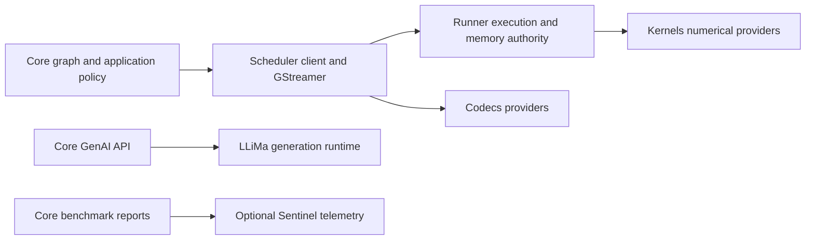

# Архітектура та проєктування репозиторію

Ця сторінка призначена для розробників, яким необхідно зрозуміти, як структурована бібліотека, де розташовані основні компоненти та як розширити структуру, не порушуючи її модульність і контракти середовища виконання.

## Скомпільована межа Scheduler

Core споживає `SimaScheduler::frontend` і типи `simaai::scheduler::client` з незалежним володінням. Через цю скомпільовану межу проходять створення чисельних запитів, інспекція, динамічний вибір, приєднання зупиненого графа, вибраний доступ до пам’яті та запити розкладки відео. Core не відкриває сеанси Runner і не включає інтерфейси реалізації Kernels або Codecs.



Kernels залишається авторитетним джерелом каталогу операцій і чисельного допуску. Scheduler передає узагальнені запити через Runner; ні Scheduler, ні Core не ведуть ідентифікаторів прошивки або таблиці диспетчеризації за операціями. Core зберігає публічні API вузлів, політику геометрії та дротове форматування. Scheduler створює свіжі екземпляри фабрик адаптерів і розв’язувачів після перевірки когорти. Кешований динамічний вибір утримує свою операцію, але прив’язує пам’ять поточного кадру.

GenAI викликає LLiMa напряму, без Runner або GenAI-адаптера Scheduler. Профілювання MLA — окремий, типово вимкнений прохід: Core викликає клієнт Scheduler, а Runner запускає встановлений інструмент командного рядка `mla-rt`. Він потребує вільного DevKit без іншої роботи MLA.

## Володіння інтерфейсами GStreamer

Scheduler володіє транспортом GStreamer та інтерфейсами структурованих помилок, включно зі встановленим заголовком `gst/SimaaiGstErrors.h`. Core споживає ці інтерфейси, а не зберігає другу реалізацію. Ще не випущена версія Core `0.6.0` включає цей перехід володіння файлом. Оновлюйте узгоджений набір пакетів Core/Scheduler разом; ця версія пакета не змінює контракт платформи або чисельний контракт.

## Фреймворк проти середовища

Слово «Neat» використовується для позначення двох пов’язаних, але різних аспектів:

- **Neat Library:** бібліотека C++/Python і середовище виконання, що міститься в цьому репозиторії. Вона завантажує модель.
  створює пакети, формує конвеєри, перевіряє контракти, працює на апаратному забезпеченні Modalix і надає доступ до публічного API.
- **Neat SDK / середовище:** контейнеризований процес розробки, що охоплює роботу з фреймворком.
  зокрема, DevKit Sync, спільні робочі простори та інструменти для агентів.

Під час внесення змін до цього репозиторію оптимізуйте його для властивостей фреймворку, які підтримують як людей, так і агентів: чіткі API, детермінована поведінка, структуровані засоби діагностики, сувора перевірка та стабільні публічні контракти.

## Для чого призначена ця бібліотека?

### Основні користувачі

Розробники, які бажають:
- Створюйте конвеєри з використанням повторно використовуваних складових (без написання стандартного коду GStreamer).
- Забезпечте перевірку конвеєрів на ранніх етапах (з урахуванням вимог безперервної інтеграції) та швидко аналізуйте причини збоїв.
- Запускайте конвеєри та обробляйте кадри мовою C++ за допомогою `appsink`.
- За бажанням, можна передавати дані конвеєра через RTSP (за допомогою `gst-rtsp-server`).
- Надавайте код машинного навчання через вихідні дані, оптимізовані для тензорів, без необхідності писати складний код для GStreamer.

## Права власності на пакет

Вибраний артефакт Core визначає пакети Core, LLiMa та узгоджені залежності Scheduler, які встановлюють разом. Core передає цей повний набір, не вибираючи й не переписуючи версії залежностей. Пакети поза артефактом належать платформі; несумісну платформу слід оновити, а не виправляти через Core чи LLiMa.

Core споживає встановлений клієнтський компонент `SimaScheduler`, а не нижчі інтерфейси розробки CMake. Координатор залежностей Scheduler перевіряє вибраний повний набір Kernels/Runner/Codecs і зберігає його точне походження. Псевдоніми сумісності `SimaRuntime`, що містять лише метадані, не володіють іншою реалізацією. Точка входу збірки й далі готує сусідні вихідні дерева або повторно використовує явно вибрані пакети в порядку Kernels → Runner → Scheduler → Core. Це координує збірки, а не виконання середовища чи активацію прошивки. Див. [побудову локальних залежностей](../build-test/local-dependencies.md).

### Рендерер і необов’язкові постачальники бекендів

Core володіє політикою публікації рамок і масок. Наявні BBOX-дані з рамками, паралельними осям, використовують координати int32; окремий формат орієнтованих рамок `BBOX_OBB_V1` зберігає геометрію FP32 і відхиляється рендерером рамок, паралельних осям. Scheduler володіє caps, життєвим циклом і холодним допуском постачальників. Виробнича композиція потребує типізованої можливості int32 рендерера; вона не переінтерпретовує ці значення як float і не додає перетворення на кожному кадрі. Kernels володіє канонічною операцією A65 `render`; Runner володіє виконанням і завершенням доступу ReadWrite до зображення. Scheduler записує перевірену операцію та ідентичності використаних Kernels/Runner. Core перевіряє цю когорту й компонує звичайні залежності без архіву `a65apps`.

Runner записує постачальників платформи окремо від залежностей, які можна розповсюджувати. Core зберігає цей запис і перевіряє встановлену платформу; він не визначає сумісність за номером її збірки й не включає платформні DSO до пакета споживача. Допуск і компонування постачальників описано в [локальних залежностях](../build-test/local-dependencies.md).

### Володіння транспортом середовища виконання

Core споживає встановлений пакет `SimaScheduler`. `SimaScheduler::elements` володіє `neatcamerabridge`, `neatmultipartjpegdemux` і `neatlatestbystreammux`, включно з їхніми типами GObject та локальною реєстрацією в процесі. Точки входу Core у `src/gst/` — це перенаправлення для сумісності, а не другі реалізації. Ці елементи не використовують чисельний виконавець і не потребують Kernels.

Core зберігає публічні API C++/Python, параметри Node, пониження графа, об’єкти Sample/Tensor і приватні кредити графа. `src/pipeline/gst/RealtimeMuxCredits.cpp` проєктує ці кредити через інтерфейс позик Scheduler, що передає лише значення. Реєстр позик mux і спільний лічильник вхідних кадрів мають одного власника в Scheduler. Розкладки ABI камери походять з узгодженого заголовка розподільника, а не приватних копій Core.

Тести реалізації справедливості й зворотного тиску mux, розбору multipart та життєвого циклу батьківського буфера захоплення належать Scheduler. Core зберігає тести публічного API, кредитів графа й наскрізні тести на пристрої. Встановіть узгоджені пакети Runner і Scheduler до побудови Core; внутрішні тести Core безпосередньо компонуються з його транспортною ціллю. Не кваліфікуйте апаратне захоплення або компактні метадані TensorBuffer хостовими тестами без постачальників.

### Додавання чисельних ядер

Для операції, яку можна виразити через наявні тензорні контракти й контракти виконання, розробка належить **лише Kernels і Core**:

1. У Kernels додайте локальний типізований запит операції, перевірений план, чисельну реалізацію, фабрику виконуваного об’єкта й декодер іменованого запиту. Зареєструйте операцію один раз у каталозі Kernels і додайте тести правильності.
2. У Core додайте Node і перетворіть його параметри на канонічний запит: операцію, явну ціль, специфікації входів/виходів і типізовані параметри. Викликайте узагальнений API підготовки Scheduler; не викликайте фабрику операції та не додавайте перемикач операцій до Runner або Scheduler.
3. Перезберіть і встановіть **Kernels → Runner → Scheduler → Core**. Зміна каталогу EV потребує явно скомпонованої узгодженої прошивки, навіть якщо вихідний код Runner не змінився. Кваліфікуйте її за ексклюзивною процедурою роботи з пристроєм.

Підготовка проходить шлях **Core → Scheduler → Runner → Kernels**. Kernels виконує чисельну перевірку; Runner є узагальненим шлюзом. Холодна перевірка не відкриває апаратне забезпечення та не виділяє ресурсів виконання. Утримуйте повернений перевірений виконуваний об’єкт і перевірте його канонічні вимоги, перш ніж допустити повний етап. Потокове виконання використовує той самий об’єкт без повторного декодування назв операцій.

Динамічні варіанти використовують необов’язкову можливість ядра, прив’язану під час налаштування. Core зберігає політику графа/метаданих і наявні обмежені кеші. Промах кешу може уточнити незмінні параметри; постачальник доводить, чи спільні точний тензорний контракт і ресурси, чи потрібна повна повторна перевірка. Влучання кешу не створюють іншої операції та не утримують позик кадрів камери або кодека.

Runner володіє виконанням, ресурсами, когерентністю та завершенням володіння; Scheduler — носіями Gst, плагінами й інтеграцією транспорту. Їхні канонічні встановлені пакети — `SimaRunner` і `SimaScheduler`. Пакет сумісності `SimaRuntime`, що містить лише метадані, перенаправляє історичні цілі до тих самих реалізацій. Псевдоніми заголовків повторно використовують канонічні типи Kernels; залежності статичного компонування можуть залишатися транзитивними. Другої схеми тензорів, розподільника, черги виконання або чисельного реєстру немає.

Чисельні етапи формують `neatkernelrunner`; перемикання чи повернення до вилученого плагіна ProcessCVU немає. Пакування публічних виходів Core залишається залежною операцією хоста з початковою межею метрик. Codecs є окремим бекендом кодування/декодування; його обгортки Gst належать Scheduler, а не Runner чи чисельним Kernels.

Квитанції збірки прив’язують точні встановлені байти й ідентичності використаних залежностей. Вони не є кваліфікацією апаратного забезпечення або продуктивності. Не змішуйте заголовки, архіви, прошивки чи Codecs із неузгоджених пакетів.

Новий транспорт, представлення тензора або можливість виконання — це розширення фреймворку, яке може потребувати змін Runner. Гарантія «лише Kernels/Core» не охоплює такі зміни. Тайм-аут або скасування ніколи не доводить завершення DMA; наявний власник виділення пам’яті має зберігатися до остаточного завершення або перевіреного відновлення платформи.

Core вибирає операції за семантичною назвою, а не ідентифікатором графа прошивки. Kernels надає незмінний каталог назв операцій та їхніх скомпільованих цілей; Runner і Scheduler передають цей каталог без ведення іншого реєстру операцій. Core володіє типізованими правилами переписування графа, включно з обов’язковим злиттям `DetessCast` і `DetessDequant`. Якщо потрібна злита реалізація недоступна, підготовка завершується помилкою замість розбиття операції на окремі ядра. Етап Core не обов’язково відповідає одній операції: TrackKLT і далі готує свій наявний складений запит.

### Відновлення прямого драйвера

`deps/manifest.json` вибирає Scheduler і LLiMa. Встановлений координатор Scheduler перевіряє узгоджений набір Kernels, Runner і Codecs; Core використовує перевірений набір, не дублюючи низькорівневі перевірки платформи.

Відновлення належить вибраній платформі, а не зіставленню помилок диспетчера.
Core не запускає AppComplex, не перезапускає служби диспетчера й не скидає віддалені процесори після помилки інференсу. Runtime повідомляє про завершення й звільнення через контракт драйвера; невідоме завершення не дає дозволу повторно використовувати сховище DMA. Ініціалізація MLA під час завантаження платформи залишається залежністю платформи.

### Володіння пам’яттю

Core використовує інтерфейси виділення та відображення Scheduler, а не фізичні адреси з метаданих, `libsimaaimem` чи другий реєстр виділень. Правила доступу CPU, строку життя відображень, імпортованої пам’яті та батьківських пакетів наведено в [моделі пам’яті](../../advanced-concepts/data-model-contracts/memory_model.md).

Core не вибирає режим когерентності кешу з топології графа. `RunAdvancedOptions::prepare_output_cpu_visible` залишається для сумісності розкладки параметрів; перед фактичним відображенням немає надлишкової завчасної синхронізації. Сумісний за вихідним кодом параметр `defer_output_invalidate` має залишатися true; false відхиляється замість відновлення повільного шляху на стороні виробника.

Асинхронне подання MLA й упорядкована видача виходу використовують окремі наявні шляхи. Зворотний виклик завершення записує кінцевий стан; емітер публікує результат без обслуговування кешу CPU. Шлях подання може допустити наступний кадр, поки ця видача активна, за умови обмеженої місткості каналу та незалежного володіння виділеннями. Саме завершення не повертає кредит допуску: завершений слот залишається у володінні, доки видача його не звільнить. Позики вихідного пулу можуть пережити це звільнення й далі перешкоджати повторному використанню сховища.

Це перекриття не усуває обслуговування кешу й не скорочує ланцюг залежностей усередині одного кадру. Воно не дає незалежній роботі CPU та пристрою виглядати як послідовні зупинки конвеєра, не додаючи іншого робітника синхронізації. Побудова графа задає бюджети один раз; політика планування окремих операцій на кожному кадрі не потрібна.

### Розміщення арени кадру

Core визначає виконавців перед пакуванням носіїв:

- Будь-який запис або читання з EV74 вимагає CMA.
- Носії лише для MLA/A65 за замовчуванням потребують DMS.
- Придатний новий вихід A65 безпосередньо перед явним публічним appsink використовує сертифіковану пам’ять HostCpu.
  Це також стосується однозначно вибраного нативного дочірнього елемента `ModelFragment`. Спільні та явно розміщені арени моделі зберігають свою купу.

Розгалуження враховує всіх споживачів; подання поділяють розміщення свого носія. Сумісні імпортовані DMA-BUF камери/застосунку зберігають сховище, зміщення, кроки й позики батьківського буфера.

Наявний доказ життєвих циклів пакує кожну купу окремо. Scheduler виділяє частини через Runner і визначає кожен діапазон у межах одного виділення без копіювання.

Типово вибрана купа є обов’язковою. Внутрішній явний вибір `ArenaDmsPolicy::PreferDmsThenCma` обмежений DMS-виділеннями Core без доступу EV74.

Core публікує для кожного етапу власний `FrameLayout` із діапазонами відносно окремого виділення. Програми ядер, MLA і TVM використовують спільний типізований інтерфейс приєднання Scheduler. Перебудуйте Core та Scheduler разом; публічний ABI Runner не змінюється.

### Типова когерентність від пристрою до CPU

Існує один підготовлений механізм пам’яті. `SIMA_CORE_DEMAND_COHERENCY_V1` і експериментальний параметр збірки Runner видалено; налаштовуйте свіжі збірки без них. Не залишилося ввімкнення через середовище чи пониження всього графа до Legacy. Core використовує лише інтерфейси виділення, відображення та етапів Scheduler. Публічна геометрія тензорів, запити Kernels і чисельна поведінка не змінюються.

Спільний контракт отримання доступу та строку життя визначено в [моделі пам’яті](../../advanced-concepts/data-model-contracts/memory_model.md).

#### Відображення логічного тензора з DMA-сховищем

Публічний `Tensor::map()` і його псевдонім `view()` зберігають наявний контракт відображення сховища: застосовують `byte_offset` один раз і можуть надавати кінцеві байти базового сховища. Межі іменованих сегментів і зворотні виклики відображення застосунку залишаються авторитетними. `TensorBuffer::map()` і далі відображає сховище безпосередньо.

Внутрішні споживачі з обмеженням за формою натомість використовують `map_dense_tensor_read()`. Ця функція перевіряє додатні кроки й переповнення відносно поточної геометрії, а потім надає лише фізичний діапазон тензора, включно з проміжками кроків. DMA-сховище Core може дозволити цей точний діапазон. Обгорнуті або власні зворотні виклики зберігають наявну поведінку відображення й очищення; допоміжна функція перевіряє повернену ними місткість перед звуженням логічного подання. Геометрія не кешується між змінюваними поданнями тензорів. Складені зображення та закодована або невизначена геометрія зберігають наявний шлях відображення; щільний логічний діапазон не дозволяє доступу до їхніх інших площин.

Scheduler може повторно використовувати вже кваліфіковану видимість поточного покоління Runner для точного подання. Перше читання після запису пристрою, непокритий діапазон або некваліфікований імпорт зберігає синхронізацію експортера. Активні записувачі, незавершена робота пристрою та карантин залишаються помилками. Відображення утримує і початковий зразок Gst, і поточне публічне сховище/позику виробника до завершення доступу CPU. Не змінюються режим володіння, копіювання навантаження, очищення WRITE-END або розкладка публічних об’єктів.

Помилка `resource_busy` етапу ядра не обов’язково означає вичерпання місткості подання. Її очищене й обмежене поле `Reason` зберігає початкову діагностику доступу, реєстрації, володіння або місткості. Перевірте цю причину перед зміною паралельності; не використовуйте буфери повторно, поки володіння або завершення пристрою не визначено.

### Володіння кодеками

Scheduler володіє `neatdecoder`, `neatencoder` та їхньою адаптацією до GStreamer. Codecs володіє сеансами декодера/енкодера й чисельними реалізаціями. Використовуйте узгоджені встановлені заголовки й бібліотеки; не копіюйте код бекенда до Runner і не поєднуйте обгортки з іншим ABI бекенда.

### Конфігурація апаратного енкодера

`SimaEncode` і сирий `VideoSender` виводять роздільність з узгоджених вхідних caps.
Роздільність фіксована протягом одного запуску; її зміна потребує нового запуску.
Параметри енкодера не містять ширини або висоти,
а вхідний адаптер зберігає видиму геометрію без масштабування.
Невідомі розміри входу залишаються невідомими в контракті виходу під час побудови,
доки попередній вхід їх не надасть.

`SimaEncode` готує сирий вхід один раз і відображає специфічні параметри кодека на `neatencoder`.
Scheduler володіє адаптацією GStreamer і публікацією виходу; Codecs володіє сеансом енкодера. Runner зберігає повноваження володіння пам’яттю та синхронізації. Core не додає потоку виконання енкодера.
Застарілий `H264EncodeSima` зберігає свій вхідний контракт без адаптера, використовуючи спільне формування властивостей енкодера. Зміни розкладки публічних класів включено до ABI 6, і вони потребують перезібраних бінарних споживачів; наявні точки входу вихідного коду залишаються доступними.

### Типові робочі процеси

- **Декодування/обробка:** файл або RTSP -> демультиплексування/розбір -> декодування -> перетворення/налаштування параметрів -> appsink -> споживач, написаний на C++
- **Перевірка:** збірка + аналіз + попередня обробка (У СТАНІ ПАУЗИ), щоб на ранніх етапах виявити проблеми, пов’язані з узгодженням.
- **Надання RTSP:** передавайте синтезовані кадри в конвеєр RTSP-сервера, використовуючи `appsrc`.
- **Адаптер тензорів зображень/відео:** зображення/відео/RTSP -> декодування -> перетворення/масштабування -> `add_output_tensor(...)` -> `Run::pull_tensors()`.
- **Навчальні матеріали:** почніть з [Навчальні матеріали](/tutorials), щоб отримати доступ до структурованого навчального курсу, який можна використовувати на практиці.

### Стандартизований виробничий конвеєр (джерело істини).

Канонічний «шлях для виробничого середовища» для цього репозиторію такий:
**вхідні дані -> попередня обробка -> MLA -> постобробка**. Джерело істини знаходиться тут:
`tests/e2e_pipelines/obj_detection/sync_yolov8_test.cpp`.

Коли цей тест змінюється, оновіть файл README та розділ «Архітектура», щоб забезпечити узгодженість документації.

### Концептуальна модель (бізнес-логіка ↔ сполучна ланка конвеєра)

Ваша програма зберігає бізнес-логіку, а фреймворк забезпечує зв’язок між елементами конвеєра.

```text
Business logic
    |
    v
Nodes/Graph fragments  ->  GStreamer fragments  ->  caps negotiation  ->  runtime (Run)
    |                                                           |
    +-----------------------------------------------------------+
                                Sample / Tensor
```

---

## Основні поняття

Ця структура навмисно організована навколо невеликої кількості ключових понять. Більшість коду, який пише користувач, стосується лише `Model`, `Graph`, `Run`, `Tensor` та `Sample`; розробники, що працюють на нижчому рівні, також працюють з `Node`, повторно використовуваними фрагментами графа, аналізом MPK-контрактів і внутрішньою структурою графа.

| Концепція | Роль |
| --- | --- |
| Архів моделі | Запакований у формат `.tar.gz` артефакт, що містить контракт для виконання MPK, конфігурації, призначені лише для плагінів, бінарні файли моделі та артефакти ядра. |
| `Model` | Публічний завантажувач для архіву моделі у форматі `.tar.gz`. Він аналізує контракт MPK, виконує планування маршруту, надає доступ до етапів моделі та забезпечує прості точки входу для виконання `run(...)` / `Graph`. |
| `Tensor` | Введений числовий блок даних із зазначенням типу даних, розмірності, структури, способу зберігання, пристрою та семантичних метаданих. |
| `Sample` | Оболонка для даних, що використовуються під час виконання, навколо тензорів, списків тензорів або наборів. Перевірте `Sample::kind` перед читанням полів. |
| `Node` | Атомарна стадія конвеєра, яка генерує детермінований фрагмент GStreamer і повертає імена відповідних елементів. |
| Фрагмент графа, який можна повторно використовувати. | Готовий `Graph`, який розширюється до кількох вузлів, наприклад, декодованого вхідного потоку RTSP або етапів моделі. |
| `Graph` | Межа збірки та перевірки. Вузли, моделі та фрагменти графа, які можна повторно використовувати, стають узгодженим, структурованим конвеєром. |
| `Run` | Активний об’єкт конвеєра, який повертається функцією `Graph::build(...)`; він відповідає за життєвий цикл операцій над даними (завантаження/вивантаження/середовище виконання). |
| Граф | Використовуйте граф для побудови DAG (направленого ациклічного графа) всередині одного конвеєра; використовуйте граф середовища виконання для координації етапів/виконань між різними конвеєрами. |

Читайте зв’язки зліва направо:

```text
model archive on disk -> Model -> Graph fragments/Nodes -> Graph -> Run
                                           |
                                           v
                                  Tensor/Sample flow
```

`Model` є початковою точкою для користувачів-початківців, але це не окремий модуль виконання. Він використовується для створення фрагментів/вузлів графа, які можна додавати до `Graph`. `Graph` є центральною концепцією для збирання; `Run` – це активний об’єкт після створення.

## Принципи дизайну для авторів

Це основні принципи архітектури, що забезпечують надійність роботи фреймворку. Використовуйте їх, коли обираєте між різними варіантами реалізації.

- **Детермінованість перемагає.** Зберігайте назви елементів, згенеровані рядки для конвеєра, серіалізовані дані конвеєра.
  поля звіту та результати тестування мають бути відтворюваними. Діагностика та цикли роботи агента залежать від стабільних ідентифікаторів.
- **Зручність налагодження є пріоритетною.** У разі виникнення помилок мають генеруватися структуровані дані, а не лише текстові рядки:
  `GraphReport.error_code`, `repro_note`, повідомлення шини та конвеєри бекенду, які можна повторно запускати.
- **Не використовуйте непомітний механізм резервного копіювання.** Не приховуйте помилки вхідних даних моделі або збої апаратного забезпечення/середовища виконання, просто мовчки ігноруючи їх.
  перетворення форматів, зміна сімейств графів, перехід на використання центрального процесора або обробка помилок плагінів.
- **Здійснюйте перевірку перед запуском.** Віддавайте перевагу структурній перевірці, перевірці великих літер, форми та відповідності вимогам перед початком роботи в середовищі виконання.
  починаються потоки або виділяються апаратні ресурси.
- **Контракт MPK є еталонним джерелом істини.** Основні функції: маршрутизація, тип даних, форма, квантування та
  рішення щодо кожного етапу мають надходити з файлів `mpk.json` / `*_mpk.json`. Файли JSON для кожного етапу є приватною власністю плагіна.
- **Логічний ранг Detess і геометрія виконання відокремлені.** Зберігайте визначений MPK `frame_shape`; інтерпретацію рангу 2 як NC/HW допускайте лише тоді, коли байтові діапазони однозначно визначають геометрію. Об’єднаний DetessDequant передає обидва дескриптори через один покадровий контракт: ранг плитки визначає ранг ядра, початкові пакетні виміри залишаються окремими, а семантичні осі, байтові діапазони, кроки та явне кодування плиткового сховища — авторитетними. Core передає ці канонічні типізовані контракти через Scheduler; Kernels перевіряє вибрану операцію й кодування. Не відтворюйте підготовлений запит ProcessCVU на межі DSO.
- **Політика чисельного бекенда має одне джерело істини.** Перевірена можливість визначає підтримувані цілі та перевагу AUTO. Явна ціль етапу чи сеансу або виконується на запитаному підтримуваному бекенді, або завершується помилкою; подальші перевизначення за роллю не можуть суперечити цьому рішенню.
- **Публічні API залишаються стабільними.** Публічні заголовні файли, що містяться в `include/*`, встановлюються та підтримуються.
  Віддавайте перевагу поступовим змінам і механізмам відмови від застарілих функцій, а не різким змінам у структурі.
- **Паралельність має бути обмеженою та відстежуваною.** Робота в потоці даних має бути легкою;
  діагностика на стороні зонда потребує використання атомарних операцій або еквівалентних механізмів безпечної обробки в багатопотоковому середовищі; завершення процесу не повинно призводити до зависання.

## Шлях виконання моделі.

Для конвеєрів, що базуються на моделях, загальна схема така:

```text
input Sample/Tensor
  -> optional preprocessing / format normalization
  -> MLA inference stages selected from MPK contract
  -> optional postprocessing / box decode
  -> output Sample/Tensor
```

Видима для користувача угода `Model` навмисно простіша, ніж апаратна угода MLA.
MLA може вимагати використання INT8/BF16 і тесельованих макетів, тоді як код користувача зазвичай працює з FP32 і звичайними макетами тензорів. Фреймворк усуває цю різницю за допомогою адаптерних етапів, керованих маніфестом.

Попередня та подальша обробка є явними етапами/параметрами фреймворку. Невідповідність формату, відсутні обов’язкові метадані попередньої обробки, недоступний вибраний апаратний транспорт, недопустимий архів моделі або контракт MPK чи помилка узгодження caps мають давати зрозумілу структуровану помилку з діями для усунення, а не приховане виправлення під час виконання.

### Публічний план виконання

`Model::execution_plan(...)` повертає те, що виконав би `build(...)` з тими самими аргументами: вузли графа моделі в порядку конвеєра, де виконується кожен вузол (`A65`, `EV74` або `MLA`), і тензори на ребрах між ними. Він викликає `build(...)` з вимкненою стартовою перевіркою, зчитує план, який збірка записала в `DiagCtx` після планування розміщення та публікації, і закриває конвеєр, тому потребує того самого пристрою, що й `build(...)`. Це публічне діагностичне подання, окреме від внутрішнього `ModelExecutionPlan`, описаного нижче. Його JSON-контракт — `schemas/execution_plan_v1.schema.json`; `schema_version` змінюється лише тоді, коли зміна ламає наявних читачів. Підсумок пам’яті враховує кожне власне виділення один раз і позначає його як `CMA`, `DMS`, `HostCpu` або `Mixed`; явну політику резервного переходу з DMS позначено бажаною купою.

### Телеметрія плати

`TelemetryMonitor` читає потужність і телеметрію плати з Sentinel, демона телеметрії плати, через його HTTP API на `/run/simaai-sentinel/api.sock`; Core не читає мікросхеми моніторингу живлення самостійно. `start()` один раз читає кеш зразків Sentinel, щоб отримати визначення метрик, інтервал між зразками та найновіший зразок, який передує вікну й не враховується. Потім робочий потік запитує останній зразок незадовго до появи кожного наступного й враховує кожен новий зразок у поточному зведенні рівно один раз, розпізнаючи його за позначкою часу. Якщо позначка часу не відстоїть від останньої врахованої рівно на один інтервал, робочий потік враховує пропущені зразки з кешу, який зберігає 240 останніх зразків Sentinel. Монітор нічого не створює в Sentinel, тож одночасно може працювати будь-яка кількість моніторів, а примусово завершений процес нічого по собі не залишає.

Типовий монітор використовує вказаний вище сокет. Явний `TelemetryMonitor(socket_path)` вибирає інший Unix-сокет Sentinel лише для цього екземпляра; `Model::benchmark()` зберігає типову кінцеву точку.

`Model::benchmark()` використовує цей самий монітор, а не другий механізм трасування. Він заздалегідь готує з’єднання та робітника, що очікує, перед таймером пропускної здатності, активує вікно після початку вимірювання й закриває його після завершення всіх потрібних виходів, але до зупинки вимірювання. Активація та закриття нічого не виділяють, не захоплюють м’ютекс, не очікують завершення потоку й не звертаються до Sentinel. Лише потім бенчмарк очікує робітника й остаточно читає кеш. Поточні опитування обмежені читанням UTC перед перевіркою зупинки, тому закриття не може допустити пізніший зразок. Прив’язування даних бенчмарка перевіряє позначки часу UTC зразків і парні межі UTC/монотонного часу; виявлені стрибки годинника роблять телеметрію недійсною замість зміни виміряної пропускної здатності. Автономні монітори зберігають відновлення за порядком кешу після переведення годинника назад.

Sentinel робить зразок приблизно кожні 2 с, тому прохід вимірювання пропускної здатності триває щонайменше `BenchmarkOptions::min_duration_ms` (типово 10 с). Прохід вимірювання затримки дотримується того самого мінімуму, тож обидва проходи зупиняються за одним правилом. Якщо Sentinel не запущено або у вікні немає зразків, бенчмарк усе одно повертає затримку та FPS; поля потужності дорівнюють нулю, а `telemetry.status` називає причину. Режим плати в `tools/install_neat_framework.sh` встановлює Sentinel або оновлює його до останньої виробничої збірки. Якщо це не вдається, інсталятор виводить попередження й продовжує роботу; пізніше виконайте `sima-cli neat install sentinel` або, як у CI, задайте `NEAT_INSTALLER_SENTINEL_REQUIRED=ON`, щоб збій зупиняв встановлення. Застарілий монітор потужності `Run` (`RunOptions::power_monitor`) також отримує дані із Sentinel: Core опитує його останній зразок і не читає мікросхеми моніторингу живлення через I2C.

Профілювання MLA явно вмикається через два поля `BenchmarkOptions`, які типово мають значення false: `include_mla_layer_stats` і `include_mla_stage_stats`. Після закриття виконавців вимірювання затримки та пропускної здатності Core вимірює виконувані файли MLA розпакованої моделі через клієнт Scheduler, виконуючи проходи профілювання один за одним. Статистика шарів MLA охоплює лише стадії MLA у вибраному маршруті інференсу з урахуванням його термінальної політики. Runner запускає `mla-rt` в окремому процесі для кожного виконуваного файлу. Статистика шарів MLA також використовує YAML статистики компілятора; статистика стадій MLA запускає кожен виконуваний файл MLA 200 разів без перерви й зчитує середнє значення `tile.lat` із файлу статистики `mla-rt`. Runner перевіряє вхідні та вихідні дані й очищає тимчасові файли; він зупиняє `mla-rt`, якщо один запуск триває понад 120 с. MLA-RT відповідає за апаратне профілювання та повернення керування до виконання через ядро. Профілювання не має перетинатися з іншими навантаженнями MLA. Шлюз бенчмарка серіалізує виклики бенчмарка, а не інші API інференсу чи застосунки.

Запуск `mla-rt`, який завершився з помилкою, аварійно завершився або був зупинений, може залишити роботу MLA незавершеною, тому Runner більше не запускає `mla-rt` у цьому процесі. Наступні проходи профілювання повідомляють, що MLA потребує відновлення. Тримайте DevKit вільним, доки відновлення MLA не буде перевірено.

Профілювання виконується за принципом best effort. Якщо `mla-rt` відсутній, завершується з помилкою, перевищує час очікування або записує непридатний вивід, Core зберігає основні вимірювання, залишає відповідний список порожнім, виводить попередження й записує причину в `mla_layer_stats.status` або `mla_stage_stats.status`. В інших випадках статус має значення `"not requested"` або `"ok"`.

`BenchmarkReport::mla_layer_stats` містить для кожного скомпільованого шару MLA індекс виконуваного етапу з нульовою нумерацією, назву та апаратну затримку в мікросекундах з одного проходу профілювання на шар. `BenchmarkReport::mla_stage_stats` містить індекс кожної стадії MLA з такою самою нумерацією та її середню апаратну затримку в мікросекундах. Ці вимірювання використовують окремі проходи профілювання, тому сума затримок шарів не дорівнює ні затримці стадії, ні загальній затримці. `BenchmarkReport::save(file_path)` явно записує повний звіт, використовуючи публічні назви полів та одиниці вимірювання: `.json` вибирає JSON; `.yaml` та інші закінчення вибирають YAML. Звіт містить телеметрію, обидва статуси та порожні списки MLA, коли профілювання вимкнено. Метод створює відсутні батьківські каталоги й атомарно замінює наявний цільовий файл.

Вилучені параметри PreparedRunner мають залишатися типовими. Для паралельності використовуйте `processcvu.async` і `GraphOptions::async_queue_depth`; старі прапорці деквантування та профілювання не мають прямої заміни. Залиште `advanced_execution.defer_output_cache_sync=true` і використовуйте CPU-відображення Tensor/GstMemory для доступу до виходів. `RunOptions::advanced.prepare_output_cpu_visible` — поле сумісності без дії, а не запит завчасної синхронізації кешу.

### Контракт виконання скомпільованої моделі

Перехід на драйвер DMA-BUF відокремлює семантику моделі від сховища окремого кадру.
Core компілює факти завантаження моделі в єдиний незмінний внутрішній
`ModelExecutionPlan`:

- значення містять точні імена, потрібні байти, необов’язкові факти логічного типу
  та необов’язковий вираз читання відносно кореня `{source ValueId, byte offset,
  byte strides}`;
- операції містять точні впорядковані ребра та специфічну конфігурацію;
- порти бекенду MLA містять порядок ELF/моделі, точні потрібні байти, джерело вимог вирівнювання та напрям доступу; і
- публічні виходи містять лише порядок публікації та значення, яке вони надають.

Маніфести MPK використовують `MpkDecoder`. `MpkDecoder::load` — єдина точка входу для
маніфесту: завантаження моделі, побудова підготовленого середовища виконання та хост
PCIe один раз читають `mpk.json` через неї, а семантичний `MpkContract` вона будує з
тих самих байтів, які декодує допуск. Необов’язковий рядок
`model_sdk_version` зберігається як інформація про походження й не обмежує допуск.
Декодер приймає лише точний зареєстрований словник `(processor, kernel)`,
розв’язує повні імена тензорів, перевіряє рівняння байтів операцій і окремо узгоджує кожен етап MLA MPK з точною топологією IFM/OFM його ELF.
Декодер поєднує свідчення виконуваних файлів і за логічним ID етапу від компілятора,
і за токеном виконуваного файлу маніфесту; порядок архіву та суфікси імен файлів не є семантичними свідченнями.
Отриманий незмінний план надає перевірений ключ
`{stage index, op ID, logical stage ID, executable}` і попередньо індексовані впорядковані діапазони портів для кожної операції MLA.
Неоднозначність, відсутні слоти або суперечливі свідчення є помилками завантаження моделі;
сторонній JSON, пошук підрядків, стан середовища та буфери часу виконання не є свідченнями.

Core може узгоджувати різні порядки вхідних і вихідних буферів за однозначного відображення,
зокрема пакетні входи та виходи. Застосунки зберігають публічні імена тензорів моделі, їхній порядок і порядок зразків.

Моделі з одним входом, пакетом один і звичайним просторовим зберіганням можуть використовувати автоматичне доповнення вхідних каналів.
Застосунки зберігають логічну форму тензора моделі; власне доповнення просторового сховища не входить до підтримуваної області.

Артефакт AFE з розширенням `.so` класифікується за етапом MPK. Для `processor="MLA"` Core перевіряє топологію ELF без завантаження в хостовий процес і передає артефакт MLArt. Хостовий модуль A65 з компіляторними `input_names`, `input_types` і `output_types` стає типізованою програмою TVM. Застаріле вирівнювання EVO залишається явною 4096-байтовою політикою `LegacyPolicy`; нові типізовані контракти оголошують власне вирівнювання.

Кадри часу виконання не копіюють статичний план. Прямий шлях несе стандартне володіння DMA-BUF,
перевірені абсолютні представлення `{fd, offset, length}` та обмежений життєвий цикл слота кадру.
Unpack і Slice є виразами читання споживача, а не операціями часу виконання:
декодер складає їх до одного матеріалізованого кореневого носія лише після доведення точних зсувів,
кроків у байтах і фізичних діапазонів. Pack, tessellation і перетворення точності залишаються
семантикою виробника/обчислень, якщо прохід зниження не доведе точне виробництво бекендом або рівнозначне злиття.
Це не дозволяє розміщенню сховища непомітно змінювати арність портів MLA чи поведінку моделі.

Усі етапи MLA прийнятого графа проєктуються через той самий збережений `FrameSlotArenaPlan`. Перший матеріалізувальний етап виділяє області за купами; наступні утримують їх через `ReuseInput` і передають точні діапазони IFM/OFM у відповідному DMA-BUF. Допоміжні проєкції без етапу потребують однозначного графа з одним MLA.

Незмінний пакет MPK Core є авторитетним джерелом контракту інференсу. Логічні публічні форми залишаються відмінними від нативних діапазонів зразків MLA, подань виконання CVU для всього пакета й місткості базового сховища. Подання Detess другого рангу нормалізуються лише тоді, коли фактична байтова геометрія входу/виходу визначає однозначну форму виконання. Злиття вибирається через семантичний пошук операцій, а ніколи через таблицю ідентифікаторів графів Core.

#### Канонічна ідентичність і вибрана публікація

Core остаточно визначає ідентичність чисельного етапу під час створення скомпільованого контракту. Він нормалізує підтримувані написання моделей і відхиляє розбіжності між операцією, сімейством і переліком сімейств. Застарілі ідентифікатори графів і дескрипторів не є повноваженням виконання. Нормалізація ідентичності не робить неповний семантичний контракт повним; Kernels і далі володіє пошуком операцій і чисельним допуском.

Для передавання Preproc, керованого моделлю, геометрія зображення й розмір сховища — окремі відомості. Плиткове доповнення може робити потрібне сховище більшим за щільну кількість скалярів. Core перевіряє поглинутий ланцюг перетворень за типізованим планом моделі, завершує розміщення носіїв і вибраний маршрут виходу, а потім створює надане вихідне подання. Дескриптор середовища виконання, маршрут і публічне подання мають посилатися на те саме остаточно визначене сховище. Більше батьківське виділення не дозволяє замале логічне подання, а однакові кількості байтів не доводять відповідності геометрії.

Автономний упакований Preproc запитує вимоги до сховища в канонічного перевіреного виконуваного об’єкта перед публікацією відомостей або виділенням арени. Він не виводить упаковану місткість множенням логічних розмірів. Місткість для кількох ROI зберігає вісь пакета в публічній формі; автономні подання одного зображення зберігають наявну форму HWC.

Типізовані дескриптори моделі охоплюють повний тензор, включно з пакетним виміром. Кількість повторень їхнього виконання дорівнює одиниці: семантичний розмір пакета не запитує повторного виконання всього тензора. Злиті DetessCast і DetessDequant зберігають явно доведене приватне подання з одиничною віссю, коли опублікований ранг відрізняється від геометрії виконання.

Це правило передавання з одиничною віссю не замінює навмисно відфільтровані вихідні подання, як-от публікацію статусу KLT. Зміни відбуваються під час підготовки, а не виконання кадру. Зберігайте злиті операції, явні зсуви й метадані квантування; не виправляйте невідповідність контракту проміжною копією або чисельним резервним переходом.

#### Підготовка типізованих перетворень

Core один раз визначає зовнішні назви типів даних і дескриптори тензорів MPK під час підготовки графа. Передавання містить перевірені виконувані об’єкти з канонічними контрактами `TensorSpec` і `DType`, включно з точністю кожного входу. Runner і Scheduler не розбирають повторно рядки типів даних окремих операцій. Метадані публікації й носіїв Core залишаються явними та окремими від повноважень чисельних типів.

Форма виконання й опублікована форма не обов’язково однакові. Core явно дозволяє подання з одиничною віссю із семантичного контракту виходу та упаковані подання фізичного сховища з транспортного контракту скомпільованої моделі. Scheduler перевіряє кожну прив’язку виходу щодо цього зв’язку під час підготовки, включно з типом даних, розкладкою, кроками й межами сховища. Однакова кількість байтів сама по собі не дозволяє зміну форми. Ці подання зберігають базове виділення пам’яті; вони не додають копіювання тензора або чисельного перетворення. Зміни контракту виходу потребують свіжої перевірки, зокрема для динамічно підготовлених варіантів.

Еквівалентні написання типів даних приймаються без урахування регістру. Невідомі назви й суперечливі дескриптори відхиляються до виконання. Спільне застаріле кодування BF16/INT16 потребує явного семантичного типу. Помилки запиту показують причину без увімкнення докладної діагностики GStreamer.

#### Перевірені чисельні етапи

Під час підготовки графа Core проєктує вихідні області виробника на вхідні прив’язки споживача. Заданий діапазон арени визначає відповідний DMA-BUF і локальний зсув; ідентифікатор області не є індексом `GstMemory`. Спільна проєкція BoxDecode/ArgMax перевіряє межі й зберігає окремий зсув відносно голови. Входи прямих носіїв і прив’язок середовища виконання зберігають початковий режим адресації.

Core понижує етапи Preproc, перетворень і комп’ютерного зору, включно з ArgMax, BoxDecode та SuperPoint, до канонічних запитів і явних відображень тензорних портів. Узагальнений механізм тензорних етапів Scheduler володіє прив’язуванням і публікацією GStreamer; Runner — залежностями, асинхронним виконанням і часом життя буферів під час виконання. Core імпортує місткості носіїв із контракту виділення попереднього етапу або вхідного сховища, а ніколи лише з логічних форм. Чисельні виходи BoxDecode та SuperPoint залишаються приватними; залежний виконуваний об’єкт серіалізації дротового формату Core зберігає публічні навантаження BBOX та ознак без дублювання математики декодування. Орієнтовані рамки використовують окремий серіалізатор `BBOX_OBB_V1` із версією та тією самою залежністю від завершення чисельних обчислень; невдалі обчислення не повинні публікувати застарілі результати.

Незмінний рецепт ядра зберігає визначений виробником формат передачі тензора після перетворення типізованого контракту вузла. Публікація на холодному шляху застосовує цей формат і до нових, і до кешованих caps; семантика ніколи не виводиться з назви ядра чи форми байтів. Публічний тензор OBB залишається щільним UInt8 рангу один із семантикою `BBOX_OBB_V1`.

InputStream переносить визначений формат на кожен повернений тензор до публікації Sample, зокрема на шляхах власної копії та кешованих метаданих. Тому безпосередні `Sample.tensors` і допоміжний API `TensorList` мають однакову семантику виявлення.

Зміни розміру зображення вибирають незмінні, сумісні за ресурсами підготовлені варіанти BoxDecode до прив’язування. Вони не змінюють операцію, яку використовує кадр в обробці. Перший етап RCNN зберігає для кожного рівня групи пропозицій top-K з лічильником і FP16. Core не має завантажувати вилучений плагін objectdecode як резервний шлях.

A65 — це ціль виконання, а не домен пам’яті GStreamer. Плагін і далі імпортує носії DMA-BUF. Прямий тензорний вхід використовує виділення зі спільною CMA, наприклад `Tensor::from_vector(values, shape, TensorMemory::EV74)`; вибраний виконуваний об’єкт і далі працює на A65.

---

## Структура репозиторію.

### Структура високого рівня.

- `include/` – загальнодоступні заголовкові файли (підтримуваний інтерфейс API).
- `src/` – реалізації.
- `docs/` – документація (цей файл)
- `examples/` – невеликі приклади, які можна запустити.
- `tests/` – модульні/інтеграційні тести.
- `python/` – вихідні коди пакета `pyneat`, прив’язки nanobind і тести для Python.
- `old_*` — знімки застарілої монолітної реалізації, що зберігаються для довідки/переходу на нову систему.

### Відкрите дерево заголовкових файлів (`include/`).

Загальнодоступні заголовкові файли розміщуються в `include/<module>/...`.
Приклади: `include/pipeline/Graph.h`, `include/model/Model.h`.

Загальнодоступні заголовкові файли, що містять корисні функції:
- `include/neat.h` (парасолька)
- `include/neat/runtime.h`
- `include/neat/models.h`
- `include/neat/nodes.h`
- `include/neat/node_groups.h`

Навмисно не передбачено загальнодоступного `include/neat/graph.h` заголовного файлу. Тести середовища виконання/компілятора, які потребують базової структури графа нижчого рівня, повинні безпосередньо використовувати вузький набір `include/graph/...` заголовних файлів. Програми, приклади та загальнодоступна документація повинні використовувати єдиний загальнодоступний `simaai::neat::Graph` з `<neat.h>`.

### Внутрішні заголовки та шляхи до плагінів середовища виконання.

Публічні заголовкові файли, що розміщені в `include/`, встановлюються та розглядаються як стабільний API.
Внутрішні заголовкові файли, що розміщені в `src/**/internal`, не встановлюються; у прикладах/навчальних матеріалах слід використовувати лише публічний API.

Спільна ціль CMake Core експортує C++20 та публічні вимоги до GStreamer, OpenCV і JSON. Core збирають із встановленими Scheduler frontend і LLiMa; нижні бібліотеки виконання залишаються залежностями розгортання, а не прямими інтерфейсами розробки Core. Статичні споживачі явно запитують компонент Static і забезпечують його залежності компонування реалізації.

Примітки щодо середовища виконання:

- Встановлені плагіни Scheduler розташовані в `${CMAKE_INSTALL_PREFIX}/${CMAKE_INSTALL_LIBDIR}/neat/gst-plugins`. Для несистемного префікса включіть цей каталог до `GST_PLUGIN_PATH` або `GST_PLUGIN_PATH_1_0`.
- Бібліотеки виконання Runner розташовані в `${CMAKE_INSTALL_PREFIX}/${CMAKE_INSTALL_LIBDIR}/neat/runtime`; використовуйте встановлені цілі CMake, а не бібліотеки дерева збірки.
- Після загальносистемного оновлення плагінів перебудуйте системний кеш GStreamer.

Збирайте Core і його встановлених споживачів із версією заголовка JSON, ABI-сумісною з вибраним пакетом LLiMa. LLiMa експортує методи C++, що містять JSON; сама сумісність синтаксису вихідного коду не доводить сумісності компонування. Квитанції SDK/бібліотек і реальні перевірки компонування мають перевагу над широкою позначкою мінімальної версії пакета.

---

## Запланований vs. стабільний (інтерфейс API)

| Площа / API | Статус | Примітки |
| --- | --- | --- |
| Основний API конвеєра (`Graph`, `Run`, `Tensor`, `Sample`) | Стабільний | Основна підтримувана поверхня C++. |
| Внутрішні компоненти конструктора (`Node`, приватні допоміжні функції для роботи з векторними вузлами, `GraphPrinter`). | Внутрішній | Підтримка лише формату STL, попереднє компонування перед використанням GStreamer. |
| API моделі (`Model`, фрагменти графа, які можна повторно використовувати) | Стабільний | Стандартний шлях інтеграції з архівом моделей. |
| `include/policy/*` | Стабільний | Мінімальні перевірені контракти та налаштування політики за замовчуванням (`Decoder`, `Encoder`, `Memory`, `RTSP`). |
| `include/nodes/groups/ImageToH264RtspGroup.h` | Заплановано | Порожня група-заповнювач. |
| Зв’язки для Python (`python/`, `pyneat`) | Бета | Зв’язування та пакування на основі Nanobind розміщуються безпосередньо в репозиторії; API зосереджується на `Tensor`, `Graph/Run`, `Model` та основних допоміжних функціях для вузлів/груп. |

---

## Модулі та сфери відповідальності

### `builder/` — підтримка контрактів для вузлів і приватної лінійної композиції (без використання GStreamer).

**Мета:** Визначити, як конвеєри складаються з логічних частин.

Основні типи:
- `Node` – інтерфейс, реалізований кожною складовою конвеєра.
- приватні допоміжні функції для роботи з векторами вузлів і `GraphPrinter` — утиліти для створення композицій і засоби діагностики.

**Правило:** засіб створення має переважно використовувати лише STL. Він не повинен містити об’єкти середовища виконання GStreamer.

### `nodes/` – типові складові конвеєра.

**Мета:** Надати готові до використання реалізації Node, які генерують детерміновані фрагменти GStreamer.

`VideoRate()` завжди створює `videorate drop-only=true`, зокрема коли його додає група джерел. Це запобігає дублюванню вихідних заголовків, які спільно використовують пул пам'яті декодера, і зберігає часові позначки джерела. Фабрики `VideoRate()` у C++ та `video_rate()` у Python не приймають аргументів і не дублюють кадри.

Приклади:
- `nodes/io/HttpSource`, `nodes/io/RTSPInput`, `nodes/io/StillImageInput`
- `nodes/common/*` (вхідні, черга, вихід тощо).
- `nodes/sima/*` (вузли для розкодування/кодування/аналізу/обробки платежів від SiMa.ai)
- `nodes/rtp/*` (вспомігальні функції для дешифрування/обробки корисного навантаження)
- `nodes/groups/*` (поширені рецепти для багатокомпонентних систем)

**Контракт:**
Кожен вузол повинен забезпечувати:
- `backend_fragment(index)` — фрагмент GStreamer для цього вузла за вказаним індексом.
- `element_names(index)` – детерміновані імена елементів, що належать цьому вузлу (для діагностики та забезпечення відповідності).

Автономний `Cast` компілює типізовані транспортні подання в канонічний запит `cast`, який Kernels перевіряє для вибраного бекенду. Логічні ідентичності джерела, кроки за осями й байтові зсуви залишаються явними; межі виділень включають адресований діапазон із кроками. Генератор застосовує звичайне визначення цілі й пряму проєкцію арени. Cast використовує ті самі типізовані бюджети виконання та вихідного пулу, що й інші етапи runner: побудова графа вибирає обмежену місткість виконання (одну для синхронних графів Input) і резервує вихідні носії для утримання. Ці бюджети передаються підготовці Runtime, а не генеруються як властивості застарілого плагіна. Переприв’язування компактних вихідних тензорів у публічну підмножину або перевпорядкований TensorSet спочатку матеріалізує метадані у власній оболонці, що утримує батька. Початкова утримувана публікація та сховище навантаження не змінюються.

#### Типізовані інтерфейси зображень і багатоплощинна публікація

`Resize`, `ColorConvert` і `Normalization` — тонкі фабрики над наявним фінальним вузлом `Preproc`. Незмінна приватна політика реалізації в його наявному утримувачі відокремлює семантику інтерфейсів без зміни публічних розкладок Preproc або PreprocOptions. Специфічна для моделі поведінка ROI/шаблона джерела залишається доступною лише в застарілому злитому режимі. Resize допускає обмежену динамічну геометрію входу з фіксованими розмірами виходу; перетворення кольору й нормалізація фіксують геометрію на один запуск.

Компіляція сирого зображення зберігає точні перевірені чисельні дескриптори кожної площини й одне фізичне виділення зображення. Додатковий API публікації зображень Scheduler перевіряє ідентичності бекендів площин, абсолютні зсуви арени, кроки й межі, а потім публікує одне зображення `GstVideoMeta` з динамічними `GstSimaMeta`. Він не публікує дескриптор набору тензорів і не вигадує сукупний чисельний тензор. Core утримує перевірені метадані публікації зображення в скомпільованому контракті середовища виконання та згенерованому етапі до підготовки будь-якого чисельного рецепта. Запит кінцевого виходу виконується на цій раннішій фазі: чисельні дескриптори площин не мають ставати публічними перевизначеннями тензорів. Іменовані селектори й далі перевіряються. Перевірені сирі caps і `GstVideoMeta` залишаються авторитетним джерелом розкладки зображення. Внутрішній цикл серіалізації метаданих у JSON і назад зберігає впорядкований дескриптор зображення, але не відновлює виконуваний об’єкт. Підготовка рецепта порівнює кожне поле дескриптора з перевіреним контрактом виходу, а потім створює окреме подання з базою арени; задані відносні зсуви площин залишаються незмінними. Нормалізація натомість публікує тензор BF16. Імпорт публічного сирого відео зберігає повновисотну площину UV формату NV16 і того самого власника зображення.

Нові етапи зображень зберігають відомі часові caps попередніх етапів у холодній, локальній для етапу проєкції OutputSpec. Межа без OutputSpecProvider робить недійсною лише успадковану частоту для цієї суворої проєкції; пізніший явний постачальник caps може її відновити. Приватне навантаження передає отриманий дріб до публікації сирого зображення. Невідомі частоти залишаються пропущеними; роботи на прогрітому кадрі чи виведення частоти не додається. Застаріла проєкція OutputSpec за принципом найкращих зусиль не змінюється.

Нативні розкладки зображень зберігають проміжки; сумісний з енкодером NV12 використовує встановлене авторитетне джерело відеорозкладки Runner і явну політику ядра InitializeStorage. Записувач EV ініціалізує оголошені кінцеві частини рядків і рядки сховища при кожному виклику; запас виділення/сторінки не є неявним доповненням, доступним для запису. Core ніколи не ініціалізує доповнення навантаження й не перепаковує вихід на A65. Наявна диспетчеризація злитого Preproc, сумісність метаданих і арифметика BF16 не змінюються.

---

### `gst/` — набір невеликих утиліт GStreamer.

**Призначення:** Невеликі обгортки/допоміжні функції для типових шаблонів GStreamer.

Приклади:
- ініціалізація (`GstInit`)
- аналіз рядків для запуску (`GstParseLaunch`)
- розпакування/перетворення даних у рядок для шини (`GstBusWatch`)
- допоміжні функції для обробки великих літер / інтроспекція елементів (`GstHelpers`, `GstIntrospection`)
- тачпади / допоміжні інструменти для зондування (`GstPadTap`)

**Правило:** `gst/` не повинен залежати від `pipeline/` (щоб уникнути циклічних залежностей і надмірного розростання «службового шару»).

### `pipeline/` – оркестрація середовища виконання та публічний API.

**Мета:** Керування повним життєвим циклом середовища виконання: створення -> аналіз -> запуск -> використання -> завершення, з можливістю діагностики.

Основні типи:
- `Graph` — основна точка входу для користувачів.
- `Run` – обробник запущеного конвеєра з використанням API для надсилання та отримання даних.
- `Sample` — структурований блок даних, що повертається у відповідь на запити.
- `GraphReport` – структурована діагностика збоїв, зупинок і відтворення.
- `Errors` — винятки (`NeatError`), що містять звіт.

#### Семантика обробки помилок.

`GraphReport.error_code` — це стандартне поле для автоматизованої класифікації помилок. Структура середовища виконання/збірки/вхідних/вихідних шляхів відображає критичні помилки на стабільні групи коду:

- `misconfig.pipeline_shape`
- `misconfig.caps`
- `misconfig.input_shape`
- `misconfig.input_capacity`
- `misconfig.media_caps`
- `misconfig.tensor_dtype_missing`
- `misconfig.option_out_of_range`
- `build.parse_launch`
- `build.pipeline_syntax`
- `build.plugin_missing`
- `build.property_invalid`
- `runtime.pull`
- `runtime.element_failed`
- `runtime.output_timeout`
- `io.parse`
- `io.open`
- `io.file_not_found`
- `io.permission_denied`
- `io.rtsp_connection_failed`
- `io.camera_not_found`
- `codec.*`, `resource.*`, `infra.*` та `internal.*`.

Помилки GStreamer проходять через один внутрішній парсер, класифікатор і модуль рендерингу.
Класифікація віддає перевагу версіонованому ідентифікатору діагностики Neat, потім нативній області/коду GStreamer і фабриці елементів, а потім використовує більш вузькі відображення сумісності для старих плагінів. У разі невідомих помилок використовується `runtime.element_failed`; вони не повідомляються як `misconfig.media_caps`, якщо переговори фактично не завершилися невдало. Коли конвеєр генерує кілька помилок, відображається найбільш конкретна основна причина, і кожна помилка зберігається в журналі.

`GraphReport.repro_note` – це зведена інформація, призначена для користувача. Продуктивний рендеринг містить причину, виражену простою мовою, відповідні спостережувані/очікувані значення, конкретні дії користувача та стабільний ідентифікатор діагностики. Необроблені рядки плагінів, розташування джерел і область/код GStreamer призначені лише для налагодження. Закладений загальнодоступний код додається один раз під час створення `NeatError`.
`GraphReport.bus` є джерелом істини для деталей помилок плагінів/середовища виконання.
Для процесів build(input), `GraphReport.build_adaptation` фіксує вирішену політику/можливість форми, джерела для початкових/максимальних обмежень, джерело захисту байтів і застосовані/пропущені дії адаптації.
Для процесів отримання даних у середовищі виконання, які не викликають виключень, `PullError.code` використовує ту саму таксономію. Помилки робочого процесу вхідного потоку зберігають типізований код помилки та передають його через межу робочого потоку, тому `Run::pull()` і перекладач винятків Python відображають одну й ту саму `NeatError`.

Порядок пріоритетів підтримки:
1. відро за `error_code`
2. прочитайте `repro_note`
3. спочатку перевірте наявність помилок у першому терміналі `bus`.
4. відтворити з використанням `repro_gst_launch`

Обгортки помилок форматують діагностику перед передаванням діагностичного звіту. Форматувати звіт і переміщувати його в окремих аргументах конструктора небезпечно, оскільки порядок обчислення аргументів може втратити початкове повідомлення. Очищення має зберігати і повідомлення винятку, і структурований звіт.

##### Діагностика чисельного Runner

Типовий шлях `neatkernelrunner` зберігає канонічні категорію помилки, фазу, поле й необов’язкове правило/причину ядра Runtime через версійні деталі помилок GStreamer. Підготовка графа використовує те саме відображення діагностики. Core показує ці помилки; він не дублює перевірку ядра та не виводить підтримку з тексту помилки. Помилки запиту, непідтримуваної реалізації, прив’язування та залежностей мають окремі коди `misconfig.kernel_request`, `misconfig.kernel_unsupported`, `runtime.kernel_binding` і `runtime.kernel_dependency`. Відсутня інформація про правило чи фазу залишається недоступною. Тайм-аут не є завершенням роботи пристрою та не дозволяє повторного використання буфера.

#### Внутрішня діагностика конвеєра.

У рамках `src/pipeline/internal/` (лише для внутрішнього використання):
- `Diagnostics.h` – спільні типи діагностичних даних, що використовуються в середовищі виконання:
  - `DiagCtx` (журнал шини + звіти вузлів + лічильники меж/елементів)
  - `BoundaryFlowCounters` (атомарні лічильники, значення яких оновлюються з потоків даних).
  - `ElementTimingCounters` (атомарний облік часу обчислень для кожного елемента)
  - `ElementFlowCounters` (атомарна статистика потоку для кожного елемента)
- `GstDiagnosticsUtil.h` — допоміжні функції для форматування та збору даних діагностики GStreamer.

#### Типізований контракт етапу Scheduler {#sima-static-manifest-context-contract}

Core передає незмінні об’єкти `StageRequest` через встановлений клієнт Scheduler. Кожен запит володіє розкладкою кадру, публікацією виходу та перевіреною програмою ядра, MLA або TVM. Scheduler перевіряє зупинену групу перед приєднанням і утримує цих власників під час виконання.

##### Виконання та допуск моделі

Виконання моделі використовує допущений шлях DMA-BUF. `ModelPack` відокремлює перевірку метаданих MPK
від підготовки виконуваного плану: перевірка описує модель без відкриття пристроїв або вимоги її виконуваних артефактів;
виконання потребує допущеного плану семантичних команд, фізичних команд і арени кадрів.
Підготовлений план кешується та повторно використовується клонами графа й синхронного виконавця.
Маршрутизація зберігає поділ компілятора на попередню обробку/інференс/подальшу обробку
й не змінюється, коли кеш виконуваних файлів стає готовим.

Публічна точка входу фрагмента моделі компілює володіння для вибраних команд
тим самим планувальником арени кадрів. Входи застосунку зберігають свої фізичні прив’язки та DMA-BUF сховище;
вони не вважаються ареною повної моделі.
Фрагменти моделі та типізовані CVU-етапи, які належать моделі й беруть участь у виконанні,
спільно використовують один локальний для побудови план розміщення, зберігаючи ідентичності команд і значень.
Кешований план повної моделі залишається незмінним.
Попередня обробка моделі також бере участь у цьому локальному плані побудови та утримує виділення для наступних етапів.

Передавання на пристрої та виділення пам’яті InputStream використовують стандартну DMA-BUF пам’ять
і визначене розміщення CMA/DMS. Спільні оболонки TensorSet утримують пам’ять кожного джерела,
її батьківський буфер і наявний кредит позики, навіть коли сусіднє CPU-поле потребує пакування.
Явна CPU-пам’ять і виходи Owned залишаються підтримуваними;
обов’язкове виділення для пристрою завершується помилкою замість непомітного переходу на CPU-пам’ять.
Застосунки не вибирають бекенд пам’яті й не ініціалізують GStreamer.

Перевага виділення вхідної пам’яті та допуск під час виконання є окремими рішеннями.
Core визначає обидва з оголошеного `Input` і його виконуваного подальшого маршруту під час побудови;
він не переписує `Auto` на явну вимогу пристрою.
`PreferDeviceZeroCopy` надає перевагу пам’яті пристрою, не відхиляючи наявний CPU-вхід.
Явні політики EV74/DMS0 і маршрути лише для пристроїв зберігають перевірки видимого пристрою входу.
Маршрути з перевагою пристрою передають сховище `Tensor` і `Sample`, що належить викликачеві,
без проміжного перетворення на CPU-зображення.
Сумісний DMA-BUF вхід залишається без копіювання; CPU-вхід і далі може потребувати матеріалізації
на наявній межі входу пристрою, наприклад `neatencoderinput`.

Підготовка виконання викликає ту саму операцію без побічних ефектів
`try_compile_dmabuf_plan()`, що й автономний інструмент
`neat-dmabuf-plan-audit`.
Передайте `--mpk <mpk.json>` і повторювану трійку
`--mla-artifact <stage-id> <manifest-executable> <resolved-file>` для кожного етапу MLA.
Одностадійна форма `--elf` залишається однозначним варіантом сумісності.
Допуск потребує точного маніфесту MPK і точної ідентичності кожного MLA ELF,
успішного суворого декодування reverse-AFE та прийнятого незмінного плану арени кадрів.
Аудит формує версійний JSON-запис зі стабільними кодами причин, розташуваннями контрактів,
хешами вмісту та базовими іменами файлів; він не виділяє пам’ять прискорювача,
не відкриває пристрій і не розкриває шляхи файлової системи клієнта.
Підготовка виконання записує той самий канонічний хеш плану та завершується помилкою,
а не створює або повторно запускає застарілий виконавець після відмови.

Після підготовки перевірених рецептів Core визначає всіх виробників і споживачів та одноразово пакує носії спільним пакувальником з урахуванням часу життя. З цього розміщення він формує діапазони відносно окремих виділень і публікацію виходів. Scheduler перевіряє та виконує ці дані, не перебудовуючи план сховища Core.

Коли вхід `cv::Mat` матеріалізується як Tensor, невизначене розміщення `Auto` використовує типову поведінку Tensor-власника: копіює безпосередньо в доступну EV74 DDR із підтримкою DMA-BUF. Побудова з’єднаного графа та іменовані/типові подання використовують це саме перетворення. Явний `SystemMemory` (або `use_simaai_pool=false` з `Auto`) зберігає позичене хостове подання; явне розміщення DMS не змінюється. Це не змінює публічного API `from_cv_mat_view()` і не робить позичене хостове сховище сумісним із пристроєм.

Публічне передавання Tensor на пристрої виділяє стандартну CMA або DMS DMA-BUF пам’ять,
виконує потрібне копіювання хоста із синхронізацією кешу
та записує розміщення пристрою в метаданих сховища Tensor.
Спільний вхід списку тензорів утримує наявну пам’ять кожного DMA-поля та життєвий цикл виробника.
CPU-поля можуть спільно використовувати сховище або пакуватися незалежно;
пакування CPU-поля ніколи не копіює сусідні DMA-поля.
Публічні позиції входу визначають логічні представлення, а не об’єднані виділення пам’яті.
Компактна таблиця фізичних прив’язок кожного кадру визначає слот пам’яті, зсув і розмір кожного запитаного представлення,
зокрема перевпорядкованих або підмножинних представлень одного спільного зразка.
Scheduler розв’язує прив’язки застосунку окремо від прямих входів пам’яті й діапазонів арени кадрів, що належать компілятору.
Лише вхід арени кадрів може встановлювати володіння повторно використовуваною вихідною ареною.

Нематеріалізувальний Pack у формі компонентів установлює розміщення виробника перед виділенням носія.
Придатні до запису виходи виробника займають кінцеві діапазони компонентів у спільному батьківському носії;
виділення пам’яті, аналіз життєвих циклів і команди пристрою використовують цей єдиний зв’язок сховища.
Вирівнювання бази батьківського носія не накладає вирівнювання сторінок на кожен внутрішній компонент.
Таке розміщення не об’єднує зовнішні виділення пам’яті й не додає копіювання під час виконання.

Недопустимі DMA-представлення завершуються помилкою, а не переходять до сегментованого виділення пам’яті
чи матеріалізації всієї оболонки. Явний вихід Owned і передавання CPU/пристрій залишаються свідомими операціями копіювання.

На суворих межах етапів логічний розмір даних і фізичний адресний діапазон є різними фактами.
Типізована операція, отримана з MPK, володіє формою/розміщенням і потрібним адресним діапазоном;
метадані TensorBuffer володіють перевіреною DMA-BUF пам’яттю, зсувом і доступним фізичним діапазоном.
Наприклад, логічне значення на 12 байтів із кроком C16 може торкатися зсувів до байта 176 у MLA OFM на 192 байти.
Тому пряме зв’язування ProcessMLA залишається впорядкованим дзеркалом IFM/OFM
`{tensor_slot, parent_carrier}`.
Єдиний булевий параметр визначає логічний якір із нульовим зсувом для більшого фізичного порту;
він не дублює розміщення.
ProcessMLA не повинен додавати надлишкові прапорці `padded`, `strided` або `contiguous`.

Для упакованої моделі з одним IFM/одним OFM Core доводить, що логічні виходи попереднього етапу
є впорядкованими дочірніми елементами одного повного носія IFM.
Значення подальших Unpack/Slice публікуються як логічні читання одного носія OFM.
ProcessMLA й далі подає рівно один фізичний порт у кожному напрямку;
CVU-ядро споживача використовує скомпільовані вирази зсуву/кроку безпосередньо,
без завдання розпакування або проміжної копії.

Кілька прямих OFM MLA можуть бути логічними представленнями однієї фізичної арени.
У такому разі кожен дескриптор з однаковим індексом пам’яті публікує те саме ім’я батьківського фізичного сегмента,
тоді як логічні/бекендні імена зберігають ідентичність OFM,
а точні зсуви арени зберігають кожне представлення.
Пряма публікація виходу Scheduler також використовує точне суворе розміщення арени,
а не застарілу евристику відновлення упакованих виходів.

Core може спрощувати одиничні пакетні виміри у внутрішніх дескрипторах перетворення,
коли представлення виконання зберігає ті самі адресовані байти.
Форми тензорів моделі, пакетна маршрутизація й публічні API не змінюються.

##### Пряме виконання під час роботи

Строгі чисельні етапи передають спроєктовані Core маршрути тензорів і прив’язки арени кадру через Scheduler до Runner. Kernels володіє перевіреним чисельним виконуваним об’єктом; Runner — виконанням бекенда, доступом до пам’яті, завершенням і звільненням після завершення. Післяетап `ReuseInput` утримує спільну арену MLA, а не копіює чи відновлює окремі виходи. Невдала підготовка або виконання не дозволяє повернутися до ConfigManager чи диспетчера.

ProcessMLA подає через MLArt драйвера ядра на `/dev/mla`,
без диспетчера MLA, MLASHM, сегментованого виділення пам’яті або M4.
Застарілі бібліотеки можуть залишатися скомпонованими з багатомаршрутним плагіном для немігрованих графів;
наявність зв’язування не дає дозволу на резервний шлях.
Після вибору суворого маршруту будь-яка помилка виконавця, відображення або синхронізації є кінцевою.

##### Розв’язання конфігурації

`StageTransformRuleRegistry` (внутрішній) — це єдина таблиця відповідностей, яка визначає, які
не-MLA етапи успадковують контракти тензорів від вхідних даних MLA порівняно з вихідними даними MLA, і коли відбувається поширення квантування вихідних даних. Це забезпечує чітке та перевіряєме визначення попередніх/подальших етапів обробки.

Скомпільовані чисельні маршрути передають явні прив’язки джерел і відображення тензорних портів через Scheduler frontend. Застарілі назви вхідних буферів не є підставою для виконання; споживачі мають використовувати перевірені прив’язки поточного кадру.

І термінали BoxDecode, задані MPK, і публічні вузли `SimaBoxDecode` використовують `neatkernelrunner`. Вони мають спільний допуск під час побудови графа для місткості носіїв, чисельних запитів, публікації виходу та динамічної геометрії зображення. Розміри моделі походять із контракту входу MLA або явних метаданих входу, а не форм голів детекції. Під час оновлення бекенду розгортайте узгоджені пакети Kernels і Runtime та перезбирайте Core; наявні публічні формати виходу залишаються сумісними; орієнтоване декодування використовує власні типізовані допоміжні функції розбору C++ і Python.

##### Контракти кількості класів BoxDecode для YOLOv5 та YOLO26

Детекція YOLOv5 — це фіксований профіль зі стандартними якорями. Core вимагає рівно трьох необроблених об'єднаних тензорів P3/P4/P5 у порядку stride 8/16/32, кожен із логічною глибиною `3 * (num_classes + 5)`. Він нормалізує область оцінок до сигмоїди та відхиляє суперечливі значення кількості класів до зниження рівня. Середовище виконання виводить прямокутні кроки x/y з геометрії моделі та голів і застосовує стандартну таблицю якорів YOLOv5. Власні таблиці AutoAnchor не входять до цього контракту.

Для моделей YOLO26, які використовують керування на основі моделі для виявлення об’єктів, визначення поз, сегментації та орієнтованих рамок, глибина класу MPK є авторитетним показником кількості класів. `Model::Options::num_classes = 0` обирає це обчислене значення. Додатне значення має відповідати йому; у разі розбіжності виникає помилка під час створення контракту, і відображається налаштоване значення, значення, отримане з MPK, і тип декодування. Це запобігає використанню недійсної кількості класів для інтерпретації згрупованого макета необроблених даних. Моделі SSD і попередні версії YOLO26, які не використовують визначення поз, зберігають свою існуючу поведінку з явним перевизначенням, тоді як декодери для визначення поз і SuperPoint зберігають свої правила, специфічні для кожної родини моделей.

##### Контракт орієнтованих рамок YOLO26

`BoxDecodeType::YoloV26Obb` понижується до іменованого чисельного профілю `yolo26_obb_v1`. Він потребує дев’яти згрупованих голів FP32, BF16 або INT8: трьох чотириканальних голів відстаней, трьох голів логітів класів з однаковою повною кількістю класів (1–256) і трьох одноканальних голів необроблених кутів у радіанах, із кроками 8, 16 і 32. Core відхиляє суперечливі ролі, ймовірнісні діапазони оцінок, розбіжності кількості класів і ненульове покадрове NMS. Kernels володіє sigmoid, двоетапним вибором анкерів/класів, повернутою геометрією та строгим фільтруванням оцінок; Core не дублює ці чисельні операції.

Для голів INT8 потрібні додатні скінченні потензорні метадані квантування та нульова точка INT8. Голови BF16 і FP32 не використовують метадані цілочисельного квантування. Core зберігає перевірені власний dtype та кроки в байтах. Для INT8 він передає Kernels обернене значення FP32 `1.0F / float(divisor)` і нульову точку. Повні тензори голів FP32 не матеріалізуються; необхідне розплиткування MLA залишається явним і зберігає dtype.

Геометрія потребує явного скінченного перетворення з координат моделі у вихідні координати з додатними однаковими масштабами X/Y і без зсувної деформації, включно з явним тотожним перетворенням для плиток розміру моделі. Core перевіряє рівність авторитетних масштабів перед звуженням метаданих до FP32. Покадрові зміни вибирають незмінні, сумісні за ресурсами варіанти `image_geometry`; відсутні чи анізотропні перетворення спричиняють помилку, а не наближення повернутого прямокутника.

У графах, керованих джерелом, Core визначає початкову геометрію підготовки з перевіреного контракту попереднього Preproc. Це лише початкове значення для підготовки: кожен кадр і далі має містити скінченне додатне рівномірне афінне перетворення та розміри полотна, що відповідають моделі. Відсутність перетворення кадру є помилкою, а не приводом для підстановки тотожного перетворення.

Чисельні виходи є приватними: геометрія FP32 `[K,5]`, оцінки FP32 `[K]`, ID класів INT32 `[K]` і кількість INT32 `[1]`. Залежний серіалізатор публікує `BBOX_OBB_V1`: заголовок на 32 байти й `K` записів по 32 байти, з нульовими невикористаними записами. Геометрія залишається `cx, cy, width, height, angle_radians`; скінченні розміри зі знаком зберігаються без обрізання. Допоміжні функції `decode_obb_tensor` і `decode_obb`, що надають власне сховище результатів, перевіряють носій із версією та повертають окремі типізовані тензори. Застарілі парсери BBOX і рендерер рамок, паралельних осям, відхиляють цей формат. Відновлення плиток і міжплиткове придушення полігонів залишаються обов’язком застосунку. Налаштування та використання Python описані в розділі [Орієнтовані рамки YOLO26](../../../reference/boxdecode_decode_types.md#yolo26-oriented-boxes).

##### Контракт SuperPoint BoxDecode.

SuperPoint використовує ту саму межу між MPK і перевіреним ядром, що й інші родини BoxDecode, якими керує модель, з наступними додатковими інваріантами:

- Запис MPK містить ідентифікатори тензорів детектор-логітів і дескриптор-сітки, а також інформацію про зберігання.
  представлення, факти щодо типу даних/розміру, інформація про чисельний профіль, а також необов’язкові явні параметри NMS та
  параметри контролю меж. Основний модуль ніколи не визначає ці ролі на основі значень тензора.
- Основний модуль пов’язує рівно один тензор з кожною роллю, перевіряє відбиток профілю та підтримувані
  представлення, застосовує явні `Model::Options::superpoint` перевантаження та обробляє лише
  пропущені значення за замовчуванням профілю. Зміна профілю повторно обчислює похідні значення за замовчуванням, зберігаючи при цьому
  параметри, які були явно визначені в MPK або API.
- Core передає розв’язаний контракт у перевіреній програмі ядра, приєднаній до `neatkernelrunner`; підготовлений етап утримує незмінні авторські дані.
- Вихідні дані виробництва використовують дротяний формат `FEATURE_POINTS_V1` і містять семантичні метадані.
  `FEATURE_POINTS_LEGACY_A65_V0` доступний лише за умови явного вибору для забезпечення сумісності; користувачі не повинні визначати формат на основі розміру буфера.

##### Контракт BoxDecode для сегментації та пози YOLOX

`yolox-seg-pose` використовує той самий шлях від MPK до перевіреного ядра, що й інші сімейства BoxDecode.

- Вхід містить 13 тензорів: три для рамок, три голови класів, три голови коефіцієнтів масок, три голови ключових точок і один прототип маски наприкінці. Кожна група має порядок кроків 8/16/32.
- `Auto` вибирає `GroupedByRoleLogit`. Підтримуються лише `GroupedByRole` та `GroupedByRoleLogit`; до оцінок застосовується сигмоїда.
- Голова класів містить один канал наявності об’єкта, за яким ідуть канали класів. Core визначає кількість класів як глибину мінус один і відхиляє явно задане значення, якщо воно не збігається.
- Шлях під керуванням моделі та автономний шлях визначають однакові компонування, активацію та кількість класів.
- Вихід містить рамки, маски й ключові точки, кожен регіон має `top_k` слотів. `decode_segmentation_pose(...)` повертає всі три; `decode_bbox(...)` та `BoxDecodeResults(...)` читають рамки на початку буфера.

Вихід має 4-байтовий заголовок кількості. Кожен слот використовує 24 байти для рамки, `160*160` байтів для маски та 204 байти для 17 ключових точок. Допоміжна функція визначає місткість за формулою:

```text
capacity = (buffer_bytes - 4) / (24 + 160*160 + 204)
```

Вона відхиляє несумісні теги формату й неповні записи, приймає буфери без тегів лише як `UInt8` рангу 1 та обмежує кількість виявлень місткістю. Усі три регіони мають використовувати однакову місткість. Застарілий a65 `boxrender` очікує 20 слотів рамок і не може правильно читати буфери з іншою місткістю.

`Model::Options::yolox_seg_pose.pose_classes` передається до бекенду через типізоване корисне навантаження або поле JSON `pose_classes`. Core перевіряє ID класів і підтримку декодером. Бекенд обнуляє ключові точки виключених класів, включно з видимістю; Core копіює результати без змін. Якщо список не задано, ключові точки отримують усі класи.

Сегментація/поза YOLOX використовує один канонічний чисельний запит із шістьма виходами: кількістю, рамками, оцінками, класами, масками та ключовими точками. Core зберігає осьове афінне перетворення виробника з моделі до оригіналу й розмір початкового зображення в кожному незмінному варіанті геометрії. Явні розміри зображення не відкидають зсувів обрізання/доповнення. Допуск обрізання потребує авторитетних афінних метаданих попередньої обробки. Ядро видає 1–17 ключових точок; публікація сумісності Core завжди містить 17 слотів на детекцію з нульовими невикористаними слотами. Необов’язковий фільтр класів пози перевіряється й сортується під час підготовки, включається до серіалізації графа та ідентичності кешу етапу й передається узагальнено без диспетчеризації Scheduler. `decode_bbox()` обмежує читання областю рамок, навіть коли за нею йдуть маски й ключові точки. Комбінована допоміжна функція повертає вирівняні рамки, маски й ключові точки.

### `contracts/` – правила перевірки.

**Мета:** Забезпечити кодування інформації про те, як має виглядати «правильно налаштований конвеєр», а не лише підтвердження успішного виконання функції «gst_parse_launch».

Приклади:
- інтерфейси та реєстри валідаторів
- структурований `ValidationReport`

Цей шар можна використовувати для безперервної інтеграції та для виявлення проблем до початку роботи програми в середовищі виконання.

### `policy/` – поведінка, яку може налаштовувати користувач.

**Мета:** Централізація параметрів налаштування (значення за замовчуванням, обмеження пам’яті, вибір політики для кодувальника/декодувальника/RTSP).

Мета полягає в тому, щоб зробити параметри налаштування явними та легкодоступними, а не прихованими в розрізненому коді.

---

### Інтеграція з архівом моделей.

**Призначення:** Завантаження архівів моделей `.tar.gz` за допомогою `Model` та адаптація отриманого контракту для виконання MPK до фрагментів графа, які можна використовувати для маршрутизації.

Безпечний завантажувач архівів є внутрішньою деталлю реалізації; код програми повинен створювати `Model` і формувати `model.graph()` або фрагменти, специфічні для певного етапу.

Типове використання:

```cpp
simaai::neat::Model model("resnet_50.tar.gz");
simaai::neat::Graph graph;
graph.add(model.graph());
```

---

### Фрагменти моделі на етапі розробки.

**Мета:** Створити попередню обробку, процес виведення, подальшу обробку або повний маршрут, що надається `Model`, не розкриваючи внутрішній завантажувач архіву.

Основні API:
- `Model::preprocess()`
- `Model::inference()`
- `Model::postprocess()`
- `Model::graph()`

Це використовується для гібридних процесів, де попередня обробка виконується один раз, а MLA/BoxDecode запускаються в окремому графі або потоці.

Планування арени кадрів поєднує послідовні області одного виклику моделі,
зокрема належні моделі вузли подальшої обробки. Повний маршрут або повторний запуск попередньої обробки/інференсу
починає окремий виклик, навіть якщо джерело моделі спільне.
Розділені етапи одного виклику зберігають єдине джерело рішень про розміщення;
повторні виклики зберігають окремий вибір команд і володіння аренами.
Це розрізнення під час побудови не копіює дані тензорів і не змінює асинхронне виконання.

### Де виконується обчислення (центральний процесор / графічний процесор / прискорювач машинного навчання)

Маршрутизація процесора визначається контрактом MPK (етапи CVU/MLA, визначені в архіві моделі), а також додатковими налаштуваннями, що застосовуються під час роботи в середовищі виконання:

* `Model::Options` визначає параметри попередньої та подальшої обробки, іменування та буферизації.
* `SIMA_MLA_NEXT_CPU` може замінювати наступний етап для MLA в деяких конфігураціях.
* Власне, вузли конвеєра мають декларативний характер; фактичне виконання відбувається у
  плагінах GStreamer та їхніх конфігураціях.

Практичне значення: збільшення кількості буферів і чітке визначення маршрутів може покращити пропускну здатність, тоді як невідповідність типів даних або недостатній розмір буферів призведе до швидкої відмови під час узгодження.

## Модель середовища виконання (як відбувається виконання).

### Ініціалізація

Усі точки входу в середовище виконання викликають єдину безпечну процедуру ініціалізації:
- `gst_init_once()` (безпечний для використання в багатопотоковому середовищі, `std::call_once`)

Крім того, під час роботи програми можна перевірити, чи встановлено необхідні плагіни:
- `require_element("appsink", ...)` тощо.

### Створення конвеєрів

`Graph` створюється шляхом додавання об’єктів `Node` та повторно використовуваних фрагментів графа. Використовуйте фрагмент, що враховує кодек, для RTSP, щоб джерело було демультиплексоване та проаналізоване перед декодуванням:

```cpp
simaai::neat::nodes::groups::RtspDecodedInputOptions source;
source.url = "rtsp://example/live";
source.codec = simaai::neat::nodes::groups::RtspCodec::H265;
source.source_fps = 30;

simaai::neat::Graph graph;
graph.add(simaai::neat::nodes::groups::RtspDecodedInput(source));
graph.add(simaai::neat::nodes::Output());
```

Зсередини:

1. Граф забезпечує наявність лише одного об’єкта Node для кожної логічної вершини композиції. Повторні виклики `connect()`.
   можна повторно використати цей проіндексований піксель для розгалуження.
2. Зміна композиції фіксується як єдине ціле або повністю скасовується.
3. Граф запитує у кожного вузла `backend_fragment(i)` і об’єднує фрагменти за допомогою `!`.
4. За бажанням, він вставляє **розмежувальні маркери** між вузлами:

   * `identity name=sima_b<i> silent=true`
5. Він аналізує точні прив’язки `name=`, один раз обробляє їх за допомогою GStreamer і робить перелік створених.
   об’єктне дерево. Наявність дублікатів або відсутність назв призводить до помилок на етапі подальшої конфігурації.
6. Він створює `DiagCtx`:

   * `node_reports` для забезпечення можливості відтворення результатів.
   * `boundaries` як `BoundaryFlowCounters` (атомарні змінні).

Звичайна побудова графа послідовно готує перевірені рецепти, остаточне сховище та публікацію виходу. `prepare_and_attach_stages()` перевіряє весь зупинений кандидатний bin, pads, порядок учасників і бюджети ресурсів перед приєднанням. Помилки зберігають початкову діагностику.

Для сегментації YOLO26 чисельний учасник записує маски безпосередньо в кінцеву область масок публічного вихідного буфера. Залежний серіалізатор записує лише початкову область із кількістю та записами рамок. Core оголошує явне подання упакованого сховища; Scheduler і далі перевіряє кожного записувача, повне покриття байтів записом, межі та залежності рядків кешу й утримує єдину епоху доступу, що належить виділенню пам’яті.

Невеликі чисельні результати залишаються в приватних буферах. Формат передавання не змінюється. Збій учасника або завершення доступу блокує публікацію нижче за потоком, але не гарантує, що неопублікований буфер залишився незміненим.

Адаптер кадру Preproc, яким володіє Core, зберігає динамічну геометрію зображення/ROI та метадані. Його обмежений кеш на два записи містить незмінні операції й відомості публікації, але ніколи поточні буфери або позики виробника. Незалежні підготовки отримують свіжі адаптери. Scheduler зберігає узагальнені шляхи прив’язування, виділення пам’яті, завершення та публікації; незмінні константи копіюються один раз під час підготовки, а не завантажуються на кожному кадрі.

### Модель взаємодії за принципом «перетягування» в середовищі виконання.

`Run` володіє чергами введення/виведення та потоком введення:

* `push(...)` додає вхідні дані до черги (блокує або відкидає їх залежно від `RunOptions::overflow_policy`).
* `pull(...)` вилучає `Sample` з черги вихідних даних від appsink.
* `try_push(...)` не блокує виконання (повертає значення «false», якщо черга заповнена).

Це підтримує повністю асинхронні конвеєри (розділення на виробника/споживача), а також одноразові обчислення (`Graph::run(...)`).

### Допуск і повторне використання автономних етапів

Автономні етапи створюють вхідні caps і необов’язкові мітки джерела з фактичних метаданих входу. Мітка джерела — не назва входу споживача: кілька логічних голів можуть спільно використовувати один фізичний носій без втрати власних ідентичностей. Холодна побудова етапу отримує повний вхідний `Sample`, включно зі зсувами голів, маршрутизацією та володінням сховищем, для допуску виконуваного об’єкта.

Інспекція метаданих середовища виконання не готує чисельні ядра. Відомості про вхід MLA походять із точного розкладу вибраного фрагмента моделі; якщо перед MLA стоїть перетворення, компілятор із заданим початковим входом перевіряє цього першого споживача, а не порівнює байти входу застосунку з внутрішнім тензором MLA. Проєкції попередньої обробки й ROI використовують наявний скомпільований контракт попередньої обробки. Помилки компіляції зберігають діагностику постачальника й відхиляються до розбору плагінів.

Кешовані плани тензорних етапів потребують рівних ефективних параметрів моделі та повної сигнатури розкладки входу, що містить лише значення. Сигнатура охоплює всі голови, фізичні прив’язки, видимі місткості й топологію спільного використання, але не містить адрес виділень, даних навантаження або утримуваних позик виробника. Інспекція метаданих не відображає й не копіює навантаження. Еквівалентні свіжі виділення можуть повторно використовувати план; непідтримувані представлення використовують сувору компіляцію із заданим входом без повторного використання кешу. Фіксована політика зміни розміру й геометрія, використана під час допуску, залишаються в ключі. Для етапів, залежних від геометрії, поза ним можуть змінюватися лише розміри початкового зображення, які обробляє розв’язувач BoxDecode, окрім SuperPoint; новий варіант геометрії все одно може потребувати підготовки всередині цього розв’язувача.

Етапи виведення з фіксованим MPK (`Infer` і `MLA`) трактують метадані ROI та афінних перетворень попередньої обробки як значення поточного кадру, а не вхідні дані підготовки; виходи несуть афінне перетворення та розміри зображення поточного кадру. Інші етапи зберігають допуск із перевіркою геометрії. Відомості про спільну оболонку описуються один раз для кожного фактичного контракту буфера/caps. Кеш автономних етапів утримує не більше 16 записів і витісняє той, що найдовше не використовувався. Витіснення звільняє лише посилання кешу поза його м’ютексом; запуски, які утримує викликач, не закриваються примусово. Це обмежує кількість утримуваних записів, а не активних запусків чи загальну кількість байтів.

Для RTP JPEG перевірка сумісності після `rtpjpegdepay` додає відсутній маркер кінця JPEG перед розбором. Коректно завершені зображення проходять без змін; це не виправляє втрату пакетів або інші пошкоджені дані JPEG.

Виділення пам’яті входу застосунку та володіння наявними буферами є окремими контрактами.
Політика пам’яті входу вибирає сховище для нових виділень;
вона не матеріалізує непомітно вже DMA-BUF-зображення для споживача, здатного працювати на CPU.
Такі зображення використовують наявний шлях утримувача Sample в синхронних і асинхронних запусках.
Явне копіювання входу та несумісні запити формату/caps зберігають свої контракти.
TensorSet лише з CPU зберігають наявний резервний шлях пакування/матеріалізації,
коли їх неможливо подати оболонкою без копіювання.
Якщо будь-який вибраний тензор має DMA-пам’ять, неявне пакування залишається забороненим;
звичайні успішні шляхи без копіювання не змінюються.

На вході, що допускає CPU, `advanced.copy_input=true` робить захисну копію
під час приймання до черги, навіть якщо нові виділення надають перевагу пам’яті пристрою.
Сувора вимога входу, видимого пристрою, відрізняється від цієї переваги виділення.

#### Перевірені рецепти та екземпляри виконання

Відокремлюйте повторно використовувані рецепти Core від змінюваного стану виконання. Рецепт володіє перевіреними виконуваними об’єктами, прив’язаними можливостями геометрії, маршрутами тензорів, константами й політикою публікації. Він не має захоплювати допущений сеанс, кеш підготовлених операцій, поточний кадр або позику виробника, зокрема всередині фабричного зворотного виклику.

Core передає незмінні фабрики до кожного свіжого запиту, не викликаючи їх. Після попередньої перевірки когорти Scheduler викликає ці фабрики один раз для цієї підготовки. Внутрішні копії утримують її стан; окрема підготовка або повторна спроба створює свіжі змінювані адаптери й розв’язувачі. Preproc повторно використовує свою незмінну перевірену політику без скидання активного адаптера чи повторної перевірки незмінної чисельної семантики. Екземпляри BoxDecode мають незалежні обмежені кеші геометрії, тому підготовка іншого етапу не може витіснити прогріті варіанти сусіднього. Нова геометрія й далі проходить перевірену підготовку варіанта.

Побудова володіє конвеєром і запитами етапів через RAII до успішного передавання. Невдала побудова звільняє непереданих власників, не скидаючи активні адаптери й не зупиняючи сторонній спільний домен Runtime. Саме знищення хостового об’єкта не доводить завершення використання DMA.

### Володіння DMA-BUF виходами

Апаратне декодування виділяє декодовані кадри безпосередньо у фіксованому стандартному пулі DMA-BUF.
Власний файловий вихід `VideoInputGroup` зберігає пам’ять виробника
та типово задає необов’язкове обмеження пам’яті кінцевих caps як `Any`.
Явні перетворення формату або запити SystemMemory залишаються операціями сумісності,
а не власними шляхами без копіювання.

На публічних виходах `OutputMemory::Auto` утримує фактичні стандартні DMA-BUF дані та сертифіковані фреймворком пули кінцевих виходів лише для CPU в синхронному й асинхронному режимах. Для інших даних у пам’яті CPU діє політика профілю/режиму. Явний `Owned` і перевизначення власного виходу через середовище лише для Auto зберігають семантику копіювання. Змішані вихідні оболонки визначають політику для кожного вибраного набору даних, а не за типом пам’яті іншого поля. DMA розпізнається через `GstDmaBufMemory`. Для розпізнавання пулу лише для CPU Runtime має сертифікувати вибраний носій, покоління виділення та діапазон. Назви хостового алокатора або утримуваного сусіднього поля недостатньо. Сховище лише для CPU залишається пам’яттю CPU, а не DMA-BUF.

`OutputMemory::Owned` матеріалізує публічні виходи в незалежне сховище CMA DMA-BUF після логічної проєкції виходу. Кожен фізичний носій копіюється один раз на отримання, зберігаючи зсуви голів, доповнені кроки, площини й чисельні метадані. Матеріалізуються лише носії, потрібні вибраним виходам. У змішаному виході Auto копіювання неутримуваної голови з CPU-сховищем не копіює її утримуваних сусідніх виходів фреймворку. Планування копіювання й дедуплікація псевдонімів локальні для цієї операції виходу; для спільного використання копії мають збігатися ідентичність виділення й перевірений діапазон подання. Скопійовані оболонки містять лише вибрані носії. Їхні селектори `memory_index` і таблиці сегментів перепризначаються разом; `physical_index` і фізичні зсуви й далі визначають контракт етапу-виробника, а не порядок цільових слотів. Новий носій не утримує позики пулу виробника чи метаданих батьківського буфера. Його `StorageKind::GstSample` визначає носій GStreamer, а не позичений буфер пулу; `Sample::owned` відрізняє незалежний вихід від утримуваного виходу виробника. Runtime володіє виділенням пам’яті й синхронізацією кешу CPU; Core — проєкцією Sample/Tensor. Повторний вхід до іншого графа утримує ці носії без додаткової проміжної копії. `Auto`/`ZeroCopy` утримують сумісні виходи DMA-BUF; явні `.cpu()` і `.clone()` і далі створюють копії в хостовій пам’яті. Помилки виділення не вибирають прихованого резервного переходу до CPU-пам’яті.

Core може вибрати пул лише для CPU для нової арени нативних тензорів тільки в точно визначеній типізованій публічній кінцевій точці. Усі операції та фізичні області мають бути призначені лише для CPU, без псевдонімів, вимог експорту чи подальших споживачів на пристроях. Явно задані вимоги до виділення не переінтерпретовуються. Scheduler незалежно перевіряє з’єднання зупиненої кінцевої точки та володіє пулом обмеженої місткості. Помилка вибраного виділення лише для CPU є помилкою, а не переходом до іншого домену пам’яті. Утримувані тензори й відкриті відображення підтримують існування покоління пулу після закриття Run; кредити виробника утримуються до звільнення останньої публічної позики. Наявні завершення доступу та синхронізація кешу для DMA-виділень не змінюються.

Декодування виходу кешує метадані, а не володіння навантаженням кадру чи остаточну політику копіювання. Логічна проєкція виходу передує матеріалізації володіння і на холодних, і на прогрітих кадрах. Компактні незмінні публікації зберігають швидкий шлях на основі ідентичності. Змінювані застарілі дескриптори потребують повної сумісності дескриптора, квантування, імен, сегментів і caps перед повторним використанням шаблона. Фізичні прив’язки й діапазони поточного кадру залишаються авторитетними, навіть коли метадані збігаються з кешованим шаблоном.

Декодування виходу зберігає і допущені логічні дескриптори Runtime, і його таблицю фізичних сегментів. `physical_index` виробника, селектор поточного носія та порядковий номер батьківського GstMemory — різні ідентичності. Точний логічний збіг або збіг маршруту в публічному перевизначенні виходу зберігає допущену поточну прив’язку й походження виробника; історичні імена чи індекси перевизначень не можуть її перенаправити. Незіставлений узагальнений транспорт зберігає розв’язання спочатку за фактичною назвою. Логічний псевдонім передавання може відрізнятися від фізичної назви розподільника.

Кеш зберігає сумісні незмінні плани дескрипторів і потрібні діапазони, а не позичені дескриптори Runtime чи місткість першого кадру. Кожен кадр переприв’язує поточне сховище й видимі межі носіїв один раз на носій. Додавання або видалення невикористаного носія робить старий план несумісним; холодне декодування перебудовує поточну таблицю замість відхилення в іншому коректного кадру. Компактне прогріте декодування не повторює допуск Runtime для кожної логічної голови. Оновлення прив’язок і проєкція не додають відображень або копій навантаження: утримувані носії `Auto`/`ZeroCopy` залишаються утримуваними, а `Owned` копіює лише вибрані носії з локальною для операції дедуплікацією псевдонімів.

Core підтримує звичайні множинні носії GstMemory та одного батьківського носія з іменованими дочірніми елементами Runtime. Спільне подання з одним дочірнім елементом зберігає його додатковий зсув GstMemory і видимі межі, включно зі скороченим поданням за нульового зсуву або порожнім вікном. Доступ CPU використовує перевірений відображувач сховища цього подання; прямий скорочений доступ до кореня розподільника не може замінити цю прив’язку. Логічні зсуви залишаються відносними до видимого вікна, тому зсув спільної пам’яті додається рівно один раз. Видобування або переприв’язування подання залишається лінивим і саме по собі не відображає й не копіює навантаження. Кілька батьківських носіїв дочірніх елементів Runtime і часткові подання кількох іменованих дочірніх елементів (ненульовий зсув або скорочене видиме вікно) завершуються помилкою до відображення чи копіювання навантаження, а не вгадують батька плоского селектора дочірнього елемента чи складають неоднозначний зсув. Повні корені підмножин дочірніх елементів Runtime зберігають власний перевірений видимий діапазон; саме по собі утримання меншої кількості дочірніх елементів не робить подання частковим.

Контракти кількості копій і володіння не гарантують FPS. Порівнюючи пропускну здатність, вимірюйте еквівалентні політики виходу та налаштування перевірки.

Виходи зі збереженням DMA-BUF використовують дедупліковані кредити утримувачів.
Тиск черги/кредитів не може активувати резервне копіювання даних
або непомітно змінити `Block` на політику відкидання.
Явний `ZeroCopy` також вимикає резервне копіювання через тиск.
Явні політики відкидання залишаються спостережуваними; зупинка пробуджує заблоковані операції.
Свідомі `Owned`, `clone()`, копіювання входу та програмні перетворення є окремими межами.
Обчислювальні етапи можуть виділяти результати в інших DMA-BUF,
не копіюючи входи лише задля транспорту.

У синхронному маршруті appsink може утримувати попередній зразок, чекаючи наступного кадру.
Дозвіл на утримання належить етапу, що фактично виділяє сховище цього зразка.
Core слідує типізованим прив’язкам `ReuseInput` до цього розподілювача
й налаштовує його вихідний пул незалежно від смуг виконання,
синхронного попереднього заповнення та кредитів позик застосунку.
Утримання додаткових виходів застосунком і далі споживає налаштовану обмежену місткість.

Окрема попередня обробка ROI спеціалізує копію допущеного контракту
окремо для кількості вхідних зображень і місткості ROI-виходів.
Контракт моделі залишається незмінним. Кожен повернутий ROI — одноелементне представлення
за точним зсувом його слота; доповнення виділеної пам’яті не входить до кроку слота.
Логічні імена тензорів визначають виходи, а імена сегментів — фізичне базове сховище.

Бюджет нативних вихідних пулів визначається окремо від слотів виконання: активні кадри плюс наявне вікно утримуваних зразків плюс один носій для кешованого поточного зразка appsink. Виходи лише з копіюванням не резервують публічних кредитів утримуваних зразків. Логічні подання тензорів, які спільно використовують одну вихідну арену, не множать цю кількість носіїв. Бюджет перевіряється один раз під час створення графа; він не збільшує паралельність EV або місткість робочої пам’яті. Черги й далі застосовують обмежений зворотний тиск, а викликачі мають звільняти зразки без копіювання в межах наявної публічної межі позик.

`SIMA_CORE_COMPACT_METADATA=1` додатково дозволяє компактний TensorSet і типізовані метадані поточного кадру на прямому ребрі runner-to-appsink, що належить графу. Appsink оголошує версію 2 через запит ALLOCATION; він також приймає версію 1 (компактний TensorSet плюс застарілі динамічні метадані), коли розширення неможливо представити. Без узгодження можливостей постачальник публікує застарілі метадані. Невідомі споживачі, tee та інші топології не успадковують це ввімкнення.

Core утримує незмінного власника публікації в обмеженому кеші декодування, але перевіряє межі сховища кожного поточного буфера перед повторним використанням. Поточна кореляція й перевірені відомості Preproc читаються безпосередньо з кадру, а ніколи з кешованої статичної розкладки тензорів. Повторний вхід через публічну межу appsrc матеріалізує обидві форми метаданих у доступній для запису оболонці зі спільним навантаженням до запуску застарілих записувачів.

Вибір відбувається, поки граф зупинений. Компактна публікація вимикається, якщо вставлені межі або наявні налагоджувальні зонди чи зонди потоку потребують застарілого контракту метаданих. Стандартні власні зонди часу етапів/елементів залишаються ввімкненими й читають поточну кореляцію з будь-якого представлення метаданих. Приєднання довільних спостерігачів, що підтримують лише застарілі метадані, після активації власного ребра не входить до цього контракту ввімкнення.

### Життєвий цикл прямого декодера

Плагін декодера відкриває апаратний сеанс кодека та володіє ним.
Core не резервує місткість через демон декодера й не утримує окрему оренду допуску.
Запуск сеансу повідомляє про апаратні помилки наявним шляхом помилок конвеєра,
а завершення звільняє сеанс і його вихідний пул.

Політика виділення пам’яті декодера не залежить від того,
чи наступним читачем буде застосунок, CVU або MLA.
Типізоване апаратне декодування послідовно запитує прямий DMA-BUF вихід;
явний кінцевий програмний адаптер натомість оголошує власний відкритий контракт пам’яті.
Явні параметри пулу й налаштування передаються декодеру,
який застосовує вимоги свого апаратного пулу.

### Зменшення кількості вхідних сигналів у реальному часі.

Програми описують граничні елементи в режимі реального часу за допомогою звичайного `Graph::connect(...)` і
реалізують їх за допомогою звичайного `Graph::build(...)`. `GraphLinkOptions` містить
найновішу політику обробки потоків, ідентифікатор потоку, зарезервоване поле глибини черги та
необов’язкові обмеження на обробку необроблених кадрів. Обробка найновіших кадрів у кожному потоці завжди зберігає один
очікуючий зразок для кожного потоку.

Компілятор графа виконання, а не програма, визначає, чи можна об’єднати
динамічне багатоджерельне з’єднання в один конвеєр GStreamer. Відповідні приватні
гілки джерел без вхідних даних обробляються разом із їхнім мультиплексором і споживачем для кожного потоку, щоб
декодовані буфери пристрою не перетинали межу appsink/appsrc. Невідповідна
топологія обробки найновіших кадрів у кожному потоці залишається сегментованою. Вкладені вже об’єднані сегменти джерел
залишаються невідповідними, доки їхні гілки не можна буде рекурсивно зберегти.

Компілятор також об’єднує джерело RTSP, розгалужене між `SimaDecode` зі зв’язком Default та закодованим наскрізним `VideoSender` з `async=false`, в один конвеєр джерела з `tee` незалежно від зв’язку після декодера; відправники з `async=true` зберігають сегментований `FanOut`.

### Внутрішні часові обмеження меж

Один логічний `Graph` може бути розбитий на декілька сегментів конвеєра GStreamer. Основний модуль вставляє `appsrc` на кожній внутрішній межі між ними.

**Вставлена межа передає часову шкалу, яку їй було надано, і ніколи не створює власний мітковий час. Лише загальнодоступний, застосунок-власник `Input`, створює мітковий час.**

`appsrc` генерує мітки часу на основі часу роботи власного сегмента, тому межа, яка генерує мітковий час, надає кожній гілці розгалуження різний час. Відео RTP потім перестає узгоджуватися з метаданими, що описують один і той самий кадр, і жоден застосунок не може це виправити: розбиття використовує додані `Input` вузли, тому `InputOptions`, встановлені застосунком, ніколи не досягають вставленої межі.

Під час додавання шляху матеріалізації сегмента:

* Створіть параметри, що передаються, за допомогою `injected_boundary_input_options(...)`, які
  є єдиним місцем, де зберігається цей інваріант.
* Збережіть `is_live = true`. Очищення цієї опції призведе до зупинки поточних сегментів.
* Залиште налаштування за замовчуванням для загального доступу `InputOptions::do_timestamp` без змін, щоб забезпечити коректну роботу.
  `cv::Mat`, який не містить інформації про час, все одно отримує її під час передавання.

Межі забезпечують передавання збереженого `GstBuffer` без копіювання, тому мітка часу, яка вже існує, зберігається під час передавання. Відмова від створення нової мітки часу ніколи не призведе до її видалення.

### Спеціалізація вхідних контрактів

Деякі складні вузли конвеєра мають більше ніж одне безпечне представлення бекенду.
Компілятор графа спеціалізує ці вузли на основі статично визначеної
`OutputSpec`; він не змінює загальний граф і не визначає постійну топологію
на основі першого зразка під час виконання. Контракт `Derived` або `Authoritative` може
вибрати оптимізоване представлення. `Hint`, невідомий формат/пам’ять або відсутність
можливостей бекенду вибирають консервативне представлення.

Наприклад, `SimaEncode` і сирий `VideoSender` розрізняють формат пікселів NV12
та сумісність сховища енкодера. SystemMemory не можна імпортувати безпосередньо
лише тому, що пікселі вже у NV12.
Межа входу енкодера зберігає сумісний DMA-BUF або перетворює/завантажує у кінцеву DMA-поверхню перед кодуванням.
Для явного Auto NV12 входу сумісний енкодер вибирає виділення на пристрої.
Окремий `SimaEncode` спеціалізує вбудований адаптер через приватний шар конвеєра;
його встановлений публічний заголовок не містить механізмів компілятора.

Геометрія сирого відео та фізичне розміщення сховища залишаються окремими контрактами.
`OutputSpec` і caps описують видимі ширину й висоту;
Core не повинен округлювати їх до вирівнювання блоків кодека, кроку рядка DMA або висоти поверхні.
Межа входу енкодера виводить фізичні зсуви та кроки площин із `GstVideoMeta` або `GstVideoInfo`.
Спільні допоміжні функції відеорозміщення визначають кінцеві крок рядка поверхні, висоту сховища та розмір.
CPU-перетворення записує безпосередньо в цю поверхню в межах перевіреної епохи DMA-BUF WRITE.
Енкодер імпортує лише сумісні DMA-BUF представлення й утримує їх до завершення;
він не робить прихованого завантаження або перепакування.
Видима геометрія й публічний API графа залишаються незалежними від специфічного для пристрою вирівнювання сховища.

### Допуск публічного входу та повноваження чисельних дескрипторів

Core перевіряє довідні за метаданими межі джерела, тип/геометрію та оголошені діапазони базового сховища до прийняття публічного входу, заміни KeepLatest або перетворення зображення на пам’ять пристрою. Елемент багатовхідного інференсу перевіряється цілком до виконання будь-якої вхідної гілки. Незалежні елементи списку Sample залишаються послідовними допусками. Недопустимі метадані викликача синхронно породжують `NeatError` зі звітом; цей елемент не прийнято, він не створює виходу й не псує Run. `try_push` і далі повертає false за недоступної місткості або закритого входу.

Чистий нормалізатор геометрії також живить повний побудовник специфікації транспорту. Він не відображає навантаження, не отримує володіння пристроєм, не клонує кадри й не створює caps GStreamer. Межі Image/Preproc походять із початкового оголошення джерела, а ніколи зі зменшеного входу MLA моделі. Тензорні маршрути використовують канонічну логічну форму, зберігаючи неодноелементні пакетні виміри та наявні зручні подання одиничного пакета/одного каналу. Початкові значення залишаються позиченими за публічним контрактом часу життя.

Попередній допуск не є транзакцією над виконанням пристрою. Межі відображення постачальника, непрозорі байти носія/оболонки, переходи стану caps і помилки виконання все ще потребують упорядкованих перевірок середовища виконання. Такі помилки залишаються термінальними; Core не відновлюється, розбираючи їхній діагностичний текст або очищаючи стан помилки Run.

Приватний авторський дескриптор тензора Core зберігає чисельне значення скаляра поряд із дротовою геометрією. BF16 та INT16 мають спільний застарілий дротовий код, тому байтові носії й типи даних публікації не можна використовувати для виведення арифметики. Копіювання, групування й проєкція лише геометрії зберігають типізований запис; лише серіалізація проєктує його сирий дескриптор ABI. Вибір злитих ядер і публічний ABI дескриптора не змінюються.

### Аналіз і запуск.

У бібліотеці в основному використовуються:

* `gst_parse_launch(pipeline_string, &err)`

Це забезпечує гнучкість і можливість налагодження (ви можете повторити точну послідовність символів за допомогою `gst-launch-1.0`).

### Біг

Типовий процес (`Graph::build()` / `Run`):

1. Забезпечуйте виконання умов контрактів (наприклад, «останній крок» для `build()` + виконання).
2. Створіть рядок конвеєра (плюс, за бажанням, додайте межі).
3. Конвеєр обробки даних
4. За бажанням, можна застосувати правила для іменування елементів.
5. Прикріпіть додаткові датчики для визначення меж.
6. Встановіть для конвеєра значення `PLAYING`.
7. Поверніть `Run` дескриптор для керування операціями надсилання/отримання.

### Термін служби рами (простими словами)

1. **Створення:** Вузли перетворюються на детермінований рядок для gst-launch.
2. **Узгодження:** GStreamer узгоджує параметри між елементами (формат, розмір, пам’ять).
3. **Запуск:** Вхідні дані передаються (або отримуються з джерел) у конвеєр.
4. **Приклад:** Appsink повертає `Sample` / `Tensor` у ваш код.
5. **Помилка:** будь-який збій під час узгодження або в середовищі виконання призводить до виникнення помилки `NeatError` з відповідним `GraphReport`.

Узгодження можливостей шифрування відбувається автоматично; у разі виникнення помилок вони виявляються на ранніх етапах (перевірка/попередній перегляд) або під час роботи системи, і ви можете відтворити їх за допомогою діагностичних інструментів (`describe_backend()` + звіт).

### Розподіл прав власності на камери.

`CameraInput` розміщує `neatcamerabridge` одразу після параметрів камери та перед будь-якою активною чергою. Neat ніколи не володіє пам’яттю камери: будь-який фізично неперервний DMA-BUF є допустимим входом EV74, і перевірка допуску EV74 у Neat приймає його, якщо він походить із купи CMA або з неперервного розподільника буферів захоплення камери (`videobuf2_dma_contig`). Під час узгодження міст лише запитує `GstVideoMeta` через запит `GST_QUERY_ALLOCATION`, що надходить від попереднього модуля; `libcamerasrc` зберігає власні буфери захоплення. Міст передає кожен кадр, площини якого розташовані впритул одна за одною в одному DMA-BUF, як єдину пам’ять, утримуючи буфер виробника, доки всі споживачі його не звільнять. У суворому режимі будь-який кадр, який неможливо передати таким чином, відхиляється; копіювання ЦП у CMA DMA-BUF залишається явним механізмом забезпечення сумісності.

Кількість буферів захоплення, що використовується застосунком, не залежить ні від прихованого ядра CSI-to-ISP RAW, ні від пізнішої черги GStreamer. Необов’язковий аргумент `capture_buffer_count` для `CameraInputWithCaptureBuffers` контролює буфери, що зберігаються між виходом ISP, libcamera та застосунком (на Platform 3.0 `libcamerasrc` не має `buffer-count`, тому він має залишатися `0`). `queue_depth` і `leaky_queue` окремо контролюють затримку та політику відкидання кадрів. Необов’язковий пул сумісності збільшується за потреби до 128 буферів і не обмежується цією глибиною черги, тому черга з можливістю втрати кадрів може застосовувати свою політику відкидання, не змушуючи попередній міст спочатку зупинятися.

### Розбирання.

Процес завершення роботи розроблено таким чином, щоб забезпечити максимальну надійність.
Деякі набори плагінів можуть зависати під час зміни стану; середовище виконання намагається уникнути блокування процесу хоста/CI.

Найпоширеніша схема така:

* надіслати EOS
* встановити `GST_STATE_NULL`
* непосилання на об’єкти
* застосуйте механізм захисту за допомогою встановлення тайм-ауту (у разі потреби, замість зависання, використовуйте механізм виявлення витоку даних).

---

Конвеєри push/appsrc зазвичай використовують відкладене завершення.
Конвеєри зі стадіями CVU або MLA на основі драйверів використовують обмежений синхронний перехід у `NULL`,
щоб прийняті асинхронні подання були зібрані до повернення `Run::close()`.

### Синхронізація життєвого циклу транспорту графа

Ті, хто очікує транспорт графа, спільно використовують м’ютекс і змінну умови. Публікуйте стан готовності збірки й переданого завершення під цим м’ютексом, а потім сповіщайте. Самого атомарного стану недостатньо, щоб сповіщення не потрапило між перевіркою предиката та засинанням. Для зупинки всього графа або закриття публічного входу опублікуйте наявний глобальний стан, звільніть його блокування, а потім захопіть і звільніть кожен транспортний м’ютекс перед сповіщенням. Ніколи не утримуйте м’ютекс публічного входу під час захоплення транспортного м’ютекса.

Тримайте поширення завершення далі, побудову конвеєра та його демонтаж поза транспортним блокуванням: вони можуть викликати зворотні виклики, що запитують зупинку. Передайте новостворений дочірній об’єкт у володіння графа, навіть якщо зупинка надійшла під час побудови, щоб звичайний демонтаж міг його закрити. Невдала спекулятивна попередня побудова все одно має дозволяти наявну пізнішу спробу зі справжнім вхідним зразком. Це операції життєвого циклу й холодної побудови; вони не додають копій навантаження до виконання кадру.

## Паралельна обробка в SimaAI

Плагіни SimaAI підтримують кілька конвеєрів в одному процесі. Якщо ви запускаєте кілька конвеєрів одночасно, зробіть назви елементів унікальними за допомогою суфіксів/префіксів назв у `GraphOptions` або `Model`, щоб уникнути конфліктів назв у GStreamer.

---

## Обмеження та безпека

* **Формати вхідних даних повинні відповідати встановленим вимогам**: `InputOptions`. Формат/ширина/висота повинні бути узгоджені як у вхідних даних, так і в конфігураціях моделі.
  У разі виявлення невідповідностей процес переговорів завершується негайно або при спробі передачі вхідних даних.
  Вхід зображення `Input` без заданого формату, безпосередньо підключений до моделі,
  приймає її вхідний формат перед обгортанням `cv::Mat` або початкових тензорів.
  Це позначає надане сховище, а не перетворює піксельні дані. Явні формати входу зберігають пріоритет.
* **Динамічний вхід із обмеженнями за можливостями**: повторне узгодження параметрів дозволяється лише тоді, коли створений граф рекламує динамічні можливості. Графи `FullyDynamic` можуть повторно узгоджувати параметри геометрії/формату/кількості кадрів/медійні можливості необробленого відео; `IngressDynamicCvuOnly` дозволяє змінювати геометрію та змінювати формат лише тоді, коли перевірки контракту на етапі створення підтверджують стабільну поведінку вихідного потоку.
* **Динаміка в межах ефективних обмежень**: `max_*` — це жорсткі верхні межі; якщо `max_*` не задано, `width/height/depth` діють як неявні верхні межі.
* **Налаштування за замовчуванням для моделі та графа**: тепер обидва потоки визначають політику обмеження кількості/максимального значення/кількості байтів за допомогою `src/pipeline/internal/InputPolicy.*`; `Model` як і раніше застосовує задокументовані налаштування за замовчуванням, що базуються на метаданих (наприклад, максимальна роздільна здатність 1920x1080), тоді як `Graph` залишається таким, що керується параметрами вузлів, якщо не налаштовано іншим чином.
* **Побудова Model для зображень із початковим зразком**: зразок задає поточну форму та формат, а визначена місткість моделі `input_max_*` незалежно передається вхідному вузлу. Зразки OpenCV, Tensor і Sample зберігають ту саму місткість, що й побудова без зразка; зразок, який перевищує цю місткість, відхиляється.
* **`caps_override`** визначає пріоритет: якщо встановлено, повторне узгодження блокується, а зміни форми вимагають перебудови.

| Потік | Значення за замовчуванням для початкового значення генератора випадкових чисел. | Максимальні значення за замовчуванням | За замовчуванням у Byte-guard |
| --- | --- | --- | --- |
| `Model` | попередня обробка метаданих (за наявності), інакше – визначення на основі формату/налаштувань, заданих користувачем. | явно вказано `input_max_*`; в іншому випадку використовуються значення за замовчуванням (наприклад, `1920x1080`, глибина, що визначається форматом). | явно вказано `RunOptions.max_input_bytes`, інакше використовується обмежена оцінка або гнучке значення за замовчуванням із `InputPolicy`. |
| `Graph` | параметри вхідного вузла та/або зразок вхідних даних для ініціалізації | явно вказано `max_*`; в іншому випадку, значення визначається неявно на основі початкових даних `width/height/depth`, якщо їх надано. | явно вказано `RunOptions.max_input_bytes`, інакше використовується обмежена оцінка або гнучке значення за замовчуванням із `InputPolicy`. |

* **Паралельна обробка в SimaAI**: можна одночасно запускати декілька конвеєрів; слід забезпечувати унікальність назв елементів.

---

## Поширення атрибутів для кожного кадру.

Джерела додають `Sample::attributes` як вкладену структуру до `GstSimaMeta`.
Елементи, що зберігають буфер, природно переносять метадані;
межі Core, що виділяють або повторно використовують буфер, глибоко копіюють атрибути та очищають застарілі значення.
`neatdecoder` зберігає контекст кадру кожного входу перед поданням
і відновлює його за ідентичністю кадру, повернутою кодеком у процесі.
Відкинуті ідентичності виводяться з обігу, а завершення від попереднього покоління сеансу відхиляються,
тож перевпорядковані або повторно використані буфери не успадковують атрибути іншого кадру.

Підтримувані шляхи та обмеження, видимі для користувача, описані в [Атрибути для кожного кадру.](../../advanced-concepts/data-model-contracts/frame_attributes.md).

## Модель багатопоточності та власності

### Потоки

* **GStreamer: потоки для потокового відтворення**: перевірка даних, декодування, планування.
* **Потік користувача**: `appsink`. Опитування + періодичне очищення шини.
* **Потік сервера RTSP**: основний цикл GLib для режиму `gst-rtsp-server`.

Core перевіряє чисельний рецепт, розміщення, маршрутизацію та контракт публікації кожного етапу до відкриття нового з’єднання з пристроєм. Етапи одного графа спільно використовують домен виконання, що належить графу, для кожного апаратного бекенду; робота A65 ніколи не виконується на службовому каналі EV. Допуск EV використовує об’єднання потрібних етапам можливостей прошивки й обмежені сукупні резерви завдань. Кожен етап і далі володіє бюджетом утримуваного виходу й вихідним пулом, потрібним для його розміщення.

`GraphOptions::kernel_runner_a65_workers` вибирає кількість робітників A65 графа (типово **2**, допустимий діапазон **1–64**; властивість Python має ту саму назву). Графи без етапів A65 не створюють робітників A65. Обмежений пул створюється під час підготовки графа, повторно використовується між викликами та скиданнями й звільняється разом із контекстом, що належить графу. Неактивні робітники сплять на змінній умови без опитування; вони не резервують ядра CPU. Більша кількість робітників лише дозволяє перекривати незалежну роботу з готовими ресурсами. Вони не розпаралелюють математику ядра й не перевизначають межі залежностей, слотів виконання чи утримання виходу.

### Правила визначення власника (об’єкти GStreamer)

* Об’єкти GStreamer використовують механізм підрахунку посилань.
* Якщо ви зберігаєте `GstObject*` поза межами області, де його було отримано, ви повинні звільнити його, викликавши `gst_object_ref()`.
* Завжди викликайте `gst_object_unref()` рівно один раз після завершення роботи.

### Діагностика безпеки багатопотоковості (важливо)

Тести зондів виконуються в потоках даних, тому **оновлення діагностичної інформації, отриманої від зондів, має відбуватися без блокувань**.

Структура така:

* `BoundaryFlowCounters` зберігає **атомарні** значення.
* зонди для вимірювання зазору виконують лише атомарні операції `fetch_add()` / `store()`.
* у звіті використовується `BoundaryFlowCounters::snapshot()` для перетворення атомарних значень у `BoundaryFlowStats` (прості цілі числа).

Це дозволяє уникнути конфліктів доступу до даних, водночас зберігаючи низьку вартість зондування.

## Діагностика та моніторинг

### Вимірювання чисельних етапів

Рецепти Core можуть приєднувати незмінні супровідні дані `StageMetrics` поряд із підготовленим етапом Runtime. Kernels володіє чисельним виконанням; Core називає семантичні часові межі; Runtime перевіряє кінцеві точки, впорядковані за залежностями, і спостерігає виконання. Додавання вимірювання часу для іншого чисельного рецепта не потребує гілки Runner для конкретної операції. Супровідні дані не змінюють публікацію тензорів або ABI виконуваного об’єкта.

BoxDecode надає два версійні компоненти реального часу A65:

| Фаза/компонент | Межа |
| --- | --- |
| `Run/boxdecode_backend_wall_v2.execution_envelope_wall` | Від початку фактичного виклику декодування до завершення залежної публікації дротового формату. Включає паузи планування між цими точками; виключає попередні допоміжні перетворення. |
| `Exec/boxdecode_stage_wall_v2` | Від допуску повного кадру, до отримання виходу, через завершення володіння, завершальну обробку й звільнення входу. Виключає власне подання цього кадру далі. |

Зовнішній інтервал включає очікування пулу, прив’язування та перебування в черзі впорядкування виходів. Зворотний тиск від наступних етапів для попереднього кадру може продовжити це перебування. Жодна метрика не є часом зайнятості CPU або часом виконання лише пристрою. Це не псевдоніми компонентів застарілого синхронного плагіна, тому порівнюйте однакові версії компонентів.

Профіль продуктивності SSD потребує p99 бекенду не більш як 0,7 мс, p99 етапу не більш як 0,93 мс, щонайменше 1000 зразків на компонент і щонайменше 99 FPS. Кожен виміряний кадр має давати рівно один повний інтервал для кожного потрібного компонента. Відсутні, дубльовані, неоднозначні або неповні спостереження не кваліфікуються.

Вимірювання запускає збирач перед фіксацією ввімкненого знімка ідентичності. Кожен кадр утримує цей знімок до завершення свого спостереження. Під час зупинки Core вимикає допуск нових трасувань до зупинки збору; він не дренує й не скасовує нативну роботу. Окрема епоха вимірювання розрізняє повторні вікна без зміни логічної ідентичності графа або запуску.

Автономний розбір допускає лише налаштовані екземпляри сеансів і записані виміряні ідентичності входу графа. Наявний постачальник трасування проєктує початковий вхідний номер послідовності, вхідний номер послідовності або ідентифікатор кадру в `message_id` разом із потоком. Числові збіги між різними видами є неоднозначністю, а не вгаданими псевдонімами. Кадри прогрівання й завершення попередніх сеансів видаляються перед утворенням пар. Вибрані інтервали, що перетинають ранню зупинку, залишаються неповним свідченням. Це використовує наявні записи часу графа, а не іншу історію гарячого шляху чи копію тензора.

Вимкнений шлях виконання не додає читань годинника, викликів приймача, виділень пам’яті на кожному кадрі або операцій з пам’яттю тензорів. Увімкнене спостереження використовує утримувані сеанси й обмежені попередньо виділені слоти. Кваліфікуйте накладні витрати й пропускну здатність на цільовому пристрої; сама інспекція вихідного коду не доводить незмінної продуктивності.

### `DiagCtx` фіксує:

* рядок конвеєра (для відтворення)
* звіти вузлів (інформація про те, що згенерував кожен вузол)
* повідомлення, що передаються через шину (за допомогою м’ютексу)
* лічильники потокових змін на межі (атомарні операції)
* час обробки елементів + лічильники потоків (атомарні операції)

### Датчики для вимірювання потоку на межі

Коли цю функцію ввімкнено, середовище виконання додає зонди для відстеження до граничних елементів `identity`.
Вони відстежують:

* кількість буферів (на вході/на виході)
* останній раз зафіксовано в PTS (нс)
* останній зафіксований час (монотонний, в мікросекундах)

Це використовується для створення зведених даних про «ймовірні місця затримок»:

* «ми востаннє спостерігали активність на межі X у момент часу T, коли об’єкт входив/виходив за її межі».

### Датчики для вимірювання часу спрацювання елементів

Коли цю функцію ввімкнено (`SIMA_GST_ELEMENT_TIMINGS=1`), середовище виконання додає зонди до вхідних і вихідних портів
**усіх портів** (статичних, динамічних і запитуваних) для кожного елемента та записує
`src_ts - sink_ts` для кожного буфера. Це дозволяє обчислювати час виконання для кожного елемента, не покладаючись на інструментарій плагінів.

Для елементів, які замінюють буфери, реалізація використовує кореляцію `GstSimaMeta` (ідентифікатор кадру/ідентифікатор потоку) і записує лічильники `missed_in`/ `missed_out`.

### Датчики для вимірювання потоку елементів

У разі активації (`SIMA_GST_FLOW_DEBUG=1`), середовище виконання додає датчики для кожного елемента,
щоб відстежувати кількість буферів/байтів і зміни параметрів, надаючи інформацію про пропускну здатність для кожного плагіна в графі.

### Журналування даних шини та повідомлення про помилки.

Під час роботи система збирає повідомлення з шини в `DiagCtx`.
У разі виникнення помилки (`GST_MESSAGE_ERROR`), система генерує виняток `NeatError`, який містить `GraphReport` та підказки щодо відтворення помилки.

### Звільнення працівників DOT

Якщо цю функцію ввімкнено, середовище виконання може генерувати графічні представлення у форматі DOT за допомогою `gst_debug_bin_to_dot_file_with_ts(...)` і зберігати їх у визначеній теці.

### Інструкція з усунення несправностей (для робочого середовища)

1. **Відтворіть конвеєр**: `Graph::describe_backend()` або `last_pipeline()`.
2. **Збережіть звіт**: `MeasureReport::to_text()` або `NeatError::report()`.
3. **Увімкніть цілеспрямовані зондування**:
   - `SIMA_GST_BOUNDARY_PROBES=1` для локалізації зони застою.
   - `SIMA_GST_ELEMENT_TIMINGS=1` для встановлення часу для кожного елемента.
   - `SIMA_GST_FLOW_DEBUG=1` для лічильників потоку для кожного елемента.
4. **Генеруйте DOT-графіки**: встановіть `SIMA_GST_DOT_DIR` і повторіть процес.
5. **Посильте перевірку**: `SIMA_GST_ENFORCE_NAMES=1` та здійсніть перевірку тайм-аутів для попередніх роликів.

---

## Обробка вихідних даних

Виконання команди `Run::pull()` дає `Sample`, який може містити:

* корисне навантаження у вигляді `Tensor` (тип зразка: `SampleKind::Tensor`)
* набір із кількох результатів (`SampleKind::Bundle`)

Використовуйте `Run::pull_tensors(...)` для процесів, орієнтованих на машинне навчання, коли вам потрібні лише тензорні дані, а не повний обсяг даних `Sample`.

## Серіалізація конвеєра (збереження/завантаження).

Конвеєри можна зберігати та відновлювати у форматі JSON:

* `Graph::save(path)` зберігає версію JSON, що містить інформацію про тип/мітку/фрагмент/елементи вузлів графа.
* `Graph::load(path)` відновлює вузли за допомогою обгортки `ConfiguredNode`.

Поточна схема навмисно максимально проста та відтворювана, і згодом її можна буде розширити, додавши більше параметрів для вузлів. Крім того, це слугує основою для майбутніх інтеграцій та інструментів.

## Інструменти для покращення користувацького досвіду.

* `Graph::describe()` використовує `GraphPrinter` для створення списку вузлів, який легко читається людиною.
* `Graph::describe_backend()` повертає рядок gst-launch, який можна використовувати для швидкої відлагодки.

---

## Найменування елементів і детермінізм.

Детерміновані імена елементів є одним із ключових принципів проєктування, оскільки вони забезпечують:

* `gst_bin_get_by_name()` для раковин та основних елементів.
* стабільне кріплення зонда
* стабільна діагностика та відтворюваність
* необов’язкове застосування правил іменування («кожен елемент належить до певного вузла»)

**Автори модулів повинні забезпечити**:

* фрагменти містять стабільні поля `name=`, коли необхідно забезпечити можливість отримання доступу до елементів.
* `element_names()` повертає кожну явно визначену назву елемента, яку створює фрагмент.
* оголошення та посилання на іменовані блоки залишаються синхронізованими.

Цілісність імен є частиною `build()` і не залежить від попереднього виклику `validate()`. Імена є унікальними в межах одного матеріалізованого сегмента конвеєра, оскільки в рамках структури для пошуку використовуються рекурсивні короткі імена. Окремо оброблені з’єднані сегменти можуть повторно використовувати одне й те саме ім’я. Структура відхиляє конфлікти замість їх перейменування, оскільки імена можуть брати участь у виразах для заповнення та маршрутизації.

З’єднані сегменти, що залежать від вхідних даних, можуть бути матеріалізовані на першому вході. Тому їхня помилка під час створення фіксується під час першого `push()` або `pull()`, при цьому оригінальний `GraphReport` зберігається.

---

## Найменування та підключення етапів

Core зіставляє кожен остаточний `StageRequest` із детермінованою назвою елемента GStreamer. Перетворення назв завершується перед допуском Scheduler. Кожен запит володіє програмою, `FrameLayout` і публікацією виходу.

## Перевірка та контракти

Перевірка потрібна для виявлення проблем на більш ранніх етапах, ніж під час роботи програми:

* `validate()` може аналізувати та виконувати попередній прокрут (у стані ПАУЗИ), щоб виявляти моменти зупинки переговорів.
* `contracts/` містить структуровані валідатори для перевірки «правильності роботи конвеєра».

Обов’язкові остаточні перевірки назви перед запуском також виконуються у звичайному процесі збірки. `ValidateOptions` контролює додаткові етапи перевірки, але не визначає, чи забезпечується цілісність назви.

Для пов’язаних графів `validate()` компілює топологію кінцевих точок, але не створює рядки для запуску для сегментів, що залежать від вхідних даних. Кожен сегмент проходить обов’язкову перевірку, коли доступний його фактичний вхідний контракт і сегмент матеріалізується.

Очікувана поведінка:

* під час виконання програми, у разі виникнення критичних помилок, генеруються винятки.
* процеси перевірки повертають структуровані звіти (зручні для використання в системах безперервної інтеграції).

### Вирішення проблем, пов’язаних із контрактом SSD BoxDecode.

Пакети моделей SSD перевіряються на відповідність приватному реєстру точних контрактів для обробки даних після операції на голові під час компіляції графа. Розв’язувач порівнює кожну впорядковану логічну локалізацію та форму H/W/C, а також рівень впевненості; він не сортує рівні, не використовує назви моделей і не приймає загальну альтернативу, подібну до SSD. Наразі зареєстровані рецепти: SSD300-v1, SSD-Mobile-300-v1, SSD-Mobile-320-v1 і SSDlite-Mobile-320-v1.

Вирішений рецепт містить інформацію про активацію оцінки, порядок каналів впевненості, фоновий клас, дозволений вибір класу, необхідний розмір моделі 300x300 або 320x320 і попередню обробку Stretch. Основна частина зберігає рецепт як внутрішній `SsdRecipeId`; тип декодування публічного та плагінного ABI залишається `BoxDecodeType::Ssd` / `ssd`, що є токеном, який підтримується розгорнутим об’єктним декодером. Непідтримувана або неправильна геометрія, конфліктна активація, недійсний вибір класу, відсутність попередньої обробки Stretch або неправильний розмір моделі призводять до помилки до запуску конвеєра. Пошук рецепту відбувається лише під час компіляції та не додає жодних додаткових обчислень для кожного кадру.

## Режим роботи сервера RTSP.

`run_rtsp()` використовує `gst-rtsp-server`:

* сервер працює в окремому потоці з основним циклом GLib.
* у розділі `media-configure` код знаходить `appsrc` за назвою та налаштовує параметри/властивості.
* кадри періодично надсилаються (на основі таймера) з чітко вказаними мітками часу.

Кожен клієнт може отримати власний екземпляр медіафайлу, залежно від конфігурації фабрики.

## Налаштування середовища / параметри конфігурації

Середовище виконання підтримує параметри налагодження, які залежать від середовища:

* `SIMA_GST_DOT_DIR` – створюйте DOT-файли, що містять графічне представлення (граф) інформації про помилки / для налагодження.
* `SIMA_GST_BOUNDARY_PROBES` – увімкнути лічильники потоку на межі.
* `SIMA_GST_STAGE_TIMINGS` – увімкнути функцію вимірювання часу для окремих етапів.
* `SIMA_GST_ELEMENT_TIMINGS` – увімкнути інструменти для вимірювання часу роботи елементів.
* `SIMA_GST_FLOW_DEBUG` – увімкнути лічильники потоку для кожного елемента.
* `SIMA_GST_ENFORCE_NAMES` – забезпечує дотримання правил іменування.
* `SIMA_GST_RUN_INPUT_TIMEOUT_MS` – час очікування вхідних даних для шляхів, що використовуються під час виконання/збірки.
* `SIMA_GST_VALIDATE_TIMEOUT_MS` – час очікування для перевірки перед початком відтворення.
* `SIMA_GST_VALIDATE_INSERT_BOUNDARIES` -- вставляйте межі під час виконання функції validate()
* `SIMA_GST_RUN_INSERT_BOUNDARIES` – вставляйте межі під час збірки/виконання().
* `SIMA_GST_TEARDOWN_TIMEOUT_MS` – час очікування переходу в стан NULL (в мілісекундах).
* `SIMA_GST_TEARDOWN_REAPER_MS` – інтервал повторних спроб для reaper (мілісекунди).
* `SIMA_GST_TEARDOWN_ASYNC` – пропустити очікування, передати завдання програмі reaper.

Ці параметри навмисно винесені за межі публічного API, щоб ви могли вмикати їх у системах безперервної інтеграції або безпосередньо в робочому середовищі, не перекомпілюючи код.
У `src/pipeline/internal/*` є додаткові низькорівневі прапори налагодження (журналування вхідного потоку, виведення зразків даних, налагодження пулу). Не включайте їх у документацію для користувачів, якщо тільки вам не потрібна глибока діагностика.

## Межа середовища виконання хоста PCIe.

Окремо запакований API хоста PCIe має два публічні рівні:

* `pcie::Model` — це зручний API, сумісний із вихідним кодом, для однієї моделі.
* `pcie::Runtime` — це координатор, що працює з кількома моделями в межах однієї картки, і призначений для підтримки тонкого адаптера OAAX C ABI.

Середовище виконання надає ідентифікатори логічної моделі, ідентифікатори запитів, надані програмою-клієнтом, неблокуюче додавання в чергу, отримання даних з будь-якої моделі, пакетне завантаження, незалежне вивантаження та ідемпотентне очищення. Ідентифікатори апаратних черг залишаються деталлю реалізації. Поточна реалізація Modalix призначає рівно одну завантажену модель кожній із шести черг даних PCIe (0–5) і продовжує передавати архіви моделей через віртуальний канал керування Ethernet SSH/SCP.

Для кореляції запитів на виведення використовується підписаний 32-бітний ідентифікатор запиту OAAX, закодований у `GstSimaHostMeta.frame-id` у процесі обміну даними через PCIe/картку. Бітовий шаблон
є незрозумілим і має бути відновлений без змін у загальнодоступному завершенні. Середовище виконання
зберігає реєстр відображення моделі на чергу та агрегує результати кожної черги; на стороні картки `pcie-pipeline-builder` залишається одним процесом і однією моделлю графа для кожної
черги.

Транспорт на картці передає непрозорий логічний токен кореляції в полі зі збереженою старою назвою `GstSimaMeta.pcie-buffer-id`. Він кодує беззнаковий 32-бітний ідентифікатор запиту плюс один, зберігаючи можливість використання ID нуль; це не адреса й не утримуваний запит драйвера. Звичайні плагіни мають передавати його без змін. `neatpciesink` декодує токен, щоб зіставити незалежне зворотне повідомлення DATA із запитом. `stream-id` вибирає вихідний потік, а `frame-id` забезпечує кореляцію кадрів. Завершення передачі входу відокремлене від завершення інференсу: запит драйвера не утримується, поки картка обробляє вхід.

Передача виходу зберігає фізичне розміщення буфера, включно з доповненням і проміжками. Перед першим зворотним повідомленням DATA `neatpciesink` надсилає версіоновану оболонку зворотного CAPS, що описує байтовий розмір сирого буфера та логічні області тензорів у публічному порядку виходів. Хост-плагін виконує наявне копіювання `si_mla_read()` у буфер приймання GStreamer і публікує це розміщення в CAPS. `HostPcieChannel` перевіряє області тензорів моделі за контрактом MPK, включно з кроками. Подання тензорів і BBOX використовують узгоджені зміщення без додаткової копії для зміни порядку.

Місткість приймання потрібно налаштувати до відкриття черги PCIe на хості. Після побудови графа картки `pcie-pipeline-builder` підсумовує місткості виділень у завершеному `FrameLayout` виробника виходу й повідомляє `output_buffer_bytes` у статусі готовності через SSH. Під час першого входу хост вибирає найбільше значення серед 512 KiB, розмірів упакованого входу/виходу моделі, розміру поданих даних і цієї межі. Зворотні метадані перевіряються щодо налаштованої місткості, а не використовуються для зміни розміру активної черги. Потрібні узгоджені пакети хоста й картки.

`ModelOptions::mla_only` зміщує межу виконання. Карта тоді виконує лише етап MLA, без квантування перед ним і без деквантування після нього, а обидва перетворення виконує застосунок. `Model::info()` публікує те, що для цього потрібно: для архіву INT8 кожен `TensorInfo` містить `quant` з одним масштабом і однією нульовою точкою; архів BF16 виконує приведення типів на обох межах і не публікує нічого. Маршрут приймає лише свій вхід INT8 або BF16, тож тензор FP32 відхиляється, а не перетворюється мовчки.

Параметр потрапляє на карту як `execution.mla_only` у JSON параметрів моделі. Він вимагає `InputKind::Tensor` і відхиляє параметри попередньої обробки та декодування рамок, які налаштовують етапи, що цей маршрут не виконує.

У підтримуваних архівах MLA-only вихідні голови можуть містити доповнення каналів або кроки, що задають нещільне розміщення. Якщо всі голови щільні, хост публікує подання отриманого буфера. Якщо хоча б одна голова потребує ущільнення, перед публікацією хост копіює логічні елементи всіх голів в один щільний блок пам’яті, усуваючи доповнення. Публічні тензори зберігають логічні форми та dtype INT8 або BF16. Це додає щонайбільше одну копію на хості понад наявне копіювання приймання `si_mla_read()` і не потребує нових символів `libsimaaipcie.so`.

Стандартизований OAAX `runtime_*` Символи C визначають межу адаптера над цим
вихідним API. Правила володіння OAAX, коди стану та сховище останньої помилки мають
знаходитися в цьому адаптері, а не в API C++.

PCIe використовує ціль `SimaScheduler::pcie_host`, придатну для хоста. Core зберігає політику логічного навантаження/місткості; Scheduler володіє каналами Gst, незмінними описами потоків, версійними caps і фактичною розкладкою сховища повернення. Core не встановлює другої копії хостового плагіна або заголовків ABI. Окремий шлях служби/RPC GenAI і далі завершується в робітнику Core, який використовує LLiMa.

### Контракт транспорту PCIe GenAI

Core містить `pcie::genai::GenAIModel`, прив’язки Python, спільний протокол
`shared/pcie_genai` і окремий процес `neat-pcie-genai-worker` для кожної моделі.
Воркер викликає наявний локальний GenAI API Core для LLM, VLM та ASR.
У LLiMa залишаються лише універсальний інтерфейс постачання ресурсів і локальне виконання.
Хост не зв’язується з повною бібліотекою Core чи LLiMa.

SSH використовується лише для запуску й зупинки воркера з перевіркою його ідентичності.
Ресурси моделі, медіа, запити та результати передаються через незмінені файлові й
сповіщувальні служби PCIe платформного демона. Кожна сесія має власні теги та шляхи.
Конструктор визначає шляхи моделей на хості відносно робочої теки застосунку. Робочий процес запитує окремі файли через виділений канал сеансу; хост перевіряє імена відносно моделі та передає кожен файл до приватної теки приймання робочого процесу через наявний сервіс демона. Корені надання файлів моделі та проміжні копії на хості не потрібні. Відповіді щодо файлів повторюються без повторного завантаження вже спожитих файлів; очікування на хості обмежене часом і переривається при закритті. Версії протоколу GenAI на хості та карті мають збігатися. Медіафайли й надалі використовують налаштований корінь надання файлів демона хоста.
Немає глобального блокування кореневої теки приймання, реєстру чи неявного стану розмови.
Файли моделі розміщуються в `/tmp/neat-genai/<session>/model` відповідно до типового кореня приймання платформи; застосункам не потрібно налаштовувати теку приймання.
Запити явно передають історію та повторно використовують перевірку й семантику результатів Core.

На воркер припадає один активний запит. Події містять ідентифікатори сесії, запиту та
послідовності; підтвердження, усунення дублікатів і повторна передача обмежені вікном.
Втрачені події спричиняють явну помилку, а не успішну неповну відповідь.
Строк оренди, строки запитів і явний close обмежують володіння сесією;
блокувальні виклики платформи й завантаження моделі не скасовуються миттєво.
Звичайне очищення видаляє лише власні файли; примусова зупинка може залишити
файли сесії та діагностичні журнали.

Переносні типи результатів спільні в `GenAIValueTypes.h`; зображення й аудіо на хості
використовують тензори PCIe, а не Core. Зображення VLM передаються в пам’яті та внутрішньо готуються до передавання; файли зображень завантажує застосунок. Канали служби вибирає платформа.
Наявні черги комп’ютерного зору та життєвий цикл їхнього білдера не змінюються.
Окремі воркери дозволяють незалежні моделі, але не гарантують певної кількості
одночасних моделей чи пропускної здатності змішаних навантажень.
Цей віддалений API не підтримує перемикання LoRA.

Хост повторно використовує перевірку каталогу моделі Core для визначення цільової та необов’язкової чернеткової моделі. Файлові провайдери з обмеженою областю додають префікси до запитів ресурсів кожної моделі, використовуючи спільний канал передавання сеансу. Обидві моделі працюють в одному робочому процесі та повторно використовують локальне спекулятивне декодування й скасування.

## Як розширити бібліотеку

### Додавання нового вузла

1. Створіть заголовок у файлі `include/nodes/<category>/<YourNode>.h`.
2. Реалізуйте в `src/nodes/<category>/<YourNode>.cpp`.
3. Переконайтеся:

   * `backend_fragment(i)` є дійсним і детермінованим.
   * усі важливі елементи мають назви, і їх повертає функція `element_names(i)`.
4. Додайте тести (в ідеалі, один із таких):

   * аналіз/перевірка тестів
   * запустіть/виконайте тести за допомогою простого конвеєра, що обробляє вхідні та вихідні дані.

### Додавання діагностичних інструментів для середовища виконання.

* Рекомендується додавати поля до `DiagCtx` та `GraphReport`.
* Якщо оновлення відбуваються в потоках, що здійснюють потокову передачу даних, використовуйте **атомарні операції** (або інший механізм, який не потребує блокування).
* Перетворіть на звичайні типи знімків для створення звітів.

---

## Правила залежностей (не підлягають обговоренню)

* `builder/` не повинен залежати від GStreamer або `pipeline/`.
* `gst/` не повинен залежати від `pipeline/`.
* `nodes/` не повинні залежати від `pipeline/` (вузли – це описи, що створюються під час компіляції, а не інструменти оркестрування, які використовуються під час виконання).
* `pipeline/` є головним координатором і може використовувати `gst/`, `builder/`, `nodes/`, `contracts/`, `policy/`, а також внутрішні компоненти моделі.

Це забезпечує модульність архітектури та запобігає виникненню циклічних залежностей.

## Тести та приклади

* `examples/` демонструють типові сценарії використання в повному циклі:

  * декодувати RTSP
  * запустити архів моделі
  * запустіть сервер RTSP
* `tests/` перевіряють важливі аспекти функціонування:

  * шляхи для читання файлів
  * еквівалентність розширення групи (вхідні групи)
  * шлях збереження тензора + повний цикл збереження/завантаження
  * `model_resnet50_multi_test` перевіряє точність моделі, використовуючи декілька екземплярів графа/запуску.

Під час додавання нових функцій, насамперед додавайте тести, які:

* відтворюйте рядок конвеєра детерміновано.
* перевірте обґрунтованість припущень щодо узгодження щодо максимальних обсягів
* забезпечте, щоб у разі виникнення помилок створювалися корисні діагностичні звіти у вигляді `GraphReport`.

Контрактні тести використовують виробничий шлях семантичного плану, фізичного плану й пониження арени з незалежно заданими очікуваннями фікстур. Перевірки архітектури вихідного коду виконуються на хості. Тести запуску встановленого споживача виконуються окремо з ізольованим пошуком плагінів, тому аудит вихідного коду не може замінити допуск під час виконання.

---

## Захист від випадкових змін у документах.

Забезпечте узгодженість документації та коду:

* Якщо ви змінюєте загальнодоступні заголовки (`include/*`), оновіть файл README + архітектура.
* Якщо ви зміните стандартний тестовий конвеєр виробництва.
  (`tests/e2e_pipelines/obj_detection/sync_yolov8_test.cpp`), оновіть обидві документації.
* Якщо ви додаєте нові параметри середовища, додайте їх до розділу «Параметри середовища/конфігурації».

---

## Нативні подання тензорів MLA

Core повторно використовує слоти спільної базової пам’яті, зберігаючи позики буферів виробника, і пропускає імпорт спільних дескрипторів для входів із різними власниками. Доведені тотожні хост-модулі зберігають нативні типи та форми виходів без виконання A65, зокрема результати INT32 ArgMax і метадані `Model::output_specs()` до початку інференсу.
