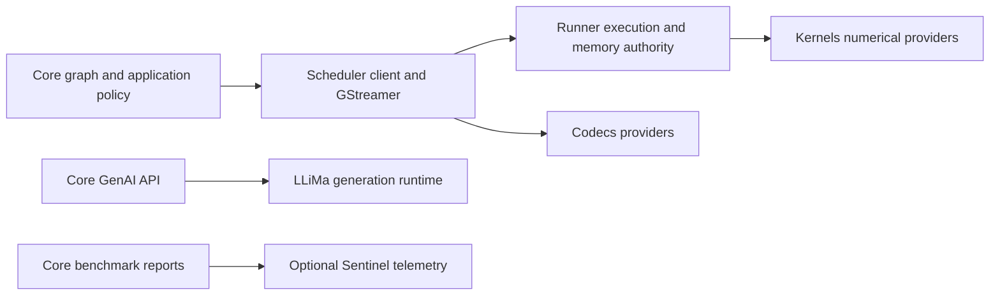

# 儲存庫架構與設計

本頁面是為貢獻者提供的，他們需要了解函式庫的結構、責任歸屬，以及如何在不破壞其模組和執行階段合約的情況下擴展框架。

## 已編譯的 Scheduler 邊界

Core 使用 `SimaScheduler::frontend` 與獨立擁有的 `simaai::scheduler::client` 型別。
數值建構、檢視、動態選擇、已停止圖的附接、所選記憶體存取與視訊佈局查詢都跨越此
已編譯邊界。Core 不開啟 Runner 工作階段，也不包含 Kernels 或 Codecs 實作介面。



Kernels 仍是操作目錄與數值准入的權威來源。Scheduler 透過 Runner 轉送一般化要求；
Scheduler 與 Core 都不維護韌體 ID 或逐操作派送表。Core 保留公開節點 API、幾何原則
與線路格式處理。Scheduler 在套件組驗證後具體化新的轉接器／解析器工廠。
快取的動態選擇保留其操作，但會綁定目前影格的記憶體。

GenAI 直接呼叫 LLiMa，不經過 Runner 或 Scheduler GenAI 配接器。MLA 剖析是獨立且預設停用的流程：Core 呼叫 Scheduler 的用戶端，由 Runner 執行已安裝的 `mla-rt` 命令列工具。它需要沒有其他 MLA 工作的閒置 DevKit。

---

## GStreamer 介面擁有權

Scheduler 擁有 GStreamer 傳輸與結構化錯誤介面，包括已安裝的
`gst/SimaaiGstErrors.h` 標頭。Core 使用這些介面，不保留第二套實作。
尚未發行的 Core `0.6.0` 包含此檔案擁有權移轉。請一併升級相符的 Core/Scheduler
套件組；此套件版本不會變更平台或數值契約。

## 框架與環境

「Neat」一詞用於描述兩個相關但獨立的概念：

- **Neat Library：** 本儲存庫中的 C++/Python 函式庫和執行階段。它載入模型套件、組成管線、驗證合約、在 Modalix 硬體上執行，並公開 API。
- **Neat SDK / 環境：** 圍繞框架的容器化開發工作流程，包括 DevKit Sync、共享工作區和代理工具。

在修改此儲存庫時，請針對支援人和代理的框架屬性進行最佳化：明確的 API、確定性行為、結構化的診斷、嚴格的驗證和穩定的公共合約。

---

## 本函式庫的用途

### 主要使用者

希望：
- 從可重複使用的建置模塊中組裝管線（無需編寫原始 GStreamer 程式碼）
- 儘早驗證管線（適合 CI），並快速了解失敗原因
- 透過 `appsink` 在 C++ 中執行管線並消費幀
- 可選擇透過 RTSP 提供管線（透過 `gst-rtsp-server`）
- 透過適合張量的輸出提供機器學習程式碼，而無需編寫 GStreamer 程式碼

## 套件所有權

所選 Core 成品是一起安裝的 Core、LLiMa 與相符 Scheduler 相依套件的權威來源。Core 轉送完整相依集合，不重新選擇或改寫相依版本。成品以外的套件仍由平台擁有；平台不相容時應更新平台，而非透過 Core 或 LLiMa 修補。

Core 使用已安裝的 `SimaScheduler` 客戶端元件，而非下層 CMake 開發介面。
Scheduler 相依協調器驗證所選 Kernels/Runner/Codecs 集合，並保留其確切來源資訊。
僅含中繼資料的 `SimaRuntime` 相容性別名不擁有另一套實作。
建置入口仍依 Kernels → Runner → Scheduler → Core 順序，準備同層來源或重用明確
選定的套件。這協調的是建置，不是執行階段執行或韌體啟用。
請參閱[本機相依建置](../build-test/local-dependencies.md)。

### 繪製器與選用後端提供者

Core 擁有方框／遮罩發布原則。既有軸對齊 BBOX 酬載使用 int32 座標；獨立的 `BBOX_OBB_V1` 旋轉框格式保留 FP32 幾何資料，軸對齊繪製器會拒絕此格式。Scheduler 擁有 caps、生命週期與
準備階段的提供者准入。正式組合需要繪製器的具型別 int32 能力，不會將這些值重新
解讀成浮點數，或加入逐影格轉換。Kernels 擁有標準 A65 `render` 操作；Runner 擁有
執行與 ReadWrite 影像安全釋放。Scheduler 記錄已檢查的操作與使用的 Kernels/Runner
身分。Core 驗證此套件組並組合一般相依項目，不使用 `a65apps` 封存檔。

Runner 將平台擁有的提供者與可再散布的相依項目分開記錄。Core 保留該憑證並檢查已安裝的平台；不從平台建置編號推斷相容性，也不把平台 DSO 納入消費端套件。提供者准入與組合方式請參閱[本機相依項目](../build-test/local-dependencies.md)。

### 執行階段傳輸擁有權

Core 使用已安裝的 `SimaScheduler` 套件。`SimaScheduler::elements` 擁有
`neatcamerabridge`、`neatmultipartjpegdemux` 與 `neatlatestbystreammux`，
包括其 GObject 型別與程序內註冊。Core 的 `src/gst/` 入口是相容性轉送器，
不是第二套實作。這些元件不使用數值執行器，也不需要 Kernels。

Core 保留公開 C++/Python API、Node 選項、圖降階、Sample/Tensor 物件與圖私用額度。
`src/pipeline/gst/RealtimeMuxCredits.cpp` 透過 Scheduler 僅含值的借用介面投影這些
額度。多工器借用登錄與共用輸入影格計數器只有一個 Scheduler 擁有者。
攝影機 ABI 佈局來自相符的分配器標頭，而非 Core 私用副本。

多工器公平性／反壓、multipart 解析與擷取父物件生命週期的實作測試位於 Scheduler。
Core 保留公開 API、圖額度與端對端裝置測試。建置 Core 前請安裝相符的 Runner 與
Scheduler 套件；Core 內部測試直接連結其傳輸目標。
不要以不含提供者的主機測試宣稱硬體擷取或精簡 TensorBuffer 中繼資料已通過驗證。

### 新增數值核心

對於可透過既有張量與執行契約表達的操作，開發工作僅屬於 **Kernels 與 Core**：

1. 在 Kernels 中新增操作專用的具型別要求、已檢查計畫、數值實作、執行物件工廠與
   具名要求解碼器。在 Kernels 擁有的目錄中註冊一次操作，並新增正確性測試。
2. 在 Core 中新增 Node，並將其選項轉為標準要求：操作、明確目標、輸入／輸出規格與
   具型別參數。呼叫 Scheduler 的一般化準備 API；不要直接呼叫操作工廠，或在 Runner
   或 Scheduler 新增操作分支。
3. 依序重新建置／安裝 **Kernels → Runner → Scheduler → Core**。EV 目錄變更需要
   明確組合相符韌體，即使 Runner 來源未變更也一樣。請使用獨占裝置程序驗證。

準備路徑為 **Core → Scheduler → Runner → Kernels**。Kernels 進行數值驗證；
Runner 是一般化入口。準備階段檢查不開啟硬體或佈建執行資源。
請保留傳回的已檢查執行物件，並在准入完整階段前檢視其標準需求。
串流使用相同執行物件，不會再次解碼操作名稱。

動態變體使用在設定時綁定、由核心擁有的選用能力。Core 保留圖／中繼資料原則與
既有有界快取。快取未命中可細化不可變參數；提供者證明是否共用確切張量契約／資源，
或需要完整重新檢查。快取命中不會建立另一個操作，也不保留攝影機／編解碼器影格借用。

Runner 擁有執行、資源、一致性與安全釋放；Scheduler 擁有 Gst 載體、外掛程式與傳輸整合。
標準已安裝套件為 `SimaRunner` 與 `SimaScheduler`。僅含中繼資料的 `SimaRuntime`
相容性套件將歷史目標轉送至相同實作。標頭別名重用標準 Kernels 型別；
靜態連結相依項目仍可能具有傳遞性。不會建立第二套張量結構描述、分配器、執行佇列或數值登錄。

數值階段產生 `neatkernelrunner`；沒有切換至已退役 ProcessCVU 外掛程式的選項或後備路徑。Core 擁有的公開輸出封裝仍是相依主機操作，保留原有量測邊界。Codecs 仍是獨立編碼／解碼後端；其 Gst 包裝層屬於 Scheduler，而非 Runner 或數值 Kernels。

建置憑證綁定確切安裝位元組與使用的相依身分，不代表硬體或效能驗證。
不要混用不相符套件的標頭、封存檔、韌體或 Codecs。

新的傳輸、張量表示法或執行能力屬於框架擴充，可能需要變更 Runner。
僅 Kernels/Core 的保證不涵蓋這些變更。逾時或取消絕不能證明 DMA 已安全釋放；
既有分配擁有者必須存活至確定完成，或經驗證的平台復原。

Core 依語意名稱選擇操作，而非韌體圖 ID。Kernels 公開不可變的操作名稱與編譯目標
目錄；Runner 與 Scheduler 轉送該目錄，不維護另一個操作登錄。
Core 擁有具型別圖改寫規則，包括強制的 `DetessCast` 與 `DetessDequant` 融合。
若必要融合實作無法使用，準備會失敗，而不是拆成獨立核心。
一個 Core 階段不一定對應一個操作：TrackKLT 仍準備其既有複合要求。

### 直接驅動程式復原

`deps/manifest.json` 選擇 Scheduler 與 LLiMa。已安裝的 Scheduler 協調器驗證相符的 Kernels、Runner 與 Codecs 完整相依集合；Core 使用已驗證的套件組，不重複實作底層平台檢查。

復原屬於選定的平台，不依賴分派器錯誤比對。推論失敗後，Core 不會啟動 AppComplex、
重新啟動分派器服務或重設遠端處理器。Runtime 透過驅動程式契約回報完成與安全釋放；
無法確認完成不代表允許回收 DMA 儲存空間。平台開機時的 MLA 初始化仍屬平台相依項目。

### 記憶體擁有權

Core 使用 Scheduler 的配置與映射介面，不使用從中繼資料附加的實體位址、`libsimaaimem` 或第二套配置登錄。CPU 存取、映射生命週期、匯入記憶體與父批次限制，請參閱[記憶體模型](../../advanced-concepts/data-model-contracts/memory_model.md)。

Core 不會依圖拓撲選擇快取一致性模式。`RunAdvancedOptions::prepare_output_cpu_visible` 保留以維持選項佈局相容性；真正映射前不會執行重複的提前同步。來源相容的 `defer_output_invalidate` 選項必須保持 true；false 會被拒絕，而不是恢復產生端的慢速路徑。

非同步 MLA 提交與有序輸出發送使用既有的分開路徑。完成回呼記錄終止狀態；
發送器發布結果而不進行 CPU 快取維護。發送進行時，提交路徑仍可接受後續影格，
但受有界通道容量與獨立分配擁有權限制。僅完成不會歸還准入額度：
已完成槽位仍被擁有，直到發送釋放它。輸出集區借用可能比該釋放更久，繼續阻止儲存空間重用。

此重疊不移除快取維護，也不縮短同一影格內的相依鏈。
它避免將獨立 CPU 與裝置工作表現為序列管線停頓，且無需另一個同步工作執行緒。
圖建構一次設定預算；不需要逐影格、操作專用的排程原則。

### 明確影格 arena 容量偏好

儲存放置與分配備援是分開的契約。既有 `ArenaDmsPolicy::PreferDmsForEligible`
為符合封閉 MLA/A65 生命週期的情況選擇**必要 DMS**；DMS 分配失敗時不允許備援。
既有正式呼叫端保持此行為。

內部規劃器可明確選擇 `ArenaDmsPolicy::PreferDmsThenCma`。
僅當 Core 擁有的 DMS arena 之完整使用端存取集合不含 EV74 時，才產生
`ArenaAllocationPolicy::PreferDmsThenCma`。任何 EV74 使用端都會使此選用編譯失敗；
不能變成隱藏暫存複製，也不能假設每個 CMA 範圍皆可到達。
外部接管、未知、自訂，以及未快取／控制儲存空間都不能取得此偏好。

這是內部規劃能力，不是新的公開 ModelPack 選項或環境開關。
預設公開流程仍採嚴格模式。原則透過現有 MLA／數值契約投影傳入 Scheduler 已安裝的
靜態清單 ABI **31**，或直接 TVM 通道結構描述 **3**。
新的 JSON 讀取端將歷史嚴格清單 JSON 與 TVM 結構描述 2 視為 `RequiredDomain`；
舊結構描述中的偏好欄位會被拒絕。舊靜態 ABI 使用端拒絕 31，舊 TVM 使用端拒絕
結構描述 3。歷史 Core JSON 讀取端可能忽略未知欄位並重建嚴格放置；
這不代表支援透過舊 Core 傳遞新偏好。請一併重新建置 Core 與 Scheduler；
Runner 公開程式庫 ABI 與標準 Kernels 要求語意保持不變。

Scheduler 在集區設定時一次分配有序的標準 DMS/CMA 替代選項，記錄實際所選 heap，
並在真正選到 CMA 時進行 CMA 初始化。重用時依設定原則驗證實際來源：
嚴格 DMS 不能接受 CMA，經驗證的偏好則可接受任一種。
暖機後執行不解析原則 JSON，也不加入負載遷移。

### 預設裝置到 CPU 一致性

只有一個已準備記憶體引擎。`SIMA_CORE_DEMAND_COHERENCY_V1` 與 Runner 的實驗性
建置選項已移除；新建置請勿使用它們。不再有環境啟用開關或整圖 Legacy 降級。
Core 僅使用 Scheduler 分配、映射與階段介面。公開張量幾何、Kernels 要求與數值行為不變。

共用的存取取得與生命週期契約定義於[記憶體模型](../../advanced-concepts/data-model-contracts/memory_model.md)。

#### 映射以 DMA 支援的邏輯張量

公開 `Tensor::map()` 及其 `view()` 別名保留既有儲存映射契約：套用一次
`byte_offset`，並可能公開尾端底層位元組。具名區段邊界與應用程式映射回呼仍是
權威來源。`TensorBuffer::map()` 仍直接映射儲存空間。

以形狀為界的內部使用端改用 `map_dense_tensor_read()`。
它依目前幾何檢查正值步幅與溢位，再只公開實體張量範圍，包括步幅間隙。
Core 擁有的 DMA 儲存空間可授權該確切範圍。包裝或自訂回呼保留既有映射與清理行為；
輔助函式先驗證回傳範圍，再縮小邏輯檢視。不會跨可變張量檢視快取幾何。
複合影像與已編碼或未解析幾何維持原有映射路徑；密集邏輯範圍不授權存取其他平面。

Scheduler 可對確切檢視重用 Runner 已驗證、目前世代的可見性。
裝置寫入後的首次讀取、未涵蓋範圍或未驗證匯入仍維持匯出端同步。
運作中的寫入端、待完成裝置工作與隔離狀態仍屬錯誤。
映射同時保留原始 Gst 樣本與目前公開儲存／產生端借用，直到 CPU 存取結束。
不變更擁有權模式、負載複製、WRITE-END 清理或公開物件佈局。

核心階段的 `resource_busy` 錯誤不一定表示提交容量用盡。
其經清理且有界的 `Reason` 保留原始存取、登錄、擁有權或容量診斷。
變更並行度前先檢視原因；擁有權或裝置完成仍未確認時，不要重用緩衝區。

### 編解碼器擁有權

Scheduler 擁有 `neatdecoder`、`neatencoder` 及其 GStreamer 適配層。Codecs 擁有解碼器／編碼器工作階段與數值實作。請使用相符的已安裝標頭與函式庫；不要將後端程式碼複製到 Runner，也不要將包裝層與不同的後端 ABI 組合。

### 硬體編碼器設定

`SimaEncode` 與原始 `VideoSender` 從協商的輸入 caps 推導解析度。
解析度在一次執行中維持固定；變更時必須開始新的執行。
編碼器選項不包含寬高，輸入適配器保留可見幾何而不縮放。
在上游輸入提供尺寸前，未知輸入尺寸在建置時輸出合約中仍維持未知。

`SimaEncode` 一次準備原始輸入，並將編解碼器專用選項對應至 `neatencoder`。
Scheduler 擁有 GStreamer 轉接與輸出發布；Codecs 擁有編碼器工作階段。
Runner 保留記憶體擁有權與同步權威。Core 不新增編碼器執行緒。
舊版 `H264EncodeSima` 保留無轉接器的輸入契約，同時共用編碼器屬性產生方式。
公開類別佈局變更已納入 ABI 6，需要重新建置二進位使用端；既有來源入口仍可使用。

### 常見工作流程

- **解碼/導入：** 檔案或 RTSP -> 拆分/多工/解析 -> 解碼 -> 轉換/caps -> appsink -> C++ 消費者
- **驗證：** 建置 + 解析 + 預滾動（暫停）以儘早捕獲協商問題
- **提供 RTSP：** 使用 `appsrc` 將合成幀推送到 RTSP 伺服器管線
- **影像/影片張量適配器：** 影像/影片/RTSP -> 解碼 -> 轉換/縮放 -> `add_output_tensor(...)` -> `Run::pull_tensors()`
- **教學：** 從 [教學指南](/tutorials) 開始，以獲得可執行的、有序的學習路徑

### 標準生產管線（權威來源）

此儲存庫的標準「生產路徑」為：**輸入 -> 預處理 -> MLA -> 後處理**。權威來源位於：`tests/e2e_pipelines/obj_detection/sync_yolov8_test.cpp`。

當此測試發生更改時，請更新 README + 架構，以保持檔案的一致性。

### 心理模型（業務邏輯 <-> 管線黏合劑）

您的應用程式保留業務邏輯；框架擁有管線黏合劑。

```text
Business logic
    |
    v
Nodes/Graph fragments  ->  GStreamer fragments  ->  caps negotiation  ->  runtime (Run)
    |                                                           |
    +-----------------------------------------------------------+
                                Sample / Tensor
```

## 核心概念

此框架刻意圍繞少數核心概念設計。大多數使用者程式碼只會與 `Model`、`Graph`、`Run`、`Tensor` 和 `Sample` 互動；較底層的貢獻者也會使用 `Node`、可重複使用的 Graph 片段、MPK 合約解析及圖的內部結構。

| 概念 | 角色 |
|---|---|
| 模型封存檔 | 一個封裝的 `.tar.gz` 成品，其中包含 MPK 推論合約、外掛程式私有設定、模型二進位檔和核心成品。 |
| `Model` | 用於載入 `.tar.gz` 模型封存檔的公開載入器。它會解析 MPK 合約、執行路徑規劃、公開模型階段，並提供簡單的 `run(...)` / `Graph` 組成進入點。 |
| `Tensor` | 帶有 dtype、shape、layout、儲存、裝置和語義中繼資料的類型化數值有效載荷。 |
| `Sample` | 圍繞張量、張量列表或捆綁包的執行階段/媒體封套。在讀取欄位之前，請檢查 `Sample::kind`。 |
| `Node` | 一個原子管線階段，它會產生一個確定性的 GStreamer 片段和所擁有的元素名稱。 |
| 可重複使用的 Graph 片段 | 預先建立的 `Graph`，可展開為多個節點，例如已解碼的 RTSP 輸入或模型階段。 |
| `Graph` | 組裝和驗證邊界。節點、模型和可重複使用的 Graph 片段會組成經過協商且可建置的管線。 |
| `Run` | 由 `Graph::build(...)` 傳回的即時管線句柄；擁有推送/拉取/執行階段生命週期。 |
| 圖 | 使用建構器圖來在單個管線內進行 DAG 組成；使用執行階段圖來協調跨管線的階段/執行。 |

從左到右閱讀它們之間的關係：

```text
model archive on disk -> Model -> Graph fragments/Nodes -> Graph -> Run
                                           |
                                           v
                                  Tensor/Sample flow
```

`Model` 是使用者入門的起點，但它並非獨立的執行引擎。它會解析為模型圖的片段/節點，這些片段/節點可以新增到 `Graph` 中。`Graph` 是核心的組裝概念；`Run` 是建置完成後產生的即時物件。

---

## 對於貢獻者的設計原則

這些是框架背後的關鍵架構原則。在決定實作選項時，請使用它們。

- **確定性優先。** 維持元件名稱、產生的管線字串、序列化的管線資料、報告欄位和測試的可重現性。診斷和代理迴圈取決於穩定的識別碼。
- **可除錯性是首要考量。** 錯誤應產生結構化資料，而不僅僅是字串：`GraphReport.error_code`、`repro_note`、匯流排訊息和可重現的後端管線。
- **不允許靜默回退。** 不要透過靜默地轉換格式、變更圖族群、回退到 CPU 或忽略外掛程式錯誤來隱藏模型輸入錯誤或硬體/執行階段失敗。
- **在執行前進行驗證。** 偏好在執行階段執行緒啟動或取得硬體資源之前進行結構、上限、形狀和合約驗證。
- **MPK 合約是模型的事實來源。** 核心路由、dtype、形狀、量化和階段決策必須來自 `mpk.json` / `*_mpk.json`。每個階段的 JSON 檔案都是外掛程式專用的。
- **Detess 邏輯秩與執行階段幾何分開處理。** 保留 MPK 撰寫的 `frame_shape`；只有位元組範圍能識別唯一幾何時，才接受秩 2 的 NC/HW 解釋。融合 DetessDequant 透過同一個逐影格合約攜帶兩個描述元：tile 秩決定核心秩，前導批次維度維持分離，語意軸、位元組範圍、步幅與明確的分塊儲存編碼仍具權威。Core 透過 Scheduler 轉送這些標準具型別合約；Kernels 驗證所選操作與編碼。不要在 DSO 邊界重建 ProcessCVU 預備請求。
- **數值後端原則只有一個權威。** 已檢查能力擁有支援目標與 AUTO 偏好。明確指定的階段或工作階段目標只能在要求且受支援的後端執行，否則失敗；後續依角色覆寫不得違背此決定。
- **公開 API 應保持穩定。** `include/*` 下的公開標頭會安裝並受到支援。優先採用增量變更和棄用路徑，避免破壞簽章的變更。
- **並行性必須受到限制且可觀察。** 串流執行緒的工作應盡可能輕量；探測端診斷需要原子操作或等效的執行緒安全處理；關閉時不應發生死鎖。

---

## 模型執行路徑

對於以模型為基礎的管線，高階路徑如下：

```text
input Sample/Tensor
  -> optional preprocessing / format normalization
  -> MLA inference stages selected from MPK contract
  -> optional postprocessing / box decode
  -> output Sample/Tensor
```

使用者可見的 `Model` 介面，其設計目的就是比 MLA 硬體介面更為友善。MLA 可能需要 INT8/BF16 和鑲嵌佈局，而使用者程式碼通常使用 FP32 和標準張量佈局。此框架透過以資訊檔為基礎的配接器階段來彌合此差距。

前處理與後處理是明確的框架階段／選項。格式不符、缺少必要的前處理中繼資料、選定的硬體傳輸不可用、模型封存檔或 MPK 合約無效，或 caps 協商失敗，都應回報可採取行動的結構化錯誤，而不是暗中在執行階段修正。

---

### 公開執行計畫

`Model::execution_plan(...)` 會傳回以相同引數呼叫 `build(...)` 時將執行的內容：依管線順序列出模型的圖節點、每個節點的執行位置（`A65`、`EV74` 或 `MLA`），以及節點之間邊上的張量。它會在關閉啟動預檢的情況下呼叫 `build(...)`，讀取建置在 GStreamer 剖析之前記錄於 `DiagCtx` 的計畫，然後關閉管線，因此需要與 `build(...)` 相同的裝置。這是公開的診斷檢視，與下文所述的內部 `ModelExecutionPlan` 不同。其 JSON 合約為 `schemas/execution_plan_v1.schema.json`；`schema_version` 只會在變更破壞現有讀取端時才會改變。

### 板子遙測

`TelemetryMonitor` 會透過 `/run/simaai-sentinel/api.sock` 上的 HTTP API，從板子遙測常駐程式 Sentinel 讀取功耗與板子遙測資料；Core 不會直接讀取電源監控晶片。`start()` 會讀取 Sentinel 的樣本快取一次，以取得指標定義、取樣間隔與最新樣本；該樣本早於視窗開始，因此不會計入。接著，一個工作執行緒會在每個樣本預定產生前不久要求最新樣本，並依時間戳記識別每個新樣本，將其只計入一次持續更新的摘要。當某個時間戳記與上一個已計入的時間戳記相差不是一個間隔時，工作執行緒會從快取中計入遺漏的樣本；該快取保存 Sentinel 最新的 240 個樣本。監控器不會在 Sentinel 中建立任何東西，因此可以同時執行任意數量的監控器，而被終止的程序也不會留下任何殘留。

預設監控器使用上述通訊端。明確指定 `TelemetryMonitor(socket_path)` 時，只會為該執行個體選擇另一個 Sentinel Unix 通訊端；`Model::benchmark()` 仍使用預設端點。

`Model::benchmark()` 使用相同監視器，而不是第二套追蹤引擎。
它會在吞吐量計時前準備連線與等待中的工作執行緒，在量測開始後啟動視窗，
並在所有必要輸出完成後、量測停止前封閉視窗。啟動與封閉不分配記憶體、不取得互斥鎖，
也不等待執行緒結束或連線至 Sentinel。之後基準測試才等待工作執行緒結束並最後讀取快取。
進行中的輪詢受其停止檢查前的 UTC 讀值限制，因此封閉後不會接受較晚樣本。
基準測試歸因會驗證 UTC 樣本時間戳記與成對的 UTC／穩定時鐘邊界；
偵測到時鐘不連續會使遙測失效，而不會改變已量測吞吐量。
獨立監視器保留時鐘回退後依快取順序復原的行為。

Sentinel 約每 2 秒取樣一次，因此吞吐量階段至少會執行 `BenchmarkOptions::min_duration_ms`（預設為 10 秒）。延遲階段也遵循相同的下限，因此兩個階段依相同規則停止。當 Sentinel 未執行或量測期間沒有樣本時，基準測試仍會傳回延遲與 FPS；功耗欄位為零，並由 `telemetry.status` 說明原因。`tools/install_neat_framework.sh` 的板子模式會安裝 Sentinel，或將其升級至最新的正式版建置。若安裝失敗，安裝程式會發出警告並繼續；之後可執行 `sima-cli neat install sentinel`，或像 CI 一樣設定 `NEAT_INSTALLER_SENTINEL_REQUIRED=ON`，讓失敗中止安裝。已棄用的 `Run` 電源監控器（`RunOptions::power_monitor`）的資料同樣來自 Sentinel：Core 會輪詢其最新樣本，不會透過 I2C 讀取電源監控晶片。

MLA 剖析透過兩個預設為 false 的 `BenchmarkOptions` 欄位明確啟用：`include_mla_layer_stats` 與 `include_mla_stage_stats`。延遲與吞吐量執行器關閉後，Core 會透過 Scheduler 的用戶端測量已解壓縮模型的 MLA 執行檔，並依序逐一進行剖析。MLA 層統計只涵蓋所選推論路徑（含其終端政策）中的 MLA 階段。Runner 會為每個執行檔在獨立程序中執行 `mla-rt`。MLA 層統計還會使用編譯器統計 YAML；MLA 階段統計會將每個 MLA 執行檔連續不中斷執行 200 次，並從 `mla-rt` 統計檔讀取 `tile.lat` 平均值。Runner 負責驗證輸入與輸出並清理暫存檔；若單次執行超過 120 秒，它會停止 `mla-rt`。MLA-RT 負責硬體剖析，以及將控制權交回核心執行路徑。剖析不得與其他 MLA 工作負載重疊。基準測試閘門只會序列化基準測試呼叫，不涵蓋其他推論 API 或應用程式。

失敗、當機或已停止的 `mla-rt` 執行可能讓 MLA 工作未完成，因此 Runner 不會在該程序中再啟動 `mla-rt`。之後的剖析流程會回報 MLA 需要復原。在確認 MLA 已復原之前，請讓 DevKit 保持閒置。

剖析採盡力而為（best effort）方式。若找不到 `mla-rt`、其執行失敗、逾時或寫出無法使用的輸出，Core 會保留主要測量值，讓對應清單保持為空，印出警告，並將原因寫入 `mla_layer_stats.status` 或 `mla_stage_stats.status`。其他情況下，狀態為 `"not requested"` 或 `"ok"`。

`BenchmarkReport::mla_layer_stats` 包含每個已編譯 MLA 層從零開始的執行階段索引、名稱，以及每層以一次剖析階段測得、以微秒表示的硬體延遲。`BenchmarkReport::mla_stage_stats` 包含以相同方式編號的各 MLA 階段索引，以及以微秒表示的平均硬體延遲。這些測量使用獨立的剖析階段，因此各層延遲的總和不等於階段延遲，也不等於整體延遲。`BenchmarkReport::save(file_path)` 會使用公開欄位名稱與單位，明確寫入完整報告：`.json` 選擇 JSON；`.yaml` 與其他結尾選擇 YAML。報告包含遙測資料與兩個狀態；停用剖析時，MLA 清單為空。此方法會建立不存在的父目錄，並以原子方式取代既有的目標檔案。

已淘汰的 PreparedRunner 選項必須維持預設值。並行處理使用 `processcvu.async` 和 `GraphOptions::async_queue_depth`；舊反量化與剖析旗標沒有直接替代。請維持 `advanced_execution.defer_output_cache_sync=true`，並透過 Tensor/GstMemory 映射存取 CPU 輸出。`RunOptions::advanced.prepare_output_cpu_visible` 是相容性用的無作用欄位，不要求預先快取同步。

### 已編譯模型執行合約

DMA-BUF 驅動程式遷移會將模型語意與每影格儲存空間分開。
Core 將模型載入時的事實編譯成單一、不可變的內部 `ModelExecutionPlan`：

- 值包含精確名稱、所需位元組數、可選的邏輯型別事實，以及可選的根相對讀取運算式 `{source ValueId, byte offset,
  byte strides}`；
- 作業包含精確且有序的邊，以及作業專用設定；
- MLA 後端連接埠包含 ELF／模型順序、精確的所需位元組數、對齊權威與存取方向；以及
- 公開輸出只包含發布順序及其提供的值。

MPK 資訊清單使用 `MpkDecoder`。`MpkDecoder::load` 是唯一的資訊清單入口：模型載入、預備執行階段建置與 PCIe 主機都透過它只讀取一次 `mpk.json`，並以接納流程解碼的同一份位元組建立語意 `MpkContract`。可選的 `model_sdk_version` 字串會保留為來源資訊，不限制接納。
解碼器只接受精確註冊的 `(processor, kernel)` 詞彙，解析完整張量名稱、
驗證作業位元組方程式，並逐一將每個 MPK MLA 階段與其精確的 ELF IFM/OFM 拓撲核對。
解碼器以編譯器定義的邏輯階段 ID 與資訊清單可執行檔 token 共同關聯可執行證據；
封存順序與檔名後綴不具有語意證據效力。
產生的不可變計畫為每個 MLA 作業提供經檢查的
`{stage index, op ID, logical stage ID, executable}` 鍵，以及預先建立索引的有序連接埠範圍。
歧義、缺少槽位或證據衝突都是模型載入錯誤；附屬 JSON、子字串比對、
環境狀態與執行階段緩衝區都不是證據。

當對應關係沒有歧義時，Core 可以核對不同的輸入與輸出緩衝區順序，包括批次輸入與輸出。
應用程式保留模型的公開張量名稱、順序與樣本順序。

具有一般空間儲存配置的單輸入、批次一模型，可以使用自動輸入通道填補。
應用程式保留模型的邏輯張量形狀；自訂空間儲存填補不在支援範圍內。

因此，以 `.so` 結尾的 AFE 成品依 MPK 階段分類，而不是依後綴。
對 `processor="MLA"`，Core 將檔案讀為 ELF 容器，不載入主機處理序，
證明其區段拓撲，並將精確成品傳給 MLArt。
對具有編譯器定義的 `input_names`、`input_types` 與 `output_types` 合約的
`processor="A65"`，該成品是主機 TVM 模組，而不是 MLA 可執行檔。
在有具型別的直接主機模組 ABI 之前，嚴格 DMA-BUF 路徑會拒絕該階段；
它不會呼叫 `dlopen`、暗中跳過階段，或改走使用分派器的 ProcessTVM 相容元件。
舊版 EVO 對齊是明確的 4096 位元組遷移原則，具有 `LegacyPolicy` 來源資訊，
不是從 MPK 或 ELF 推斷的事實。新的具型別合約必須宣告自己的對齊。

執行階段影格不複製靜態計畫。直接路徑攜帶標準 DMA-BUF 所有權、
經檢查的絕對 `{fd, offset, length}` 檢視，以及有界的影格槽位生命週期。
Unpack 與 Slice 是使用端讀取運算式，不是執行階段作業：
解碼器只有在證明精確偏移、位元組步長與實體範圍後，才會將它們組合為單一已實體化的根載體。
Pack、鑲嵌與精度轉換仍是生產端／計算語意，除非降階處理證明精確的後端生成或等效融合。
這可避免儲存空間配置暗中改變 MLA 連接埠元數或模型行為。

已接受圖中的所有 MLA 階段，均透過相同且持續保留的 `FrameSlotArenaPlan` 投影。
第一個實體化的嚴格階段會配置 arena；
後續 MLA 階段使用 `ReuseInput`，在相同 DMA-BUF 上提交精確的根相對 IFM/OFM 檢視。
沒有階段參數的投影輔助函式，只適用於無歧義的單 MLA 圖；多階段計畫會明確拒絕。

Core 的不可變 MPK 套件是推論契約權威來源。邏輯公開形狀仍與原生 MLA 樣本範圍、
整批 CVU 執行檢視與底層容量分開。只有實際輸入／輸出位元組幾何識別出無歧義的
執行形狀時，才正規化二階 Detess 檢視。融合透過語意操作探索選擇，
絕不使用 Core 擁有的圖 ID 表。

#### 標準身分與所選發布

Core 建構已編譯契約時，會定案數值階段身分。它正規化支援的模型名稱寫法，
並拒絕操作、系列與系列列舉值不一致的情況。舊式圖與描述元 ID 不是執行權威。
身分正規化不會將不完整語意契約標為完整；Kernels 仍擁有操作探索與數值准入。

對於模型管理的 Preproc 交接，影像幾何與儲存範圍是不同資訊。
平鋪填補可能使必要儲存空間大於密集純量數量。Core 會根據具型別模型計畫驗證已吸收
的轉換鏈，完成載體放置與所選輸出路由，再建構公開輸出檢視。
執行階段描述元、路由與公開檢視必須參照相同且已定案的儲存空間。
較大的父分配不能授權過小的邏輯檢視，位元組數相等也不能證明幾何一致。

獨立封裝式 Preproc 在發布資訊或分配 arena 前，會向標準已檢查執行物件查詢儲存需求，
不會以邏輯維度相乘來推導封裝容量。多 ROI 容量在公開形狀中保留批次軸；
單影像獨立檢視保留既有 HWC 形狀。

具型別模型描述元涵蓋完整張量，包括批次維度。其執行重複次數為一：
語意批次大小不代表要求重複執行整個張量。融合的 DetessCast 與 DetessDequant 在
發布階數與執行幾何不同時，保留經明確證明的私用單元素軸檢視。

此單元素交接規則不取代刻意篩選的輸出檢視，例如 KLT 狀態發布。
變更發生於準備階段，而非影格執行。保留融合操作、明確位移與量化中繼資料；
不要以暫存複製或數值備援修復契約不符。

#### 具型別轉換準備

Core 在圖準備期間解析一次外部 dtype 名稱與 MPK 張量描述元。
交接包含具有標準 `TensorSpec` 與 `DType` 契約的已檢查執行物件，包括逐輸入精度。
Runner 與 Scheduler 不重新解析操作專用的 dtype 字串。
Core 的發布與載體中繼資料保持明確，並與數值型別權威分開。

執行形狀與發布形狀不必相同。Core 根據語意輸出契約明確授權單元素軸檢視，
並根據已編譯模型的傳輸契約授權封裝實體儲存檢視。
Scheduler 在準備階段依此關係檢查每個輸出綁定，包括 dtype、佈局、步幅與儲存邊界。
僅位元組數相等不能授權變更形狀。這些檢視保留底層分配，不新增張量複製或數值轉換。
輸出契約變更需要重新驗證，包括動態準備的變體。

等價 dtype 寫法不區分大小寫。未知名稱與互相矛盾的描述元在執行前就會失敗。
共用的舊式 BF16/INT16 編碼需要明確語意型別。
要求錯誤會顯示原因，不必啟用詳細 GStreamer 診斷。

#### 已檢查數值階段

圖準備時，Core 將產生端輸出區域投影至使用端輸入綁定。
對於已宣告的影格 arena，每個區域都以其設定的 arena 位移定址同一個 DMA-BUF；
區域 ID 不是 `GstMemory` 索引。BoxDecode 與 ArgMax 共用的投影會驗證區域邊界，
並保留獨立的輸出頭相對位移。未宣告產生端 arena 的直接載體與執行階段綁定輸入
保留原本定址模式。

Core 將 Preproc、轉換與視覺階段，包括 ArgMax、BoxDecode 與 SuperPoint，降階為
標準要求與明確張量埠對應。Scheduler 的一般化張量階段引擎擁有 GStreamer 綁定與
發布；Runner 擁有相依、非同步執行與執行期間緩衝區生命週期。
Core 從上游分配契約或輸入儲存空間匯入載體容量，絕不只根據邏輯形狀推斷。
BoxDecode 與 SuperPoint 數值輸出保持私用；相依的 Core 線路序列化執行物件保留
公開 BBOX 與特徵負載，不重複解碼運算。 旋轉框使用獨立的版本化 `BBOX_OBB_V1` 序列化器，並保留相同的數值運算完成相依關係；數值運算失敗時不得發布過期結果。

影像尺寸變更會在綁定前選擇不可變且資源相容的已準備 BoxDecode 變體，
不會修改在途影格使用中的操作。RCNN 第 1 階段保留逐層 top-K 計數加 FP16 提案群組。
Core 不得載入已淘汰的 objectdecode 外掛程式作為備援。

A65 是執行目標，不是 GStreamer 記憶體域。外掛程式仍匯入 DMA-BUF 載體。
直接張量輸入使用共用 CMA 分配，例如
`Tensor::from_vector(values, shape, TensorMemory::EV74)`；所選執行物件仍在 A65 執行。

---

## 儲存庫佈局

### 高階結構

- `include/` -- 公開標頭檔（支援的 API 介面）
- `src/` -- 實作
- `docs/` -- 檔案（本檔案）
- `examples/` -- 小型可執行範例
- `tests/` -- 單位/整合測試
- `python/` -- `pyneat` 套件來源、nanobind 繫結和 Python 測試
- `old_*` -- 舊版單體實作快照，用於參考/遷移

### 公開標頭樹 (`include/`)

公開標頭檔位於 `include/<module>/...` 下。
範例：`include/pipeline/Graph.h`、`include/model/Model.h`。

公開便利的進入點標頭檔：
- `include/neat.h`（總攬）
- `include/neat/runtime.h`
- `include/neat/models.h`
- `include/neat/nodes.h`
- `include/neat/node_groups.h`

有意沒有 `include/neat/graph.h` 公開總攬。需要較低層級圖基礎的執行階段/編譯器測試，會直接包含較窄的 `include/graph/...` 標頭檔。應用程式、範例和公開檔案應使用來自 `<neat.h>` 的單一公開 `simaai::neat::Graph`。

### 內部標頭檔和執行階段外掛程式路徑

位於 `include/` 下的公開標頭檔會被安裝並視為穩定的 API。
位於 `src/**/internal` 下的內部標頭檔不會被安裝；範例/教學應該僅使用公開 API。

Core 共用 CMake 目標匯出 C++20 與公開的 GStreamer、OpenCV、JSON 需求。Core 使用已安裝的 Scheduler frontend 與 LLiMa 建置；底層執行階段函式庫仍是部署相依項目，而非 Core 直接使用的開發介面。靜態消費端需明確要求 Static 元件並提供其實作連結相依項目。

執行階段環境注意事項：

- 已安裝 Scheduler 外掛程式位於 `${CMAKE_INSTALL_PREFIX}/${CMAKE_INSTALL_LIBDIR}/neat/gst-plugins`。使用非系統前綴時，請將該目錄加入 `GST_PLUGIN_PATH` 或 `GST_PLUGIN_PATH_1_0`。
- Runner 執行階段函式庫位於 `${CMAKE_INSTALL_PREFIX}/${CMAKE_INSTALL_LIBDIR}/neat/runtime`；請使用已安裝的 CMake 目標，而非建置樹內的函式庫。
- 系統範圍外掛程式更新後，請重建系統 GStreamer 快取。

建置 Core 與其已安裝使用端時，請使用與所選 LLiMa 套件 ABI 相容的 JSON 標頭版本。
LLiMa 匯出帶有 JSON 的 C++ 方法；僅來源語法相容不能證明連結相容。
SDK／程式庫憑證與實際連結檢查優先於套件寬鬆的最低版本標籤。

---

## 規劃與穩定 (API 介面)

| 區域/API | 狀態 | 備註 |
|---|---|---|
| 核心管線 API (`Graph`、`Run`、`Tensor`、`Sample`) | 穩定 | 主要支援的 C++ 介面。 |
| 建置器內部元件 (`Node`、私有節點向量輔助工具、`GraphPrinter`) | 內部 | 僅使用 STL，支援 GStreamer 之前的組合。 |
| 模型 API (`Model`、可重複使用的 Graph 片段) | 穩定 | 標準模型檔案整合路徑。 |
| `include/policy/*` | 穩定 | 最少的已驗證策略合約和預設值 (`Decoder`、`Encoder`、`Memory`、`RTSP`)。 |
| `include/nodes/groups/ImageToH264RtspGroup.h` | 已規劃 | 空的佔位符群組。 |
| Python 綁定 (`python/`、`pyneat`) | Beta | 基於 Nanobind 的綁定和封裝位於儲存庫中；API 介面著重於 `Tensor`、`Graph/Run`、`Model`，以及核心節點/群組輔助工具。 |

---

## 模組和職責

### `builder/` -- 節點合約和私有線性組合支援（不使用 GStreamer）

**目的：** 定義如何從邏輯部分組裝管線。

主要類型：
- `Node` -- 每個管線建置區塊所實作的介面
- 私有節點向量輔助工具和 `GraphPrinter` -- 組合工具和診斷

**規則：** 建置器必須主要使用 STL。它不應擁有 GStreamer 執行階段物件。

---

### `nodes/` -- 已定義類型的管線建置區塊

**目的：** 提供隨即可用的節點實作，這些節點會產生確定性的 GStreamer 片段。

`VideoRate()` 一律會發出 `videorate drop-only=true`，包括由來源群組插入時亦然。這可避免共用集區解碼器記憶體的輸出標頭重複，並保留來源時間戳記。C++ 的 `VideoRate()` 與 Python 的 `video_rate()` 工廠函式不接受任何引數，也不會複製影格。

範例：
- `nodes/io/HttpSource`、`nodes/io/RTSPInput`、`nodes/io/StillImageInput`
- `nodes/common/*`（Caps、Queue、Output 等）
- `nodes/sima/*` (SiMa.ai 解碼/編碼/解析/酬載節點)
- `nodes/rtp/*`（depay/payload 輔助工具）
- `nodes/groups/*`（常見的多節點配方）

**合約：**
每個節點都必須產生：
- `backend_fragment(index)` -- 在特定索引處，此節點的 GStreamer 片段
- `element_names(index)` -- 此節點所擁有的確定性元素名稱（用於診斷和強制執行）

獨立 `Cast` 將具型別傳輸檢視編譯為標準 `cast` 要求，由 Kernels 針對所選後端檢查。
來源邏輯身分、逐軸步幅與位元組位移保持明確；分配範圍包含步幅定址所需區間。
繪製器套用一般目標解析與直接 arena 投影。Cast 與其他 runner 階段共用具型別執行與
輸出集區預算：圖建構選擇有界執行容量（同步 Input 圖為一），並保留輸出載體供持有。
這些預算傳給 Runtime 準備，而非產生舊式外掛程式屬性。
將精簡輸出張量重新綁定至公開子集或重新排序的 TensorSet 前，會先在擁有且保留父物件的
封套上具體化中繼資料。不修改原本持有的發布與負載儲存空間。

#### 具型別影像前端與多平面發布

`Resize`、`ColorConvert` 與 `Normalization` 是既有 final `Preproc` 節點上的
薄型工廠。既有持有者內不可變、實作私用的原則區分前端語意，不改變公開 Preproc 或
PreprocOptions 佈局。模型專用 ROI／來源範本行為仍限於舊式融合模式。
Resize 接受有界動態輸入幾何與固定輸出尺寸；色彩轉換與正規化在每次執行固定幾何。

原始影像編譯保留每個平面確切且已檢查的數值描述元，以及一個實體影像分配。
新增的 Scheduler 影像發布 API 驗證平面後端身分、絕對 arena 位移、步幅與邊界，
再發布一張帶有動態 `GstSimaMeta` 的 `GstVideoMeta` 影像。
它不發布張量集合描述元，也不虛構彙總數值張量。
Core 在準備任何數值配方前，於已編譯執行階段契約與產生的階段保留已檢查影像發布
中繼資料。終端輸出查詢在此較早階段執行：數值平面描述元不能變成公開張量覆寫。
具名選擇器仍會驗證。已檢查的原始 caps 與 `GstVideoMeta` 仍是影像佈局權威來源。
內部中繼資料 JSON 往返保留有序影像描述元，但不還原執行物件。
配方準備會將每個描述元欄位與已檢查輸出契約比較，再建立獨立的 arena 重定位檢視；
原先設定的相對平面位移保持不可變。Normalization 則發布 BF16 張量。
公開原始視訊匯入保留 NV16 的完整高度 UV 平面與相同影像擁有者。

新影像階段在準備時、階段專屬的 OutputSpec 投影中保留已知上游時間 caps。
沒有 OutputSpecProvider 的邊界只會使此嚴格投影中的繼承影格率失效；
後續明確 caps 提供者可將它還原。私用負載將產生的分數影格率帶到原始影像發布。
未知影格率仍省略，不加入暖機後逐影格工作或影格率推斷。
既有盡力而為的 OutputSpec 投影保持不變。

原生影像佈局保留空隙；編碼器相容 NV12 使用 Runner 已安裝的視訊佈局權威與明確的
InitializeStorage 核心原則。EV 寫入端每次呼叫都初始化已宣告的列距尾端與儲存列；
分配／頁面剩餘空間不是隱含可寫入填補。Core 絕不在 A65 初始化負載填補或重新封裝輸出。
既有融合 Preproc 派送、中繼資料相容性與 BF16 運算保持不變。

---

### `gst/` -- 簡潔的 GStreamer 工具

**目的：** 針對常見的 GStreamer 模式提供小型包裝函式/輔助工具。

範例：
- 初始化 (`GstInit`)
- 解析啟動字串 (`GstParseLaunch`)
- 匯流排排清/字串化 (`GstBusWatch`)
- caps 輔助工具/元素內省 (`GstHelpers`、`GstIntrospection`)
- 填充點/探測輔助工具 (`GstPadTap`)

**規則：** `gst/` 不應依賴 `pipeline/`（以避免依賴循環和「工具層」膨脹）。

---

### `pipeline/` -- 執行階段協調和公開 API

**目的：** 擁有執行階段生命週期：建置 -> 解析 -> 執行 -> 消耗 -> 拆解，並提供診斷資訊。

主要類型：
- `Graph` -- 使用者的主要進入點
- `Run` -- 具有推入/拉出 API 的執行管線處理器
- `Sample` -- 拉取操作所傳回的結構化輸出酬載
- `GraphReport` -- 針對失敗、停頓和重現的結構化診斷資訊
- `Errors` -- 異常 (`NeatError`) 嵌入報告

#### 錯誤語義合約

`GraphReport.error_code` 是標準的機器可讀錯誤碼欄位。框架中的
執行階段/建置/I/O 路徑將終端錯誤映射到穩定的程式碼分類：

- `misconfig.pipeline_shape`
- `misconfig.caps`
- `misconfig.input_shape`
- `misconfig.input_capacity`
- `misconfig.media_caps`
- `misconfig.tensor_dtype_missing`
- `misconfig.option_out_of_range`
- `build.parse_launch`
- `build.pipeline_syntax`
- `build.plugin_missing`
- `build.property_invalid`
- `runtime.pull`
- `runtime.element_failed`
- `runtime.output_timeout`
- `io.parse`
- `io.open`
- `io.file_not_found`
- `io.permission_denied`
- `io.rtsp_connection_failed`
- `io.camera_not_found`
- `codec.*`、`resource.*`、`infra.*` 和 `internal.*`

GStreamer 錯誤會通過一個內部解析器、分類器和渲染器。
分類器優先使用帶版本號的 Neat 診斷 ID，然後使用原生
GStreamer 域/程式碼和元件工廠，然後縮小舊版外掛程式的相容性映射。
未知的錯誤會使用 `runtime.element_failed`；除非實際協商失敗，否則不會
將其報告為 `misconfig.media_caps`。當管線發布多個錯誤時，會渲染最特定的根本原因，並且每個錯誤都會
保留在匯流排日誌中。

`GraphReport.repro_note` 是面向使用者的摘要。生產渲染包含
以純文字形式呈現的原因、相關的觀察/預期值、具體的
使用者操作以及穩定的診斷 ID。原始外掛程式字串、來源位置和
GStreamer 域/程式碼僅用於除錯。在 `NeatError` 建立時，會添加一次括號中的公共程式碼。
`GraphReport.bus` 是外掛程式/執行階段錯誤詳細資訊的真實來源。
對於建置（輸入）流程，`GraphReport.build_adaptation` 會記錄已解析的形狀原則/功能、種子/最大限制的來源、位元組保護的來源以及應用/跳過的調整動作。
對於非拋出型執行階段拉取，`PullError.code` 使用相同的分類法。
輸入串流工作程式失敗會保留類型化的錯誤程式碼並報告到
工作程式執行緒邊界，因此 `Run::pull()` 和 Python 例外翻譯器
會顯示相同的 `NeatError`。

支援優先順序是：
1. 依 `error_code` 分組
2. 閱讀 `repro_note`
3. 檢查第一個終端 `bus` 錯誤
4. 使用 `repro_gst_launch` 重新執行

錯誤包裝器在移交診斷報告前先格式化診斷。於不同建構函式引數中分別格式化與移動報告
是不安全的，因為引數求值順序可能丟失原始訊息。
清理必須同時保留例外訊息與結構化報告。

##### 數值 Runner 診斷

預設 `neatkernelrunner` 路徑透過版本化的 GStreamer 錯誤詳細資料，保留 Runtime 的
標準錯誤類別、階段、欄位與選用核心規則／原因。圖準備使用相同診斷對應。
Core 呈現失敗，不重複核心驗證，也不從錯誤文字推斷支援能力。
要求、不支援實作、綁定與相依失敗分別具有 `misconfig.kernel_request`、
`misconfig.kernel_unsupported`、`runtime.kernel_binding` 與
`runtime.kernel_dependency` 碼。缺少規則或階段資訊時保持無法取得。
逾時不是裝置安全釋放，也不允許重用緩衝區。

#### 內部管線診斷

在 `src/pipeline/internal/`（僅限內部使用）下：
- `Diagnostics.h` -- 執行階段使用的共享診斷類型：
  - `DiagCtx`（匯流排日誌 + 節點報告 + 邊界/元件計數器）
  - `BoundaryFlowCounters`（從串流執行緒更新的原子計數器）
  - `ElementTimingCounters`（原子每元件計算時間）
  - `ElementFlowCounters`（原子每元件流量統計資訊）
- `GstDiagnosticsUtil.h` -- 用於格式化和收集 GStreamer 診斷資訊的輔助程式

#### SIMA 靜態資訊清單上下文合約 {#sima-static-manifest-context-contract}

對於模型管線，框架會建置靜態階段/張量合約資料，並將其注入為
管線層級的 `GstContext`：

- 環境類型：`sima.model.manifest.v1`
- 環境欄位：
  - `manifest_version`
  - `manifest_json`（舊版相容性負載）
  - `manifest_accessor_v1`（ABI 安全的存取器表格指標）
  - 可選的 `session_id`、`model_id`
- 上下文擁有其存取器指標所需的不可變中繼資料儲存。保留上下文可維持中繼資料可讀，
  不會保留數值工作階段或執行快取。外掛程式借用指標期間必須保留上下文。
- 儲存庫邊界：此儲存庫不得新增建置時對外掛程式/分派器儲存庫的依賴。整合僅透過介面進行（執行階段 `GstContext`、屬性、caps/meta，以及 C-ABI 合約）。

##### 模型執行與接納

模型執行使用已接納的 DMA-BUF 路徑。`ModelPack` 將 MPK 中繼資料檢查與可執行計畫準備分開：
檢查能描述模型，而不開啟裝置或要求可執行成品；
執行則需要已接納的語意命令、實體命令與影格 arena 計畫。
準備好的計畫會快取，供圖與同步執行器複本重複使用。
路由保留編譯器的前處理／推論／後處理分割，不因可執行快取就緒而改變。

公開的模型片段入口會以相同的影格 arena 規劃器，為選定命令編譯所有權。
應用程式輸入保留實體繫結與 DMA-BUF 儲存空間，不會被當成完整模型 arena。
參與的模型片段與具型別的模型自有 CVU 階段，共用同一個建置範圍配置計畫，
保留命令與值的身分。快取的完整模型計畫維持不可變。
真正由模型擁有的前處理生產端，會保留已接納的共用 arena 供後續階段使用。

裝置傳輸與 InputStream 配置使用標準 DMA-BUF 記憶體，以及解析後的 CMA／DMS 配置。
共用 TensorSet 封套會保留每個來源記憶體、其父緩衝區與既有借用額度，
即使 CPU 同層欄位需要封裝也是如此。
仍支援明確的 CPU 記憶體與 Owned 輸出；必要的裝置配置若失敗，會直接回報，而不暗中退回 CPU 記憶體。
應用程式不需選擇記憶體後端或初始化 GStreamer。

輸入配置偏好與執行階段接納是不同的決定。Core 在建置時依宣告的 `Input`
與其可執行的下游路徑解析兩者，不會將 `Auto` 改寫為明確的裝置要求。
`PreferDeviceZeroCopy` 偏好裝置配置，但不拒絕既有 CPU 儲存輸入。
明確的 EV74／DMS0 原則與僅裝置路徑仍保留裝置可見輸入檢查。
偏好裝置的路徑會轉送呼叫端擁有的 `Tensor` 與 `Sample` 儲存空間，
不往返 CPU 影像。相容的 DMA-BUF 輸入維持零複製；CPU 輸入仍可能需要
在既有裝置輸入邊界（例如 `neatencoderinput`）實體化。

執行準備呼叫與離線 `neat-dmabuf-plan-audit` 工具相同、無副作用的
`try_compile_dmabuf_plan()` 作業。
請傳入 `--mpk <mpk.json>`，以及每個 MLA 階段一組可重複指定的
`--mla-artifact <stage-id> <manifest-executable> <resolved-file>` 三元組。
單階段的 `--elf` 寫法仍是無歧義的相容形式。
接納要求精確的 MPK 資訊清單、每個 MLA ELF 的精確身分、
成功的嚴格 reverse-AFE 解碼，以及已接受的不可變影格 arena 計畫。
稽核會輸出具版本的 JSON 記錄，包含穩定原因碼、合約位置、內容摘要與檔案基本名稱；
它不配置加速器記憶體、不開啟裝置，也不公開客戶檔案系統路徑。
執行準備記錄相同的標準計畫摘要；拒絕後會失敗，而不建構或重試舊版執行器。

Core 只在接納後才會於靜態資訊清單 ABI 版本 31 設定
`processmla.dmabuf_plan_contract`。
Core 也會將每個後端連接埠的 `required_alignment_bytes` 與不可變的影格 arena 配置計畫，
投影至其實體緩衝區記錄；ProcessMLA 使用該值，而不重複舊版頁面對齊原則。
它使用 Core 擁有的這些事實，不得推斷缺少的連接埠或退回舊版傳輸。
因此，Core 與所有使用靜態資訊清單標頭的外掛程式，都必須以 ABI 版本 31 一起建置與發布。

當 `cv::Mat` 輸入具體化為 Tensor 時，尚未解析的 `Auto` 放置會使用擁有型 Tensor
預設值：直接複製到 EV74 可見、以 DMA-BUF 支援的 DDR。
連接式圖建構與具名／預設推送共用此轉換。明確的 `SystemMemory`
（或 `Auto` 搭配 `use_simaai_pool=false`）保留借用的主機檢視；明確的 DMS 放置不變。
這不會變更公開 `from_cv_mat_view()` API，也不會讓借用的主機儲存空間變成裝置相容。

公開 Tensor 裝置傳輸會配置標準 CMA 或 DMS DMA-BUF 記憶體，
執行必要的快取同步主機複製，並將裝置配置記錄於 Tensor 儲存中繼資料。
共用張量列表輸入保留每個 DMA 支援欄位的既有記憶體與生產端生命週期。
CPU 欄位可共用儲存空間或獨立封裝；封裝 CPU 欄位絕不會複製 DMA 支援的同層欄位。
公開輸入位置識別邏輯檢視，而不是串接的配置。
每影格的精簡實體繫結表格，識別每個要求檢視的記憶體槽位、偏移與範圍，
包括同一共用樣本中重新排序或選取部分的檢視。
Scheduler 將應用程式繫結與直接記憶體輸入、編譯器擁有的影格 arena 範圍分別解析。
只有影格 arena 輸入能確立重複使用輸出 arena 的所有權。

不實體化且採元件形式的 Pack，會在載體配置之前確立生產端配置。
可寫入的生產端輸出占據共用父載體中的最終元件範圍；
配置、生命週期分析與裝置命令都使用此單一儲存關係。
父載體基本對齊不代表每個內部元件都必須頁面對齊。
此配置不會合併外部擁有的配置，也不插入執行階段複製。

無效 DMA 檢視會失敗，不會退回分段配置或完整封套實體化。
明確的 Owned 輸出與 CPU／裝置傳輸仍是有意的複製作業。

在嚴格階段邊界，邏輯負載大小與實體位址範圍是不同事實。
MPK 衍生的具型別作業擁有形狀／佈局與必要位址範圍；
TensorBuffer 中繼資料擁有經檢查的 DMA-BUF 記憶體、偏移與可用實體範圍。
例如，具有 C16 步長的 12 位元組邏輯值，可能觸及 192 位元組 MLA OFM 中直到位元組 176 的偏移。
因此，ProcessMLA 的直接繫結仍是有序的 IFM/OFM 鏡像
`{tensor_slot, parent_carrier}`。
該布林值識別較大實體連接埠中的零偏移邏輯錨點，不重複佈局。
ProcessMLA 不得新增冗餘的 `padded`、`strided` 或 `contiguous` 旗標。

對封裝為單 IFM／單 OFM 的模型，Core 證明上游邏輯輸出是單一完整 IFM 載體的有序子項。
下游 Unpack／Slice 值以單一 OFM 載體的邏輯讀取發布。
ProcessMLA 在每個方向仍只提交一個實體連接埠；
使用端 CVU 核心直接使用已編譯的偏移／步長運算式，不需要 unpack 工作或中間複製。

多個直接 MLA OFM 可以是同一實體 arena 的邏輯檢視。
這時，每個記憶體索引相同的描述元，都發布相同的父實體區段名稱；
邏輯／後端名稱保留 OFM 身分，精確 arena 偏移則保留每個檢視。
直接 Scheduler 輸出發布同樣使用精確的嚴格 arena 佈局，
而不是舊版封裝輸出重建啟發式方法。

當執行檢視保留相同的定址位元組時，Core 可以簡化內部轉換描述元中的單元素批次維度。
模型張量形狀、批次路由與公開 API 維持不變。

##### 直接執行階段執行

嚴格數值階段透過 Scheduler 將 Core 投影的張量路由與影格 arena 綁定傳給 Runner。Kernels 擁有已檢查的數值執行物件；Runner 擁有後端執行、記憶體存取、完成與退役。`ReuseInput` 後處理階段保留共用 MLA arena，不複製或重建個別輸出。準備或執行失敗時不得退回 ConfigManager 或派送器執行。

ProcessMLA 透過 `/dev/mla` 上的核心驅動程式 MLArt 提交，
不使用 MLA 分派器、MLASHM、分段配置或 M4。
多路徑外掛程式仍可能為尚未遷移的圖連結舊版函式庫；
存在連結不代表允許備援。選定嚴格路徑後，
任何執行器、對映或同步錯誤都是終止錯誤。

##### 設定解析

已遷移欄位的解析器優先順序是確定性的：

1. 從合約/執行階段訊號推斷（形狀/meta/caps）
2. 環境/預設/屬性路徑
3. 嚴格的匯流排錯誤（永遠不會中止/SIGSEGV）

`StageTransformRuleRegistry`（內部）是單一的映射表格，它告訴解析器哪些非 MLA 階段繼承來自 MLA 輸入與 MLA 輸出的張量合約，以及何時傳播輸出量化。這使得預/後推導過程明確且可測試。

對於使用聚合器範本的已遷移 SIMA 外掛程式，執行階段設定現在遵循環境/屬性驅動的解析：
1. 階段靜態欄位來自模型資訊環境
2. 執行階段旋鈕來自屬性/環境預設值
3. 未解析的必要欄位會明確失敗（框架中沒有階段 JSON 備援）

已編譯數值路由透過 Scheduler frontend 傳送明確的來源綁定與張量連接埠對應。舊版輸入緩衝區名稱不是執行權威；消費端必須使用已檢查的目前影格綁定。

如果提供 `logical_stage_id`，則會從 `stage-id`/`stage_id` 管線屬性中解析，否則它會回退到元素名稱。
數值模型片段使用 `neatkernelrunner`，並依元件名稱比對其具型別 Runtime 上下文；
它們不會在該元件設定 `stage-id` 屬性。

MPK 建構的 BoxDecode 終端與公開 `SimaBoxDecode` 節點都使用 `neatkernelrunner`。
它們共用圖建置准入，檢查載體容量、數值要求、輸出發布與動態影像幾何尺寸。
模型尺寸來自 MLA 輸入契約或明確輸入中繼資料，而非偵測輸出頭形狀。
升級後端時，請部署相符的 Kernels 與 Runtime 套件並重新建置 Core；
既有公開輸出格式保持相容；旋轉框解碼使用專屬的 C++ 與 Python 具型別解析輔助函式。

##### YOLOv5 與 YOLO26 BoxDecode 類別計數合約

YOLOv5 偵測是採用標準錨點的固定設定檔。Core 需要正好三個依 stride 8/16/32 排序的原始封裝張量，每個的邏輯深度都必須是 `3 * (num_classes + 5)`。它會將分數範圍正規化為 sigmoid，並在降階之前拒絕相互矛盾的類別數量。執行階段會從模型與標頭的幾何結構推導矩形 x/y stride，並套用標準的 YOLOv5 錨點表。自訂的 AutoAnchor 表格不在此合約範圍內。

對於模型管理的 YOLO26 偵測、姿勢、分割與旋轉框路徑，MPK 類別標頭深度是權威的類別計數。`Model::Options::num_classes = 0` 選擇該推斷值。一個正值必須與其匹配；如果出現矛盾，則會在合約建構期間失敗，並報告已設定的值、MPK 衍生的值和解碼類型。這可防止使用無效的類別計數來解釋分組的原始標頭佈局。SSD 和預先 YOLO26 非姿勢 YOLO 系列保留其現有的明確覆寫行為，而姿勢和 SuperPoint 解碼器保留其系列特定的規則。

##### YOLO26 旋轉框契約

`BoxDecodeType::YoloV26Obb` 會降階至具名數值設定檔 `yolo26_obb_v1`。它需要九個依角色分組的 FP32 頭：三個四通道距離頭、三個完整類別數相同（1–256）的類別 logit 頭，以及三個單通道原始弧度角度頭，各組步幅為 8、16、32。Core 會拒絕角色矛盾、機率分數域、類別數不符，以及非零的逐影格 NMS。Kernels 負責 sigmoid、兩階段錨點/類別選取、旋轉幾何運算與嚴格分數篩選；Core 不會重複這些數值運算。

幾何資料需要明確且有限的模型座標到原圖座標轉換，X/Y 縮放係數須為正且相等，且不得包含剪切；模型尺寸的圖塊也必須明確提供恆等轉換。Core 在將中繼資料縮窄為 FP32 前，會檢查權威縮放係數是否相等。逐影格變更會選取不可變且資源相容的 `image_geometry` 變體；若缺少轉換或轉換為非等向性，則會失敗，而不是近似旋轉矩形。

數值輸出是私用的 FP32 `[K,5]` 幾何資料、FP32 `[K]` 分數、INT32 `[K]` 類別 ID，以及 INT32 `[1]` 計數。相依序列化器會發布 `BBOX_OBB_V1`：32 位元組標頭與 `K` 筆 32 位元組記錄，未使用記錄填零。幾何資料維持 `cx, cy, width, height, angle_radians`，保留帶正負號的有限尺寸且不裁切。提供自身儲存空間的 `decode_obb_tensor` 與 `decode_obb` 輔助函式會驗證版本化載體，並傳回分開的具型別張量。舊版 BBOX 解析器與軸對齊繪製器會拒絕此格式。圖塊還原與跨圖塊多邊形抑制仍由應用程式負責。設定與 Python 用法請參閱 [YOLO26 旋轉框](../../../reference/boxdecode_decode_types.md#yolo26-oriented-boxes)。

##### SuperPoint BoxDecode 合約

SuperPoint 使用與其他模型管理的 BoxDecode 系列相同的 MPK 到靜態模型資訊邊界，並具有以下其他不變性：

- MPK 記錄擁有檢測器-logits 和描述符-grid 張量識別碼、儲存表示法、dtype/shape 資訊、數值設定檔來源，以及可選的明確 NMS 和邊界控制。核心永遠不會從張量值中識別這些角色。
- 核心將精確地將一個張量繫結到每個角色，驗證設定檔指紋和支援的表示法，應用明確的 `Model::Options::superpoint` 覆寫，並且僅解決省略的設定檔預設值。更改設定檔會重新計算其衍生的預設值，同時保留 MPK 或 API 明確設定的控制項。
- 版本化的靜態資訊清單 ABI 攜帶已解決的合約到 `neatobjectdecode`。外掛程式僅在設定期間借用資訊清單指標，並且必須複製執行階段所需的任何狀態；核心在管線的整個生命週期內保留資訊清單的所有權。
- 實際輸出使用 `FEATURE_POINTS_V1` 線格式和特徵語義中繼資料。`FEATURE_POINTS_LEGACY_A65_V0` 僅在明確選擇以用於相容性時才可用；使用者不應從緩衝區大小推斷任何一種格式。

##### YOLOX 分割 + 姿態的 BoxDecode 契約

`yolox-seg-pose` 與其他 BoxDecode 系列使用相同的 MPK 至靜態資訊清單路徑。

- 輸入共 13 個張量：3 個邊界框、3 個類別頭、3 個遮罩係數頭、3 個關鍵點頭，最後是 1 個遮罩原型。各組依步幅 8/16/32 排序。
- `Auto` 選擇 `GroupedByRoleLogit`。僅接受 `GroupedByRole` 和 `GroupedByRoleLogit`；分數使用 sigmoid。
- 類別頭先包含一個物件性通道，後接類別通道。Core 以深度減一推算類別數，並拒絕不一致的明確指定值。
- 模型管理路徑與獨立路徑會解析出相同的佈局、啟用函數及類別數。
- 輸出包含邊界框、遮罩與關鍵點，各有 `top_k` 個槽位。`decode_segmentation_pose(...)` 傳回全部三者；`decode_bbox(...)` 和 `BoxDecodeResults(...)` 讀取前段的邊界框。

輸出有一個 4 位元組的計數標頭。每個槽位使用 24 位元組儲存邊界框、`160*160` 位元組儲存遮罩，以及 204 位元組儲存 17 個關鍵點。輔助函式以下式推算容量：

```text
capacity = (buffer_bytes - 4) / (24 + 160*160 + 204)
```

它會拒絕不相容的格式標籤及不完整的記錄，只接受秩為 1 的 `UInt8` 無標籤緩衝區，並將偵測數限制在容量內。三個區域必須使用相同容量。舊版 a65 `boxrender` 假設有 20 個邊界框槽位，無法正確讀取其他容量。

`Model::Options::yolox_seg_pose.pose_classes` 透過具型別的酬載或 JSON `pose_classes` 欄位傳至後端。Core 會驗證類別 ID 及解碼器支援情況。後端將排除類別的關鍵點及可見度設為零；Core 原樣複製結果。未設定清單時，每個類別都會產生關鍵點。

YOLOX 分割／姿態使用一個標準數值要求，包含六個輸出：計數、方框、分數、類別、
遮罩與關鍵點。Core 在每個不可變幾何變體中，保留產生端從模型到原始影像的軸對齊
仿射轉換與原始影像範圍。明確影像尺寸不會捨棄裁切／填補位移。
裁切准入需要權威前處理仿射中繼資料。核心輸出 1–17 個關鍵點；Core 的相容性發布
一律為每次偵測提供 17 個槽位，未使用槽位補零。
選用姿態類別閘門在準備時檢查並排序，納入圖序列化與階段快取身分，
並以一般方式轉送，不需要 Scheduler 派送。
即使後面還有遮罩與關鍵點，`decode_bbox()` 也將讀取限制於方框區域。
組合輔助函式傳回對齊的方框、遮罩與關鍵點。

---

### `contracts/` -- 驗證規則

**目的：** 編碼「有效管線的樣子」，而不僅僅是「gst_parse_launch 成功」。

範例：
- 驗證器介面和註冊表
- 結構化的 `ValidationReport`

此層可用於 CI，並在執行階段之前捕獲問題。

---

### `policy/` -- 可供使用者調整的行為

**目的：** 將可調整的參數（預設值、記憶體限制、編碼器/解碼器/RTSP 策略選項）集中化。

目標是使「旋鈕」明確且易於發現，而不是隱藏在分散的程式碼中。

---

### 模型封存檔整合

**目的：** 透過 `Model` 載入 `.tar.gz` 模型封存檔，並將解析後的 MPK 推論合約轉換為可路由的 Graph 片段。

安全的封存檔載入器是內部實作細節；應用程式程式碼應建立 `Model` 並組合 `model.graph()` 或特定階段的片段。

常見用法：

```cpp
simaai::neat::Model model("resnet_50.tar.gz");
simaai::neat::Graph graph;
graph.add(model.graph());
```

---

### 模型階段片段

**目的：** 組成 `Model` 公開的預處理、推論、後處理或完整流程，而不公開內部封存檔載入器。

主要 API：
- `Model::preprocess()`
- `Model::inference()`
- `Model::postprocess()`
- `Model::graph()`

這用於混合流程，其中預處理僅執行一次，而 MLA/BoxDecode 則在單獨的圖或執行緒中執行。

---

影格 arena 規劃會將同一次模型呼叫的連續區域連接起來，包括模型擁有的後處理節點。
完整路徑或重新開始前處理／推論，會啟動另一次呼叫，即使共用模型來源也是如此。
同一次呼叫中的分割階段保留單一配置權威；重複呼叫則維持各自的命令選擇與 arena 所有權。
這是在建置時區分，不會複製張量負載，也不改變非同步執行。

### 工作執行位置（CPU / CVU / MLA）

處理器路由由 MPK 合約（模型封存檔中定義的 CVU/MLA 階段）以及可選的執行階段覆寫決定：

* `Model::Options` 控制預處理、後處理、命名和緩衝區選擇。
* `SIMA_MLA_NEXT_CPU` 可以在某些設定中覆寫 MLA 的下一個階段。
* 管線節點本身是宣告式的；實際執行發生在 GStreamer 外掛程式及其設定中。

實際影響：更多的緩衝區和明確的路由可以提高吞吐量，而封包類型不匹配或緩衝區大小不足會在協商期間快速失敗。

---

## 執行階段模型（執行方式）

### 初始化

所有執行階段進入點都呼叫單一的安全初始化例程：
- `gst_init_once()`（執行緒安全，`std::call_once`）

此外，執行階段路徑可能會驗證是否存在所需的外掛程式：
- `require_element("appsink", ...)` 等。

### 建立管線

透過新增 `Node` 物件和可重複使用的 Graph 片段來建立 `Graph`。對於 RTSP，請使用能辨識編解碼器的片段，以便在解碼前對來源進行解封包和解析：

```cpp
simaai::neat::nodes::groups::RtspDecodedInputOptions source;
source.url = "rtsp://example/live";
source.codec = simaai::neat::nodes::groups::RtspCodec::H265;
source.source_fps = 30;

simaai::neat::Graph graph;
graph.add(simaai::neat::nodes::groups::RtspDecodedInput(source));
graph.add(simaai::neat::nodes::Output());
```

內部：

1. 圖強制每個邏輯組合節點使用一個節點物件。重複的 `connect()` 呼叫可以重複使用該索引節點進行扇出。
2. 一個組合的變更會以一個單元的形式提交，或者完全回滾。
3. 圖會要求每個節點提供 `backend_fragment(i)`，並使用 `!` 將片段串連起來。
4. 它可選擇性地在節點之間插入**邊界標記**：

   * `identity name=sima_b<i> silent=true`
5. 它會分析精確的 `name=` 繫結，使用 GStreamer 進行一次解析，並清點建構的物件樹。在下游設定之前，如果名稱重複或遺漏，則會失敗。
6. 它會建立一個 `DiagCtx`：

   * `node_reports`，用於可重現性
   * `boundaries` 作為 `BoundaryFlowCounters`（原子變數）

一般圖建構會先降階數值要求，再序列化放置與發布資料。
數值清單負載為 `NONE`；不可變配方保留於程序內。共用已準備上下文仍用於 MLA
及其他非數值相容性，而非 ProcessCVU 要求。Scheduler 的
`prepare_and_attach_tensor_stages()` 會先驗證完整且停止中的候選 bin、要求 pad、
成員順序、量測與資源預算，再準備並附接上下文。
失敗會連同原始診斷向上傳遞，不使用備援或虛構輸入權威資料。

對於 YOLO26 分割，數值運算成員會將遮罩直接寫入公開輸出緩衝區尾端的遮罩區域。相依的序列化器只寫入前端的數量與邊界框記錄。Core 宣告明確的封裝儲存檢視；Scheduler 仍會驗證每個寫入者、所有位元組的寫入涵蓋範圍、邊界與快取行相依性，並保留由配置擁有的單一存取 epoch。

小型數值結果仍保留在私有緩衝區中。傳輸格式保持不變。若成員處理或存取結束失敗，便不會向下游發佈；但這不保證尚未發佈的緩衝區未被修改。

由 Core 擁有的 Preproc 影格轉接器保留動態影像／ROI 幾何與中繼資料。
其有界的兩項快取保存不可變操作與發布資訊，絕不保存目前緩衝區或產生端借用。
獨立準備會取得新轉接器。Scheduler 保留一般化綁定、分配、完成與發布路徑；
不可變常數只在準備時複製一次，不會逐影格上傳。

### 推送/拉取執行階段模型

`Run` 擁有輸入/輸出佇列和一個輸入執行緒：

* `push(...)` 將輸入排入佇列（根據 `RunOptions::overflow_policy` 進行阻塞或丟棄）
* `pull(...)` 從應用程式接收器中取出 `Sample` 輸出
* `try_push(...)` 是非阻塞的（如果佇列已滿，則傳回 false）

這支援完全非同步的管線（生產者/消費者分離），以及單次流程（`Graph::run(...)`）。

### 獨立階段准入與重用

獨立階段根據實際輸入中繼資料建構輸入 caps 與選用來源標籤。
來源標籤不等於使用端輸入名稱：數個邏輯輸出頭可共用一個實體載體，仍保有各自身分。
準備階段建置接收完整輸入 `Sample`，包括輸出頭位移、路由與儲存擁有權，供執行物件准入。

執行階段中繼資料檢視不會準備數值核心。MLA 輸入資訊來自確切選定的模型片段排程；
若 MLA 之前有轉換，具種子輸入的編譯器會驗證第一個使用端，而不是將應用程式輸入
位元組與內部 MLA 張量比較。前處理與 ROI 投影使用既有的已編譯前處理契約。
編譯失敗會保留提供者診斷，並在外掛程式解析前拒絕。

快取的張量階段計畫要求有效模型選項相等，且具有完整、僅含值的輸入佈局簽章。
簽章涵蓋所有輸出頭、實體綁定、可見容量與共用拓撲，但不含分配位址、負載資料或
保留的產生端借用。中繼資料檢視不映射或複製負載。等價的新分配可重用計畫；
不支援的表示法採嚴格種子編譯，不重用快取。准入時使用的固定調整大小原則與幾何尺寸
保留於索引鍵內。對於依賴幾何資訊的階段，只有非 SuperPoint BoxDecode 解析器處理的原始影像尺寸可以在索引鍵
之外變動；新的幾何變體仍可能需要在該解析器內準備。

固定 MPK 推論階段（`Infer` 與 `MLA`）將前處理 ROI 與仿射中繼資料視為逐影格值，而非準備階段的輸入；輸出攜帶目前影格的仿射資訊與影像尺寸。其他階段仍依幾何資訊進行准入驗證。共用封套資訊依每個實際緩衝區/caps 契約只描述一次。獨立階段快取最多保留 16 個項目，並淘汰最久未使用的項目。淘汰時僅在互斥鎖外釋放快取的參照，不會強制關閉呼叫端仍持有的執行。此上限限制的是保留項目數，而非作用中的執行數或總位元組數。

對於 RTP JPEG，`rtpjpegdepay` 之後的相容性探測會在解析之前補上缺少的 JPEG 結束標記。正確結束的影像會原樣通過；這並不會修復封包遺失或其他格式錯誤的 JPEG 資料。

應用程式輸入配置與既有緩衝區所有權是不同合約。
輸入記憶體原則選擇新配置的儲存空間，不會為可使用 CPU 的使用端暗中實體化已由 DMA-BUF 支援的影像。
這些影像在同步與非同步執行中都使用既有的 Sample 持有者路徑。
明確的輸入複製，以及不相容的格式／caps 要求，維持各自的合約。
只有 CPU 的 TensorSet，當零複製封套無法表示時，保留既有的封裝／實體化備援。
若任何選定張量由 DMA 支援，仍禁止隱式封裝；正常成功的零複製路徑維持不變。

在允許 CPU 的輸入處，`advanced.copy_input=true` 會在入列接納時進行保護性複製，
即使新配置偏好裝置記憶體也是如此。嚴格的裝置可見輸入要求，與此配置偏好不同。

#### 已檢查配方與執行個體

將可重用的 Core 配方與可變執行狀態分開。配方擁有已檢查執行物件、已綁定幾何能力、
張量路由、常數與發布原則。它不可擷取已准入工作階段、已準備操作快取、目前影格或
產生端借用，工廠回呼內也不例外。

Core 將不可變工廠移交給每個新要求，但不呼叫它們。
套件組預先檢查後，Scheduler 對該次準備呼叫這些工廠一次。內部副本保留其狀態；
另一次準備或重試會建立新的可變轉接器與解析器。Preproc 重用不可變的已檢查原則，
不重設運作中的轉接器，也不重新檢查未變更的數值語意。
BoxDecode 執行個體各有獨立有界幾何快取，因此準備另一個階段不會驅逐兄弟階段已暖機的
變體。新幾何仍遵循已檢查變體準備流程。

靜態清單上下文取得私用中繼資料投影：標準階段保留負載 `NONE`，舊式值負載保持完整，
並在建立 ABI 存取器前移除數值配方參照。原始 Core 語意清單不變。
不要在診斷歷史中保留完整且可執行的清單。

建構透過 RAII 擁有管線與上下文，直到成功交接。建置失敗會釋放未提交擁有者，
不重設已被使用的轉接器，也不停止無關的共用 Runtime 域。
有意保留的執行上下文可以讓階段存活；靜態中繼資料不可以。
僅主機物件解構不能證明 DMA 已安全釋放。

### DMA-BUF 輸出所有權

硬體解碼直接在固定的標準 DMA-BUF 集區中配置解碼影格。
原生 `VideoInputGroup` 檔案輸出保留生產端記憶體，
並將選用的尾端 caps 記憶體限制預設為 `Any`。
明確的格式轉換或 SystemMemory 要求仍是相容性作業，而不是原生零複製路徑。

在公開輸出上，`OutputMemory::Auto` 在同步與非同步模式都會保留實際的標準 DMA-BUF 負載，以及經框架認證的僅限 CPU 終端輸出集區。其他以 CPU 記憶體承載的負載仍遵循預設組態／模式原則。明確的 `Owned` 與僅適用 Auto 的自有輸出環境覆寫保留其複製語意。混合輸出封套依每個選定負載決定原則，而不是依其他欄位的記憶體型別。DMA 辨識使用 `GstDmaBufMemory`。辨識僅限 CPU 的集區時，Runtime 必須認證選定載體、配置世代與範圍；僅有主機配置器名稱或保留的同層欄位並不足夠。僅限 CPU 的儲存仍是 CPU 儲存，不是 DMA-BUF。

`OutputMemory::Owned` 在邏輯輸出投影後，將公開輸出具體化至獨立的 CMA DMA-BUF
儲存空間。每次拉取中，各實體載體只複製一次，保留輸出頭位移、填補步幅、平面與
數值中繼資料。僅具體化所選輸出需要的載體。混合 Auto 輸出中，複製未保留的 CPU 記憶體輸出頭，不會複製其保留的框架同層輸出頭。複製規劃與別名去重僅屬於該次輸出操作；
分配身分與已檢查檢視範圍都必須相符，才能共用副本。複製後的封套僅含選定載體。
其 `memory_index` 選擇器與區段表會一起重新對應；`physical_index` 與實體位移仍識別
產生階段的契約，而非目的槽位順序。新載體不保留產生端集區借用或父緩衝區中繼資料。
其 `StorageKind::GstSample` 識別 GStreamer 載體，而非借用的集區；`Sample::owned`
區分獨立輸出與保留的產生端輸出。Runtime 擁有分配與 CPU 快取同步；Core 擁有
Sample/Tensor 投影。重新進入另一個圖時會保留這些載體，不做另一份暫存複製。
`Auto`/`ZeroCopy` 保留相容的 DMA-BUF 輸出；明確的 `.cpu()` 與 `.clone()` 仍產生
主機記憶體副本。分配錯誤不會選擇隱藏的 CPU 記憶體備援。

Core 只能在明確識別且具有型別的公開終端，為新的原生張量區域選擇僅限 CPU 的集區。所有成員與實體區域都必須僅限 CPU，且不得有別名、匯出要求或下游裝置消費者。不會重新解讀明確指定的配置要求。Scheduler 會獨立驗證停止中的終端連線，並擁有容量受限的集區。選定的僅限 CPU 配置若失敗，會回報錯誤，不會退回其他儲存領域。保留的張量與開啟的映射可在 Run 關閉後繼續維持集區世代的存續；最後一個公開借用釋放前，生產者額度會持續保留。DMA 配置既有的存取完成處理與快取同步不變。

輸出解碼快取中繼資料，而非影格負載擁有權或最終複製原則。首次與暖機後影格都先
進行邏輯輸出投影，再具體化擁有權。精簡不可變發布保留其依身分快速路徑。
可變的舊式描述元必須在完整描述元、量化、名稱、區段與 caps 都相容後才能重用範本。
即使中繼資料符合快取範本，目前影格的實體綁定與範圍仍是權威來源。

輸出解碼同時保留 Runtime 已准入的邏輯描述元與實體區段表。產生端 `physical_index`、
目前載體選擇器與 GstMemory 父序號是不同身分。公開輸出覆寫若精確符合邏輯或路由，
就保留已准入的目前綁定與產生端來源資訊；歷史覆寫名稱或索引無法將其重新導向。
未匹配的一般傳輸保留實際名稱優先解析。邏輯交接別名可與實體佈局器名稱不同。

快取儲存相容的不可變描述元計畫與必要範圍，而非借用的 Runtime 控制代碼或首影格容量。
每個影格會為每個載體重新綁定一次目前儲存空間與可見範圍。新增或移除未使用載體會使
舊計畫不相容；首次解碼會重建目前的表，而不是拒絕原本有效的影格。
精簡格式暖機後解碼不會對每個邏輯輸出頭重複 Runtime 准入。
綁定更新與投影不新增負載映射或複製：保留的 `Auto`/`ZeroCopy` 載體仍保持保留，
`Owned` 僅複製所選載體，並在該操作內去除重複別名。

Core 支援一般多個 GstMemory 載體與一個 Runtime 具名子項父物件。
單一子項共用檢視保留其額外 GstMemory 位移與可見邊界，包括位移零的截短檢視或空視窗。
CPU 存取使用檢視經檢查的儲存映射器；直接走分配器根物件的捷徑不能取代此綁定。
邏輯位移仍相對於可見視窗，因此共用記憶體位移恰好合成一次。
擷取或重新綁定檢視仍採延遲方式，本身不映射或複製負載。
多個 Runtime 子項父物件，以及跨多個具名子項的部分檢視（非零位移或截短可見視窗），
會在負載映射或複製前失敗，而不猜測平面子項選擇器的父物件或合成有歧義的位移。
完整的 Runtime 子項子集根物件保留各自經檢查的可見範圍；保留較少子項本身不代表部分檢視。

複製次數與擁有權契約不保證 FPS。比較吞吐量時，請以等同輸出原則與驗證設定進行基準測試。

保留 DMA-BUF 的輸出使用去重後的持有者額度。
佇列／額度壓力不能啟用負載複製備援，或暗中將 `Block` 改成丟棄原則。
明確的 `ZeroCopy` 也會停用壓力引發的複製備援。
明確的丟棄原則仍可觀察；停止會喚醒阻塞作業。
有意的 `Owned`、`clone()`、輸入複製與軟體轉換都是各自的邊界。
計算階段可在不同 DMA-BUF 中配置結果，但不會僅為傳輸而複製輸入。

同步路徑中，appsink 等待下一影格時可能保留上一個樣本。
保留容許量屬於實際配置該樣本儲存空間的階段。
Core 沿具型別的 `ReuseInput` 繫結找到該配置端，
並獨立調整其輸出集區，不與執行通道、同步預填或應用程式借用額度混用。
應用程式保留額外輸出，仍會使用設定的有界容量。

獨立 ROI 前處理針對來源影像數與 ROI 輸出容量分別特化已接納合約的一份副本。
模型合約維持不可變。每個傳回的 ROI 都是在精確槽位偏移上的單成員檢視；
配置填補不是槽位步長的一部分。
邏輯張量名稱識別輸出，區段名稱則識別實體底層儲存空間。

原生輸出集區的預算與執行槽位分開：運作中影格，加上既有保留樣本視窗，再加一個
供 appsink 快取目前樣本的載體。僅複製輸出不保留公開保留樣本額度。
共用同一輸出 arena 的邏輯張量檢視不會倍增載體數量。
預算在圖建立時檢查一次，不會增加 EV 並行度或暫存容量。
佇列仍套用有界反壓，呼叫端必須在既有公開借用限制內釋放零複製樣本。

`SIMA_CORE_COMPACT_METADATA=1` 另外允許在圖擁有的 runner 直連 appsink 邊界
使用精簡 TensorSet 與具型別的目前影格中繼資料。appsink 透過 ALLOCATION 查詢公告
版本 2；若無法表示某擴充，也接受版本 1（精簡 TensorSet 加舊式動態中繼資料）。
未達成能力協議時，提供者發布舊式中繼資料。未知使用端、tee 與其他拓撲不繼承此啟用設定。

Core 在有界解碼快取中保留不可變發布擁有者，但重用前檢查每個目前緩衝區的儲存範圍。
目前關聯與已檢查 Preproc 資訊直接來自影格，絕不來自快取的靜態張量佈局。
重新進入公開 appsrc 邊界時，會在可寫入且共用負載的封套上具體化兩種中繼資料形式，
再執行舊式寫入端。

選擇發生於圖停止時。若插入邊界或現有偵錯／流程探查需要舊式中繼資料契約，
就停用精簡發布。標準具擁有權階段／元件計時探查仍啟用，並從任一中繼資料表示法讀取
目前關聯。具擁有權邊界啟用後，附加任意僅支援舊式格式的觀察器，不在此啟用契約範圍內。

### 直接解碼器生命週期

解碼器外掛程式開啟並擁有硬體編解碼器工作階段。
Core 不會透過解碼器常駐程式預留容量，也不持有獨立的接納租約。
工作階段啟動透過既有管線錯誤路徑回報硬體錯誤，拆解則釋放工作階段與輸出集區。

解碼器配置原則不取決於下一個讀取端是應用程式、CVU 或 MLA。
具型別的硬體解碼一致地要求直接 DMA-BUF 輸出；
明確的軟體適配器尾端則公開自己的記憶體合約。
明確的集區與調校選項會傳給解碼器，由它套用硬體集區要求。

### 即時扇入降低

應用程式使用普通 `Graph::connect(...)` 描述即時邊緣，並使用普通 `Graph::build(...)` 將其具體化。`GraphLinkOptions` 攜帶最新的流策略、流識別碼、保留的佇列深度欄位和可選的原始幀許可限制。最新的流策略始終為每個流保留一個待處理樣本。

執行圖編譯器（而不是應用程式）決定是否可以將即時多來源扇入融合到一個 GStreamer 管線中。符合條件的私有、無輸入的來源分支將與其按流多工器和消費者一起降低，以便解碼的設備緩衝區不會跨越應用程式接收器/應用程式來源邊界。不符合條件的最新流拓撲結構將保持分割狀態。嵌套的已融合的來源片段在可以遞迴地保留其分支之前，將始終不符合條件。

編譯器也會將分流至 Default 連結的 `SimaDecode` 與 `async=false` 已編碼直通 `VideoSender` 的 RTSP 來源，降低為一個使用 `tee` 的來源管線，不論解碼器之後是何種連結；`async=true` 的傳送端則保留分割的 `FanOut`。

### 內部邊界計時

一個邏輯 `Graph` 可以降低到幾個 GStreamer 管線片段。核心在它們之間的每個內部邊界處注入一個 `appsrc`。

**一個注入的邊界會傳輸它所接收的時間軸，並且永遠不會自行產生時間戳。只有一個公開的、應用程式擁有的 `Input` 會產生時間戳。**

`appsrc` 會從其自身區段的執行時間中產生時間戳，因此產生時間戳的邊界會為扇出中的每個分支提供不同的時鐘。視訊 RTP 接著會停止與描述相同影格的模型輸出中繼資料同步，而且沒有任何應用程式可以更正它：降低操作會消耗應用程式宣告的 `Input` 節點，因此應用程式設定的 `InputOptions` 不會傳遞到注入的邊界。

在新增區段實體化路徑時：

* 使用 `injected_boundary_input_options(...)` 建立注入選項，這是此不變量的唯一位置。
* 保持 `is_live = true`。清除它會導致即時區段停止。
* 維持公開的 `InputOptions::do_timestamp` 預設值，以便推送的 `cv::Mat`（不帶有 PTS）仍然可以在進入時接收到時間戳。

邊界會以零拷貝方式轉發保留的 `GstBuffer`，因此已存在的時間戳會在跨越時仍然存在。拒絕產生時間戳永遠無法移除它。

### 輸入合約的專業化

某些複合管線節點具有多個安全的後端表示形式。圖編譯器會從靜態建立的 `OutputSpec` 中對這些節點進行專業化；它不會修改公開的圖，也不會從第一個執行階段樣本中推斷出永久拓撲。`Derived` 或 `Authoritative` 合約可以選擇最佳化的表示形式。`Hint`、未知的格式/記憶體或缺少後端功能會選擇保守的表示形式。

例如，`SimaEncode` 與原始 `VideoSender` 區分 NV12 像素格式與編碼器儲存相容性。
SystemMemory 不會因像素已是 NV12 就能直接匯入。
編碼器輸入邊界會保留相容的 DMA-BUF，或在編碼前轉換／上傳至最終 DMA 表面。
對明確的 Auto NV12 輸入，相容編碼器會選擇裝置配置。
獨立 `SimaEncode` 透過私有管線層特化其內嵌適配器；已安裝的公開標頭不包含編譯器掛鉤。

原始視訊幾何與實體儲存佈局仍是分開的合約。
`OutputSpec` 與 caps 描述可見寬高；Core 不得將這些值捨入至編解碼區塊、DMA pitch 或表面高度對齊。
編碼器輸入邊界從 `GstVideoMeta` 或 `GstVideoInfo` 推導實體平面偏移與步長。
共用視訊佈局輔助函式定義最終表面 pitch、儲存高度與範圍。
CPU 轉換在經檢查的 DMA-BUF WRITE 時段內直接寫入該表面。
編碼器只匯入相容的 DMA-BUF 檢視，並保留至完成；不會暗中上傳或重新封裝。
可見幾何與公開圖 API 維持獨立於裝置專用儲存對齊。

### 公開輸入准入與數值描述元權威

Core 在接受公開輸入、KeepLatest 替換或影像轉裝置之前，驗證可由中繼資料證明的
來源限制、型別／幾何與宣告底層範圍。多輸入推論項目會在任何輸入分支執行前整體檢查。
Sample 清單中的獨立項目仍依序准入。無效呼叫端中繼資料會同步引發含報告的
`NeatError`；該項目未被接受、不產生輸出，也不破壞 Run 狀態。
容量不可用或輸入關閉時，`try_push` 仍傳回 false。

純幾何正規化器也供應完整傳輸規格建構器。它不映射負載、不取得裝置擁有權、
不複製影格，也不建構 GStreamer caps。影像／Preproc 限制來自原始來源宣告，
絕不來自模型已調整大小的 MLA 輸入。張量路由使用標準邏輯形狀，保留非一的批次維度，
以及既有單批次／單通道便利檢視。原始值仍依公開生命週期契約借用。

預先准入不是裝置執行的交易。提供者映射範圍、不透明載體／封套位元組、caps 狀態轉換
與執行錯誤仍需要有序的執行階段檢查。這類失敗仍屬終止性；
Core 不會透過解析診斷文字或清除 Run 錯誤狀態復原。

Core 私用的建構張量描述元在線路幾何之外保留數值純量意義。
BF16 與 INT16 共用舊式線路碼，因此不能從位元組載體或發布 dtype 推斷算術意義。
複製、分組與僅幾何投影保留具型別記錄；只有序列化才投影其原始 ABI 描述元。
融合核心選擇與公開描述元 ABI 保持不變。

### 解析與啟動

該函式庫主要使用：

* `gst_parse_launch(pipeline_string, &err)`

這提供了靈活性和可除錯性（您可以透過 `gst-launch-1.0` 重新執行完全相同的字串）。

### 執行

典型流程（`Graph::build()` / `Run`）：

1. 執行合約（例如，對於 `build()` + 拉取操作，執行「sink last」）。
2. 建立管線字串（+ 可選的邊界）。
3. 解析管線。
4. 可選地執行元件命名合約。
5. 附加可選的邊界探測器。
6. 將管線設定為 `PLAYING`。
7. 傳回一個 `Run` 控點，用於推/拉控制。

### 幀的生命週期（簡潔語言）

1. **建立：** 節點變成一個確定性的 gst-launch 字串。
2. **協商：** GStreamer 在元件之間協商 caps（格式、大小、記憶體）。
3. **執行：** 輸入被推送到管線中（或從來源拉取）。
4. **樣本：** Appsink 將一個 `Sample` / `Tensor` 傳回您的程式碼。
5. **錯誤：** 任何協商或執行階段失敗都會變成一個 `NeatError`，並附帶一個 `GraphReport`。

Caps 協商是自動的；失敗會在早期（驗證/預滾動）或在執行階段發生，並提供您可以重現的診斷資訊（`describe_backend()` + 報告）。

### 相機設定的所有權

`CameraInput` 會在其相機 caps 之後，並在任何即時佇列之前，立即放置 `neatcamerabridge`。 Neat 從不擁有相機記憶體：任何實體連續的 DMA-BUF 都是有效的 EV74 輸入，且當其來自 CMA 堆積或相機的連續捕獲分配器（`videobuf2_dma_contig`）時，Neat 的 EV74 准入檢查會予以接受。 在協商期間，橋接器只會透過上游的 `GST_QUERY_ALLOCATION` 請求 `GstVideoMeta`；`libcamerasrc` 會保留其自身的捕獲緩衝區。 橋接器會將各平面在單一 DMA-BUF 中緊密相連的每個幀作為單一記憶體轉送，並保留生產端的緩衝區，直到每個消費端將其釋放。 嚴格模式會拒絕任何無法以此方式轉送的幀；以 CPU 複製到 CMA DMA-BUF 仍然是一種明確的相容性後備方案。

面向應用程式的捕獲深度與核心的私有 CSI 到 ISP RAW 傳輸環以及後續的 GStreamer 佇列都是獨立的。 可選的 `capture_buffer_count` 參數，用於 `CameraInputWithCaptureBuffers`，用於控制在 ISP 輸出、libcamera 和應用程式之間保留的緩衝區（在 Platform 3.0 上，`libcamerasrc` 沒有 `buffer-count`，因此它必須保持為 `0`）。 `queue_depth` 和 `leaky_queue` 分別控制下游延遲和幀丟棄策略。 可選的相容性複製池會按需增長至最多 128 個緩衝區，並且不受該佇列深度的限制，因此，漏洩佇列可以應用其丟棄策略，而無需首先使上游橋接器停頓。

### 拆解

拆解是故意防禦性的。
某些外掛程式堆疊可能會在狀態變更時掛起；執行階段更傾向於避免使主機程序/CI 陷入死鎖。

常見的模式是：

* 發送 EOS
* 設定 `GST_STATE_NULL`
* 取消引用物件
* 應用逾時保護（如果需要，則洩漏而不是掛起）

---

Push／appsrc 管線通常使用延後拆解。
包含驅動程式支援 CVU 或 MLA 階段的管線，使用有界的同步 `NULL` 轉換，
以在 `Run::close()` 返回前回收已接受的非同步提交。

### 圖傳輸生命週期同步

圖傳輸等待端共用互斥鎖與條件變數。在該互斥鎖下發布建置就緒與轉送完成狀態，
再發出通知。僅使用原子狀態無法防止通知落在條件檢查與休眠之間。
對於全圖停止或公開輸入關閉，先發布既有全域狀態、釋放其鎖，再於通知前逐一取得
並釋放各傳輸互斥鎖。取得傳輸互斥鎖時，絕不可持有公開輸入互斥鎖。

將下游完成傳遞、管線建構與結束清理放在傳輸鎖之外：它們可能呼叫要求停止的回呼。
即使停止要求在建構期間到達，也要將新建構的子物件交由圖擁有，讓正常清理可關閉它。
推測性預先建置失敗後，仍必須允許既有流程稍後使用真正輸入樣本重試。
這些屬於生命週期與準備建置操作，不會在影格執行中加入負載複製。

## SimaAI 並行

SimaAI 外掛程式支援每個程序中的多個管線。 如果您同時執行多個管線，請使用 `GraphOptions` 或 `Model` 名稱字尾/字首來使元件名稱唯一，以避免 GStreamer 名稱衝突。

---

## 限制與安全性

* **輸入格式必須與 caps 匹配**：`InputOptions` 和模型設定必須就格式/寬度/高度達成一致。
  如果格式不匹配，則會在協商期間或推送輸入時立即失敗。
  未指定影像格式的 `Input` 若直接連接至模型，會在包裝 `cv::Mat` 或張量種子之前採用模型輸入格式。
  這只是替提供的儲存空間加上格式標籤，不會轉換像素資料。明確的輸入格式仍具決定權。
* **基於功能的動態輸入**：僅當已建構的圖宣佈具有動態功能時，才允許在執行階段重新協商。`FullyDynamic` 圖可以重新協商原始影片的幾何形狀/格式/幀率/媒體 caps；`IngressDynamicCvuOnly` 允許幾何形狀的更改，並且僅當建構時的下游合約檢查證明輸出行為穩定時，才允許格式的更改。
* **在有效範圍內動態調整**：`max_*` 是硬性上限；如果未設定 `max_*`，則 `width/height/depth` 作為隱含的上限。
* **模型與圖的預設值**：這兩種流程現在都透過 `src/pipeline/internal/InputPolicy.*` 解析種子/最大值/位元組保護原則；`Model` 仍然應用其記錄的基於元資料的預設值（例如 1920x1080 的上限），而 `Graph` 則保持由節點選項驅動，除非已進行設定。
* **使用種子的 Model 影像建置**：種子設定目前的形狀與格式，而模型已解析的 `input_max_*` 容量會獨立傳入輸入節點。OpenCV、Tensor 與 Sample 種子保留與無種子建置相同的容量；超過該容量的種子會被拒絕。
* **`caps_override` 具有權威性**：如果已設定，則會阻止重新協商，並且形狀的更改需要重新建構。

| 流程 | 種子預設值 | 最大值預設值 | 位元組保護預設值 |
|---|---|---|---|
| `Model` | 如果存在，則為預處理元資料，否則從使用者格式/選項推斷 | 明確的 `input_max_*`；否則為原則預設值（例如 `1920x1080`，基於格式的深度） | 明確的 `RunOptions.max_input_bytes`，否則為 `InputPolicy` 中的有界估計值或彈性預設值 |
| `Graph` | 輸入節點選項和/或種子輸入樣本 | 明確的 `max_*`；否則為隱含的種子 `width/height/depth`（如果已提供） | 明確的 `RunOptions.max_input_bytes`，否則為 `InputPolicy` 中的有界估計值或彈性預設值 |

* **SimaAI 並行處理**：多個管線可以在進程內運行；請保持元素名稱的唯一性。

---

## 每幀屬性傳播

來源將 `Sample::attributes` 以巢狀結構附加至 `GstSimaMeta`。
保留緩衝區的元素自然攜帶中繼資料；配置或重用緩衝區的 Core 邊界，會深層複製屬性並清除過時值。
`neatdecoder` 在提交之前擷取每個輸入的影格上下文快照，
並使用處理序內編解碼器返回的影格身分還原。
已丟棄的身分會退役，來自較早工作階段世代的完成事件會被拒絕，
因此重新排序或回收的緩衝區不會繼承其他影格的屬性。

支援的使用者介面路徑和限制記錄在 [每幀屬性](../../advanced-concepts/data-model-contracts/frame_attributes.md) 中。

---

## 執行緒和所有權模型

### 執行緒

* **GStreamer 串流執行緒**：pad 探測、解碼、排程
* **使用者執行緒**：`appsink` 輪詢 + 定期匯流排清空
* **RTSP 伺服器執行緒**：用於 `gst-rtsp-server` 模式的 GLib 主迴圈

Core 在開啟新的裝置連線前，檢查每個階段的數值配方、放置、路由與發布契約。
同一圖的階段按硬體後端共用圖所擁有的執行域；A65 工作絕不在 EV 服務通道上執行。
EV 准入使用各階段所需韌體能力的聯集及有界彙總工作保留量。
每個階段仍擁有其保留輸出預算，以及放置方式所需的任何輸出集區。

`GraphOptions::kernel_runner_a65_workers` 選擇圖的 A65 工作執行緒數量
（預設 **2**，有效範圍 **1–64**；Python 屬性同名）。沒有 A65 階段的圖不建立 A65
工作執行緒。有界集區在圖準備時建立、跨呼叫與清空重用，並隨圖擁有的上下文釋放。
閒置工作執行緒透過條件變數休眠、不輪詢，也不保留 CPU 核心。
更多工作執行緒只允許獨立且資源已就緒的工作重疊，不會平行化核心運算，也不覆寫相依、
執行槽位或輸出保留限制。

### 所有權規則（GStreamer 物件）

* GStreamer 物件會進行參考計數。
* 如果您將 `GstObject*` 儲存在超出其取得範圍的位置，則必須 `gst_object_ref()` 它。
* 完成後，請始終 `gst_object_unref()` 一次。

### 診斷執行緒安全性（重要）

Pad probe 在串流執行緒上執行，因此從 probe 取得的診斷資訊必須是無鎖的。

設計如下：

* `BoundaryFlowCounters` 儲存原子變數。
* pad probe 僅執行原子 `fetch_add()` / `store()` 操作。
* 報告使用 `BoundaryFlowCounters::snapshot()` 將原子變數轉換為 `BoundaryFlowStats`（普通整數）。

這可避免資料競用，同時保持 probe 的效能。

---

## 診斷與可觀察性

### 數值階段量測

Core 配方可在已準備 Runtime 階段旁附加不可變的 `StageMetrics` 附屬資料。
Kernels 擁有數值執行；Core 命名語意計時邊界；Runtime 驗證依相依順序的端點並觀察執行。
替另一個數值配方加入計時不需要操作專用的 Runner 分支。
附屬資料不會變更張量發布或執行物件 ABI。

BoxDecode 提供兩個版本化的 A65 實際時間元件：

| 階段／元件 | 邊界 |
| --- | --- |
| `Run/boxdecode_backend_wall_v2` | 從實際解碼呼叫開始，到相依線路發布完成。包含端點之間的排程間隔；不含先前的轉換輔助操作。 |
| `Exec/boxdecode_stage_wall_v2` | 從完整影格准入、取得輸出之前，到安全釋放、完成處理與輸入釋放。不含該影格本身的下游推送。 |

外層區間包含集區等待、綁定與輸出排序停留。較早影格的下游反壓可能延長此停留。
兩項量測都不是 CPU 忙碌時間或僅裝置執行時間，也不是舊式同步外掛程式元件的別名，
因此請比較相符版本的元件。

SSD 效能設定組合要求後端 p99 不超過 0.7 ms、階段 p99 不超過 0.93 ms，
每個元件至少 1,000 個樣本且至少 99 FPS。每個受測影格都必須為每個必要元件提供
恰好一個完整區間。缺少、重複、有歧義或不完整的觀察結果都不合格。

量測會先啟動收集器，再提交啟用的身分快照。每個影格保留該快照直到其觀察結束。
停止時，Core 先停用新的追蹤准入，再停止收集；它不排空或取消原生工作。
獨立量測時期區分重複視窗，不改變邏輯圖或執行身分。

離線解析僅接受設定的工作階段執行個體與記錄的受測圖入口身分。
現有追蹤提供者將原始輸入序號、輸入序號或影格 ID 投影至 `message_id`，並搭配串流。
跨種類的數字碰撞屬於歧義，不猜測別名。配對前移除暖機影格與先前工作階段的結束事件。
跨越提早停止的所選區間仍是不完整證據。此機制使用既有圖計時記錄，
而非另一套熱路徑歷史或張量副本。

停用的執行路徑不會加入時鐘讀取、接收端呼叫、逐影格分配或張量記憶體操作。
啟用觀察使用保留的工作階段與有界預先分配槽位。
請在目標上驗證額外成本與吞吐量；僅來源檢視不能證明效能不變。

### `DiagCtx` 擷取：

* 管線字串（用於重現）
* 節點報告（每個節點產生了什麼）
* 匯流排訊息（在互斥鎖下）
* 邊界流量計數器（原子變數）
* 元素計時 + 流量計數器（原子變數）

### 邊界流量 probe

啟用時，執行階段會將 pad probe 附加到邊界 `identity` 元素。
它們追蹤：

* 緩衝區計數（輸入/輸出）
* 最後看到的 PTS（奈秒）
* 最後看到的牆面時鐘時間（單調遞增，微秒）

這用於產生「可能停頓」摘要：

* 「我們上次看到活動在時間 T 處進入/離開邊界 X」

### 元素計時 probe

啟用時（`SIMA_GST_ELEMENT_TIMINGS=1`），執行階段會將 sink+src pad probe 附加到每個元素的**所有 pad**（靜態、動態和請求），並記錄每個緩衝區的 `src_ts - sink_ts`。這產生每個元素的計算計時，而無需依賴外掛程式檢測。

對於替換緩衝區的元素，實作會回退到 `GstSimaMeta` 關聯（框架 ID/串流 ID），並記錄 `missed_in`/`missed_out` 計數器。

### 元素流量 probe

啟用時（`SIMA_GST_FLOW_DEBUG=1`），執行階段會將每個元素的 pad probe 附加到每個元素，以追蹤緩衝區/位元組計數和 caps 變更，從而為圖中每個外掛程式提供輸送量上下文。

### 匯流排記錄和錯誤

執行階段會將匯流排訊息排入 `DiagCtx`。
如果發生錯誤訊息（`GST_MESSAGE_ERROR`），它會拋出 `NeatError`，其中包含 `GraphReport` 和重現提示。

### DOT 轉儲

如果啟用，執行階段可以透過 `gst_debug_bin_to_dot_file_with_ts(...)` 將 DOT 圖輸出到已設定的目錄。

### 偵錯流程（生產環境）

1. **重現管線**：`Graph::describe_backend()` 或 `last_pipeline()`。
2. **擷取報告**：`MeasureReport::to_text()` 或 `NeatError::report()`。
3. **啟用目標 probe**：
   - `SIMA_GST_BOUNDARY_PROBES=1`，用於定位停頓
   - `SIMA_GST_ELEMENT_TIMINGS=1`，用於每個元素的計時
   - `SIMA_GST_FLOW_DEBUG=1`，用於每個元素的流量計數器
4. **產生 DOT 圖**：設定 `SIMA_GST_DOT_DIR` 並重現。
5. **加強驗證**：`SIMA_GST_ENFORCE_NAMES=1` 並驗證預先緩衝逾時。

---

## 輸出處理

`Run::pull()` 會產生一個 `Sample`，其中可能包含：

* 一個 `Tensor` 有效載體（`SampleKind::Tensor`）
* 一個包含多個輸出的集合（`SampleKind::Bundle`）

在您希望使用張量負載而非完整的 `Sample` 封包時，對於以機器學習為中心的流程，請使用 `Run::pull_tensors(...)`。

---

## 管線序列化（儲存/載入）

管線可以儲存並還原為 JSON 格式：

* `Graph::save(path)` 會寫入包含節點類型/標籤/片段/元素的版本化 JSON
* `Graph::load(path)` 會透過 `ConfiguredNode` 封裝來重新建立節點

目前的結構設計是簡潔且可重現的，並且可以演進到更豐富的節點設定。這也可用於未來綁定和工具的橋樑。

---

## UX 輔助工具

* `Graph::describe()` 使用 `GraphPrinter` 來呈現可供人類閱讀的節點清單
* `Graph::describe_backend()` 會傳回 gst-launch 字串，以便快速進行偵錯

---

## 元素命名與確定性

確定性的元素名稱是核心設計原則，因為它們可以實現：

* `gst_bin_get_by_name()` 用於接收器和關鍵元素
* 穩定的探測器附加
* 穩定的診斷和可重現性
* 可選的命名合約強制執行（「每個元素都屬於某個節點」）

**節點作者必須確保：**

* 片段包含穩定的 `name=` 欄位，以便在需要可檢索元素時使用
* `element_names()` 傳回片段建立的每個明確元素名稱
* 宣告和具名填充參考保持同步

名稱完整性是 `build()` 的一部分，並且不依賴於先前的 `validate()` 呼叫。名稱在一個已實體的管線區段中是唯一的，因為框架查找使用遞迴簡短名稱。單獨解析的連接區段可以使用相同的名稱。框架會拒絕衝突，而不是重新命名它們，因為名稱可以參與填充和路由表達式。

取決於輸入的連接區段可以在第一個輸入上實體化。因此，它們的建置失敗會在第一次 `push()` 或 `pull()` 上報告，並保留原始的 `GraphReport`。

---

## 階段命名和連接

框架現在將外掛程式 JSON 視為外掛程式擁有的資料，並且在管線建置期間不會重新編寫或驗證每個階段的 JSON 欄位。

連接的真相來源：

1. 來自節點片段的確定性 GStreamer 元素名稱。
2. SIMA 模型路徑元素上的 `stage-id`。
3. 用於靜態階段/張量合約查找的 `sima.model.manifest.v1` 上下文。

影響：

* 建置不再修改 `node_name` / `input_buffers[*].name` / `buffers.input[*].name`。
* 建置不再執行基於 JSON 的連接檢查。
* 名稱轉換僅適用於元素名稱。

對於模型管理的圖執行，階段解析由 `stage-id` + 清單上下文驅動。對於非模型圖執行，明確的外掛程式屬性是執行階段控制平面。

---

## 驗證與合約

驗證的目的是在執行階段之前及早發現問題：

* `validate()` 可以解析並預先滾動（PAUSED），以檢測協商停頓
* `contracts/` 提供用於「管線正確性」的結構化驗證器

強制性的最終啟動名稱檢查也會在標準建置路徑中執行。`ValidateOptions` 控制額外的驗證工作，而不是是否強制執行名稱完整性。

對於連接的圖，`validate()` 會編譯端點拓撲，但不會為依賴輸入的區段建立啟動字串。每個區段在其實際輸入合約可用且區段實體化時，都會收到強制檢查。

預期的行為：

* 執行階段流程在發生致命錯誤時會拋出異常
* 驗證流程會傳回結構化的報告（適合 CI）

### SSD BoxDecode 合約解析

SSD 模型封包會在圖編譯期間，針對私有登錄中的精確術後頭部合約進行驗證。解析器會比較每個有序的邏輯定位和置信度 H/W/C 形狀；它不會對層級進行排序、使用模型名稱或接受通用的類似 SSD 的預設值。目前已註冊的模型為 SSD300-v1、SSD-Mobile-300-v1、SSD-Mobile-320-v1 和 SSDlite-Mobile-320-v1。

已解析的模型擁有分數啟動、置信度通道順序、背景類別、允許的類別選擇、所需的 300x300 或 320x320 模型框架以及 Stretch 預處理。核心將模型作為內部 `SsdRecipeId` 儲存；公開和外掛程式 ABI 解碼類型仍然是 `BoxDecodeType::Ssd` / `ssd`，這是已部署物件解碼器支援的標記。如果頭部幾何形狀不受支援或格式不正確、啟動衝突、類別選擇無效、非 Stretch 調整大小或模型框架錯誤，則在管線啟動之前會發生錯誤。模型發現僅在編譯時進行，並且不會增加每個框架的工作量。

---

## RTSP 伺服器模式

`run_rtsp()` 使用 `gst-rtsp-server`：

* 伺服器在專用的執行緒中執行，並具有 GLib 主要迴圈
* 在 `media-configure` 中，程式碼會依名稱找到 `appsrc` 並設定 caps/屬性
* 框架會定期推送（基於計時器），並帶有明確的時間戳記

根據工廠設定，每個客戶端都可能獲得自己的媒體實例。

---

## 環境/設定旋鈕

執行階段支援由環境驅動的偵錯旋鈕：

* `SIMA_GST_DOT_DIR` – 對於失敗/偵錯，寫入 DOT 圖
* `SIMA_GST_BOUNDARY_PROBES` – 啟用邊界流程計數器
* `SIMA_GST_STAGE_TIMINGS` – 啟用階段計時探測
* `SIMA_GST_ELEMENT_TIMINGS` – 啟用元素計時探測
* `SIMA_GST_FLOW_DEBUG` – 啟用每個元素的流程計數器
* `SIMA_GST_ENFORCE_NAMES` – 強制執行命名合約
* `SIMA_GST_RUN_INPUT_TIMEOUT_MS` – 執行/建置輸入路徑的輸入逾時
* `SIMA_GST_VALIDATE_TIMEOUT_MS` – 預滾動的驗證逾時
* `SIMA_GST_VALIDATE_INSERT_BOUNDARIES` – 在 validate() 期間插入邊界
* `SIMA_GST_RUN_INSERT_BOUNDARIES` – 在 build/run() 期間插入邊界
* `SIMA_GST_TEARDOWN_TIMEOUT_MS` – 等待 NULL 狀態（毫秒）
* `SIMA_GST_TEARDOWN_REAPER_MS` – reaper 重試間隔（毫秒）
* `SIMA_GST_TEARDOWN_ASYNC` – 跳過等待，延遲到 reaper

這些控制項有意地設計在公開 API 之外，因此您可以在 CI 或現場環境中啟用它們，而無需重新編譯。
在 `src/pipeline/internal/*` 中有額外的低階偵錯旗標（輸入資料流記錄、樣本轉儲、池偵錯）。除非您需要深入的診斷，否則請將這些內容排除在使用者檔案之外。

---

## PCIe 主機執行階段邊界

獨立打包的 PCIe 主機 API 具有兩個公開層級：

* `pcie::Model` 是一個與原始碼相容的便利 API，用於單個模型。
* `pcie::Runtime` 是一個卡片範圍的多模型協調器，旨在支援一個精簡的 OAAX C ABI 介面。

執行階段公開邏輯模型 ID、呼叫者提供的請求 ID、非阻塞佇列、從任何模型檢索、批次載入、獨立卸載和冪等清理。硬體佇列 ID 仍然是一個實作細節。目前的 Modalix 實作會將精確的一個已載入的模型指派給六個 PCIe 資料佇列（0–5）中的每一個，並繼續透過虛擬乙太網路 SSH/SCP 控制路徑傳輸模型封存檔。

推論請求關聯使用在 PCIe/卡片往返過程中編碼在 `GstSimaHostMeta.frame-id` 中的帶符號的 32 位元 OAAX 請求 ID。位元模式是不透明的，並且必須在公開完成時保持不變。執行階段擁有模型到佇列的註冊表，並彙總每個佇列的結果；卡片端的 `pcie-pipeline-builder` 仍然是一個程序和一個模型圖，每個佇列一個。

卡片傳輸會在沿用舊名稱的 `GstSimaMeta.pcie-buffer-id` 欄位中攜帶不透明的邏輯關聯權杖。它將無號 32 位元請求 ID 加一後編碼，因此也能保留 ID 零；它不是位址，也不是尚未釋放的驅動程式請求。一般外掛程式必須原樣轉送。`neatpciesink` 會解碼此權杖，將獨立的傳回 DATA 訊息與請求關聯。`stream-id` 選擇輸出串流，`frame-id` 則用於影格關聯。輸入傳輸完成與推論完成彼此獨立：卡片處理輸入時，不會持續保留驅動程式請求。

輸出傳輸會保留實體緩衝區配置，包括填補與間隙。在第一個傳回 DATA 訊息之前，`neatpciesink` 會傳送帶版本的傳回 CAPS 封裝，描述原始緩衝區的位元組範圍及有序的實體輸出區域。主機外掛程式透過既有的 `si_mla_read()` 複製將資料移入 GStreamer 接收緩衝區，並在 CAPS 中公開該配置。`HostPcieChannel` 會驗證區域與承載資料範圍，再依模型的公開輸出順序，於正確的位移建立張量檢視。不需要額外的重新排序複製。

主機開啟 PCIe 佇列之前，必須先設定接收容量。卡片圖建置完成後，`pcie-pipeline-builder` 會讀取連接至 `neatpciesink` 的資料產生端之編譯後清單，並透過 SSH 就緒狀態回報保守上限 `output_buffer_bytes`。此上限涵蓋規劃的影格記憶體區與實體輸出範圍；BoxDecode 則使用輸出記錄格式及 `topk`。第一次輸入時，主機會從 512 KiB、模型封裝後的輸入/輸出大小、提交的承載資料大小，以及此上限中選取最大值。傳回的中繼資料會對照已設定的容量進行驗證，而不是用來調整使用中佇列的大小。主機與卡片必須使用相互匹配的套件。

`ModelOptions::mla_only` 會移動執行邊界。此時卡片只會執行 MLA 階段，之前不做量化、之後也不做反量化，這兩項轉換都由應用程式負責。`Model::info()` 會發布所需的資訊：對於 INT8 封存檔，每個 `TensorInfo` 都會帶有含單一縮放值與單一零點的 `quant`；BF16 封存檔會在兩端邊界進行轉型，且不發布任何內容。此路由只接受其 INT8 或 BF16 輸入，因此 FP32 張量會被拒絕，而不會被靜默轉換。

此選項會以模型選項 JSON 中的 `execution.mla_only` 傳送到卡片。它需要 `InputKind::Tensor`，並拒絕前處理與框解碼選項，因為那些選項設定的是此路由不會執行的階段。

對於支援的 MLA-only 封存檔，輸出頭可能包含通道填補或非連續的跨距。如果所有輸出頭皆連續，主機會公開接收緩衝區的檢視。如果任一輸出頭需要緊密化，主機會在發布前將所有輸出頭的邏輯元素複製到單一緊密記憶體區，移除填補。公開張量保留其邏輯形狀及 INT8 或 BF16 dtype。除了既有的 `si_mla_read()` 接收複製外，最多只增加一次主機複製，且不需要新的 `libsimaaipcie.so` 符號。

標準化的 OAAX `runtime_*` C 符號是一個介面，位於此原生 API 之上。OAAX 所有權規則、狀態碼和最後錯誤儲存應位於該介面中，而不是 C++ API 中。

PCIe 使用可在主機執行的 `SimaScheduler::pcie_host` 目標。
Core 保留邏輯負載／容量原則；Scheduler 擁有 Gst 通道、不可變串流描述、版本化 caps
與實際回傳儲存佈局。Core 不安裝第二份主機外掛程式或 ABI 標頭。
獨立 GenAI 服務／RPC 路徑仍終止於使用 LLiMa 的 Core 工作程序。

---

### PCIe GenAI 傳輸契約

Core 負責 `pcie::genai::GenAIModel`、Python 繫結、共用協定
`shared/pcie_genai`，以及每個模型各自的 `neat-pcie-genai-worker` 程序。
工作程序透過現有的 Core 本機 GenAI API 執行 LLM、VLM 和 ASR。
LLiMa 僅保留通用資源提供者介面與本機執行。主機不連結完整的 Core 或 LLiMa。

SSH 僅用於啟動及停止已驗證身分的工作程序。模型資源、媒體、請求及結果使用未變更的
平台常駐程式 PCIe 檔案傳輸與通知服務。每個工作階段都有唯一標籤及專用路徑。
建構函式會以應用程式的工作目錄為基準解析主機模型路徑。工作程序透過獨立的工作階段通道請求個別資產；主機驗證模型相對名稱後，使用現有常駐程式服務將各檔案傳送到工作程序的私有接收目錄。不需要主機模型提供根目錄或暫存副本。資產回覆會重試，但不會重新上傳已使用的檔案；主機等待有時間限制，並在關閉時中斷。主機與卡端的 GenAI 通訊協定版本必須一致。媒體仍使用主機常駐程式設定的提供根目錄。
沒有全域接收根目錄鎖定、共用登錄或隱含對話狀態。
模型資源暫存於 `/tmp/neat-genai/<session>/model`，與平台的預設接收根目錄一致；應用程式不需要設定接收目錄。
請求明確傳入歷史記錄，
並重用 Core 的驗證與輸出語意。

每個工作程序同時只有一個作用中請求。事件包含工作階段、請求及序號識別碼，
並在有上限的視窗內確認、去除重複及重送。事件遺失會明確失敗，不會把不完整回答視為成功。
租約到期、請求期限及明確 close 限制工作階段的持有時間；但阻塞的平台呼叫及模型載入無法立即取消。
正常清理只移除自己擁有的檔案；強制停止可能留下專用工作階段檔案與診斷日誌。

可攜式結果型別共用於 `GenAIValueTypes.h`；主機的影像與音訊輸入使用 PCIe 張量，而非 Core 張量。
VLM 影像以記憶體形式提供，並在內部暫存以供傳輸；影像檔案由應用程式讀取。服務通道由平台選擇，現有視覺佇列與其建構程序生命週期不變。
獨立工作程序允許各模型分開執行，但不保證特定的同時模型數量或混合工作負載吞吐量。
此遠端 API 不支援 LoRA 切換。

主機重複使用 Core 的模型目錄檢查，以識別目標及選用的草稿模型。具範圍限制的檔案提供者會為各模型的資產請求加上前綴，並共用工作階段的傳輸通道。兩個模型都在同一工作程序中執行，並重複使用本機的推測解碼與取消機制。

## 如何擴展程式庫

### 新增一個節點

1. 在 `include/nodes/<category>/<YourNode>.h` 中建立一個標頭檔
2. 在 `src/nodes/<category>/<YourNode>.cpp` 中實作
3. 確保：

   * `backend_fragment(i)` 有效且確定性
   * 所有重要的元素都已命名，並由 `element_names(i)` 傳回
4. 新增測試（理想情況下，新增以下測試之一）：

   * 解析/驗證測試
   * 使用簡單的來源/接收管線進行執行/建置測試

### 新增執行階段診斷

* 最好將欄位新增到 `DiagCtx` 和 `GraphReport`
* 如果更新來自串流執行緒，請使用 **原子**（或其他無鎖機制）
* 轉換為純快照類型以進行報告

---

## 依賴規則（不可協商）

* `builder/` 不應依賴 GStreamer 或 `pipeline/`。
* `gst/` 不應依賴 `pipeline/`。
* `nodes/` 不應依賴 `pipeline/`（節點是在建置時的描述，而不是執行階段的協調器）。
* `pipeline/` 是協調器，可以依賴 `gst/`、`builder/`、`nodes/`、`contracts/`、`policy/` 和模型內部元件。

這有助於保持架構的模組化，並防止循環依賴。

---

## 測試與範例

* `examples/` 顯示典型的端到端使用模式：

  * 解碼 RTSP
  * 執行模型封存檔
  * 執行 RTSP 伺服器
* `tests/` 驗證關鍵行為：

  * 檔案讀取路徑
  * 群組擴展等效性（輸入群組）
  * 張量輸出路徑 + 儲存/載入往返
  * `model_resnet50_multi_test` 驗證具有多個圖形/執行個體的模型準確性。

在新增功能時，請優先新增以下測試：

* 以確定性方式重現管線字串。
* 驗證 caps 協商假設。
* 確保失敗產生有用的 `GraphReport` 診斷資訊。

契約測試使用正式的語意計畫、實體計畫與 arena 降階路徑，並採獨立建立的測試期望值。
來源架構檢查在主機執行。已安裝使用端啟動測試會另行在隔離的外掛程式探索環境執行，
因此來源稽核不能取代執行階段准入。

---

## 檔案一致性保護

保持檔案和程式碼一致：

* 如果您變更公用標頭 (`include/*`)，請更新 README + 架構。
* 如果您變更標準的生產管線測試 (`tests/e2e_pipelines/obj_detection/sync_yolov8_test.cpp`)，請同時更新檔案。
* 如果您新增新的環境參數，請將它們新增到「環境/設定參數」部分。

---

## 原生 MLA 張量檢視

Core 會保留產生端的借用生命週期並重用共用底層記憶體槽位；輸入來自不同擁有者時，會略過共用描述元的匯入。經驗證的恆等主機模組不執行 A65，即可保留原生輸出的型別與形狀，包括 INT32 ArgMax 結果及推論前的 `Model::output_specs()` 中繼資料。
